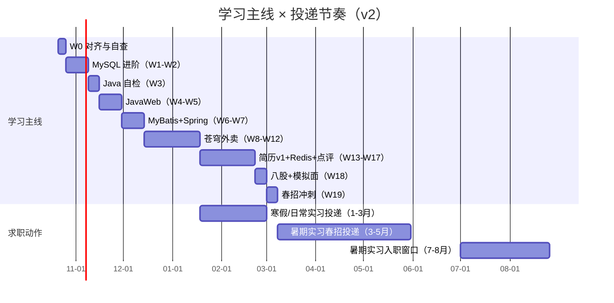
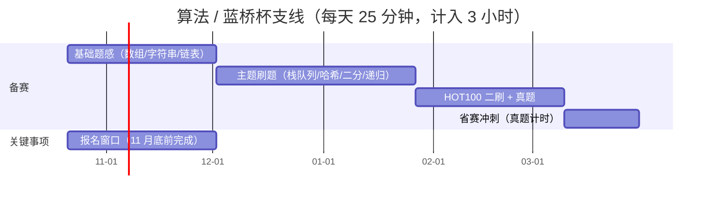

# learning

后端 Java 学习计划 **v2**（每天 3 小时 · 2026-10-21 → 2027-03-07 · 19 周 + 1 个对齐周）

> 目标：2027-01 出简历 v1 开始投寒假/日常实习；2027-03 前打通 MySQL 进阶 → Java 自检 → JavaWeb → SSM → 苍穹外卖 → Redis/黑马点评，并完成八股一轮；2027-03~05 春招主投 **7–8 月入职**的暑期实习；2027-04 蓝桥杯 Java 组省赛。

## 一、这份计划和上一版有什么不同

| 项目 | v1（2026-09-21 起） | v2（本版） |
| --- | --- | --- |
| 每日时长 | 约 4 小时 | **3 小时**（八股放碎片时间，不计入） |
| 起点 | 按"非零基础"从语法巩固周开始 | 直接对齐进度：JavaSE 已完成、MySQL 到多表查询 |
| 周数 | 17 周 | **19 周**（新增 W3 Java 自检周） |
| Java 复习 | W1–W4 整周重学 | 砍掉，改为 MySQL 结束后 **1 周自检 + 只补 P0 薄弱点** |
| 时间线表述 | 3 月 = 暑期实习 | **寒假（1–3 月）投寒假/日常实习；春招（3–5 月）投 7–8 月暑期实习** |
| 支线 | Agent 每周日半天 4h | Agent 周日 1 小时、隔周完整；算法每天 25 分钟 |

## 二、现状（起点声明，读完再开始）

| 内容 | 状态 | 本计划怎么处理 |
| --- | --- | --- |
| 黑马《Java 最新版》（JavaSE） | ✅ 已完成 | 不重学；W3 用 60 题 + 5 道手写做自检，只补薄弱点 |
| MySQL 基础篇 | 到「多表查询」 | W0 补事务/约束，W1 起进进阶篇 |
| JDBC / Maven | ❓ 不确定 | W0 D1 用 1 个 JDBC demo 自查，决定 W6 是 1 天还是 3 天 |
| MySQL 进阶、JavaWeb、SSM、苍穹外卖、Redis、黑马点评 | 未开始 | 按时间线推进 |
| v1 计划进度 | week2 day5 | v1 已归档到 `study/plans/archive/2026-09-v1/` |

## 三、时间线

| 周 | 日期 | 主题 | 里程碑 |
| --- | --- | --- | --- |
| W0 | 10/21–10/25 | 对齐与自查（JDBC/Maven + MySQL 基础收尾） | 起点确认、目录工具就绪 |
| W1 | 10/26–11/01 | MySQL 进阶上（索引 / EXPLAIN / SQL 优化） | — |
| W2 | 11/02–11/08 | MySQL 进阶下（锁 / 事务原理 / MVCC / 表设计） | M1 MySQL 进阶通过 |
| W3 | 11/09–11/15 | **Java 自检 + 薄弱点补强** | M2 薄弱点清单 + P0 补齐 |
| W4 | 11/16–11/22 | JavaWeb 上（前端快过 / HTTP / Servlet / 会话） | — |
| W5 | 11/23–11/29 | JavaWeb 下（Filter / AJAX / 员工管理小项目） | M3 Web CRUD 跑通 |
| W6 | 11/30–12/06 | MyBatis + Maven | — |
| W7 | 12/07–12/13 | Spring 全家桶速通 | M4 SpringBoot 最小 CRUD |
| W8 | 12/14–12/20 | 苍穹外卖①启动 / 登录 / 员工 / 分类 | — |
| W9 | 12/21–12/27 | 苍穹外卖②菜品 / 套餐 / 店铺 | — |
| W10 | 12/28–01/03 | 苍穹外卖③用户端 / 购物车 / 地址簿（期末降速档） | — |
| W11 | 01/04–01/10 | 苍穹外卖④下单 / 支付 / 订单（期末降速档） | — |
| W12 | 01/11–01/17 | 苍穹外卖⑤缓存 / WebSocket / 统计 / 部署 | M5 主项目可演示 |
| W13 | 01/18–01/24 | 项目收尾 + 简历 v1 + 投递启动 + Redis 基础 | M6 简历 v1，开始投寒假/日常实习 |
| W14 | 01/25–01/31 | 黑马点评①登录 / 商户缓存 / 缓存进阶 | — |
| W15 | 02/01–02/07 | 黑马点评②秒杀 / 分布式锁 / Lua / 异步下单 | — |
| W16 | 02/08–02/14 | 黑马点评③高级功能（探店 / GEO / 签到 / UV，春节降速） | M7 点评主体完成 |
| W17 | 02/15–02/21 | 点评收尾 + 项目文档 + 简历 v2 + 八股启动 | — |
| W18 | 02/22–02/28 | 八股系统化 + 模拟面 + 简历终版 | M8 终版简历 + 八股一轮 |
| W19 | 03/01–03/07 | 冲刺 + 春招投递启动 + 蓝桥杯 | M9 春招投递 20+ |

> 3/07 之后不是空窗：3–6 月持续三件事——投递暑期实习、面试复盘补八股、蓝桥杯真题（省赛 4 月）。





## 四、每天 3 小时怎么分（五档模板）

| 档位 | 适用周 | 看课/查文档 | 动手写码 | 算法 | 记录/复盘 | 合计 |
| --- | --- | --- | --- | --- | --- | --- |
| A 基础 | W0–W2 | 85 分 | 55 分（SQL/实验） | 25 分 | 15 分 | 180 |
| B 自检 | W3 | 做题/手写 95 分 | 补强 40 分 | 25 分 | 清单整理 20 分 | 180 |
| C 框架课 | W4–W7 | 90 分 | 60 分 | 25 分 | 5 分 | 180 |
| D 项目 | W8–W17 | 45 分（跟课/查文档） | 95 分（独立写，不抄） | 25 分 | 15 分 | 180 |
| E 冲刺 | W18–W19 | 30 分八股 + 45 分模拟面 | 65 分项目/简历 | 40 分 | — | 180 |

**周日**：复盘 30 + 八股自测 20 + Agent 60（隔周）/补进度（隔周）+ 算法 30 + 机动 40。

**八股不进 3 小时**：每天 10 分钟碎片时间（睡前/通勤/排队），从 W3 自检出 P0 模块开始。

## 五、提效规则（照做，别自由发挥）

1. 视频 **1.25–1.5 倍速**，每段只看 1 遍；不懂就回看那一个知识点，不整章重看。
2. **15 分钟规则**：卡住超过 15 分钟 → 记进当天"问题清单" → 问 AI / 查文档 → 继续；每周六统一清。
3. **24 小时规则**：任何模块 24 小时内必须有能跑的代码，否则停下看课去写码。
4. **不抄代码**：看完关掉视频自己写；报错先自己查 10 分钟。
5. **每天收尾 5 分钟**：`git commit` + 3 行日志（今天学了什么 / 卡在哪 / 明天第一件事）。
6. **周验收不过不欠账**：用周日机动时间补，连续两周不过就检查是不是"只看不写"。

### 明确不看 / 快过的章节（减法清单）

JSP、Vue/Element 深度、微信小程序前端、真实微信支付对接、触发器/存储过程深度、Spring XML 配置、AOP 源码、MyBatisPlus（项目需要再补）、MySQL 运维篇。

## 六、投递节奏（三个词分清楚）

| 机会 | 投递期 | 入职期 | 本计划对应动作 |
| --- | --- | --- | --- |
| 寒假实习 / 日常实习 | 2027-01 中 – 03 初 | 寒假内或开学后 | W13 简历 v1 → 每周投 5 家 → 有面就复盘 |
| 暑期实习（主战场） | 2027-03 – 05（春招） | 2027-07 – 08（暑假） | W19 起集中投递，20 家起，边投边补 |
| 蓝桥杯省赛 | 报名截至 11 月底 | 2027-04 比赛 | 每天 25 分钟算法 + 3 月真题计时 |

## 七、支线

- **算法（每天 25 分钟，计入 3 小时）**：力扣 HOT100 打底，蓝桥杯真题按年份刷，Java 提交。
- **八股（每天 10 分钟碎片，不计入）**：W3 自检的 P0 模块优先；W18 系统化一轮。
- **Agent（周日 1 小时，隔周完整做）**：把主线学到的 SpringBoot/Redis 用到"AI 智能客服"小功能上，作为差异化亮点；时间不够时**优先砍它**，不影响主线。

## 八、里程碑（完成就打勾）

- [ ] M1 W2：MySQL 进阶通过（能讲 B+ 树、回表、MVCC）
- [ ] M2 W3：Java 薄弱点清单 + P0 补齐
- [ ] M3 W5：Web CRUD 小项目跑通
- [ ] M4 W7：SpringBoot 最小 CRUD（MyBatis + 统一返回 + 拦截器）
- [ ] M5 W12：苍穹外卖可演示（管理端 + 用户端主流程）
- [ ] M6 W13：简历 v1 + 投递启动 + Redis 基础
- [ ] M7 W16：黑马点评主体完成
- [ ] M8 W18：简历终版 + 八股一轮 + 模拟面
- [ ] M9 W19：春招投递 20+

## 九、课程来源（全部哔哩哔哩「黑马程序员」）

| 课程 | 链接 | 用在哪几周 |
| --- | --- | --- |
| Java 最新版（JavaSE） | https://space.bilibili.com/37974444 | 已完成（W3 只按需回看薄弱点） |
| MySQL 入门到精通（基础+进阶） | https://www.bilibili.com/search?keyword=黑马%20MySQL数据库入门到精通 | W0–W2 |
| JavaWeb 开发教程 | https://www.bilibili.com/video/BV1m84y1w7Tb | W4–W6 |
| SSM 框架教程（Spring/SpringMVC/SpringBoot） | https://www.bilibili.com/video/BV1Fi4y1S7ix | W7 |
| 苍穹外卖项目实战 | https://www.bilibili.com/video/BV1FSvde6EBs | W8–W12 |
| Redis 入门到实战 | https://www.bilibili.com/video/BV1cr4y1671t | W13 |
| 黑马点评（Redis 实战项目） | https://space.bilibili.com/37974444 | W14–W17 |

> 周文件里写的章节名以课程目录为准，按章节名搜索定位，不写死 P 编号。

## 十、目录结构

```
study/
├─ plans/
│  ├─ README.md            # 19 周计划索引 + 使用方法
│  ├─ PROGRESS.md          # 打卡表 / 3 行日志 / 落后记录
│  ├─ week00-…week19…md    # 每周计划（v2，当前有效）
│  ├─ archive/2026-09-v1/  # 旧版 17 周计划（只读，不再维护）
│  ├─ java/                # 历史 Java 笔记（保留）
│  └─ JAVA coding/         # 历史刷题/练习笔记（保留）
├─ notes/                  # 新笔记（mysql-索引.md、java-薄弱点清单.md…）
├─ sql/                    # SQL 脚本（basics-review/、sky-tables-v0.sql…）
├─ projects/               # web-crud/、sky-take-out/、heima-dianping/
├─ algorithm/              # 力扣 / 蓝桥杯代码（按周分目录）
├─ resume/                 # 简历各版本 + 项目介绍文档
└─ ds-practice/            # 早期 C 数据结构练习（保留）
```

## 十一、怎么用（每周固定动作）

1. 周日晚上打开 `study/plans/PROGRESS.md`，勾掉本周完成项，写下周"第一件事"。
2. 每天开始前打开对应 `weekNN-*.md`，只看当天那一行，别一次读完。
3. 每天结束做一次 `git commit`（提交信息：`week01-d3: 索引失效实验`）。
4. 落后 ≤2 天：周日补；落后 >3 天：按各周文件末尾的"减法清单"砍内容，**不整体延期**。
