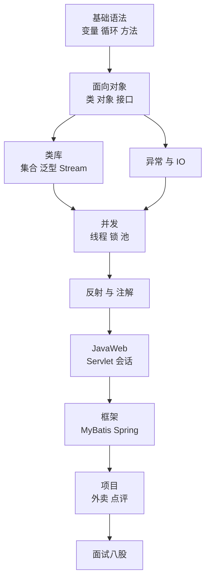

# JavaSE 总体路线与术语表（看不懂视频时先查这里）

> 用途：① 视频/讲义里冒出没听过的词 → 查 §5；② 不知道自己学到哪、为什么要学这块 → 看 §1–§3；③ 复习时当清单过一遍 → §7。
> 维护方式：每天学完，把当天遇到的 **3 个新词**按 §6 的格式加进 §5 对应分组。**只写自己的话，不抄定义。**

---

## §1 JavaSE 到底是什么

一句话：**JavaSE 是"Java 这门语言本身"**——语法、面向对象、常用类库（集合/IO/异常/多线程/反射）。所有 Java 方向的东西（Web、Spring、大数据、Android）都建在它上面。

三个缩写只在面试/课程标题里出现，不用深究：

| 缩写 | 全称 | 一句话 |
| --- | --- | --- |
| JavaSE | Standard Edition 标准版 | 语言 + 基础类库，**你现在学的就是它** |
| JavaEE | Enterprise Edition 企业版 | 在 SE 之上加 Web、数据库、消息、事务那套规范（现在多叫 Jakarta EE） |
| JavaME | Micro Edition 微型版 | 功能机/嵌入式，和你的路线无关，忽略 |

**你现在的位置**：JavaSE → JavaWeb → MyBatis/Spring → 项目（苍穹外卖、黑马点评）→ 面试。
JavaSE 是地基，地基不牢，后面每一层（框架、项目、八股）都会反复卡住——这也是这次把 W3–W6 单独拿出来补课的原因。

## §2 学完 JavaSE，你应该能做到这 8 件事

这是 M2 里程碑的验收口径。**不用会背原理，要能写出来、能讲清"什么时候用它"。**

- [ ] 1. 不查资料写出一个带 `main` 的类，包含 if/for/方法调用，能编译运行
- [ ] 2. 自己定义一个类（属性 + 构造器 + getter/setter），能 new 出对象并使用
- [ ] 3. 用 `List`/`Map` 装数据、遍历、增删改查；知道 `Set` 去重
- [ ] 4. 用 Lambda + Stream 把一个 for 循环改写成链式调用
- [ ] 5. 用 `try-catch-finally` 处理异常，能自定义异常类
- [ ] 6. 读写一个文本文件（字符流）；知道字节流和字符流什么时候用哪个
- [ ] 7. 起一个线程 / 用线程池跑任务；知道 `synchronized` 解决什么问题
- [ ] 8. 用反射创建对象、调方法；能说出注解为什么需要反射才生效

> 这 8 条对应 W3–W6 四块内容：集合+泛型+Stream（W3）→ 异常+IO（W4）→ 多线程+网络（W5）→ 反射+综合项目（W6）。

## §3 为什么要学这 8 块（人话 + 用在哪 + 够用线）

| 内容 | 人话解释 | 后面的项目里用在哪 | 学到什么程度就够（够用线） |
| --- | --- | --- | --- |
| 基础语法/流程控制 | 变量、判断、循环、方法 | 所有代码 | 能默写 50 行不报错 |
| 面向对象 | 把"数据 + 操作"打包成类 | 每个 `Controller`/`Service`/`Mapper` 都是类 | 能设计一个类并说清为什么这么分 |
| 集合 | 一个能装很多数据的"容器" | 查数据库返回的就是 `List<User>` | List/Map/Set 三件套熟练，能选型 |
| 泛型 | 给容器贴"只能装什么"的标签 | `Result<T>`、`List<Order>` | 会用、能看懂 `<? extends>` |
| Lambda/Stream | 少写 for 循环，把"要什么"写出来 | 集合转 DTO、分组统计 | 能把 for 改成 Stream |
| 异常 | 出错时怎么优雅地处理 | 全局异常处理器、统一返回 | 会 try-catch、会自定义异常 |
| IO | 读写文件、网络传输 | 文件上传下载、配置文件、NIO（Redis/Netty 基础） | 字符流读写文本没问题 |
| 多线程/并发 | 同时干多件事 | 线程池、秒杀、异步任务 | 会建线程池、知道锁解决什么 |
| 反射/注解 | 程序运行时"看自己"、贴标签 | **Spring 的底层就是注解 + 反射** | 会反射创建对象/调方法即可 |

**一句话串起来**：Spring 帮你 new 对象、帮你把请求转到方法上，靠的就是**注解 + 反射**；MyBatis 帮你把 SQL 结果变成对象，靠的就是**泛型 + 反射 + 集合**。所以这几块不是"考试内容"，是框架的原材料。

## §4 一张总图



> 看图的重点：**越往下越"应用"，越往上越"地基"**。你卡在任何下层，上层的报错都会看不懂——比如 `NullPointerException` 看着像框架问题，实际是集合里取出了 `null`。

## §5 术语表

格式：**词 → 一句话人话 → 类比 → 你在哪会遇到它**。
看不懂的定义就跳过"类比"，先记住"它解决什么问题"。

### 5.1 环境与运行

| 词 | 人话 | 类比 | 在哪遇到 |
| --- | --- | --- | --- |
| JDK | 开发工具包，**写** Java 要用它（含编译器） | 全套厨房 | 装环境、`javac` |
| JRE | 运行环境，**跑** Java 要用它（不含编译器） | 只吃饭的餐桌 | 服务器上只装 JRE |
| JVM | 虚拟机，真正执行字节码的程序 | 翻译官 | 面试常问"跨平台原理" |
| 源码 / 字节码 | `.java` 是人写的；`.class` 是编译后的中间产物 | 菜谱 / 预制菜 | 反编译、`javap` |
| 编译期 / 运行期 | 编译期=写代码到生成 class；运行期=程序真正跑起来 | 排练 / 演出 | 报错分"编译错误""运行时异常" |
| API | 别人写好的方法，你直接调用 | 家电说明书 | 查 JDK 文档 |
| classpath | JVM 去哪找 `.class` 和 jar 包 | 仓库地址 | Maven 依赖报错时 |
| 跨平台 | 一次编译，Windows/Linux 都能跑 | 通用插头 | JVM 的核心卖点 |

### 5.2 面向对象

| 词 | 人话 | 类比 | 在哪遇到 |
| --- | --- | --- | --- |
| 类 / 对象 | 类是模板，对象是按模板造出来的东西 | 图纸 / 房子 | 每个业务类 |
| 实例 | 就是"对象"的另一个叫法（`new` 出来的） | — | "实例化"= new |
| 属性 / 方法 | 属性=它有什么（数据）；方法=它能做什么（行为） | 人的身高 / 人会跑 | 类定义 |
| 构造器 | `new` 时自动执行的方法，用来初始化 | 出厂设置 | `public User(){}` |
| `this` / `super` | `this`=我自己；`super`=我父类 | 我 / 我爸 | 构造器互调 |
| 封装 | 属性私有 `private`，通过方法访问 | 手机只露屏幕 | getter/setter |
| 继承 | 子类自动拥有父类的东西 | 父子 | `extends` |
| 多态 | 同一个方法调用，不同对象有不同表现 | "打开"对门/对文件不同 | `List = new ArrayList()` |
| 重写 / 重载 | 重写=子类改父类方法（同名同参）；重载=同名不同参 | 改台词 / 一个名字多种用法 | `toString()` / `println` |
| 接口 / 实现 | 接口=只规定"能做什么"；实现类=真正做 | 插座标准 / 具体电器 | `implements` |
| 抽象类 | 半成品类，不能 new，只能被继承 | 草图 | `abstract` |
| `static` | 属于类本身，不属于某个对象 | 班级的班规 | 工具类方法 |
| `final` | 最终的：变量不能改、方法不能重写、类不能被继承 | 刻死了 | 常量 |
| 访问修饰符 | `private`→本类 / 默认→本包 / `protected`→子类 / `public`→都行 | 门的钥匙范围 | 类设计 |
| `Object` | 所有类的老祖宗，有 `toString/equals/hashCode` | 人类 | 重写这三个 |
| 包 / import | 包=文件夹，用来防重名；import=引用别的包 | 地址 / 快递单 | `java.util.*` |

### 5.3 数据类型

| 词 | 人话 | 类比 | 在哪遇到 |
| --- | --- | --- | --- |
| 基本类型 | `int/long/double/boolean/char...` 8 种，直接存值 | 现金 | 变量声明 |
| 引用类型 | 存的是"地址"，指向堆里的对象 | 银行卡 | 对象、数组、集合 |
| 装箱 / 拆箱 | 基本类型 ⇄ 包装类（`int` ⇄ `Integer`）自动转换 | 现金 ⇄ 卡 | 集合里只能放 `Integer` |
| `null` | 引用没有指向任何对象 | 空卡 | `NullPointerException` 的源头 |
| 值传递 | Java **只有值传递**；对象传的是地址的副本 | 复印件 | 面试高频 |

### 5.4 集合与泛型

| 词 | 人话 | 类比 | 在哪遇到 |
| --- | --- | --- | --- |
| 集合 / 容器 | 能装一堆对象的"盒子" | 收纳箱 | `List/Set/Map` |
| `List` | **有序、可重复**，能按下标取 | 排队队伍 | 查询结果 |
| `Set` | **不重复**，通常无序 | 身份证号集合 | 去重 |
| `Map` | **键值对**，靠 key 找 value | 字典 | 缓存、统计 |
| `Iterable` / `Iterator` | 能被 foreach 遍历 / 遍历器本身 | 能翻页的书 / 书签 | 集合遍历 |
| 有序 / 无序 | 有序=取出顺序和放入一致 | — | 选 List 还是 Set |
| 哈希 / `hashCode` | 把对象算成一个数字，用来快速定位 | 图书馆分区号 | `HashMap`/`HashSet` |
| `equals` | 判断两个对象"内容是否相等" | 比对身份证 | 自定义对象去重 |
| fail-fast | 遍历时有人改结构，立刻抛异常 | 点到一半书被换 | `ConcurrentModificationException` |
| 泛型 | 给容器贴"只装什么类型"的标签 | 分类垃圾桶 | `List<String>` |
| 类型擦除 | 泛型只在**编译期**有效，运行时被擦掉 | 标签贴纸会撕掉 | 面试"泛型怎么实现" |
| 通配符 `? extends/super` | 限制能装"谁的子类/父类" | 一类人 / 一类人及其父类 | 方法参数 |
| 时间复杂度 `O(1)/O(n)/O(log n)` | 数据量翻倍时，耗时怎么涨 | 直接翻到某页 / 一页页翻 / 折半找 | 选型、面试 |

### 5.5 函数式（Lambda / Stream）

| 词 | 人话 | 类比 | 在哪遇到 |
| --- | --- | --- | --- |
| 函数式接口 | **只有一个抽象方法**的接口 | 只有一个按钮的遥控器 | `Runnable`、`Comparator` |
| Lambda | 把"一段代码"当参数传进去的简写 | 递一张便条 | `(a,b) -> a+b` |
| 方法引用 | Lambda 的进一步简写 | 直接指路 | `User::getName` |
| Stream | 对集合做"流水线加工"：过滤→映射→排序→收集 | 流水线 | `list.stream()...` |
| 惰性求值 | 不调用"终止操作"就不真正执行 | 攒够再开工 | 忘了 `collect` 没结果 |

### 5.6 进阶（W4–W6 会遇到，先混个脸熟）

| 词 | 人话 | 类比 | 在哪遇到 |
| --- | --- | --- | --- |
| 异常 | 程序出问题时抛出的"错误对象" | 报警器 | `try-catch` |
| 受检异常 | 编译器强制你处理的（如 `IOException`） | 必须签收的快递 | 编译报错 |
| `try-with-resources` | 自动关资源的写法 | 自动关门 | 读写文件 |
| IO / 流 | 数据像水流一样进出（文件、网络） | 水管 | 文件读写 |
| 字节流 / 字符流 | 按字节（图片视频）/ 按字符（文本）处理 | 搬砖 / 搬字 | `InputStream` / `Reader` |
| 编码（UTF-8） | 字符和字节的对应规则，不对应就乱码 | 翻译表 | 乱码问题 |
| 进程 / 线程 | 进程=一个运行的程序；线程=程序里的一条执行线 | 工厂 / 工人 | `Thread` |
| 并发 / 并行 | 并发=交替做（看起来同时）；并行=真同时 | 一个人轮着干 / 多个人一起干 | 面试必问 |
| 锁 / 死锁 | 锁=排队用同一资源；死锁=互相等对方放手 | 两个人堵门口 | `synchronized` |
| 线程池 | 预先养几个线程反复用，避免频繁创建 | 出租车队 | `ExecutorService` |
| 反射 | 程序运行时"看自己的结构"：类有什么字段/方法 | 照镜子 | `Class.forName` |
| 注解 | 贴在类/方法上的"标签"，本身不干活 | 便利贴 | `@Override`、`@Autowired` |
| 代理 | 帮原对象"代跑腿"，可以在前后加逻辑 | 中介 | Spring AOP |

## §6 每天 5 分钟怎么积累术语（就三步）

学完当天内容，挑 **3 个**你刚才卡住的词，按这个格式加到 §5 对应分组（一句话，不要长）：

```
| 词 | 我自己的话 | 类比 | 今天在哪遇到 |
```

三条规矩：

1. **能用大白话讲给非程序员听懂**，才算懂；写不出来就说明没懂。
2. 不要抄百度/视频里的定义——抄了也不进脑子。
3. 只记"今天真的卡住"的词，别把整本书抄一遍。

## §7 自查：这 12 个词能一句话讲清吗

学完 W3 前，至少这 12 个要过：

- [ ] 类和对象有什么区别
- [ ] 接口和抽象类有什么区别
- [ ] `==` 和 `equals` 的区别
- [ ] `List` 和 `Set` 的区别
- [ ] `ArrayList` 和 `LinkedList` 的区别
- [ ] `HashMap` 的 key 为什么不能重复
- [ ] 泛型是干什么用的
- [ ] 迭代器和 for 循环的区别
- [ ] 什么是 `NullPointerException`，为什么天天见
- [ ] 值传递和引用传递（Java 只有值传递）
- [ ] 时间复杂度 `O(1)` 和 `O(n)` 差在哪
- [ ] Lambda 表达式解决了什么麻烦

> 一个都答不出不要慌——这 12 条就是 W3 的"术语主线"，每天学完回来划一条。

## §8 五个常见误解

1. **"JavaSE 学完就能做项目"** —— 不能。JavaSE 是原料，项目是菜；中间还差 Web + 框架（W7–W10）。
2. **"视频看完就是学会了"** —— 视频是"输入"，能不看视频写出来才是"输出"。这是补课期唯一的标准。
3. **"名词不懂先跳过，做着做着就懂了"** —— 名词不懂，后面的报错你也读不懂，会越欠越多。**当天查，当天记。**
4. **"底层源码必须全懂"** —— 现阶段不需要。红黑树、AQS、零拷贝这些留到八股阶段（W21）再补。
5. **"概念背下来就有用"** —— 面试官一问"你在项目里怎么用的"，背的答案立刻穿帮。**每学一个词，想一个用过它的场景。**
