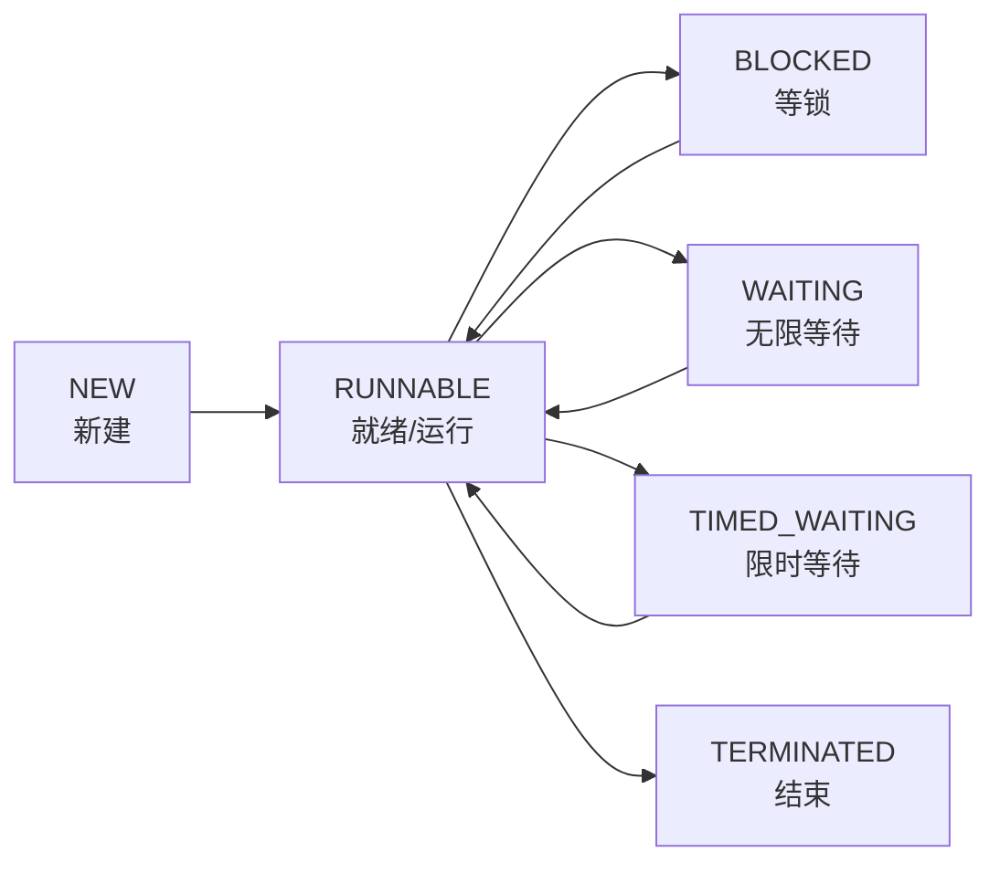

# W5 D1 · 线程创建与生命周期

> 2026-11-23（一）｜W5 第 1 天｜预计 3 小时

> 从今天开始，你写的不再是"一条线跑到底"的程序。
> 这一周的目标不是成为并发专家，而是**能看懂框架里的线程池、能讲清 synchronized 和锁、面试被问到不慌**。

## 0. 今天会遇到的 9 个名词

| 名词 | 一句话 | 类比 |
| --- | --- | --- |
| 进程 / 线程 | 进程是资源单位，线程是执行单位 | 一个厨房（进程）里有几个厨师（线程） |
| `Thread` | Java 里代表线程的类 | 一张"开工申请单" |
| `Runnable` | "要做的事"，只有一个 `run()` | 一张菜谱 |
| `Callable` | 能返回结果、能抛异常的 `Runnable` | 会端菜出来的菜谱 |
| `start()` | 真正开一条新线程去执行 | 新开一个灶台 |
| `run()` | 普通方法，谁调用就在谁的线程里跑 | 在现有灶台上做这道菜 |
| 生命周期 | 线程从新建到结束的 6 个状态 | 员工的入职到离职 |
| `join()` | 等这条线程结束再往下走 | 等这个厨师做完再上菜 |
| 守护线程 | 主线程结束它就跟着结束 | 打扫卫生的钟点工 |

## 1. 今天 3 小时怎么分

| 分钟 | 做什么 |
| --- | --- |
| 80 | 看课 + 读 §2–§6，明确"为什么需要多线程""start 和 run 差在哪" |
| 60 | 敲 §7 的动手任务 A–D，四种创建方式各跑一遍，看控制台线程名 |
| 25 | 算法 1 题（保持手感，别停） |
| 15 | 写 3 个术语 + 填练习答案 + commit |

## 2. 为什么需要多线程：两堵墙

**第一堵墙：等待。** 读一个 5MB 文件要 200ms，这 200ms 里 CPU 几乎什么都没干，只是等磁盘。如果一个请求要读 3 个文件，单线程就是 600ms。多线程可以让"等 A 的时候去干 B"。

**第二堵墙：单核频率。** CPU 主频十几年前就卡在 3–4GHz 上不去了，厂商改走"多核"路线。单线程程序只能用一个核，等于把多出来的核全浪费了。

对应到你的项目里：
- 苍穹外卖的"来单提醒"——一个线程在等新订单，不能卡住主流程
- 黑马点评的秒杀——几百个请求同时进来，必须并发处理
- 后面的 `ThreadPoolExecutor` 就是"线程的复用池"，避免每次请求都新建销毁线程

## 3. 创建线程的四种写法

### 写法一：继承 `Thread`（能跑，但不推荐）

```java
// 文件：ThreadSubclassDemo.java
public class ThreadSubclassDemo {

    // 继承 Thread，重写 run()：run() 里写"这条线程要干什么"
    static class MyThread extends Thread {
        @Override
        public void run() {
            for (int i = 1; i <= 3; i++) {
                // currentThread() 拿到"当前正在执行这段代码的线程"
                System.out.println(Thread.currentThread().getName() + " 执行第 " + i + " 次");
            }
        }
    }

    public static void main(String[] args) {
        MyThread t1 = new MyThread();
        t1.setName("线程-A");   // 起名，方便看日志
        t1.start();             // 启动：由 JVM 新开一条线程去跑 run()
        System.out.println("主线程继续往下走：" + Thread.currentThread().getName());
    }
}
// 输出（顺序可能不同，因为两条线程在抢 CPU）：
// 主线程继续往下走：main
// 线程-A 执行第 1 次
// 线程-A 执行第 2 次
// 线程-A 执行第 3 次
```

**不推荐的原因**：Java 只能单继承，`MyThread` 继承了 `Thread` 就不能再继承别的类（比如 `extends ServiceImpl`），业务类会被这条限制卡死。

### 写法二：实现 `Runnable`（推荐）

```java
// 文件：RunnableDemo.java
public class RunnableDemo {

    // 实现 Runnable，把"要做的事"和"线程本身"分开
    static class TicketTask implements Runnable {
        @Override
        public void run() {
            for (int i = 1; i <= 3; i++) {
                System.out.println(Thread.currentThread().getName() + " 卖第 " + i + " 张票");
            }
        }
    }

    public static void main(String[] args) {
        Runnable task = new TicketTask();        // 任务：卖票
        Thread t1 = new Thread(task, "窗口-1");   // 线程：一个窗口
        Thread t2 = new Thread(task, "窗口-2");   // 同一个任务，开两个窗口
        t1.start();
        t2.start();
    }
}
// 输出（交替，顺序不定）：
// 窗口-1 卖第 1 张票
// 窗口-2 卖第 1 张票
// 窗口-1 卖第 2 张票
// ...
```

**关键点**：同一个 `Runnable` 对象可以交给多条线程执行——这就是明天"卖票超卖"问题的来源（两个窗口共享同一份票数）。

### 写法三：Lambda（`Runnable` 是函数式接口）

```java
// 文件：LambdaThreadDemo.java
public class LambdaThreadDemo {
    public static void main(String[] args) {
        // Runnable 只有一个抽象方法 run()，所以可以直接用 lambda 写
        Thread t = new Thread(() -> {
            System.out.println("lambda 线程：" + Thread.currentThread().getName());
        }, "lambda-线程");
        t.start();
    }
}
// 输出：
// lambda 线程：lambda-线程
```

### 写法四：实现 `Callable`（要返回值 / 要抛异常时）

```java
// 文件：CallableDemo.java
import java.util.concurrent.Callable;
import java.util.concurrent.ExecutionException;
import java.util.concurrent.FutureTask;

public class CallableDemo {

    public static void main(String[] args) throws ExecutionException, InterruptedException {
        // Callable 有返回值，可以抛受检异常；Thread 只认 Runnable，
        // 所以要用 FutureTask 做"适配器"
        Callable<Integer> task = () -> {
            int sum = 0;
            for (int i = 1; i <= 100; i++) {
                sum += i;
            }
            return sum;          // 这里能 return，Runnable 不行
        };

        FutureTask<Integer> futureTask = new FutureTask<>(task);
        new Thread(futureTask, "计算线程").start();

        // get() 会阻塞，直到线程算出结果
        Integer result = futureTask.get();
        System.out.println("1 加到 100 = " + result);
    }
}
// 输出：
// 1 加到 100 = 5050
```

`FutureTask` 后面讲线程池时会再遇到——`submit()` 返回的就是 `Future`，`get()` 拿结果。

## 4. `start()` 和 `run()` 的区别（面试第一问）

```java
// 文件：StartVsRunDemo.java
public class StartVsRunDemo {

    static class Task extends Thread {
        @Override
        public void run() {
            System.out.println("run() 正在执行，所在线程：" + Thread.currentThread().getName());
        }
    }

    public static void main(String[] args) {
        System.out.println("主线程名：" + Thread.currentThread().getName());

        Task t1 = new Task();
        t1.run();      // 直接调用 run()：就是普通方法调用，跑在 main 线程里

        Task t2 = new Task();
        t2.setName("子线程");
        t2.start();    // start()：JVM 新开一条线程，再让那条线程去调 run()
    }
}
// 输出：
// 主线程名：main
// run() 正在执行，所在线程：main      ← 关键证据
// run() 正在执行，所在线程：子线程
```

**一句话记住**：`run()` 是"内容"，`start()` 是"开机"。直接调 `run()` 只是把内容在**当前线程**执行了一遍，根本没有并发。

两个附加考点：
1. `start()` 只能调用一次，第二次抛 `IllegalThreadStateException`（线程已经跑过了，不能重跑）。
2. `start()` 之后线程不一定立刻执行，只是进入"就绪"状态，等 CPU 调度。

## 5. 生命周期：6 个状态



| 状态 | 怎么进入 | 怎么出去 |
| --- | --- | --- |
| `NEW` | `new Thread()` 之后、`start()` 之前 | 调用 `start()` |
| `RUNNABLE` | `start()` 之后 | 被调度执行 / 进入等待 / 结束 |
| `BLOCKED` | 等 `synchronized` 锁 | 拿到锁 |
| `WAITING` | `wait()`、`join()`（无参）、`park()` | 被 `notify()`/`join` 的线程结束 |
| `TIMED_WAITING` | `sleep(ms)`、`join(ms)`、`wait(ms)` | 时间到 / 被唤醒 |
| `TERMINATED` | `run()` 执行完或抛未捕获异常 | — |

```java
// 文件：LifecycleDemo.java
public class LifecycleDemo {
    public static void main(String[] args) throws InterruptedException {
        Thread t = new Thread(() -> {
            try {
                Thread.sleep(500);      // 进入 TIMED_WAITING
            } catch (InterruptedException e) {
                Thread.currentThread().interrupt();   // 恢复中断标志（规范写法）
            }
        }, "观察对象");

        System.out.println("1. new 之后：" + t.getState());      // NEW
        t.start();
        System.out.println("2. start 之后：" + t.getState());    // RUNNABLE 或 TIMED_WAITING
        Thread.sleep(100);
        System.out.println("3. sleep 期间：" + t.getState());    // TIMED_WAITING
        t.join();                                                 // 主线程等它结束
        System.out.println("4. 结束之后：" + t.getState());      // TERMINATED
    }
}
// 输出：
// 1. new 之后：NEW
// 2. start 之后：RUNNABLE
// 3. sleep 期间：TIMED_WAITING
// 4. 结束之后：TERMINATED
```

> ⚠️ 第 2 行有时会打印 `TIMED_WAITING`，因为子线程可能已经跑到 `sleep` 了——这正说明"线程调度不由你控制"。看到两种输出都正常。

## 6. 四个常用方法

| 方法 | 作用 | 坑 |
| --- | --- | --- |
| `sleep(ms)` | 当前线程暂停，**不释放锁** | 在 `synchronized` 里 sleep，别人还是进不来 |
| `join()` | 等这条线程结束 | 会阻塞当前线程，别在 UI 线程里随便用 |
| `interrupt()` | 给线程打"中断标志" | 只是标记，线程不检查标志就照跑；若在 sleep/wait 会抛 `InterruptedException` |
| `setDaemon(true)` | 设为守护线程 | 必须在 `start()` 之前设置，否则抛 `IllegalThreadStateException` |

```java
// 文件：MethodDemo.java
public class MethodDemo {
    public static void main(String[] args) throws InterruptedException {
        Thread worker = new Thread(() -> {
            try {
                for (int i = 1; i <= 3; i++) {
                    System.out.println("工作中 " + i);
                    Thread.sleep(300);
                }
            } catch (InterruptedException e) {
                System.out.println("被中断，提前收工");
                Thread.currentThread().interrupt();   // 保留中断状态，交给上层决定
            }
        }, "工人");

        worker.setDaemon(false);   // 默认就是 false（用户线程），主线程会等它
        worker.start();

        Thread.sleep(500);
        worker.interrupt();        // 打断它的 sleep
        worker.join();             // 主线程等它真正结束
        System.out.println("主线程结束");
    }
}
// 输出：
// 工作中 1
// 工作中 2
// 被中断，提前收工
// 主线程结束
```

## 7. 动手任务 A–D（60 分钟）

### A. 四种写法各跑一遍

分别运行 §3 的四个文件，**记录每次控制台里出现的线程名**，填下表：

| 写法 | 执行 `run()` 的线程名 |
| --- | --- |
| 继承 Thread + `start()` | |
| 实现 Runnable + `start()` | |
| Lambda + `start()` | |
| Callable + FutureTask | |

### B. 验证 `start()` 与 `run()` 的差别

运行 `StartVsRunDemo`，确认直接调 `run()` 时打印的是 `main`。然后**故意**对同一个线程调用两次 `start()`，看抛什么异常，把异常名抄下来：\_\_\_\_\_\_\_\_\_\_。

### C. 用 `join()` 保证顺序

写一个程序：主线程先打印"开始"，启动 3 条子线程各自 `sleep` 不同时间后打印自己的名字，主线程 `join` 三条线程后打印"全部完成"。要求**"全部完成"必须是最后一行**。

### D. 观察状态变化

跑 `LifecycleDemo` 三次，把第 2 行打印的状态记下来。如果三次都是同一个状态，说明什么？（提示：和 CPU 调度有关）

## 8. 练习（先写，再看答案）

### A. 判断（5 题）

**A1.** 一个线程对象调用 `run()` 方法，就会启动一条新线程。

> 答：

**A2.** `Thread.sleep(1000)` 会让当前线程暂停 1 秒，并释放它持有的锁。

> 答：

**A3.** 同一个 `Thread` 对象可以连续调用两次 `start()`。

> 答：

**A4.** `RUNNABLE` 状态包含"正在运行"和"已经就绪、等待 CPU"两种情况。

> 答：

**A5.** 守护线程（daemon）会在主线程结束时被 JVM 强制结束。

> 答：

### B. 选择（5 题）

**B1.** 下面哪种方式**不能**创建并启动一条新线程？
A. `new Thread(() -> {}).start()`
B. `new Thread(new Runnable(){ public void run(){} }).start()`
C. `new Thread().run()`
D. `new Thread(new FutureTask<>(() -> 1)).start()`

> 答：

**B2.** `Callable` 相比 `Runnable` 多了什么能力？
A. 能被 `Thread` 直接接收　B. 有返回值、能抛受检异常　C. 能自动加锁　D. 能设置优先级

> 答：

**B3.** 调用 `t.interrupt()` 后，如果 `t` 正卡在 `Thread.sleep(10000)` 里，会发生什么？
A. 线程立刻结束　B. 抛 `InterruptedException` 并清除中断标志　C. 什么都不发生　D. 线程进入 BLOCKED

> 答：

**B4.** 下面哪个方法会让线程进入 `TIMED_WAITING`？
A. `wait()`　B. `join()`（无参）　C. `sleep(1000)`　D. `start()`

> 答：

**B5.** `setDaemon(true)` 必须在什么时候调用？
A. 随时都可以　B. `start()` 之前　C. `run()` 内部　D. 线程结束后

> 答：

### C. 简答（3 题）

**C1.** 用一句话说清 `start()` 和 `run()` 的区别，并说明"只调 `run()` 不调 `start()`"会有什么后果。

> 答：

**C2.** 为什么实际开发中更推荐"实现 `Runnable`"而不是"继承 `Thread`"？至少说两点。

> 答：

**C3.** `sleep()` 和 `wait()` 都会让线程等待，它们的区别是什么？（提示：从"锁"和"谁来唤醒"两个角度答）

> 答：

<details>
<summary>参考答案</summary>

**A 判断**：A1 **错**（`run()` 是普通方法，在调用者线程里执行）｜A2 **错**（`sleep` **不释放锁**，这正是它和 `wait` 的关键区别）｜A3 **错**（第二次抛 `IllegalThreadStateException`）｜A4 **对**（Java 把"运行中"和"就绪"都归为 `RUNNABLE`）｜A5 **对**（所有用户线程结束后，守护线程被强制终止）

**B 选择**：B1 **C**（`run()` 不会开新线程）｜B2 **B**｜B3 **B**（抛异常并**清除**中断标志，所以 catch 里要 `Thread.currentThread().interrupt()` 恢复）｜B4 **C**｜B5 **B**

**C1**：`start()` 会让 JVM 新开一条线程，由那条线程去执行 `run()`；`run()` 只是普通方法，谁调用就在谁的线程里跑。只调 `run()` 的后果是**完全没有并发**——所有代码仍在主线程串行执行，还会阻塞主线程。

**C2**：① Java 单继承，继承 `Thread` 后业务类不能再继承别的类；② "任务"和"线程"解耦，同一个 `Runnable` 可以交给多条线程或线程池执行，而 `Thread` 子类只能用一次；③ 线程池只接收 `Runnable`/`Callable`，不接收 `Thread`。

**C3**：`sleep()` 属于 `Thread`，**不释放锁**，只能等时间到自然醒，无法被别人唤醒；`wait()` 属于 `Object`，**会释放锁**，必须由别的线程 `notify()`/`notifyAll()` 唤醒，且必须在 `synchronized` 块里调用（否则抛 `IllegalMonitorStateException`）。明天讲 `synchronized` 时会重点用这个区别。

</details>

## 9. 高频坑

| 坑 | 说明 |
| --- | --- |
| 调 `run()` 当 `start()` 用 | 没有并发，还阻塞主线程，最典型的"看起来对但完全错了" |
| 同一线程 `start()` 两次 | `IllegalThreadStateException`，线程不能重跑 |
| 在子线程里 `System.out` 看不到输出 | 主线程先结束、JVM 退出，用户线程还没跑完；用 `join()` 等 |
| `catch (InterruptedException e) { }` 吞掉 | 吞了中断标志就丢了，规范写法是 `Thread.currentThread().interrupt()` |
| `sleep` 当"让出 CPU"用 | `sleep(0)` 才有让出语义，`sleep(1000)` 是实打实等 1 秒 |
| 守护线程里做持久化 | 主线程一结束它就被杀，写一半的文件会坏 |

## 10. 30 秒卡

- **`start()` 开线程，`run()` 只是方法调用**——这是面试第一个问题，答错直接减分。
- **四种创建**：继承 `Thread`（不推荐）、实现 `Runnable`（推荐）、Lambda（最简）、`Callable` + `FutureTask`（要返回值）。
- **六个状态**：`NEW` → `RUNNABLE` → （`BLOCKED`/`WAITING`/`TIMED_WAITING`）→ `TERMINATED`。
- **`sleep` 不释放锁，`wait` 释放锁**——明天 `synchronized` 的地基。
- **`interrupt()` 只是打标记**，卡在 `sleep/wait` 时才会抛异常，且会清除标记。

## 11. 今天要记的 3 个术语（写进术语表）

- 线程 / `Runnable` / `Callable` / `FutureTask`
- `start()` vs `run()` / `IllegalThreadStateException`
- 线程生命周期六状态 / `TIMED_WAITING` / 守护线程

## 12. 面试一句话

> **`start()` 和 `run()` 有什么区别？**
> "`start()` 是启动线程：JVM 会新开一条线程，由那条线程去调用 `run()`，所以是真正的并发；`run()` 只是普通方法调用，在调用者所在的线程里执行——直接调 `run()` 等于没用多线程，还会阻塞当前线程。另外同一个 `Thread` 对象 `start()` 只能调一次，第二次会抛 `IllegalThreadStateException`。"

## 13. 明天预告

**W5 D2（11/24）：线程安全与 `synchronized`**——3 个窗口卖 100 张票，先让你亲手跑出"卖出 103 张"的超卖现场，再加锁修好。那天你会第一次真正理解"锁的是谁"。
