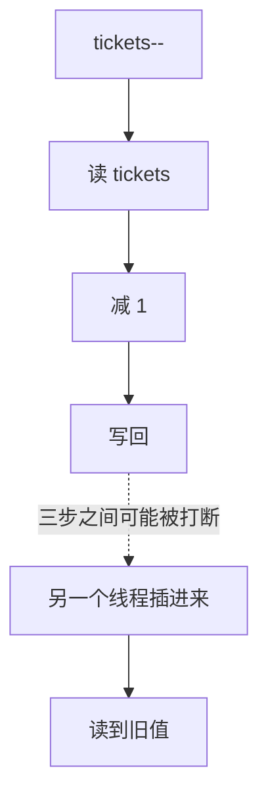

# W5 D2 · 线程安全与 synchronized

> 2026-11-24（二）｜W5 第 2 天｜预计 3 小时

> 今天你会先亲手制造一场事故：3 个窗口卖 100 张票，最后卖出 103 张。
> 然后用 `synchronized` 把它修好，并且搞清一个被问烂的问题：**锁的到底是什么？**

## 0. 今天会遇到的 8 个名词

| 名词 | 一句话 | 类比 |
| --- | --- | --- |
| 线程安全问题 | 多线程跑同一份数据，结果不对 | 两个人同时改一张表格，最后数字乱了 |
| 临界区 | 会出问题的那几行代码（读写共享数据） | 只能一个人进的电话亭 |
| 竞态条件 | 结果取决于"谁先谁后" | 抢红包，谁手快谁多 |
| 原子性 | 一个操作要么全做、要么全不做 | 转账不能只扣不存 |
| 可见性 | 一个线程改了，另一个能看见 | 白板写完要让人看见，不能写在自己小本子上 |
| `synchronized` | 给临界区加锁，保证互斥 | 电话亭的门锁 |
| 监视器锁（monitor） | 每个对象都有一个，`synchronized` 锁的就是它 | 每扇门自带的一把锁 |
| 可重入 | 同一线程可以重复拿同一把锁 | 你自己家的门，进去还能再开一次 |

## 1. 今天 3 小时怎么分

| 分钟 | 做什么 |
| --- | --- |
| 85 | 看课 + 读 §2–§5（重点是"为什么错"和"锁的是谁"） |
| 55 | 敲 §2 的事故代码（先看到错）+ §5 的修复版（看到对） |
| 25 | 算法 1 题 |
| 15 | 术语 + 练习 + commit |

## 2. 先制造事故：3 个窗口卖 100 张票

```java
// 文件：UnsafeTicketDemo.java
public class UnsafeTicketDemo {

    // 静态变量：三个线程共享同一份票数
    static int tickets = 100;

    static class Seller implements Runnable {
        @Override
        public void run() {
            while (true) {
                if (tickets > 0) {
                    try {
                        // 故意睡 10ms：放大"检查"和"扣减"之间的时间窗口
                        Thread.sleep(10);
                    } catch (InterruptedException e) {
                        Thread.currentThread().interrupt();
                        return;
                    }
                    System.out.println(Thread.currentThread().getName()
                            + " 卖出第 " + tickets + " 张");
                    tickets--;              // 问题就出在这一行
                } else {
                    break;
                }
            }
        }
    }

    public static void main(String[] args) {
        Runnable task = new Seller();          // 同一个任务，三个窗口共用
        new Thread(task, "窗口1").start();
        new Thread(task, "窗口2").start();
        new Thread(task, "窗口3").start();
    }
}
// 输出（每次不同，典型的一次）：
// 窗口1 卖出第 100 张
// 窗口2 卖出第 100 张      ← 同一张票卖了两次
// 窗口3 卖出第 99 张
// 窗口1 卖出第 98 张
// ...
// 窗口2 卖出第 -1 张       ← 卖出负数
// 窗口3 卖出第 -2 张
```

**你要自己跑一次，并数一数：**
- 一共打印了多少行？（应该正好 100，实际会更多）
- 有没有出现重复的票号？
- 有没有出现 0 或负数？

把这三个数字记下来，这是你的"事故报告"。

## 3. 为什么错了：两个维度



**维度一：原子性。** `tickets--` 在字节码层面是三步：①把 `tickets` 读到寄存器；②减 1；③写回内存。这三步之间，CPU 随时可能切到另一个线程。

想象这个时序：

| 时刻 | 窗口1 | 窗口2 | `tickets` 实际值 |
| --- | --- | --- | --- |
| t1 | 读到 100 | | 100 |
| t2 | | 读到 100 | 100 |
| t3 | 卖掉 100 | | 100 |
| t4 | | 卖掉 100 | 100 |
| t5 | 写回 99 | | 99 |
| t6 | | 写回 99 | 99 |

**两张票卖了同一个号，最后只扣了 1**。

**维度二：可见性。** 每个线程有自己的工作内存（CPU 缓存），一个线程改了变量，另一个线程**可能还在读自己缓存里的旧值**。这是 `volatile` 要解决的问题（后天讲）。

> 记住：`synchronized` 同时解决这两件事——互斥（一次只进一个）+ 内存刷新（进出同步块时同步主内存）。

## 4. `synchronized` 的三种写法，和"锁的是谁"

| 写法 | 代码 | 锁的对象 |
| --- | --- | --- |
| 同步代码块 | `synchronized (lock) { ... }` | `lock` 这个**对象** |
| 同步实例方法 | `public synchronized void sell() { ... }` | **`this`**（当前实例） |
| 同步静态方法 | `public static synchronized void sell() { ... }` | **`类名.class`**（Class 对象） |

**这张表就是全部答案。** 面试问"`synchronized` 锁的是什么"，标准回答是："锁的是**对象**，每个对象都有一个监视器锁（monitor）；修饰实例方法锁 `this`，修饰静态方法锁 `Class` 对象，同步代码块锁括号里的对象。"

```java
// 文件：LockOwnerDemo.java
public class LockOwnerDemo {

    static class Counter {
        private int count = 0;

        // 写法一：同步代码块，锁的是 lockObj 这个对象
        private final Object lockObj = new Object();

        void addWithBlock() {
            synchronized (lockObj) {
                count++;
            }
        }

        // 写法二：同步实例方法，锁的是 this
        synchronized void addWithMethod() {
            count++;
        }

        // 写法三：同步静态方法，锁的是 LockOwnerDemo.Counter.class
        static synchronized void addWithStatic() {
            System.out.println("静态同步方法，锁的是 Class 对象");
        }

        int get() {
            return count;
        }
    }

    public static void main(String[] args) throws InterruptedException {
        Counter c = new Counter();
        Thread t1 = new Thread(() -> { for (int i = 0; i < 1000; i++) c.addWithMethod(); });
        Thread t2 = new Thread(() -> { for (int i = 0; i < 1000; i++) c.addWithMethod(); });
        t1.start();
        t2.start();
        t1.join();
        t2.join();
        System.out.println("加锁后 count = " + c.get());

        Counter.addWithStatic();   // 静态同步方法用类名调用
    }
}
// 输出：
// 静态同步方法，锁的是 Class 对象
// 加锁后 count = 2000
```

### 最容易错的一点：锁对象必须是**同一个**

```java
// 文件：WrongLockDemo.java
public class WrongLockDemo {

    static int count = 0;

    static class Task implements Runnable {
        @Override
        public void run() {
            for (int i = 0; i < 1000; i++) {
                // ❌ 每次进来都 new 一个新对象，每个线程锁的是不同的锁
                synchronized (new Object()) {
                    count++;
                }
            }
        }
    }

    public static void main(String[] args) throws InterruptedException {
        Thread t1 = new Thread(new Task());
        Thread t2 = new Thread(new Task());
        t1.start();
        t2.start();
        t1.join();
        t2.join();
        System.out.println("count = " + count + "（期望 2000）");
    }
}
// 输出（每次不同，通常小于 2000）：
// count = 1847（期望 2000）
```

**锁失效的原因**：`synchronized` 要求"多条线程抢同一把锁"才互斥。每进来一次就 new 一个对象，等于每人发一把自己的锁，谁都锁不住谁。

## 5. 修好票务系统

```java
// 文件：SafeTicketDemo.java
public class SafeTicketDemo {

    static int tickets = 100;
    // 锁对象：单独定义、final、所有线程共用同一个
    static final Object LOCK = new Object();

    static class Seller implements Runnable {
        @Override
        public void run() {
            while (true) {
                // 临界区：判断 + 扣减必须在同一把锁里
                synchronized (LOCK) {
                    if (tickets <= 0) {
                        break;
                    }
                    try {
                        Thread.sleep(10);   // 即使这里睡，别人也进不来（sleep 不释放锁）
                    } catch (InterruptedException e) {
                        Thread.currentThread().interrupt();
                        return;
                    }
                    System.out.println(Thread.currentThread().getName()
                            + " 卖出第 " + tickets + " 张");
                    tickets--;
                }
            }
        }
    }

    public static void main(String[] args) throws InterruptedException {
        Runnable task = new Seller();
        Thread t1 = new Thread(task, "窗口1");
        Thread t2 = new Thread(task, "窗口2");
        Thread t3 = new Thread(task, "窗口3");
        t1.start(); t2.start(); t3.start();
        t1.join(); t2.join(); t3.join();
        System.out.println("售票结束，剩余：" + tickets);   // 一定是 0
    }
}
// 输出：
// 窗口1 卖出第 100 张
// 窗口2 卖出第 99 张
// ...
// 窗口3 卖出第 1 张
// 售票结束，剩余：0
```

**三个关键点：**
1. `if (tickets <= 0) break;` 必须**在锁里面**。放到锁外面，就变成"你判断的时候还有票，进去时已经被别人卖完"。
2. `tickets--` 和判断在同一个 `synchronized` 块里，才构成原子操作。
3. **`sleep` 放在锁里也没关系**——因为 `sleep` 不释放锁，别人进不来。这也是昨天 A2 那道判断题的实战意义。

### 不能锁的东西（面试爱问）

| 不能锁 | 为什么 |
| --- | --- |
| `String` 常量 / `Integer` 等包装类 | 有缓存/常量池，不同代码可能锁到同一个对象，造成意外阻塞（`Integer` 在 -128~127 有缓存） |
| `null` | 抛 `NullPointerException` |
| 每次 `new` 的对象 | 锁不是同一个，互斥失效（见 `WrongLockDemo`） |
| 锁住后可能被替换的引用 | 比如 `lock = new Object()` 中途重新赋值，锁对象变了 |

## 6. 可重入与死锁

```java
// 文件：ReentrantDemo.java
public class ReentrantDemo {

    static class Service {
        // 同步方法 A 里面调用同步方法 B，如果是同一线程，能再次拿到 this 锁
        synchronized void a() {
            System.out.println("进入 a()，锁持有次数 +1");
            b();                     // 同一线程再拿一次 this 锁，不会死锁
            System.out.println("退出 a()");
        }

        synchronized void b() {
            System.out.println("进入 b()，锁持有次数 +1");
        }
    }

    public static void main(String[] args) {
        new Service().a();
    }
}
// 输出：
// 进入 a()，锁持有次数 +1
// 进入 b()，锁持有次数 +1
// 退出 a()
```

如果 `synchronized` **不可重入**，`a()` 调用 `b()` 时就会自己等自己，直接死锁。Java 的监视器锁是可重入的（内部记录持有线程和重入次数），所以不会。

```java
// 文件：DeadlockDemo.java
public class DeadlockDemo {

    static final Object A = new Object();
    static final Object B = new Object();

    public static void main(String[] args) {
        Thread t1 = new Thread(() -> {
            synchronized (A) {
                System.out.println("t1 拿到 A，等 B");
                sleep(100);
                synchronized (B) {
                    System.out.println("t1 拿到 B");
                }
            }
        });

        Thread t2 = new Thread(() -> {
            synchronized (B) {
                System.out.println("t2 拿到 B，等 A");
                sleep(100);
                synchronized (A) {
                    System.out.println("t2 拿到 A");
                }
            }
        });

        t1.start();
        t2.start();
        // 运行后大概率卡住不动 —— 这就是死锁
    }

    static void sleep(long ms) {
        try {
            Thread.sleep(ms);
        } catch (InterruptedException e) {
            Thread.currentThread().interrupt();
        }
    }
}
// 输出（然后卡住）：
// t1 拿到 A，等 B
// t2 拿到 B，等 A
```

**死锁的四个必要条件**（今天只要知道名字，后面八股会展开）：互斥、持有并等待、不可剥夺、循环等待。**破掉任意一个就不会死锁**，工程上最常用的是"**按固定顺序加锁**"——两个线程都先拿 A 再拿 B，就不会交叉。

## 7. 动手任务 A–D（55 分钟）

### A. 复现并记录事故

跑 §2 的 `UnsafeTicketDemo`，把三个数字填进来：

| 项目 | 记录 |
| --- | --- |
| 实际打印行数 | |
| 重复的票号（举 2 个例子） | |
| 是否出现 0 或负数 | 是 |

### B. 用两种方式修好

分别用 **同步代码块**（`synchronized (LOCK)`）和 **同步实例方法**（`synchronized void sell()`）各写一版，确认都能稳定卖出恰好 100 张、剩余 0。

> 第二版需要把 `tickets` 从静态变量改成实例变量，否则静态方法/实例方法混用会锁错对象——这个转换过程本身就是理解"锁的是什么"的最好练习。

### C. 验证 `sleep` 不释放锁

在 `SafeTicketDemo` 的 `synchronized` 块里加 `Thread.sleep(200)`，观察：是不是**每个窗口只能一张一张地卖**、三个窗口完全串行（总耗时约 100×200ms）。这说明锁在整个 sleep 期间都被占着。

### D. 制造一次死锁并观察

跑 `DeadlockDemo`，确认它卡住。然后用 `jps` 找到进程号，执行 `jstack <pid>`，在输出里找到 `Found one Java-level deadlock` 段落，把两个线程的名字抄下来。

> 这一步是"面试可讲"的素材：**死锁不是猜出来的，是 jstack 看出来的**。

## 8. 练习（先写，再看答案）

### A. 判断（5 题）

**A1.** `synchronized` 修饰实例方法时，锁的是 `this`。

> 答：对

**A2.** 两个线程分别锁**不同**的 `Object` 对象，也能实现互斥。

> 答：错，两个不同的线程锁不能实现互斥

**A3.** `synchronized` 块里调用 `Thread.sleep(1000)`，其他线程在此期间可以进入该同步块。

> 答：错，sleep不释放锁，其他线程仍得等待

**A4.** `synchronized` 修饰静态方法时，锁的是 `类名.class`。

> 答：对

**A5.** 只要给方法加上 `synchronized`，就一定线程安全。

> 答：错，锁错了对象、或者共享数据在锁外被改，加了也白加；见 WrongLockDemo

### B. 选择（5 题）

**B1.** `a++` 在多线程下不安全，根本原因是：
A. `int` 不能并发修改　B. `a++` 不是原子操作　C. 没有加 `volatile`　D. CPU 只有单核

> 答：B

**B2.** 下面哪种写法**不能**保证两个线程互斥？
A. 两个线程调用同一个实例的 `synchronized` 方法
B. 两个线程对同一个 `static final Object LOCK` 加锁
C. 两个线程各自 `synchronized (new Object())`
D. 两个线程调用同一个类的 `static synchronized` 方法

> 答：C

**B3.** 下列关于可重入的说法，正确的是：
A. 同一线程可以多次获取同一把锁　B. 不同线程可以同时获取同一把锁　C. 可重入意味着没有死锁　D. `synchronized` 不可重入

> 答：A

**B4.** 死锁的四个必要条件**不包含**：
A. 互斥　B. 持有并等待　C. 循环等待　D. 优先级反转

> 答：D

**B5.** `synchronized` 除了保证互斥，还顺带保证了：
A. 原子性的加法运算　B. 内存可见性　C. 线程按顺序执行　D. 自动重试

> 答：B

### C. 简答（3 题）

**C1.** 用自己的话说清：`tickets--` 为什么在多线程下会出错？请写出"读-改-写"被打断的时序。

> 答：因为多线程下会相互抢占运行，导致每一个线程的操作无法连续且完整执行。A改票为99，还没写回，B读到票数99，因此只写回99，票数少了一张

**C2.** `synchronized` 的三种写法分别锁的是什么？为什么"锁对象必须是同一个"？

> 答：同步代码块：锁object对象，同步实例方法：锁this，同步静态方法：锁整一个class类
>     互斥的前提是多线程竞争同一个监视器锁，如果对象不同那各个线程并不会互相影响

**C3.** 为什么说"`synchronized` 里 `sleep` 不影响正确性，但会影响性能"？

> 答：因为sleep不释放锁，线程无法被插入修改因此保证正确性，但是sleep会让进程进入timed-waiting状态，其他线程需要为其等待，cpu调度性能下降

<details>
<summary>参考答案</summary>

**A 判断**：A1 **对**｜A2 **错**（锁不同对象 = 各锁各的，没有互斥）｜A3 **错**（`sleep` **不释放锁**，其他线程进不来）｜A4 **对**｜A5 **错**（锁错了对象、或者共享数据在锁外被改，加了也白加；见 `WrongLockDemo`）

**B 选择**：B1 **B**｜B2 **C**（每次 `new` 一个新锁，形同没锁）｜B3 **A**（可重入 ≠ 不死锁，死锁仍可能发生）｜B4 **D**（优先级反转是另一个问题，不是死锁的必要条件）｜B5 **B**（`synchronized` 进出时会刷新主内存，同时保证可见性与有序性；但内部的复合运算仍需靠锁保证互斥）

**C1**：`tickets--` 编译后是三条指令：读 `tickets` → 减 1 → 写回。线程 A 读到 99 后还没写回，CPU 切到线程 B，B 读到 100，两个线程各卖一次"第 99 张"，最后 `tickets` 只减少 1。这就是"检查与扣减之间被打断"导致的重复售票和负数。

**C2**：同步代码块锁**括号里的对象**；同步实例方法锁 **`this`**；同步静态方法锁 **`Class` 对象**。`synchronized` 的互斥依赖于"**多条线程竞争同一个监视器锁**"，如果各锁各的对象，等于各进各的电话亭，自然不会互斥。

**C3**：正确性上没问题——`sleep` 期间锁不释放，其他线程进不来，临界区依然只有一个线程。性能上问题很大——锁被占着的这 1 秒里，其他线程全部阻塞，等于把并发退化成了串行。所以临界区要**尽量短**：不要在 `synchronized` 里做 IO、远程调用、`sleep`。

</details>

## 9. 高频坑

| 坑 | 说明 |
| --- | --- |
| 锁写在循环外 | `while(...) { synchronized(...) {...} }` 才对；写在外面等于一直持有 |
| 判断在锁外 | `if (tickets > 0) { synchronized (...) { tickets--; } }` 仍会超卖 |
| 锁 `String` 常量 / `Integer` | 常量池与缓存会让无关代码锁到同一对象，引发莫名阻塞 |
| 用 `synchronized` 修饰 `run()` | 锁的是 `this`（线程对象本身），三个线程是三个不同对象，等于没锁 |
| 认为加了 `synchronized` 就万事大吉 | 共享数据在锁外被访问照样出错 |
| 死锁靠"重启"解决 | 应该用 `jstack` 找到两个互相等待的线程，再按固定顺序加锁修复 |

## 10. 30 秒卡

- **`tickets--` = 读 → 改 → 写，三步之间可被打断**，这就是竞态条件的根。
- **`synchronized` 锁的是对象**：实例方法锁 `this`、静态方法锁 `Class`、代码块锁括号里的对象。
- **必须锁同一个对象**，否则等于没锁。
- **`sleep` 不释放锁、`wait` 释放锁**——所以 `sleep` 放锁里安全但慢。
- **可重入**：同一线程可重复获取同一把锁；死锁仍需四个条件同时成立。

## 11. 今天要记的 3 个术语（写进术语表）

- 临界区 / 竞态条件 / 原子性
- 监视器锁 monitor / `this` 锁 / `Class` 锁
- 可重入 / 死锁四条件 / `jstack`

## 12. 面试一句话

> **`synchronized` 的原理是什么？锁的是什么？**
> "`synchronized` 是基于对象监视器（monitor）实现的互斥锁：每个对象都关联一个 monitor，进入同步块时执行 `monitorenter`，退出时 `monitorexit`，同一时刻只有一个线程能持有。修饰实例方法锁的是 `this`，修饰静态方法锁的是 `Class` 对象，同步代码块锁的是括号里的对象。它是**可重入**的，同一线程可以重复获取；同时它保证**可见性**——进出同步块会与主内存同步。要注意的是它只能保证临界区内的互斥，锁对象不唯一或共享数据在锁外被访问时依然不安全。"

## 13. 明天预告

**W5 D3（11/25）：等待唤醒 + `Lock`**——一个线程放、一个线程取，放满了要等、取空了要等。今天你学会了"互斥"，明天要学"协作"：`wait/notify` 和 `Condition` 到底解决了 `synchronized` 解决不了什么问题。

---

## 附：批改与点评（11/24 阅）

### 得分表

| 板块 | 得分 | 满分 | 说明 |
| --- | --- | --- | --- |
| A 判断 | 5 | 5 | 全对，A3/A5 理由都对 |
| B 选择 | 5 | 5 | 全对 |
| C 简答 | 4.5 | 6 | 三题各扣 0.5：时序细节、漏答第二问、线程/进程混淆 |
| **合计** | **14.5** | **16** | |

### 逐题批注

**C1（扣 0.5）** 你的描述里有一处时序错误："A 改票为 99，还没写回，B 读到票数 99"——**B 读到的其实是 100**。因为 A 的 99 还存在它自己的寄存器/工作内存里，主内存里还是 100。所以正确时序是：

| 时刻 | 窗口A | 窗口B | 主内存 |
| --- | --- | --- | --- |
| t1 | 读到 100 | | 100 |
| t2 | | 读到 100 | 100 |
| t3 | 算出 99（还没写回） | | 100 |
| t4 | | 算出 99（还没写回） | 100 |
| t5 | 写回 99 | | 99 |
| t6 | | 写回 99 | 99 |

结论"票数少了一张"是对的，但**机制要说准**：两个线程**各自读到了同一个旧值 100**，都卖出了"第 100 张"，最后只扣了 1。这个细节面试时会被追问"B 读到的是几"，答 99 就露馅了。

**C2（扣 0.5）** 三种写法锁的对象都答对了（`object`、`this`、`Class`）。但**第二问没答**——"为什么锁对象必须是同一个？"这是这道题的重点。答案：`synchronized` 的互斥依赖于"多个线程竞争**同一个**监视器锁"，锁不同对象等于各进各的门，自然不互斥（对应讲义里的 `WrongLockDemo`）。

**C3（扣 0.5）** 逻辑完全正确：不释放锁保证正确性、其他线程等待导致性能下降。只有一个用词问题：**"进程"应为"线程"**。线程是 CPU 调度单位，进程是资源分配单位——你后面讲线程池、并发时如果混用，会被认为概念不清。

### 一个没做完的环节

动手任务 A 的"事故记录表"你只填了"是否出现 0 或负数 = 是"，前两行（实际打印行数、重复票号例子）是空的。

这不是形式主义：**"你亲眼看它错了"和"你听说它会错"是两种理解**。跑一次 `UnsafeTicketDemo`，数一下打印了多少行（大概率 103–107），抄两个重复的票号，两分钟的事，但对"竞态"的体感完全不同。

### 整体评价

选择和判断继续满分，说明概念边界已经清楚。简答的三个扣分点**都不是"不知道"，而是"没说完"**：时序少推一步、第二问漏答、术语混一个。

这和你 W4 时期的失分模式已经不一样了——W4 是"定义模糊"，现在是"表达不完整"。这是进步，但也意味着接下来要练的是**把答案说全**：写完自问一句"这题问了几件事，我答了几件"。

### 明天的衔接

今天两个点明天会直接用上：
1. `sleep` 不释放锁 → 明天 `wait` 恰恰**要**释放锁，这是它俩最本质的区别
2. 锁对象必须是同一个 → 明天生产者-消费者里，`wait/notify` 也必须基于同一个对象
