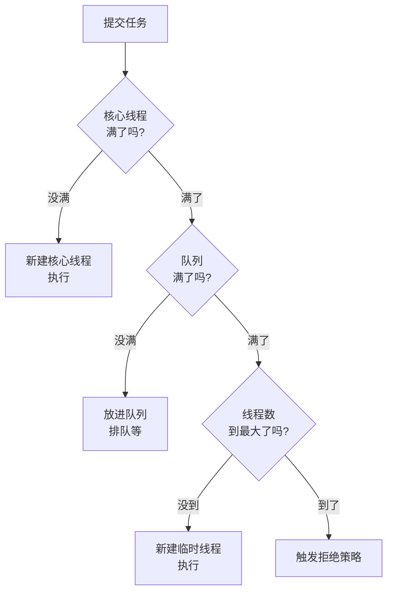

# W5 D4 · 线程池

> 2026-11-27（五）｜W5 第 4 天｜预计 3 小时

> 昨天学的 `wait/notify` 是"线程之间怎么配合"。
> 今天学的是"**线程本身怎么被管理**"——起 100 个任务，难道真起 100 个线程？
> 线程池是 Java 并发里出现频率最高的面试题，也是唯一一道能靠"背参数"拿分、但**只能靠真正跑过才能答深**的题。

## 0. 今天会遇到的 8 个名词

| 名词 | 一句话 | 类比 |
| --- | --- | --- |
| 线程池 | 复用一组线程来执行任务，避免频繁创建销毁 | 餐厅固定的 8 个服务员，不走一个招一个 |
| 核心线程数 `corePoolSize` | 常驻员工数，即使空闲也不裁 | 正式员工 |
| 最大线程数 `maximumPoolSize` | 忙起来最多能加到多少人 | 忙时叫的临时工 |
| 工作队列 `workQueue` | 排队的任务 | 等位区 |
| 空闲存活时间 `keepAliveTime` | 临时工闲多久走人 | 临时工合同有期限 |
| 拒绝策略 | 人满、队满以后怎么处理新任务 | 客满时门口怎么回话 |
| `Future` | 拿任务的结果（可能还没算完） | 取餐小票 |
| 线程工厂 `ThreadFactory` | 决定线程怎么创建、起什么名字 | 工牌怎么发 |

## 1. 今天 3 小时怎么分

| 分钟 | 做什么 |
| --- | --- |
| 85 | 看课 + 读 §2–§7（重点：**执行流程的四个判断顺序**、四种拒绝策略） |
| 55 | 敲 4 个 Demo，特别是 A（观察线程数怎么长上去）和 B（触发拒绝） |
| 25 | 算法 1 题 |
| 15 | 术语 + 练习 + commit |

## 2. 为什么不能 `new Thread` 就用

```java
// 问题写法：1000 个任务就 1000 个线程
for (int i = 0; i < 1000; i++) {
    new Thread(() -> doSomething()).start();
}
```

三个致命问题：

| 问题 | 后果 |
| --- | --- |
| 创建/销毁开销 | 每个线程约占 1MB 栈内存 + 内核态调度成本，1000 个就是 1GB |
| 数量无上限 | 任务来时无限创建，直接把内存/CPU 打爆（`OutOfMemoryError: unable to create native thread`） |
| 无法管理 | 不能统一超时、不能统计、不能优雅关闭 |

**线程池解决的就是这三件事**：复用、限流、可管理。

## 3. `ThreadPoolExecutor` 的七个参数

```java
public ThreadPoolExecutor(
    int corePoolSize,                      // ①核心线程数
    int maximumPoolSize,                   // ②最大线程数
    long keepAliveTime,                    // ③空闲线程存活时间
    TimeUnit unit,                         // ④时间单位
    BlockingQueue<Runnable> workQueue,     // ⑤工作队列
    ThreadFactory threadFactory,           // ⑥线程工厂
    RejectedExecutionHandler handler       // ⑦拒绝策略
)
```

### 任务提交后的四步判断（背下来）



**顺序是核心 → 队列 → 最大 → 拒绝。** 很多人记成"核心 → 最大 → 队列"，这是错的：线程池**优先排队而不是优先扩容**，因为扩容比排队贵。

理解这一点的关键是：**核心线程满了不代表马上加线程，而是先让任务排队**；只有队列也满了，才会动用"最大线程数"那部分额度。

## 4. 四种拒绝策略

| 策略 | 行为 | 什么时候用 |
| --- | --- | --- |
| `AbortPolicy`（默认） | 抛 `RejectedExecutionException` | 不能丢任务，宁可报错让调用方知道 |
| `CallerRunsPolicy` | 让**提交任务的线程自己执行** | 要背压：谁提交谁跑，自然拖慢提交速度 |
| `DiscardPolicy` | 静默丢弃，不抛异常 | 可丢的日志、监控数据（**慎用，出问题无声无息**） |
| `DiscardOldestPolicy` | 丢掉队列里最老的，再试一次 | 只关心最新数据的场景 |

`CallerRunsPolicy` 最值得体会：它会让提交任务的那个线程（比如主线程）去跑任务，**提交速度自然被拖慢**，形成一种天然的限流。

## 5. `Executors` 的三个工厂方法，和为什么阿里规约禁用

```java
Executors.newFixedThreadPool(10);        // 核心=最大=10，队列是 LinkedBlockingQueue（无界！）
Executors.newSingleThreadExecutor();     // 核心=最大=1，队列无界
Executors.newCachedThreadPool();         // 核心=0，最大=Integer.MAX_VALUE，队列 SynchronousQueue
```

《阿里巴巴 Java 开发手册》明确禁止用它们，原因就两条：

- **`FixedThreadPool`/`SingleThreadExecutor`**：队列是**无界**的（`LinkedBlockingQueue` 默认容量 `Integer.MAX_VALUE`），任务堆积会一直涨到 **OOM**。
- **`CachedThreadPool`**：最大线程数是 `Integer.MAX_VALUE`，任务多时会无限创建线程，直到 **OOM（unable to create native thread）**。

**正确做法**：自己 `new ThreadPoolExecutor(...)`，把七个参数写清楚，队列给一个有界容量。

## 6. 动手任务 A–D（55 分钟）

### A. 看线程数是怎么长上去的（最重要）

```java
// 文件：ThreadPoolBasicDemo.java
import java.util.concurrent.ArrayBlockingQueue;
import java.util.concurrent.ThreadPoolExecutor;
import java.util.concurrent.TimeUnit;

public class ThreadPoolBasicDemo {

    public static void main(String[] args) throws InterruptedException {
        // 核心 2、最大 4、队列 2 —— 故意造得很小，方便观察
        ThreadPoolExecutor pool = new ThreadPoolExecutor(
                2, 4,
                10, TimeUnit.SECONDS,
                new ArrayBlockingQueue<>(2),
                new ThreadPoolExecutor.AbortPolicy());

        for (int i = 1; i <= 6; i++) {
            final int taskId = i;
            try {
                pool.execute(() -> {
                    System.out.println("  任务 " + taskId + " 由 " + Thread.currentThread().getName()
                            + " 执行");
                    try {
                        Thread.sleep(2000);   // 占住线程，方便观察池子状态
                    } catch (InterruptedException e) {
                        Thread.currentThread().interrupt();
                    }
                });
            } catch (Exception e) {
                System.out.println("  任务 " + taskId + " 被拒绝：" + e.getClass().getSimpleName());
            }

            System.out.println("提交任务 " + taskId
                    + " → 线程数=" + pool.getPoolSize()
                    + "，活跃=" + pool.getActiveCount()
                    + "，排队=" + pool.getQueue().size());
        }

        pool.shutdown();
    }
}
// 输出（关键看每一行的数字，顺序可能略有抖动）：
// 提交任务 1 → 线程数=1，活跃=1，排队=0
// 提交任务 2 → 线程数=2，活跃=2，排队=0
// 提交任务 3 → 线程数=2，活跃=2，排队=1      ← 核心满了，进队列
// 提交任务 4 → 线程数=2，活跃=2，排队=2      ← 队列满了
// 提交任务 5 → 线程数=3，活跃=3，排队=2      ← 队列满了才扩线程
// 提交任务 6 → 线程数=4，活跃=4，排队=2      ← 扩到最大值
// 任务 1 由 pool-1-thread-1 执行
// ...
```

**这一步要盯着看的**：第 3、4 个任务**没有**让线程数变成 3、4，而是排进了队列；第 5 个任务才让线程数变成 3。这就是"核心 → 队列 → 最大"的顺序。

再提交第 7 个任务，就会看到 `AbortPolicy` 抛 `RejectedExecutionException`（队列满 2、线程已到 4）。

### B. 四种拒绝策略对比

```java
// 文件：RejectPolicyDemo.java
import java.util.concurrent.ArrayBlockingQueue;
import java.util.concurrent.RejectedExecutionHandler;
import java.util.concurrent.ThreadPoolExecutor;
import java.util.concurrent.TimeUnit;

public class RejectPolicyDemo {

    static void test(String name, RejectedExecutionHandler handler) {
        System.out.println("===== " + name + " =====");
        // 核心 1、最大 1、队列 1：第 3 个任务必然被拒绝
        ThreadPoolExecutor pool = new ThreadPoolExecutor(
                1, 1, 0, TimeUnit.SECONDS,
                new ArrayBlockingQueue<>(1),
                handler);

        for (int i = 1; i <= 3; i++) {
            final int id = i;
            try {
                pool.execute(() -> {
                    System.out.println("  执行任务 " + id + "（" + Thread.currentThread().getName() + "）");
                    try {
                        Thread.sleep(500);
                    } catch (InterruptedException e) {
                        Thread.currentThread().interrupt();
                    }
                });
                System.out.println("  任务 " + id + " 提交成功");
            } catch (Exception e) {
                System.out.println("  任务 " + id + " 被拒绝：" + e.getClass().getSimpleName());
            }
        }
        pool.shutdown();
        try {
            pool.awaitTermination(5, TimeUnit.SECONDS);
        } catch (InterruptedException e) {
            Thread.currentThread().interrupt();
        }
    }

    public static void main(String[] args) {
        test("AbortPolicy 抛异常", new ThreadPoolExecutor.AbortPolicy());
        test("CallerRunsPolicy 调用者自己跑", new ThreadPoolExecutor.CallerRunsPolicy());
        test("DiscardPolicy 静默丢弃", new ThreadPoolExecutor.DiscardPolicy());
        test("DiscardOldestPolicy 丢最老的", new ThreadPoolExecutor.DiscardOldestPolicy());
    }
}
// 输出要点：
// AbortPolicy   → 任务 3 被拒绝：RejectedExecutionException
// CallerRunsPolicy → 任务 3 由 main 线程执行（注意线程名是 main）
// DiscardPolicy → 任务 3 提交成功但从未执行（静默）
// DiscardOldestPolicy → 任务 3 执行，任务 2 被挤掉
```

**观察重点**：`CallerRunsPolicy` 那组里，第三个任务的执行线程名是 **`main`**——提交者自己下场跑。

### C. `submit` 拿返回值：`Future`

```java
// 文件：FutureDemo.java
import java.util.concurrent.ExecutionException;
import java.util.concurrent.ExecutorService;
import java.util.concurrent.Executors;
import java.util.concurrent.Future;
import java.util.concurrent.TimeUnit;
import java.util.concurrent.TimeoutException;

public class FutureDemo {

    public static void main(String[] args) throws InterruptedException {
        ExecutorService pool = Executors.newFixedThreadPool(2);

        // 任务 1：正常返回
        Future<Integer> ok = pool.submit(() -> {
            Thread.sleep(500);
            return 1 + 2 + 3;
        });

        // 任务 2：故意抛异常
        Future<Integer> bad = pool.submit(() -> {
            throw new IllegalStateException("计算失败");
        });

        // 任务 3：算很久，测试超时
        Future<Integer> slow = pool.submit(() -> {
            Thread.sleep(3000);
            return 100;
        });

        try {
            System.out.println("任务 1 结果：" + ok.get());                    // 阻塞直到算完
            System.out.println("任务 1 是否完成：" + ok.isDone());
        } catch (ExecutionException e) {
            System.out.println("任务 1 抛异常：" + e.getCause());
        }

        try {
            bad.get();                                    // 任务里的异常会被包成 ExecutionException
        } catch (ExecutionException e) {
            System.out.println("任务 2 的异常被包住：" + e.getCause());
        }

        try {
            System.out.println("任务 3 结果：" + slow.get(1, TimeUnit.SECONDS));   // 只等 1 秒
        } catch (TimeoutException e) {
            System.out.println("任务 3 超时，不等了");
            slow.cancel(true);                            // 尝试中断
        } catch (ExecutionException e) {
            System.out.println("任务 3 抛异常：" + e.getCause());
        }

        pool.shutdown();
    }
}
// 输出：
// 任务 1 结果：6
// 任务 1 是否完成：true
// 任务 2 的异常被包住：java.lang.IllegalStateException: 计算失败
// 任务 3 超时，不等了
```

`submit` 和 `execute` 的区别：`execute` 只接 `Runnable`、无返回值、异常直接抛在池内线程里（外面看不见）；`submit` 接 `Callable`/`Runnable`、返回 `Future`、**异常被包进 `Future`，只有 `get()` 时才抛出来**。

### D. 关闭池子：`shutdown` vs `shutdownNow`

```java
// 文件：ShutdownDemo.java
import java.util.concurrent.ArrayBlockingQueue;
import java.util.concurrent.ThreadPoolExecutor;
import java.util.concurrent.TimeUnit;

public class ShutdownDemo {

    public static void main(String[] args) throws InterruptedException {
        ThreadPoolExecutor pool = new ThreadPoolExecutor(
                1, 1, 0, TimeUnit.SECONDS, new ArrayBlockingQueue<>(5));

        for (int i = 1; i <= 4; i++) {
            final int id = i;
            pool.execute(() -> {
                try {
                    Thread.sleep(1000);
                } catch (InterruptedException e) {
                    System.out.println("  任务 " + id + " 被中断");
                    Thread.currentThread().interrupt();
                    return;
                }
                System.out.println("  任务 " + id + " 完成");
            });
        }

        pool.shutdown();                                   // 不再接新任务，已提交的跑完
        System.out.println("shutdown 后 isShutdown=" + pool.isShutdown()
                + "，排队中=" + pool.getQueue().size());

        boolean done = pool.awaitTermination(10, TimeUnit.SECONDS);
        System.out.println("全部结束=" + done + "，isTerminated=" + pool.isTerminated());
    }
}
// 输出：
// shutdown 后 isShutdown=true，排队中=3
//   任务 1 完成
//   任务 2 完成
//   任务 3 完成
//   任务 4 完成
// 全部结束=true，isTerminated=true
```

把 `shutdown()` 换成 `shutdownNow()`（会尝试 `interrupt` 正在跑的、丢掉队列里的），再跑一次对比输出。

## 7. 线程数到底设多少

| 任务类型 | 经验公式 | 说明 |
| --- | --- | --- |
| CPU 密集（计算） | `N + 1` | N = CPU 核数；多 1 个是为了在偶发缺页时不断档 |
| IO 密集（读写库、调接口） | `2N` 起，可到 `N × (1 + 等待时间/计算时间)` | 线程大部分时间在等，多给几个能提高吞吐 |

`N` 用 `Runtime.getRuntime().availableProcessors()` 取。

**面试加分点**：说"公式只是起点，真实值要压测"，并给出调优方向（看 CPU 利用率、看队列堆积、看拒绝次数）。

## 8. 练习（先写，再看答案）

### A. 判断（5 题）

**A1.** 核心线程满了以后，线程池会立刻创建新线程，直到达到最大线程数。

> 答：

**A2.** `newFixedThreadPool` 使用的是无界队列，任务堆积可能导致 OOM。

> 答：

**A3.** `CallerRunsPolicy` 会让提交任务的线程自己去执行那个任务。

> 答：

**A4.** `shutdown()` 会立刻中断正在执行的任务。

> 答：

**A5.** `submit(Runnable)` 返回的 `Future.get()` 得到的是 `null`。

> 答：

### B. 选择（5 题）

**B1.** 核心 2、最大 4、队列容量 2，依次提交 5 个任务，此时池中线程数是：
A. 2　B. 3　C. 4　D. 5

> 答：

**B2.** 默认的拒绝策略是：
A. `CallerRunsPolicy`　B. `AbortPolicy`　C. `DiscardPolicy`　D. `DiscardOldestPolicy`

> 答：

**B3.** 任务里抛出的异常，用 `submit` 提交时会在哪里暴露？
A. 池内线程的控制台　B. 提交时立刻抛　C. `Future.get()` 时包成 `ExecutionException`　D. 永远不会暴露

> 答：

**B4.** 下面哪种池子最可能因为创建过多线程导致 OOM？
A. `newFixedThreadPool`　B. `newSingleThreadExecutor`　C. `newCachedThreadPool`　D. 自定义有界队列的池

> 答：

**B5.** `keepAliveTime` 对谁生效（默认配置下）？
A. 核心线程　B. 超过核心线程的那部分　C. 所有线程　D. 队列里的任务

> 答：

### C. 简答（3 题）

**C1.** 提交一个任务后，线程池按什么顺序决定"新建线程 / 进队列 / 拒绝"？请写出四个判断。

> 答：

**C2.** 为什么《阿里巴巴 Java 开发手册》禁止用 `Executors` 创建线程池？分别说出 `newFixedThreadPool` 和 `newCachedThreadPool` 的风险。

> 答：

**C3.** 线程池里一个任务抛了未捕获异常，会发生什么？会对池子里的其他线程有影响吗？

> 答：

<details>
<summary>参考答案</summary>

**A 判断**：A1 **错**（先排队，队列满了才扩容）｜A2 **对**（`LinkedBlockingQueue` 默认 `Integer.MAX_VALUE`）｜A3 **对**｜A4 **错**（`shutdown()` 是"温柔关闭"，等已提交的跑完；`shutdownNow()` 才中断）｜A5 **对**（`Runnable` 无返回值，`Future.get()` 是 `null`）

**B 选择**：B1 **B**（前 2 个占核心线程，第 3、4 个进队列，第 5 个才扩到第 3 个线程）｜B2 **B**｜B3 **C**｜B4 **C**（最大线程数 `Integer.MAX_VALUE`）｜B5 **B**（默认核心线程不回收；`allowCoreThreadTimeOut(true)` 后才对所有线程生效）

**C1**：①线程数 < 核心数 → 新建核心线程；②核心已满 → 尝试放队列；③队列满且线程数 < 最大数 → 新建临时线程；④队列满且已达最大数 → 执行拒绝策略。

**C2**：`newFixedThreadPool`/`newSingleThreadExecutor` 用无界 `LinkedBlockingQueue`，任务堆积无上限 → 堆内存 OOM；`newCachedThreadPool` 最大线程数是 `Integer.MAX_VALUE`、队列是 `SynchronousQueue`（不存储），任务来一个就要一个线程 → 线程数爆炸，`OutOfMemoryError: unable to create native thread`。正确做法是 `new ThreadPoolExecutor(...)` 明确七参数 + 有界队列。

**C3**：用 `execute` 提交时，异常会抛到池内那个工作线程，该线程**终止**，线程池随后**补一个新线程**继续工作——池子不会挂，但这个异常在外面完全看不到（要设 `UncaughtExceptionHandler` 或 `setUncaughtExceptionHandler`）。用 `submit` 提交时，异常被捕获并包进 `Future`，只有 `get()` 时才以 `ExecutionException` 抛出，**线程不会终止、会继续复用**。这也是"任务里必须自己 try-catch"的原因。

</details>

## 9. 高频坑

| 坑 | 说明 |
| --- | --- |
| 用 `Executors.newFixedThreadPool` | 无界队列，任务堆积直接 OOM |
| 记错执行顺序 | 核心 → **队列** → 最大 → 拒绝，不是核心 → 最大 |
| `submit` 里异常没人管 | 异常被吞进 `Future`，不 `get()` 永远不知道任务失败了 |
| 忘记关闭线程池 | JVM 不退出（非守护线程还活着） |
| `shutdownNow()` 以为能立刻停 | 它只是 `interrupt`，任务若不响应中断照样跑完 |
| 在任务里再提交任务并无限等待 | 池满了会死锁（任务互相等对方腾出线程） |

## 10. 30 秒卡

- **七参数**：核心数、最大数、存活时间、时间单位、队列、线程工厂、拒绝策略。
- **执行顺序**：核心 → 队列 → 最大 → 拒绝。
- **四种拒绝**：Abort（抛）、CallerRuns（提交者跑）、Discard（丢新的）、DiscardOldest（丢最老的）。
- **阿里规约**：不用 `Executors`，用 `new ThreadPoolExecutor` + 有界队列。
- **线程数**：CPU 密集 `N+1`，IO 密集 `2N` 起，真实值压测。

## 11. 今天要记的 3 个术语（写进术语表）

- `ThreadPoolExecutor` / `corePoolSize` / `maximumPoolSize` / `workQueue`
- `AbortPolicy` / `CallerRunsPolicy` / `DiscardPolicy` / `DiscardOldestPolicy`
- `Future` / `ExecutionException` / `shutdown` vs `shutdownNow`

## 12. 面试一句话

> **说说线程池的执行流程。**
> "提交任务后先看核心线程有没有满，没满就建核心线程执行；核心满了不会立刻扩容，而是先放进工作队列；队列也满了才创建临时线程直到最大线程数；如果连最大线程数都到了，就走拒绝策略。核心思想是**优先排队、满了才扩容**，因为扩容的代价比排队大。默认拒绝策略是 AbortPolicy，直接抛 `RejectedExecutionException`。实际项目里我会自己 `new ThreadPoolExecutor` 把七个参数写清楚、队列给有界容量，而不用 `Executors` 的工厂方法，因为 `newFixedThreadPool` 的队列是无界的，任务堆积会 OOM。"

## 13. 明天预告

**W5 D5（11/28）：JUC 工具类 + 单例**——`AtomicInteger`、`ConcurrentHashMap`、`CountDownLatch`、`volatile` 与双重检查锁。这一天是"面试高频词"密度最高的一天，但代码量不大，重点是能说清楚每个东西**解决什么问题**。
