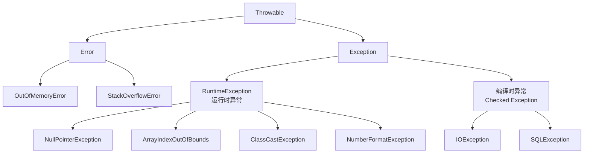

# W4 D1 · 异常体系：try-catch-finally 与 throws

> 2026-11-17（二）｜W4 第 1 天｜档位 A 基础｜配套课程：黑马「异常」— 异常概述、`try-catch`、`throws`、`finally`
>
> 今天要拿到两样东西：**① 看到一段 `Exception in thread "main" ...` 的红色报错，能立刻说出"是什么、在哪、怎么修"；② 知道什么时候该 catch、什么时候该 throws。**
> 异常是后面所有框架代码的"必备阅读能力"——Spring 的 `GlobalExceptionHandler`、MyBatis 的 `PersistenceException`，全是这套东西。

## 0. 今天会遇到的 8 个名词

| 名词 | 一句话人话 | 类比 |
| --- | --- | --- |
| 异常（Exception） | 程序运行中出的"意外情况" | 汽车仪表盘的故障灯 |
| `Error` | JVM 级的严重问题，程序管不了 | 发动机炸了，司机无能为力 |
| 编译时异常 | 编译器**强制**你处理，不处理编译不过 | 上高速前必须系安全带 |
| 运行时异常 | 编译器不管你，跑起来才炸 | 超速，抓到了才罚 |
| `try-catch` | 试着做，出事就接住 | 安全网 |
| `throw` | **主动**抛出一个异常 | 自己按下警报按钮 |
| `throws` | 在方法签名上**声明**"我可能会抛" | 门口贴"内有恶犬" |
| `finally` | 不管出没出事都会执行 | 下车必锁门 |

## 1. 今天 3 小时怎么分

| 时段 | 分钟 | 做什么 | 产出 |
| --- | --- | --- | --- |
| 看课 | 85 | 异常概述、异常体系、`try-catch`、`throws`、`finally`，1.25 倍速边看边敲 | 跟敲代码 |
| 敲代码 | 55 | 5 个异常示例（空指针 / 数组越界 / 类型转换 / 数字格式 / 除零）+ `finally` 与 `return` 的实验 | `ExceptionDemo` |
| 算法 | 25 | 力扣 1 题（字符串类） | AC 记录 |
| 记录 | 15 | 笔记 3 条 + **术语 3 个**（写进 [术语表](../00-JavaSE总体路线与术语表.md)）+ commit + 日志 | 提交完成 |

## 2. 没有异常时，代码长什么样（先看痛点）

假设用"返回错误码"表示失败：

```java
// 每个方法都要返回 int 表示成功/失败，真正的结果只能塞进参数里
int readFile(String path, StringBuilder out) {
    if (!new File(path).exists()) {
        return -1;      // 文件不存在
    }
    // ... 读文件
    if (读取失败) {
        return -2;      // 读失败
    }
    return 0;           // 成功
}

// 调用方：必须一层层判断，代码全是 if
int code = readFile("a.txt", sb);
if (code == -1) { ... }
else if (code == -2) { ... }
```

问题：**正常逻辑被错误处理淹没了**，而且错误码没有上下文（哪个文件？哪一行？）。

异常的解法：**正常逻辑照常写，出问题就"抛"出去，让上层统一处理**。

```java
String content = readFile("a.txt");   // 出问题会抛异常，这里不用写 if
```

## 3. 异常体系（一张图记住）



| 分支 | 要不要处理 | 典型代表 | 说明 |
| --- | --- | --- | --- |
| `Error` | **不处理** | `OutOfMemoryError`、`StackOverflowError` | JVM 级灾难，捕获了也没法恢复 |
| `RuntimeException` | 可以不管（不建议不管） | `NullPointerException`、`ArrayIndexOutOfBoundsException`、`ClassCastException`、`NumberFormatException`、`ArithmeticException` | **代码 bug**，应该修代码而不是 catch |
| 其他 `Exception`（编译时异常） | **必须处理**（catch 或 throws） | `IOException`、`SQLException`、`FileNotFoundException`、`InterruptedException` | 外部原因导致，编译器强制你考虑 |

> **为什么编译时异常必须处理？** 因为它们通常是**外部环境**的问题（文件没了、网络断了、数据库连不上），程序员必须显式决定"出这事我怎么办"。而 `RuntimeException` 是**自己代码写错了**，修代码才对。

## 4. try-catch 的三种写法

```java
// 写法 1：单个 catch
try {
    int a = 10 / 0;               // ArithmeticException
} catch (ArithmeticException e) {
    System.out.println("除以零了：" + e.getMessage());
}

// 写法 2：多个 catch（从子类到父类，顺序不能反！）
try {
    String s = null;
    s.length();                   // NullPointerException
} catch (NullPointerException e) {
    System.out.println("空指针");
} catch (RuntimeException e) {     // 父类放后面，否则前面的永远执行不到
    System.out.println("其他运行时异常");
}

// 写法 3：一个 catch 捕获多个（JDK7+，用 | 分隔）
try {
    Integer.parseInt("abc");      // NumberFormatException
} catch (NumberFormatException | NullPointerException e) {
    System.out.println("数字格式或空指针：" + e);
}
```

**顺序铁律**：多个 `catch` 必须**子类在前、父类在后**。反过来编译器直接报错（"已捕获该异常"），因为父类会吞掉子类。

## 5. finally：不管出没出事都要执行

```java
try {
    System.out.println("打开资源");
    int x = 1 / 0;                 // 抛异常
    System.out.println("这行不会执行");
} catch (ArithmeticException e) {
    System.out.println("捕获到异常");
} finally {
    System.out.println("finally 一定执行");   // 会执行
}
```

执行顺序：**try 里出错 → 跳到 catch → 再执行 finally**。即使 try 里有 `return`，`finally` 也会在返回前执行。

**三个必做的实验（今天动手部分的核心）**：

```java
// 实验 1：finally 里 return，会覆盖 try 里的 return
static int f1() {
    try {
        return 1;
    } finally {
        return 2;       // 返回值变成 2！
    }
}

// 实验 2：finally 修改基本类型变量，不影响已经确定的返回值
static int f2() {
    int x = 1;
    try {
        return x;       // 这里已经把 1 存进"返回槽"
    } finally {
        x = 2;          // 改了也没用，返回的仍是 1
    }
}

// 实验 3：但改"引用指向的对象内容"是有效的
static StringBuilder f3() {
    StringBuilder sb = new StringBuilder("A");
    try {
        return sb;
    } finally {
        sb.append("B");  // 对象内容被改了，返回的是 "AB"
    }
}
```

> **结论**：`finally` 里**不要写 `return`**（会吞掉异常、覆盖返回值，是出 bug 的经典源头）。`finally` 只用来做"关资源"。

## 6. throw vs throws

| 关键字 | 位置 | 作用 | 后面跟什么 |
| --- | --- | --- | --- |
| `throw` | **方法体内部** | 主动抛出一个异常（真的执行） | 一个异常**对象**：`throw new RuntimeException("...")` |
| `throws` | **方法签名上** | 声明"我这个方法可能会抛这些异常"，把锅甩给调用者 | 异常**类名**，可多个：`throws IOException, SQLException` |

```java
// throws：声明，不一定真抛
public void read(String path) throws IOException {
    FileInputStream in = new FileInputStream(path);   // 这里可能抛 IOException
    // 我不处理，交给调用我的人
}

// throw：真的抛出去
public void check(int age) {
    if (age < 0) {
        throw new IllegalArgumentException("年龄不能为负：" + age);   // 主动中断
    }
}
```

**选择原则**：

- 你能处理（知道怎么补救）→ `try-catch` 自己处理。
- 你处理不了（缺上下文、该由上层决定）→ `throws` 往上抛。
- 遇到非法参数 → 主动 `throw`，别让它带着脏数据继续跑。

## 7. 怎么读红色报错（今天必须练会）

```
Exception in thread "main" java.lang.NumberFormatException: For input string: "abc"
    at java.lang.Integer.parseInt(Integer.java:652)
    at com.itheima.demo.ExceptionDemo.main(ExceptionDemo.java:12)
```

**三行信息，按顺序读**：

| 部分 | 含义 | 怎么用 |
| --- | --- | --- |
| `NumberFormatException: For input string: "abc"` | **是什么异常 + 什么原因** | 关键字搜这句 |
| 第一行 `at ...` | 异常**发生的位置** | 这行往往在 JDK 源码里，不是你的代码 |
| **最后一行 `at ...你的类.你的方法(文件:行号)`** | **你的代码里出问题的那一行** | 直接点过去改这里 |

> 新手最大的误区：盯着第一行 JDK 的代码看。**要看的是你自己类名那一行**（通常在栈的最下面几条）。

## 8. 动手任务（55 分钟）

**任务 A：5 个异常各来一次（30 分钟）**
分别制造并捕获：`NullPointerException`（调 null 的方法）、`ArrayIndexOutOfBoundsException`（越界取数组）、`ClassCastException`（强转错误类型）、`NumberFormatException`（`Integer.parseInt("abc")`）、`ArithmeticException`（整除零）。
每个 catch 里打印三句话：**是什么、为什么会发生、怎么修**。

**任务 B：finally 三个实验（15 分钟）**
把 §5 的 `f1` / `f2` / `f3` 抄下来跑一遍，把实际输出写进笔记，并用自己的话解释 `f2` 为什么返回 1。

**任务 C：读报错（10 分钟）**
故意写一个第 20 行越界的代码，运行，从红色报错里找出**你自己的类名 + 行号**，抄进笔记。

**验收标准**

- [ ] 能画出 `Throwable → Error / Exception → RuntimeException` 的树，并各举一个例子
- [ ] 能说出编译时异常和运行时异常的本质区别
- [ ] 能解释 `finally` 里有 `return` 会发生什么
- [ ] 能说出 `throw` 和 `throws` 的三个区别

## 9. 练习（先写，再看答案）

### A. 判断（5 题）

**A1.** `Error` 和 `Exception` 都继承自 `Throwable`。

> 答：

**A2.** `RuntimeException` 必须被 `try-catch` 或 `throws` 处理，否则编译不通过。

> 答：

**A3.** `finally` 块中的代码在任何情况下都会执行。

> 答：

**A4.** 多个 `catch` 时，父类异常要写在子类前面。

> 答：

**A5.** `throws` 后面跟的是异常对象，`throw` 后面跟的是异常类名。

> 答：

### B. 选择（5 题）

**B1.** 下列哪个是**编译时异常**：
A. `NullPointerException`　B. `ArrayIndexOutOfBoundsException`　C. `IOException`　D. `ArithmeticException`

> 答：

**B2.** `int a = 10 / 0;` 会抛：
A. `NullPointerException`　B. `ArithmeticException`　C. `NumberFormatException`　D. `IllegalArgumentException`

> 答：

**B3.** 关于 `finally`，正确的是：
A. 只有 try 成功才执行　B. 只有 catch 执行了才执行　C. 无论是否抛异常都会执行　D. 只能写 `return`

> 答：

**B4.** `throw new RuntimeException("x")` 应该写在：
A. 方法签名上　B. 方法体内部　C. 类声明上　D. catch 块外

> 答：

**B5.** 下面代码的输出是：
```java
static int f() {
    try { return 1; }
    finally { return 2; }
}
```
A. 1　B. 2　C. 编译报错　D. 运行时异常

> 答：

### C. 简答（3 题）

**C1.** 用自己的话说清"编译时异常"和"运行时异常"的区别（不要只说"一个要处理一个不用"，要说**为什么**）。

> 答：

**C2.** `finally` 里写 `return` 会有什么问题？为什么建议不要在 `finally` 里 `return`？

> 答：

**C3.** 什么时候用 `try-catch` 自己处理，什么时候用 `throws` 往上抛？各举一个场景。

> 答：

<details>
<summary>参考答案</summary>

**A 判断**：A1 对｜A2 **错**（运行时异常编译器不强制处理）｜A3 **错**（严格说：`System.exit()` 或 JVM 崩溃时不执行；通俗说法"一定执行"也对，但要能说清例外）｜A4 **错**（子类在前、父类在后）｜A5 **错**（说反了：`throws` 跟类名，`throw` 跟对象）

**B 选择**：B1 C｜B2 B｜B3 C｜B4 B｜B5 B（`finally` 的 `return` 覆盖了 try 的 `return`）

**C1**：编译时异常（`Exception` 里除 `RuntimeException` 之外的）是编译器**强制**你处理——不 catch 也不 throws 就编译不过。原因是它们通常由**外部环境**引起（文件不存在、网络中断、数据库连不上），程序无法预知，必须显式决定怎么办。运行时异常（`RuntimeException` 及其子类）是**代码本身有 bug**（空指针、越界、类型转换），属于"写错了"，正确做法是修代码，所以编译器不强制你捕获。

**C2**：`finally` 里的 `return` 会**覆盖** `try` 或 `catch` 中已经准备好的返回值（实验 1：返回 2 而不是 1），更严重的是它会**吞掉正在抛出的异常**，让上层完全感知不到出过错，问题被掩盖。`finally` 的职责只有一个——**释放资源**（关流、关连接、解锁），不该改变控制流。

**C3**：能就地处理、知道怎么补救的，用 `try-catch`——比如"读配置文件失败就用默认配置"。处理不了、需要上层决定策略的，用 `throws` 往上抛——比如 DAO 层读数据库失败，应该抛给 Service 层决定是重试还是提示用户。另外"参数非法"这类应由调用方保证的错误，直接 `throw new IllegalArgumentException(...)`，不要让它带着脏数据继续跑。

</details>

## 10. 高频坑

| 坑 | 说明 |
| --- | --- |
| `catch (Exception e) {}` 空着 | 吞异常，问题彻底消失，排查时生不如死 |
| `e.printStackTrace()` 当处理 | 只是打印，业务没恢复；生产环境该用日志 |
| `catch` 顺序父类在前 | 编译报错，或子类分支永远走不到 |
| `finally` 里 `return` / 抛异常 | 覆盖返回值、吞掉异常 |
| `finally` 里关流但流可能是 null | 要先判空，或者用 `try-with-resources`（明天讲） |
| 把 `Error` 也 catch 了 | `OutOfMemoryError` catch 了也没用，掩盖真实问题 |
| 以为 `throws` 就"处理"了异常 | `throws` 只是**甩锅**，最终总要有人 catch |

## 11. 30 秒卡

- **体系**：`Throwable` → `Error`（不管）/ `Exception` → `RuntimeException`（可不处理）/ 其他（必须处理）。
- **编译时异常 = 外部环境问题**，编译器强制处理；**运行时异常 = 代码 bug**，靠修代码。
- **`finally` 一定执行**（除 `System.exit`），执行顺序：try → catch → finally。
- **`finally` 里不要 `return`**：会覆盖返回值、吞异常。
- **`throw` 抛对象（方法体内）**，**`throws` 声明类名（方法签名）**。
- **读报错看最后几行**：自己类名 + 行号才是要改的地方。

## 12. 今天要记的 3 个术语（写进术语表）

- 异常体系（`Throwable` / `Error` / `Exception`）
- 编译时异常 / 运行时异常
- 异常链 / 栈轨迹（stack trace）
- `throw` vs `throws`

## 13. 面试一句话

> **Java 的异常体系？编译时异常和运行时异常有什么区别？**
> 顶层是 `Throwable`，分两支：`Error` 是 JVM 级严重问题（`OutOfMemoryError`、`StackOverflowError`），程序无法恢复，不该捕获；`Exception` 又分 `RuntimeException`（运行时异常，如空指针、越界、类型转换）和其他编译时异常（如 `IOException`）。区别在于：运行时异常通常由代码 bug 引起，编译器不强制处理，正确处理是修代码；编译时异常多由外部环境引起（文件、网络、数据库），编译器强制 catch 或 throws，逼你显式决定怎么应对。另外 `finally` 无论是否抛异常都会执行，只该用来释放资源，在里面 `return` 会覆盖返回值甚至吞掉异常。

## 14. 明天预告

**W4 D2：自定义异常 + try-with-resources**——把 `BusinessException`（带错误码）定义出来，并学会"读文件失败 → 包装成业务异常"的写法，以及为什么 `try-with-resources` 能自动关流（它是 `finally` 的语法糖）。
