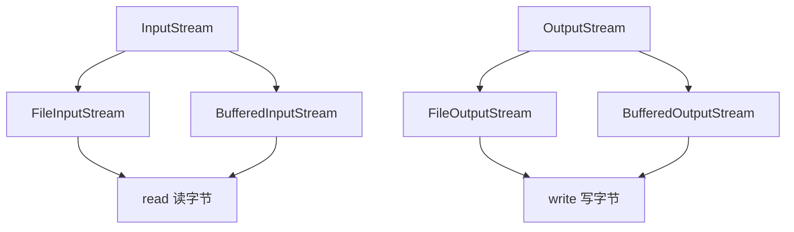

# W4 D3 · `File` 类与字节流

> 2026-11-19（四）｜W4 第 3 天｜档位 A 基础｜配套课程：黑马「IO」— `File` 类、`FileInputStream` / `FileOutputStream`
>
> 今天要拿到三样东西：**① 能用 `File` 判断/创建/遍历文件和目录；② 能用字节流把一个文件原样复制（图片、视频都行）；③ 知道字节流读中文为什么会乱码（明天用字符流解决）。**
>
> 这是"程序和数据打交道"的第一天。后面苍穹外卖的图片上传、Excel 导入导出、日志落盘，底层全是今天这套东西。

> 🧩 **代码块约定**：每个 `java` 代码块都是完整可运行的文件——复制 → 存成 `// 文件：` 后的名字 → 运行。**代码里会自己生成测试文件**，不需要你提前准备图片或文本。

## 0. 今天会遇到的 8 个名词

| 名词 | 一句话人话 | 类比 |
| --- | --- | --- |
| `File` | 一个"路径"对象，**不代表文件一定存在** | 一张写着地址的纸条 |
| 绝对路径 / 相对路径 | 从盘符开始 / 从当前工作目录开始 | 完整门牌号 / "我家隔壁" |
| 字节流 | 按**字节**（8 bit）搬运数据，什么文件都能搬 | 搬家公司，不关心里面装什么 |
| `InputStream` / `OutputStream` | 字节流的两个顶层抽象类（读 / 写） | 水管的两头 |
| `read()` 返回 `int` | 返回 0–255 的字节值，**读到末尾返回 -1** | 水位计，-1 表示没水了 |
| 缓冲区 | 一次搬一大块，比一次搬一个字节快得多 | 用箱子搬 vs 用手一件件拿 |
| 递归遍历 | 方法自己调用自己，把子目录也走一遍 | 一层层打开抽屉找东西 |
| 编码（charset） | 字节和字符的翻译表（UTF-8 / GBK） | 密码本 |

## 1. 今天 3 小时怎么分

| 时段 | 分钟 | 做什么 | 产出 |
| --- | --- | --- | --- |
| 看课 | 85 | `File` 类、`FileInputStream`/`FileOutputStream`，1.25 倍速边看边敲 | 跟敲代码 |
| 敲代码 | 55 | 复制文件（单字节 vs 缓冲区）+ 递归遍历目录找 `.java` + 乱码实验 | `io-demo/` 三个类 |
| 算法 | 25 | 力扣 1 题（字符串） | AC 记录 |
| 记录 | 15 | 笔记 3 条 + **术语 3 个**（写进 [术语表](../00-JavaSE总体路线与术语表.md)）+ commit + 日志 | 提交完成 |

## 2. `File`：只是一个路径对象

```java
// 文件：FileBasicDemo.java
import java.io.File;
import java.io.IOException;

public class FileBasicDemo {

    public static void main(String[] args) throws IOException {

        // new File(...) 只创建"路径对象"，不检查文件是否存在，也不创建文件
        File f = new File("test-dir/hello.txt");
        System.out.println("路径：" + f.getPath());
        System.out.println("绝对路径：" + f.getAbsolutePath());
        System.out.println("文件存在吗：" + f.exists());
        System.out.println("是文件吗：" + f.isFile());
        System.out.println("是目录吗：" + f.isDirectory());

        // 创建目录（父目录不存在会失败，所以要用 mkdirs 而不是 mkdir）
        File dir = new File("test-dir");
        if (!dir.exists()) {
            boolean ok = dir.mkdirs();
            System.out.println("创建目录：" + ok);
        }

        // 创建文件（文件已存在会返回 false，不报错）
        if (!f.exists()) {
            boolean ok = f.createNewFile();
            System.out.println("创建文件：" + ok);
        }

        System.out.println("文件大小（字节）：" + f.length());
        System.out.println("父目录：" + f.getParent());
        System.out.println("文件名：" + f.getName());
    }
}
// 输出：
// 路径：test-dir\hello.txt
// 绝对路径：C:\Users\你的用户名\IdeaProjects\demo\test-dir\hello.txt
// 文件存在吗：false
// 是文件吗：false
// 是目录吗：false
// 创建目录：true
// 创建文件：true
// 文件大小（字节）：0
// 父目录：test-dir
// 文件名：hello.txt
```

**常用方法速查**

| 方法 | 作用 | 注意 |
| --- | --- | --- |
| `exists()` | 存在吗 | `File` 对象本身永远存在，这个方法才判断磁盘上有没有 |
| `isFile()` / `isDirectory()` | 是文件 / 是目录 | 文件不存在时都返回 `false` |
| `mkdir()` / `mkdirs()` | 创建目录 | `mkdirs` 会连父目录一起创建，**优先用这个** |
| `createNewFile()` | 创建空文件 | 已存在返回 `false`，不覆盖 |
| `delete()` | 删除 | **目录非空时删不掉**，返回 `false` |
| `length()` | 文件大小（字节） | 目录返回的值不固定，别用 |
| `getName()` / `getParent()` / `getPath()` | 名字 / 父路径 / 路径 | `getName()` 只返回最后一段 |
| `listFiles()` | 列出子文件/子目录 | 目录不存在或不是目录时返回 **`null`**（不是空数组！） |

> ⚠️ 最常见的一行崩溃：`for (File f : dir.listFiles())` —— `dir` 不存在时 `listFiles()` 返回 `null`，直接 NPE。必须先判空。

## 3. 路径：绝对 vs 相对

```java
// 文件：PathDemo.java
import java.io.File;

public class PathDemo {

    public static void main(String[] args) {
        // 相对路径：从"当前工作目录"算起（IDEA 里默认是项目根目录）
        File relative = new File("data/a.txt");
        // 绝对路径：从盘符开始
        File absolute = new File("C:/data/a.txt");

        System.out.println("相对路径的绝对位置：" + relative.getAbsolutePath());
        System.out.println("是否绝对路径：" + relative.isAbsolute());
        System.out.println("是否绝对路径：" + absolute.isAbsolute());

        // 跨平台拼接路径：不要手写 "/" 或 "\\"，用 File.separator 或 Path
        String joined = "data" + File.separator + "a.txt";
        System.out.println("拼接结果：" + joined);
    }
}
// 输出（Windows）：
// 相对路径的绝对位置：C:\Users\你的用户名\IdeaProjects\demo\data\a.txt
// 是否绝对路径：false
// 是否绝对路径：true
// 拼接结果：data\a.txt
```

## 4. 字节流的结构



**为什么 `read()` 返回 `int` 而不是 `byte`？** 因为 `byte` 范围是 -128~127，而一个字节的数据是 0~255；如果返回 `byte`，就无法用某个值表示"读完了"。所以用 `int`：**0–255 是数据，`-1` 表示到末尾**。

```java
// 文件：ReadOneByteDemo.java
import java.io.FileInputStream;
import java.io.FileOutputStream;
import java.io.IOException;

public class ReadOneByteDemo {

    public static void main(String[] args) throws IOException {
        // 先造一个 5 字节的测试文件，避免依赖外部素材
        try (FileOutputStream out = new FileOutputStream("one-byte.bin")) {
            out.write(new byte[]{65, 66, 67, 68, 69});   // 对应 ASCII 的 A B C D E
        }

        // 一个字节一个字节地读，直到返回 -1
        try (FileInputStream in = new FileInputStream("one-byte.bin")) {
            int b;
            while ((b = in.read()) != -1) {              // 关键：先读、再判断、再使用
                System.out.println("读到字节：" + b + "，对应字符：" + (char) b);
            }
        }
    }
}
// 输出：
// 读到字节：65，对应字符：A
// 读到字节：66，对应字符：B
// 读到字节：67，对应字符：C
// 读到字节：68，对应字符：D
// 读到字节：69，对应字符：E
```

## 5. 复制文件：单字节 vs 缓冲区（今天的核心实验）

```java
// 文件：CopyFileDemo.java
import java.io.FileOutputStream;
import java.io.FileInputStream;
import java.io.IOException;
import java.util.Random;

public class CopyFileDemo {

    public static void main(String[] args) throws IOException {

        // ---------- 准备：造一个 5MB 的测试文件 ----------
        String src = "big.bin";
        try (FileOutputStream out = new FileOutputStream(src)) {
            byte[] chunk = new byte[8192];
            new Random(42).nextBytes(chunk);
            for (int i = 0; i < 640; i++) {      // 640 × 8KB ≈ 5MB
                out.write(chunk);
            }
        } catch (IOException e) {
            // 今天的知识点：包装时保留 cause
            throw new IOException("生成测试文件失败：" + src, e);
        }

        // ---------- 方式 1：一次一个字节（慢，只做对比）----------
        long t1 = System.currentTimeMillis();
        try (FileInputStream in = new FileInputStream(src);
             FileOutputStream out = new FileOutputStream("copy-1byte.bin")) {
            int b;
            while ((b = in.read()) != -1) {
                out.write(b);
            }
        }
        long t2 = System.currentTimeMillis();

        // ---------- 方式 2：用数组缓冲区（推荐）----------
        long t3 = System.currentTimeMillis();
        try (FileInputStream in = new FileInputStream(src);
             FileOutputStream out = new FileOutputStream("copy-buffer.bin")) {
            byte[] buf = new byte[8192];          // 8KB 缓冲区，一次搬 8192 个字节
            int len;
            while ((len = in.read(buf)) != -1) {  // len 是"本次实际读到的字节数"
                out.write(buf, 0, len);           // 必须写 len，不能写 buf.length
            }
        }
        long t4 = System.currentTimeMillis();

        System.out.println("单字节复制耗时：" + (t2 - t1) + " ms");
        System.out.println("缓冲区复制耗时：" + (t4 - t3) + " ms");
        System.out.println("两次复制结果一样吗：" + sameFile(src, "copy-buffer.bin"));
    }

    // 逐字节比较两个文件是否完全相同
    private static boolean sameFile(String a, String b) throws IOException {
        try (FileInputStream in1 = new FileInputStream(a);
             FileInputStream in2 = new FileInputStream(b)) {
            if (in1.available() != in2.available()) {
                return false;
            }
            int x, y;
            while ((x = in1.read()) != -1) {
                y = in2.read();
                if (x != y) {
                    return false;
                }
            }
            return true;
        }
    }
}
// 输出（机器不同数值不同，但差距是数量级的）：
// 单字节复制耗时：2500 ms 左右
// 缓冲区复制耗时：15 ms 左右
// 两次复制结果一样吗：true
```

**两个必须记住的点**

1. `out.write(buf, 0, len)` —— **不能写 `out.write(buf)`**。最后一次读到的可能只填了缓冲区前一半，`write(buf)` 会把上一次的残留数据也写进去，复制出来的文件比原文件大。
2. 缓冲区大小取 **8KB 或 8192** 就够（磁盘一次读写就是 4KB~8KB），再大收益很小。

**复制一张图片到指定目录（真实场景写法）**

```java
// 文件：CopyImageDemo.java
import java.io.File;
import java.io.FileInputStream;
import java.io.FileOutputStream;
import java.io.IOException;

public class CopyImageDemo {

    public static void main(String[] args) {
        File src = new File("photo.png");
        File destDir = new File("backup");
        File dest = new File(destDir, "photo-copy.png");   // 用 (目录, 文件名) 构造更安全

        // 1. 源文件必须存在且是文件
        if (!src.isFile()) {
            System.out.println("源文件不存在：" + src.getAbsolutePath());
            return;
        }
        // 2. 目标目录不存在就先建（mkdirs 会连父目录一起建）
        if (!destDir.exists() && destDir.mkdirs()) {
            System.out.println("已创建目录：" + destDir.getAbsolutePath());
        }

        // 3. try-with-resources 自动关两个流，顺序逆序（先关 out 再关 in）
        try (FileInputStream in = new FileInputStream(src);
             FileOutputStream out = new FileOutputStream(dest)) {
            byte[] buf = new byte[8192];
            int len;
            while ((len = in.read(buf)) != -1) {
                out.write(buf, 0, len);
            }
            System.out.println("复制完成：" + dest.getAbsolutePath());
            System.out.println("源大小 " + src.length() + " 字节，目标大小 " + dest.length() + " 字节");
        } catch (IOException e) {
            throw new RuntimeException("复制失败：" + src + " → " + dest, e);
        }
    }
}
// 输出（先在项目根目录放一张 photo.png）：
// 已创建目录：...\backup
// 复制完成：...\backup\photo-copy.png
// 源大小 123456 字节，目标大小 123456 字节
```

## 6. 递归遍历目录，找出所有 `.java` 文件

```java
// 文件：ListJavaFilesDemo.java
import java.io.File;

public class ListJavaFilesDemo {

    public static void main(String[] args) {
        // 在自己的项目 src 目录上跑一次，看看能列出多少 .java
        File root = new File("src");
        if (!root.exists()) {
            root = new File(".");            // 没有 src 就从当前目录开始
        }
        listJava(root, 0);
    }

    /**
     * 递归遍历：level 用来缩进，方便看清层级
     */
    private static void listJava(File dir, int level) {
        String indent = "    ".repeat(level);

        File[] files = dir.listFiles();      // 可能返回 null！
        if (files == null) {
            System.out.println(indent + "[跳过] 不是目录或没有权限：" + dir.getName());
            return;
        }

        for (File f : files) {
            if (f.isDirectory()) {
                System.out.println(indent + "[目录] " + f.getName());
                listJava(f, level + 1);      // 递归进去
            } else if (f.getName().endsWith(".java")) {
                System.out.println(indent + "[文件] " + f.getName() + "（" + f.length() + " 字节）");
            }
        }
    }
}
// 输出（示例）：
// [目录] main
//     [目录] java
//         [目录] demo
//             [文件] ListJavaFilesDemo.java（1234 字节）
// [文件] App.java（256 字节）
```

**用 `FileFilter` / lambda 只取需要的文件**（省掉 if 判断）：

```java
// 文件：FilterDemo.java
import java.io.File;
import java.io.IOException;

public class FilterDemo {

    public static void main(String[] args) throws IOException {
        new File("filter-dir").mkdirs();
        new File("filter-dir/A.java").createNewFile();
        new File("filter-dir/B.java").createNewFile();
        new File("filter-dir/C.txt").createNewFile();

        File dir = new File("filter-dir");

        // 方式 1：listFiles(FileFilter) —— 只保留满足条件的
        File[] javaFiles = dir.listFiles(f -> f.isFile() && f.getName().endsWith(".java"));
        System.out.println("方式 1 找到 " + (javaFiles == null ? 0 : javaFiles.length) + " 个 .java");

        // 方式 2：listFiles(FilenameFilter) —— 按文件名过滤
        String[] names = dir.list((d, name) -> name.endsWith(".txt"));
        System.out.println("方式 2 找到 " + (names == null ? 0 : names.length) + " 个 .txt");

        // 方式 3：listFiles(FileFilter) + 方法引用（后面 Lambda 会讲）
        File[] all = dir.listFiles(File::isFile);
        for (File f : all) {
            System.out.println("文件：" + f.getName());
        }
    }
}
// 输出：
// 方式 1 找到 2 个 .java
// 方式 2 找到 1 个 .txt
// 文件：A.java
// 文件：B.java
// 文件：C.txt
```

## 7. 字节流读中文：为什么乱码

```java
// 文件：ChineseByteDemo.java
import java.io.FileOutputStream;
import java.io.FileInputStream;
import java.io.IOException;

public class ChineseByteDemo {

    public static void main(String[] args) throws IOException {
        String text = "你好";                    // UTF-8 下占 6 个字节，GBK 下占 4 个字节
        try (FileOutputStream out = new FileOutputStream("cn.txt")) {
            out.write(text.getBytes("UTF-8"));
        }

        // 一个字节一个字节读，转成 char：每个字节单独翻译，必然乱码
        try (FileInputStream in = new FileInputStream("cn.txt")) {
            int b;
            while ((b = in.read()) != -1) {
                System.out.print((char) b);       // 把单个字节强转成字符
            }
            System.out.println();
        }

        // 正确做法：把字节全部读出来，再按编码整体解码
        try (FileInputStream in = new FileInputStream("cn.txt")) {
            byte[] data = in.readAllBytes();      // JDK9+
            System.out.println("字节数：" + data.length);
            System.out.println("按 UTF-8 解码：" + new String(data, "UTF-8"));
        }
    }
}
// 输出：
// ä½ å¥½            （乱码：6 个字节被当成 6 个字符）
// 字节数：6
// 按 UTF-8 解码：你好
```

> 字节是**数据**，字符是**人看的符号**，中间需要"编码表"翻译。明天用 `FileReader`/`InputStreamReader` 就不用手动解码了。

## 8. 动手任务（55 分钟）

**任务 A：跑通今天全部示例（20 分钟）**
依次创建并运行：`FileBasicDemo` → `ReadOneByteDemo` → `CopyFileDemo` → `ListJavaFilesDemo` → `FilterDemo` → `ChineseByteDemo`。把两次复制耗时记进笔记。

**任务 B：自己写一个 `copy(String src, String dest)`（15 分钟）**
要求：源不存在 → 抛 `RuntimeException`（带原因）；自动创建目标父目录；用 8KB 缓冲；复制完比较两个文件大小并打印。

**任务 C：统计目录代码行数（15 分钟）**
遍历 `src` 下所有 `.java`，累加总行数（按 `\n` 数），打印"共 N 个文件、M 行"。提示：读文件用 `Files.readAllLines(path).size()` 或按字节数 `\n`。

**任务 D：故意踩一次 NPE（5 分钟）**
把 `listFiles()` 的结果不判空，对一个不存在的目录调用，看报错长什么样——然后加上判空。

**验收标准**

- [ ] 能说出 `File` 对象和磁盘文件的关系（对象存在 ≠ 文件存在）
- [ ] 能说出 `read()` 为什么返回 `int`、`-1` 代表什么
- [ ] 能用缓冲区完成文件复制，并说出 `write(buf, 0, len)` 里为什么是 `len`
- [ ] 能说出字节流读中文为什么乱码

## 9. 练习（先写，再看答案）

### A. 判断（5 题）

**A1.** `new File("a.txt")` 会在磁盘上创建一个空文件。

> 答：

**A2.** `FileInputStream.read()` 读到文件末尾时返回 `-1`。

> 答：

**A3.** `dir.listFiles()` 在目录不存在时返回长度为 0 的数组。

> 答：

**A4.** `out.write(buf, 0, len)` 中的 `len` 必须使用 `read()` 返回的值，不能写 `buf.length`。

> 答：

**A5.** 字节流既能读文本文件也能读图片，但读中文文本时需要按编码解码。

> 答：

### B. 选择（5 题）

**B1.** 要创建多级目录（`a/b/c`），应该用：
A. `mkdir()`　B. `mkdirs()`　C. `createNewFile()`　D. `new File()` 构造

> 答：

**B2.** `read(byte[] buf)` 的返回值表示：
A. 缓冲区总长度　B. 本次实际读到的字节数，`-1` 表示结束　C. 文件总大小　D. 剩余字节数

> 答：

**B3.** 复制文件时最推荐的做法是：
A. 一次读一个字节　B. 一次读固定大小缓冲区的数据　C. 一次读整个文件　D. 用 `File.renameTo`

> 答：

**B4.** 下面哪个流适合写二进制数据：
A. `FileReader`　B. `FileWriter`　C. `FileOutputStream`　D. `BufferedReader`

> 答：

**B5.** `try (FileInputStream in = ...)` 结束时自动调用：
A. `in.flush()`　B. `in.close()`　C. `in.reset()`　D. 不调用

> 答：

### C. 简答（3 题）

**C1.** `File` 对象存在，是否代表磁盘上文件存在？为什么？

> 答：

**C2.** 复制文件时为什么必须用 `write(buf, 0, len)` 而不是 `write(buf)`？

> 答：

**C3.** 用字节流读一段中文为什么会乱码？怎么解决？

> 答：

<details>
<summary>参考答案</summary>

**A 判断**：A1 **错**（`new File` 只是路径对象，不碰磁盘）｜A2 **对**｜A3 **错**（返回 `null`，不是空数组）｜A4 **对**（最后一次可能没填满缓冲区，写 `buf.length` 会把残留数据写进去）｜A5 **对**

**B 选择**：B1 B｜B2 B｜B3 B｜B4 C｜B5 B

**C1**：不代表。`File` 只是一个**路径的封装对象**，`new File("a.txt")` 只把字符串 "a.txt" 包装起来，既不检查、也不创建。磁盘上有没有这个文件，必须调用 `exists()` / `isFile()` 才知道。这也是为什么 `listFiles()` 对不存在的目录返回 `null` 而不是空数组。

**C2**：因为 `read(buf)` 最后一次读到的数据可能**只填满了缓冲区的前 `len` 个字节**，后面还是上一次读到的旧数据。`write(buf)` 会把整个 8192 字节全写出去，导致目标文件尾部多了重复数据、比源文件大。`write(buf, 0, len)` 只写"本次真正读到的这 `len` 个字节"。

**C3**：中文在 UTF-8 下占 3 个字节、GBK 下占 2 个字节，一个汉字由**多个字节**组成。字节流 `read()` 一次只取一个字节，把它单独强转成 `char` 就是拿半个汉字去翻译，必然乱码。解决办法有两种：① 字节流读出全部字节后按编码整体解码 `new String(data, "UTF-8")`；② 直接用字符流 `FileReader` / `InputStreamReader`（明天讲），它们内部会按编码把字节拼成字符。

</details>

## 10. 高频坑

| 坑 | 说明 |
| --- | --- |
| `dir.listFiles()` 直接遍历 | 目录不存在/不是目录时返回 `null` → NPE，必须判空 |
| `write(buf)` 而不是 `write(buf, 0, len)` | 目标文件尾部出现重复/垃圾数据，文件变大 |
| 用 `mkdir()` 建多级目录 | 父目录不存在时返回 `false`，用 `mkdirs()` |
| `delete()` 删非空目录 | 返回 `false`，必须递归删空子项 |
| 忘了关流 | 文件被占用删不掉、缓冲区数据没落盘；一律用 try-with-resources |
| 用字节流读中文再 `(char)` 强转 | 必然乱码，见 §7 |
| `File.separator` 写死 `"/"` | Windows 能跑但跨平台不稳，用 `File.separator` 或 `Path` |
| 复制时忘了建目标目录 | `FileNotFoundException: 系统找不到指定的路径` |

## 11. 30 秒卡

- **`File` 只是路径对象**，`exists()/isFile()` 才碰磁盘；`mkdirs()` 建多级。
- **`read()` 返回 `int`**：0–255 是数据，`-1` 是末尾。
- **复制文件 = 读多少写多少**：`while ((len = in.read(buf)) != -1) out.write(buf, 0, len)`。
- **缓冲 8KB**，比单字节快几百倍。
- **`listFiles()` 可能是 `null`**，遍历前必判空。
- **字节流读中文会乱码**，要按编码整体解码，或换字符流。

## 12. 今天要记的 3 个术语（写进术语表）

- 字节流 / 字符流
- 缓冲区（buffer）
- 递归遍历
- 编码 / 解码（charset）

## 13. 面试一句话

> **Java 里怎么复制一个文件？字节流和字符流有什么区别？**
> 用 `FileInputStream` + `FileOutputStream`，配一个 8KB 的 byte 数组做缓冲：`while ((len = in.read(buf)) != -1) out.write(buf, 0, len)`，两个流都用 `try-with-resources` 保证关闭，目标目录先用 `mkdirs()` 建好。字节流按字节搬运、不关心内容，什么文件都能复制（图片、视频、class 文件）；字符流按字符搬运，内部有编码表，适合读写文本，能避免中文乱码。字节流读文本时要自己按 UTF-8/GBK 解码，否则一个汉字被拆成几个字节单独转换就会乱码。

## 14. 明天预告

**W4 D4：字符流 + 编码**——`FileReader`/`FileWriter`、`InputStreamReader` 指定编码，写一个"GBK 文件转 UTF-8"的小工具，并亲眼看一下用错编码读出来是什么样。
