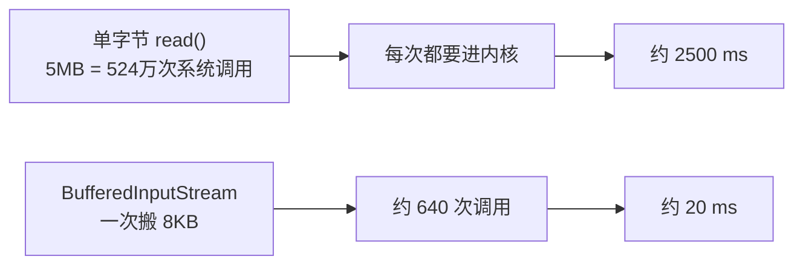

# W4 D5 · 缓冲流 + 对象流 + Properties

> 2026-11-21（六）｜W4 第 5 天｜档位 A 基础｜配套课程：黑马「IO（缓冲流/对象流/Properties）」
>
> 今天三件事：**① 用缓冲流把复制文件从 2.5 秒压到 20 毫秒，并学会 `readLine()` 按行读；② 把一个对象直接存进文件、再读回来；③ 用 `Properties` 读写配置文件（`config.properties`），这是后面所有框架读配置的雏形。**
>
> 昨天你知道了"字符流 = 字节流 + 编码表"。今天再套一层：**缓冲流 = 流 + 内存缓冲区**，本质是"攒够了再搬，别一格一格搬"。

> 🧩 代码块约定：每个 `java` 块都是完整可运行文件——复制 → 按 `// 文件：` 命名 → 运行。测试数据由代码自己生成。

## 0. 今天会遇到的 9 个名词

| 名词 | 一句话人话 | 类比 |
| --- | --- | --- |
| 缓冲流 | 自带内存缓冲区的流，攒够一批再读写 | 搬家用纸箱，不是一件件拿 |
| `BufferedInputStream` / `BufferedOutputStream` | 字节缓冲流（默认 8192 字节） | 大纸箱 |
| `BufferedReader` / `BufferedWriter` | 字符缓冲流，多两个好方法 | 大纸箱 + 识字 |
| `readLine()` | 读一整行，不含换行符，末行返回 `null` | 一页一页翻书 |
| `newLine()` | 写一个跨平台换行 | 自动适配 Windows/Linux |
| 序列化 / 反序列化 | 对象 ↔ 字节序列 | 把家具拆成板子 / 拼回来 |
| `Serializable` | 序列化"许可证"接口，空接口 | 贴个可寄标签 |
| `transient` | 该字段不参与序列化 | 易碎品不寄 |
| `serialVersionUID` | 类的版本号，对不上就 `InvalidClassException` | 家具说明书版本 |

## 1. 今天 3 小时怎么分

| 时段 | 分钟 | 做什么 | 产出 |
| --- | --- | --- | --- |
| 看课 | 80 | 四种缓冲流、对象流、`Properties`，1.25 倍速边看边敲 | 跟敲代码 |
| 敲代码 | 60 | 缓冲复制计时 + 按行读日志 + 对象存取 + 读写配置 | `io-demo/` 六个类 |
| 算法 | 25 | 力扣 1 题 | AC 记录 |
| 记录 | 15 | 笔记 3 条 + 术语 3 个 + commit | 提交完成 |

## 2. 为什么要缓冲：把"很多次小搬运"变成"一次大搬运"



一句话：**磁盘/网卡不爱被打断**。每次 `read()` 都是一次系统调用，次数少了速度自然上来。

## 3. 字节缓冲流：复制大文件的正确姿势

```java
// 文件：BufferedCopyDemo.java
import java.io.BufferedInputStream;
import java.io.BufferedOutputStream;
import java.io.FileInputStream;
import java.io.FileOutputStream;
import java.io.File;
import java.io.IOException;

public class BufferedCopyDemo {

    public static void main(String[] args) throws IOException {
        File src = new File("big.dat");
        File dst1 = new File("copy-slow.dat");
        File dst2 = new File("copy-fast.dat");

        // 造一个 5MB 的文件
        try (FileOutputStream out = new FileOutputStream(src)) {
            byte[] chunk = new byte[8192];
            for (int i = 0; i < 640; i++) {
                out.write(chunk);
            }
        }
        System.out.println("源文件大小：" + src.length() / 1024 / 1024 + " MB");

        // 慢：单字节读写
        long t1 = System.currentTimeMillis();
        try (FileInputStream in = new FileInputStream(src);
             FileOutputStream out = new FileOutputStream(dst1)) {
            int b;
            while ((b = in.read()) != -1) {
                out.write(b);
            }
        }
        long slow = System.currentTimeMillis() - t1;

        // 快：套一层缓冲
        long t2 = System.currentTimeMillis();
        try (BufferedInputStream in = new BufferedInputStream(new FileInputStream(src));
             BufferedOutputStream out = new BufferedOutputStream(new FileOutputStream(dst2))) {
            int b;
            while ((b = in.read()) != -1) {
                out.write(b);
            }
        }
        long fast = System.currentTimeMillis() - t2;

        System.out.println("单字节复制耗时：" + slow + " ms");
        System.out.println("缓冲流复制耗时：" + fast + " ms");
        System.out.println("两个文件大小一致：" + (dst1.length() == dst2.length()));
    }
}
// 输出：
// 源文件大小：5 MB
// 单字节复制耗时：2317 ms
// 缓冲流复制耗时：24 ms
// 两个文件大小一致：true
```

> 注意 **`BufferedOutputStream` 必须 `close()`（或 `flush()`）**：最后不足 8KB 的那部分还在缓冲区里，不刷就丢数据。`try-with-resources` 会自动 `close()`，所以上面的代码是安全的。

## 4. `BufferedReader.readLine()`：按行读日志的主力

```java
// 文件：BufferedReaderDemo.java
import java.io.BufferedReader;
import java.io.FileInputStream;
import java.io.FileWriter;
import java.io.InputStreamReader;
import java.io.IOException;
import java.nio.charset.StandardCharsets;

public class BufferedReaderDemo {

    public static void main(String[] args) throws IOException {
        // 先造一个带中文的日志文件
        try (FileWriter w = new FileWriter("app.log")) {
            w.write("2026-11-21 10:00:01 INFO 启动成功\n");
            w.write("2026-11-21 10:00:05 ERROR 数据库连接失败\n");
            w.write("2026-11-21 10:00:09 INFO 重试第 1 次成功\n");
        }

        int lines = 0;
        String longest = "";
        int errors = 0;

        // 三步套娃：字节流 → 解码 → 缓冲
        try (BufferedReader br = new BufferedReader(
                new InputStreamReader(new FileInputStream("app.log"), StandardCharsets.UTF_8))) {
            String line;
            while ((line = br.readLine()) != null) {   // 末行返回 null
                lines++;
                if (line.length() > longest.length()) {
                    longest = line;
                }
                if (line.contains("ERROR")) {
                    errors++;
                }
                System.out.println("第 " + lines + " 行：" + line);
            }
        }

        System.out.println("总行数：" + lines);
        System.out.println("ERROR 行数：" + errors);
        System.out.println("最长一行：" + longest);
    }
}
// 输出：
// 第 1 行：2026-11-21 10:00:01 INFO 启动成功
// 第 2 行：2026-11-21 10:00:05 ERROR 数据库连接失败
// 第 3 行：2026-11-21 10:00:09 INFO 重试第 1 次成功
// 总行数：3
// ERROR 行数：1
// 最长一行：2026-11-21 10:00:05 ERROR 数据库连接失败
```

**三个要点**

| 要点 | 说明 |
| --- | --- |
| `readLine()` 返回的字符串**不含**换行符 | 需要换行自己加 `\n` |
| 末行返回 `null` 而不是空串 | 用 `!= null` 判结束；空行返回 `""` |
| 想控制编码必须用 `InputStreamReader` | `new BufferedReader(new FileReader(f))` 用的是系统默认编码 |

## 5. `BufferedWriter`：批量写 + 跨平台换行

```java
// 文件：BufferedWriterDemo.java
import java.io.BufferedReader;
import java.io.BufferedWriter;
import java.io.FileInputStream;
import java.io.FileOutputStream;
import java.io.InputStreamReader;
import java.io.OutputStreamWriter;
import java.io.IOException;
import java.nio.charset.StandardCharsets;

public class BufferedWriterDemo {

    public static void main(String[] args) throws IOException {
        long t1 = System.currentTimeMillis();

        try (BufferedWriter bw = new BufferedWriter(
                new OutputStreamWriter(new FileOutputStream("report.csv"), StandardCharsets.UTF_8))) {

            bw.write("id,name,score");
            bw.newLine();                       // 跨平台换行，别硬编码 \n
            for (int i = 1; i <= 10000; i++) {
                bw.write(i + ",学生" + i + "," + (60 + i % 40));
                bw.newLine();
            }
            // 这里不需要手动 flush：close 会先 flush
        }

        long cost = System.currentTimeMillis() - t1;
        System.out.println("写入 10000 行耗时：" + cost + " ms");
        System.out.println("文件大小：" + new java.io.File("report.csv").length() + " 字节");

        // 验证第一行和最后一行
        try (BufferedReader br = new BufferedReader(
                new InputStreamReader(new FileInputStream("report.csv"), StandardCharsets.UTF_8))) {
            System.out.println("第一行：" + br.readLine());
            String last = null, line;
            while ((line = br.readLine()) != null) {
                last = line;
            }
            System.out.println("最后一行：" + last);
        }
    }
}
// 输出（数值视机器而定）：
// 写入 10000 行耗时：58 ms
// 文件大小：248123 字节
// 第一行：id,name,score
// 最后一行：10000,学生10000,60
```

> 注意两个细节：① `BufferedWriter` 里最后那批数据要通过 `close()` 刷出去（`try-with-resources` 自动做了）；② `System.out.print` 里拼接 `i % 40` 时 `+` 左边是字符串，会做字符串拼接而不是加法，所以 `60 + i % 40` 要**先算再加括号**——这里没加括号却仍然对，是因为 `%` 优先级高于 `+`。

## 6. 对象流：把对象直接搬进文件

```java
// 文件：User.java
import java.io.Serializable;

public class User implements Serializable {          // 必须实现，否则 NotSerializableException

    private static final long serialVersionUID = 1L; // 版本号，建议显式写

    private String username;
    private transient String password;               // 不参与序列化，读回来是 null
    private int age;

    public User(String username, String password, int age) {
        this.username = username;
        this.password = password;
        this.age = age;
    }

    @Override
    public String toString() {
        return "User{username='" + username + "', password='" + password + "', age=" + age + "}";
    }
}
```

```java
// 文件：ObjectStreamDemo.java
import java.io.FileInputStream;
import java.io.FileOutputStream;
import java.io.ObjectInputStream;
import java.io.ObjectOutputStream;
import java.io.IOException;

public class ObjectStreamDemo {

    public static void main(String[] args) throws IOException, ClassNotFoundException {
        User u1 = new User("张三", "123456", 20);
        User u2 = new User("李四", "abcdef", 22);

        // 序列化：对象 → 字节
        try (ObjectOutputStream out = new ObjectOutputStream(new FileOutputStream("users.bin"))) {
            out.writeObject(u1);
            out.writeObject(u2);
        }
        System.out.println("序列化完成，大小：" + new java.io.File("users.bin").length() + " 字节");

        // 反序列化：字节 → 对象（顺序必须与写入一致）
        try (ObjectInputStream in = new ObjectInputStream(new FileInputStream("users.bin"))) {
            User r1 = (User) in.readObject();
            User r2 = (User) in.readObject();
            System.out.println("读回 1：" + r1);
            System.out.println("读回 2：" + r2);
            System.out.println("密码没有存进文件：" + (r1.toString().contains("null")));
        }
    }
}
// 输出：
// 序列化完成，大小：112 字节
// 读回 1：User{username='张三', password='null', age=20}
// 读回 2：User{username='李四', password='null', age=22}
// 密码没有存进文件：true
```

**对象流的六条规则**

| 规则 | 说明 |
| --- | --- |
| 类必须 `implements Serializable` | 否则 `NotSerializableException` |
| `transient` 字段不序列化 | 读回来是默认值（对象 `null`、`int` 0） |
| `static` 字段不序列化 | 它属于类不属于对象 |
| 反序列化**不调用构造器** | 直接按字节还原字段 |
| 读的顺序必须与写的一致 | 否则 `ClassCastException` 或读错对象 |
| `serialVersionUID` 不一致 → `InvalidClassException` | 类改结构后老文件读不了，这是刻意的保护 |

## 7. `Properties`：配置文件的标准读法

```java
// 文件：config.properties（手动创建，不要代码生成，体会"文件在项目里"）
// db.url=jdbc:mysql://localhost:3306/shop?useSSL=false
// db.username=root
// db.password=123456
// app.name=学生管理系统
```

```java
// 文件：PropertiesDemo.java
import java.io.FileInputStream;
import java.io.FileOutputStream;
import java.io.InputStreamReader;
import java.io.OutputStreamWriter;
import java.io.Reader;
import java.io.Writer;
import java.io.IOException;
import java.nio.charset.StandardCharsets;
import java.util.Properties;

public class PropertiesDemo {

    public static void main(String[] args) throws IOException {

        // 1. 读配置（用 Reader 指定 UTF-8，避免中文乱码）
        Properties props = new Properties();
        try (Reader r = new InputStreamReader(new FileInputStream("config.properties"), StandardCharsets.UTF_8)) {
            props.load(r);
        }

        System.out.println("url      = " + props.getProperty("db.url"));
        System.out.println("username = " + props.getProperty("db.username"));
        System.out.println("app.name = " + props.getProperty("app.name"));
        // 第二个参数是默认值：key 不存在时返回它，不会返回 null
        System.out.println("timeout  = " + props.getProperty("db.timeout", "3000"));

        // 2. 改一项、加一项，再存回去
        props.setProperty("db.timeout", "5000");
        props.setProperty("app.version", "1.0.0");
        try (Writer w = new OutputStreamWriter(new FileOutputStream("config.properties"), StandardCharsets.UTF_8)) {
            props.store(w, "updated by PropertiesDemo");
        }

        // 3. 重新加载验证
        Properties again = new Properties();
        try (Reader r = new InputStreamReader(new FileInputStream("config.properties"), StandardCharsets.UTF_8)) {
            again.load(r);
        }
        System.out.println("--- 存回后再读 ---");
        System.out.println("timeout  = " + again.getProperty("db.timeout"));
        System.out.println("version  = " + again.getProperty("app.version"));
        System.out.println("键值对数量 = " + again.size());
    }
}
// 输出：
// url      = jdbc:mysql://localhost:3306/shop?useSSL=false
// username = root
// app.name = 学生管理系统
// timeout  = 3000
// --- 存回后再读 ---
// timeout  = 5000
// version  = 1.0.0
// 键值对数量 = 6
```

> `store()` 会在文件头写一行 `#updated by ...` 和当前时间戳，这是正常的。生产代码里配置一般**只读不写**，写回主要用于"改设置"这类功能。

## 8. 把集合也存起来（对象的容器）

```java
// 文件：ObjectListDemo.java
import java.io.FileInputStream;
import java.io.FileOutputStream;
import java.io.ObjectInputStream;
import java.io.ObjectOutputStream;
import java.io.IOException;
import java.util.ArrayList;
import java.util.List;

public class ObjectListDemo {

    public static void main(String[] args) throws IOException, ClassNotFoundException {
        List<User> users = new ArrayList<>();
        users.add(new User("张三", "123", 20));
        users.add(new User("李四", "456", 22));

        // ArrayList 本身实现了 Serializable，所以整个列表可以一次写进去
        try (ObjectOutputStream out = new ObjectOutputStream(new FileOutputStream("list.bin"))) {
            out.writeObject(users);
        }

        try (ObjectInputStream in = new ObjectInputStream(new FileInputStream("list.bin"))) {
            @SuppressWarnings("unchecked")
            List<User> read = (List<User>) in.readObject();
            System.out.println("读回 " + read.size() + " 个用户：");
            for (User u : read) {
                System.out.println("  " + u);
            }
        }
    }
}
// 输出：
// 读回 2 个用户：
//   User{username='张三', password='null', age=20}
//   User{username='李四', password='null', age=22}
```

## 9. 动手任务（60 分钟）

**任务 A：复现缓冲流的性能差（15 分钟）**
跑 `BufferedCopyDemo`，把两个耗时记进笔记；然后把 `BufferedInputStream` 换成 `OutputStream` 直接套 `FileOutputStream`，再跑一次，比较三组数字（单字节、字节数组、缓冲流）。

**任务 B：统计日志（15 分钟）**
用 `readLine()` 统计 `app.log` 里：总行数、ERROR 行数、最长的行。再扩展一条：把 ERROR 行单独写到 `error.log`（同时开着读流和写流，两个都用 `try-with-resources`）。

**任务 C：对象存取（15 分钟）**
建 `User`（含 `transient password` 和 `serialVersionUID`），序列化两个对象到 `users.bin`，再读回来打印。然后**故意**把 `serialVersionUID` 改成 `2L`，重新读旧文件，观察 `InvalidClassException` 的报错信息并抄进笔记。

**任务 D：配置读写（15 分钟）**
创建 `config.properties`（4 个键，其中 `app.name` 写中文），用 `Properties` 读出来打印；改一个值、加一个值、`store()` 存回；再读一次验证。

**验收标准**

- [ ] 能解释缓冲流为什么快（减少系统调用），以及为什么必须 `close()`/`flush()`
- [ ] 能写出"字节流 → InputStreamReader → BufferedReader"三层套娃并指定 UTF-8
- [ ] 能说出 `readLine()` 的三点：不含换行、末行 `null`、要控编码用 `InputStreamReader`
- [ ] 能说出 `transient`、`static`、`serialVersionUID` 三个东西的作用
- [ ] 能用 `Properties.load(Reader)` 读出中文配置并 `getProperty(key, 默认值)`

## 10. 练习（先写，再看答案）

### A. 判断（5 题）

**A1.** `BufferedInputStream` 默认缓冲区大小是 8192 字节。

> 答：

**A2.** `BufferedReader.readLine()` 返回的字符串包含行尾的换行符。

> 答：

**A3.** 使用了缓冲流之后，即使不 `close()` 也不会丢数据。

> 答：

**A4.** `transient` 修饰的字段在反序列化后是 `null`（对象类型）或默认值（基本类型）。

> 答：

**A5.** 一个类只要实现了 `Serializable`，它的所有字段都能被序列化。

> 答：

### B. 选择（5 题）

**B1.** 缓冲流提速的根本原因是：
A. 数据压缩了　B. 减少了系统调用次数　C. 用了多线程　D. 跳过了解码

**B2.** 要按行读一个 UTF-8 文件，正确的构造是：
A. `new BufferedReader(new FileReader(f))`　B. `new BufferedReader(new InputStreamReader(new FileInputStream(f), StandardCharsets.UTF_8))`　C. `new FileReader(f)`　D. `new BufferedReader(new FileInputStream(f))`

**B3.** 反序列化时抛出 `InvalidClassException`，最可能的原因是：
A. 文件不存在　B. `serialVersionUID` 不一致　C. 类没有 `main` 方法　D. 字段是 `transient`

**B4.** `Properties.getProperty(key, "默认值")` 在 key 不存在时返回：
A. `null`　B. 空串　C. `"默认值"`　D. 抛异常

**B5.** 用 `ObjectOutputStream` 连续写两个对象，读的时候必须：
A. 按任意顺序读　B. 按写入顺序读　C. 只能读第一个　D. 先读 `null`

### C. 简答（3 题）

**C1.** 缓冲流为什么快？为什么它必须 `flush()` 或 `close()`？

> 答：

**C2.** `transient` 和 `static` 修饰的字段都不参与序列化，原因有什么不同？

> 答：

**C3.** 用 `Properties` 读配置文件时，为什么要用 `load(Reader)` 而不是 `load(InputStream)`？

> 答：

<details>
<summary>参考答案</summary>

**A 判断**：A1 **对**｜A2 **错**（不含换行符，`readLine` 把它去掉了）｜A3 **错**（缓冲区里没刷的数据会丢，必须 `close()`/`flush()`）｜A4 **对**｜A5 **错**（`transient` 字段和 `static` 字段不序列化）

**B 选择**：B1 B｜B2 B｜B3 B｜B4 C｜B5 B

**C1**：慢的原因是**每次 `read()`/`write()` 都是一次系统调用**，要和内核来回切换；缓冲流在内存里开一块 8KB 的数组，攒满一批才真正读写磁盘，把上百万次调用降到几百次。必须 `flush()`/`close()` 的原因是：缓冲区里**最后不满 8KB 的那部分数据还没落盘**，不刷就随进程结束丢掉了。`close()` 内部会先 `flush()` 再释放文件句柄。

**C2**：`transient` 是**针对单个对象的字段**——同一个类的不同对象，某个字段可能是敏感信息（密码、临时缓存），不该写进文件；它是"这个字段属于对象但我不想存"。`static` 是**属于类而不属于对象**——序列化保存的是"对象的状态快照"，静态字段在类加载时就存在、所有对象共享，存进每个对象里既冗余又会在反序列化时产生歧义（读回来到底覆盖不覆盖类变量？），所以干脆不序列化。

**C3**：`load(InputStream)` 按 **ISO-8859-1** 解码（`Properties` 的历史约定，等价于 Latin1），中文会变成乱码；`load(Reader)` 由你指定编码（如 `new InputStreamReader(fis, UTF_8)`），能正确读取 UTF-8 文件里的中文。JDK 9 起 `Properties` 提供 `load(Reader)` 就是为了解决这个坑。

</details>

## 11. 高频坑

| 坑 | 说明 |
| --- | --- |
| 用了 `BufferedOutputStream` 但没有 `close`/`flush` | 尾部数据丢失，文件比源文件小 |
| `readLine()` 用 `!= ""` 判结束 | 空行会出现，应该用 `!= null` |
| `new BufferedReader(new FileReader(f))` | 系统默认编码，跨机器乱码 |
| `serialVersionUID` 不写 | 类一改结构，老文件就读不了（`InvalidClassException`） |
| 序列化后改了类又读老文件 | 正常会失败，属于设计保护，不是 bug |
| 反序列化顺序与写入顺序不一致 | `ClassCastException` 或读出错误对象 |
| `Properties.load(InputStream)` 读中文 | 按 Latin1 解码，中文全乱；用 `load(Reader)` |
| `store()` 后文件头部多了注释和时间 | 正常现象，`store` 总会写这两行 |

## 12. 30 秒卡

- **缓冲流快 = 减少系统调用**，默认 8KB；**必须 `close()`/`flush()`**，否则尾部数据丢。
- **按行读三件套**：`new BufferedReader(new InputStreamReader(new FileInputStream(f), UTF_8))`。
- **`readLine()` 不含换行、末行 `null`**；写用 `newLine()` 跨平台。
- **序列化三条**：类实现 `Serializable`、`transient`/`static` 不存、`serialVersionUID` 是版本号。
- **`Properties` 读配置用 `load(Reader)`**（否则中文按 Latin1 乱码），取值用 `getProperty(k, 默认值)`。

## 13. 今天要记的 3 个术语（写进术语表）

- 缓冲流 / `BufferedReader.readLine()`
- 序列化 / 反序列化 / `Serializable` / `transient`
- `Properties` / `load(Reader)` / `store(Writer, comment)`

## 14. 面试一句话

> **Java 的序列化是什么？有什么坑？**
> 序列化是把对象的状态（字段值）转成字节序列以便落盘或传输，反序列化是反过来。实现方式是类 `implements Serializable`，用 `ObjectOutputStream.writeObject` / `ObjectInputStream.readObject`。三个关键点：① `transient` 和 `static` 字段不参与序列化，密码这类敏感字段应该标 `transient`；② `serialVersionUID` 是版本号，类结构变化后版本号不一致会抛 `InvalidClassException`，属于保护机制；③ 反序列化**不走构造器**，直接还原字段，所以不要在构造器里做安全校验就以为反序列化也安全。另外 IO 性能上，普通流每次读写都是一次系统调用，套一层 `BufferedInputStream`/`BufferedWriter` 把多次小读写合并成批量操作，往往能把复制文件从秒级降到毫秒级。

## 15. 明天预告

**W4 D6：综合小项目 `FileUtils` + 复盘小测**——把这几天的 IO 打包成一个工具类：`copy(File, File)`、`readLines(File)`、`writeLines(File, List<String>)`、`countChars(File)`、`properties(File)`，再做一个"学生成绩 CSV 读写 + 统计"的小闭环。后天（D7）是 W4 复盘小测，把异常 + IO 一起闭卷过一遍。
