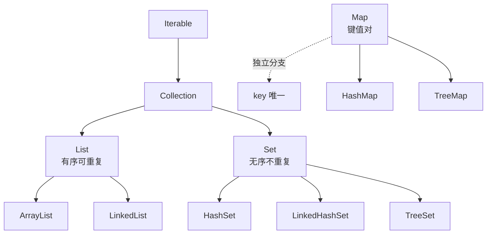

# W3 D1 · 集合入门与 ArrayList

> 2026-11-09（一）｜W3 第 1 天｜档位 A 基础｜配套课程：黑马「集合」— 集合概述 / Collection / List / ArrayList
>
> 今天只有一件事：**从"会数组"升级到"会用集合"**。学完你要能不看笔记写出三种遍历，能说出 ArrayList 扩容规则。

## 0. 今天 3 小时怎么分

| 时段 | 分钟 | 做什么 | 产出 |
| --- | --- | --- | --- |
| 看课 | 85 | 集合概述 → Collection → List → ArrayList 底层，1.25 倍速，**边看边暂停敲** | 跟敲完的代码 |
| 敲代码 | 55 | 自己写 `ListDemo`（不看视频、不看笔记） | 能跑的类 |
| 算法 | 25 | 力扣 1 题：数组/哈希入门（如「两数之和」） | AC 记录 |
| 记录 | 15 | 笔记 3 条 + `git commit` + `PROGRESS.md` 日志 | 提交完成 |

> 铁律：**看课时间不超过动手时间的两倍**。视频里敲一遍不算会，关掉视频自己再写一遍才算过。

## 1. 为什么要有集合（数组不够用在哪）

| 对比 | 数组 `int[]` | 集合 `ArrayList` |
| --- | --- | --- |
| 长度 | **定长**，创建时就定了，改不了 | **可变长**，装不下自动扩容 |
| 存什么 | 基本类型 + 对象都行 | **只能存对象**（`int` 要装箱成 `Integer`） |
| 功能 | 只有 `length` 和下标 | 增删改查、查找、排序、去重一堆现成方法 |
| 适合 | 长度固定、追求极致性能 | 业务开发 99% 的场景 |

一句话记住：**数组是"一排固定座位"，集合是"可以加座撤座的排"**。

## 2. 集合体系一张图



> 看图上三个问题：①`List` 和 `Set` 最本质的区别是什么？（有序/可重复）②`Map` 为什么不在 `Collection` 下面？（它是另一条线，存的是 key-value）③`ArrayList` 和 `LinkedList` 是同一个父类的两个实现？（是，都是 `List` —— 这叫"面向接口编程"）

**为什么业务代码里写 `List<String> list = new ArrayList<>()`，左边不写 `ArrayList`？**
因为调用方只关心"它能按顺序存、能下标取"，不关心底层是数组还是链表。哪天要换成 `LinkedList`，只改右边一处。

## 3. ArrayList 底层：一个会自动变长的数组

```java
// 简化版原理（不是源码，是帮你理解的结构）
public class MyList {
    Object[] elementData;  // 底层就是这个数组，所有元素存在这里
    int size;              // 真实元素个数（不是数组长度！）

    // 无参构造：数组先是一个空数组，不是 10
    // 第一次 add 时才真正分配容量 10 —— 这叫「懒初始化」
    // 目的：你 new 了 100 个 List 但只用 3 个，不浪费内存
}
```

**扩容规则（面试必问，背这三条）**

1. 第一次 `add` 才把容量从 0 变成 **10**（`DEFAULT_CAPACITY = 10`）。
2. 装满了再 `add`，扩容到原来的 **1.5 倍**：`newCapacity = oldCapacity + (oldCapacity >> 1)`（`>> 1` 就是除以 2）。
3. 扩容动作 = **新建一个更大的数组 + 把老元素 `System.arraycopy` 拷过去 + 丢掉老数组**。

所以：**扩容是拷贝，很贵**。知道大概要装多少个，就用 `new ArrayList<>(100)` 直接给够。

> 常用量级记忆：10 → 15 → 22 → 33 → 49 ……（每次向下取整）

## 4. 常用 API + 带注释代码

| 方法 | 作用 | 返回 |
| --- | --- | --- |
| `add(E e)` | 尾部添加 | `boolean`（永远 true） |
| `add(int i, E e)` | 在 i 位置插入，后面元素整体后移 | `void` |
| `get(int i)` | 取第 i 个 | `E` |
| `set(int i, E e)` | 替换第 i 个 | 被替换掉的旧值 |
| `remove(int i)` | **按下标**删 | 被删掉的元素 |
| `remove(Object o)` | **按值**删（第一个匹配的） | `boolean` |
| `indexOf(Object o)` | 找第一次出现的下标 | `int`，找不到 `-1` |
| `contains(Object o)` | 是否包含 | `boolean` |
| `size()` | 元素个数 | `int` |
| `isEmpty()` | 是否为空 | `boolean` |
| `clear()` | 清空 | `void` |

```java
import java.util.ArrayList;
import java.util.List;

public class ListDemo {
    public static void main(String[] args) {
        // 泛型 <String>：声明这个 List 只装 String，装别的东西编译就报错
        // 右边的 <> 是"钻石运算符"，Java 7 起可以省略类型，编译器自己推断
        List<String> list = new ArrayList<>();

        // 1. 添加
        list.add("张三");          // 尾部加
        list.add("李四");
        list.add(1, "王五");       // 插到下标 1，原来的"李四"被挤到 2
        System.out.println(list);  // [张三, 王五, 李四]

        // 2. 查询
        String s = list.get(0);    // 下标从 0 开始
        System.out.println(s);     // 张三
        System.out.println(list.indexOf("李四"));  // 2
        System.out.println(list.contains("王五")); // true
        System.out.println(list.size());           // 3

        // 3. 修改
        String old = list.set(0, "张三丰");  // 返回被替换的旧值
        System.out.println(old + " -> " + list);   // 张三 -> [张三丰, 王五, 李四]

        // 4. 删除 —— 这里有个大坑
        list.remove(0);            // 传 int  → 按下标删，删掉"张三丰"
        // list.remove("王五");    // 传对象 → 按值删
        System.out.println(list);  // [王五, 李四]

        // 5. 清空 / 判空
        System.out.println(list.isEmpty());  // false
        list.clear();
        System.out.println(list.isEmpty());  // true
    }
}
```

> **`remove` 的歧义坑**：`List<Integer>` 里 `list.remove(1)` 删的是**下标 1**，不是"值为 1 的元素"。想按值删要写 `list.remove(Integer.valueOf(1))`。

## 5. 三种遍历（今天必须闭卷写出来）

```java
List<String> list = new ArrayList<>();
list.add("A"); list.add("B"); list.add("C");

// 写法 1：普通 for —— 需要下标时用
for (int i = 0; i < list.size(); i++) {
    System.out.println(list.get(i));
}

// 写法 2：增强 for（foreach）—— 只读遍历首选，最简洁
// 原理：编译器把它翻译成迭代器，所以遍历中不能改集合结构
for (String s : list) {
    System.out.println(s);
}

// 写法 3：迭代器 —— 需要在遍历中删除元素时**唯一安全**的写法
Iterator<String> it = list.iterator();
while (it.hasNext()) {          // 还有下一个吗
    String s = it.next();       // 取下一个，并把指针后移
    if ("B".equals(s)) {
        it.remove();            // 用迭代器删，不是 list.remove()
    }
}
System.out.println(list);       // [A, C]
```

**为什么 `foreach` 里 `list.remove()` 会炸？**
`ArrayList` 内部有个 `modCount` 记"被结构性修改过几次"。迭代器创建时把当时的 `modCount` 存成 `expectedModCount`，每次 `next()` 都检查两者是否相等。你直接 `list.remove()` 只改了 `modCount`，迭代器发现对不上，立刻抛 `ConcurrentModificationException`（并发修改异常）。而 `it.remove()` 会**同步更新** `expectedModCount`，所以不炸。

> 明天（D2）会专门复现这个异常并讲三种改法，今天先记住结论。

## 6. 动手任务（55 分钟，不看视频抄）

**任务：`ListDemo` —— 学生名单管理**

1. 建 `List<String> names`，存 5 个学生名字。
2. 打印全部（用增强 for）。
3. 在下标 2 插入一个新同学，再打印。
4. 把第 0 个改成"张三丰"，打印被替换的旧值。
5. 删除名字里带"李"的同学（用迭代器），打印结果。
6. 打印当前人数，判断是否为空。

**验收标准（做完自查，不达标就重做）**

- [T] 三种遍历都能**不看笔记**写出，且能说出各自适用场景
- [T] 能口述 ArrayList 的扩容三条规则（10 / 1.5 倍 / arraycopy）
- [T] 能解释 `remove(1)` 和 `remove(Integer.valueOf(1))` 的区别
- [T] 代码能跑通，控制台输出和预期一致

## 7. 练习（先自己写，再看答案）

### A. 判断（5 题，每题 1 分）

**A1.** `ArrayList` 无参构造时立即分配容量 10 的数组。

> 答：错，不分配空间

**A2.** `List` 允许存重复元素，且元素有顺序。

> 答：对

**A3.** `list.remove(1)` 在 `List<Integer>` 中删除的是值为 1 的元素。

> 答：错，删下标，integer.valuesof(1)才是删值

**A4.** 扩容时是在原数组后面直接追加空间，不需要拷贝。

> 答：错，是创建一个新的扩容数组再copy过去

**A5.** 增强 for 循环底层使用的是迭代器。

> 答：对

### B. 选择（5 题，每题 1 分）

**B1.** `new ArrayList<>()` 后第一次 `add` 时，底层数组容量变为：
A. 0　B. 10　C. 16　D. 15

> 答：B

**B2.** 容量 10 的 ArrayList 装满后再 add，新容量是：
A. 11　B. 15　C. 20　D. 10

> 答：B

**B3.** 下列哪个操作在 ArrayList 中间插入时最慢（代价最高）：
A. `add(e)`　B. `add(0, e)`　C. `get(0)`　D. `size()`

> 答：B

**B4.** 想在遍历过程中安全删除元素，应该用：
A. `for (String s : list) { list.remove(s); }`
B. `for (int i = 0; i < list.size(); i++) { list.remove(i); }`
C. `Iterator<String> it = list.iterator(); while (it.hasNext()) { if (...) it.remove(); }`
D. `list.clear();`

> 答：C

**B5.** `List<String> list = new ArrayList<>();` 这行代码体现了：
A. 面向接口编程　B. 多继承　C. 反射　D. 泛型擦除

> 答：A

### C. 简答（3 题，每题 2 分）

**C1.** 用自己的话说清 ArrayList 的扩容过程（为什么扩容、扩到多少、怎么扩）。

> 答：当数组长度不够时要进行扩容，扩大到原数组长度的1.5倍，创建新数组复制进去

**C2.** `for (String s : list)` 里调用 `list.remove(s)` 为什么会抛异常？怎么改？

> 答：arraylist里有modcount，迭代器里用expectedmodcount替代，每次next（）时会检查两者是否相等，而list.remove(s)只改变原modcount。将for增强改为迭代器实现，每次remove都会同步更新

**C3.** 为什么业务代码习惯写 `List<String> list = new ArrayList<>()`，而不是 `ArrayList<String> list = new ArrayList<>()`？

> 答：左边写接口 = 只依赖"能按顺序存、能下标取"这个契约，不绑定具体实现。以后想换 `LinkedList` 或 `CopyOnWriteArrayList`，只改右边一处；方法参数也建议声明成 `List`，调用方传什么实现都行。这是"面向接口编程"。

<details>
<summary>参考答案</summary>

**A 判断**：A1 错（懒初始化，第一次 add 才 10）｜A2 对｜A3 错（删下标 1，按值删要 `Integer.valueOf(1)`）｜A4 错（新建数组 + `System.arraycopy` 拷贝）｜A5 对（编译后就是迭代器）

**B 选择**：B1 B｜B2 B（10 + 10/2 = 15）｜B3 B（头插要让后面所有元素后移一位，O(n)）｜B4 C（迭代器 `remove` 会同步 `expectedModCount`）｜B5 A

**C1**：装满了才扩容；扩容到原容量的 1.5 倍（`old + old>>1`）；新建更大数组，把老元素 `System.arraycopy` 拷过去，再指向新数组，老数组被回收。因为数组定长，扩容必然要拷贝，所以能预估大小时直接 `new ArrayList<>(容量)`。

**C2**：增强 for 编译后是迭代器；迭代器每次 `next()` 都检查 `modCount == expectedModCount`。直接调 `list.remove()` 只改了 `modCount`，两者不一致就抛 `ConcurrentModificationException`。改法：①用 `Iterator.remove()`（推荐）②用 `list.removeIf(x -> 条件)` ③先收集要删的元素，遍历完再统一删。

**C3**：左边写接口 = 只依赖"能按顺序存、能下标取"这个契约，不绑定具体实现。以后想换 `LinkedList` 或 `CopyOnWriteArrayList`，只改右边一处；方法参数也建议声明成 `List`，调用方传什么实现都行。这是"面向接口编程"。

</details>

## 8. 高频坑

| 坑 | 说明 |
| --- | --- |
| `remove(int)` vs `remove(Object)` | `List<Integer>` 里 `remove(1)` 删下标；按值删必须 `remove(Integer.valueOf(1))` |
| 以为 `size()` 是数组长度 | 是**元素个数**；底层数组容量通常更大 |
| `Arrays.asList(...)` 当 ArrayList 用 | 返回的是定长视图，`add`/`remove` 抛 `UnsupportedOperationException` |
| `subList` 当新集合用 | 是**视图**，改子列表会影响原列表；要独立副本用 `new ArrayList<>(list.subList(1,3))` |
| 遍历时改结构 | 只有迭代器的 `remove()` 安全 |
| 以为 ArrayList 线程安全 | 它**不是**，多线程写要用 `Collections.synchronizedList` 或 `CopyOnWriteArrayList` |

## 9. 30 秒卡（睡前扫一眼）

- **体系**：`Collection` = `List`（有序可重复）+ `Set`（无序不重复）；`Map` 是独立分支。
- **ArrayList**：底层 `Object[]`，懒初始化 10，满则 **1.5 倍**，靠 `arraycopy` 拷贝。
- **三种遍历**：下标 for / 增强 for / 迭代器；**边遍历边删只能用迭代器**。
- **接口声明**：`List<..> = new ArrayList<>()`。

## 10. 面试一句话

> **ArrayList 的扩容机制是什么？**
> 底层是 `Object[]`，无参构造时是空数组，第一次 `add` 才初始化成 10；装满后按 **1.5 倍**扩容（`oldCapacity + (oldCapacity >> 1)`），通过 `Arrays.copyOf` 新建数组并把老元素拷过去。因为扩容有拷贝开销，能预估容量时建议用 `new ArrayList<>(initialCapacity)` 指定初始大小。
