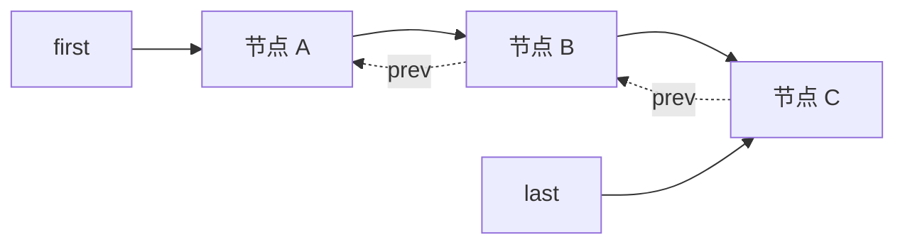
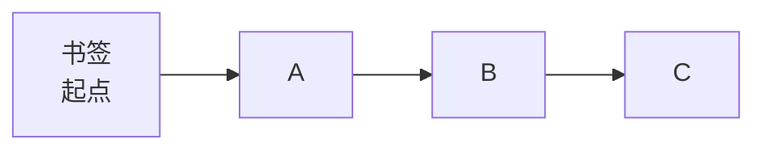

# W3 D2 · LinkedList 与迭代器

> 2026-11-11（三）｜W3 第 2 天｜档位 A 基础｜配套课程：黑马「集合」— LinkedList / Iterator / List 选型
>
> 今天的目标不是"多学一个类"，而是**搞懂"数组"和"链表"两种存数据的方式差在哪**，以及**"迭代器"到底是个啥**。这两个概念后面到处都是。

## 0. 今天会遇到的 6 个名词（先扫一眼，学完回来对一遍）

| 名词 | 一句话人话 | 类比 |
| --- | --- | --- |
| 节点 Node | 链表里的一节"车厢"，存着数据 + 前后车厢的地址 | 火车车厢 |
| 指针 / 引用 | 记着"下一个东西在哪"的便条 | 车厢之间的挂钩 |
| 链表 | 一串靠"指针"连起来的节点，不用连续内存 | 火车 |
| 数组 | 一块连续内存，按下标直接跳到第 n 个 | 电影院连排座位 |
| 迭代器 Iterator | 一个"书签"，帮你一个接一个地翻元素 | 看书用的书签 |
| 并发修改异常 | 你一边翻书一边有人撕页，书就报错 | — |

> 这 6 个词今天都会在你眼前出现。学完把还觉得模糊的 3 个，按 [术语表](../00-JavaSE总体路线与术语表.md) §6 的格式记进去。

## 1. 今天 3 小时怎么分

| 时段 | 分钟 | 做什么 | 产出 |
| --- | --- | --- | --- |
| 看课 | 80 | LinkedList、Iterator、List 选型，1.25 倍速，**边看边敲** | 跟敲代码 |
| 敲代码 | 60 | 手写一个迷你双向链表 + 复现并修好并发修改异常 | 两个能跑的类 |
| 算法 | 25 | 力扣 1 题（链表入门：反转链表 / 合并两个有序链表） | AC 记录 |
| 记录 | 15 | 笔记 3 条 + **术语 3 个** + commit + `PROGRESS.md` 日志 | 提交完成 |

## 2. 先搞懂"两种存数据的方式"

**数组（ArrayList 用的）**：一块**连续**的内存，像电影院连排座位。想找第 5 个，直接"第 1 个地址 + 4"跳过去，**一次就到位**。

```
下标:   0     1     2     3     4
      ┌────┬────┬────┬────┬────┐
      │ A  │ B  │ C  │ D  │ E  │   ← 内存里挨着放
      └────┴────┴────┴────┴────┘
```

**链表（LinkedList 用的）**：每个元素单独放，各自记住"我前面是谁、后面是谁"，**内存里可以不挨着**。

```
   ┌──────┐    ┌──────┐    ┌──────┐
   │ prev │    │ prev │    │ prev │
   │  A   │◄──►│  B   │◄──►│  C   │
   │ next │    │ next │    │ next │
   └──────┘    └──────┘    └──────┘
```

**一句话记住差别**：

- 数组：**找得快**（下标直达），**中间插队慢**（后面所有人要挪位置）。
- 链表：**插队快**（改两根绳子就行），**找得慢**（只能从头一节一节走）。

## 3. LinkedList 的底层：一个 Node 类

```java
// LinkedList 内部大概长这样（简化版，用来理解结构）
private static class Node<E> {
    E item;        // 这一节装的数据
    Node<E> next;  // 指向下一节的"引用"（就是下节的内存地址）
    Node<E> prev;  // 指向上一节的"引用"

    Node(Node<E> prev, E element, Node<E> next) {
        this.item = element;
        this.prev = prev;
        this.next = next;
    }
}

// LinkedList 自己只记两个"门把手"
transient Node<E> first;  // 头节点
transient Node<E> last;   // 尾节点
```



> 图里实线是 `next`（往后走），虚线是 `prev`（往前走）。**因为是双向的，所以从头或从尾都能走** —— 这就是为什么 `LinkedList` 既能当队列又能当栈。

**头尾插入为什么是 O(1)？** 因为 `first`/`last` 直接指着两端，加一节只要改两根引用：

```java
// 尾插：把新节点挂到 last 后面
// 1) 记住原来的 last
// 2) new 一个节点，prev 指向老 last
// 3) 老 last 的 next 指向新节点（如果老 last 是 null，说明链表本来是空的，新节点就是 first）
// 4) 把 last 移到新节点上
// 全程没有"挪动其他元素"，所以是 O(1)
```

## 4. 那为什么 `get(i)` 很慢？

链表的第 5 个元素在哪？**它自己不知道**，只能从头（或从尾）一节一节数过去。

```java
// LinkedList 的查找逻辑（简化）
Node<E> node(int index) {
    if (index < size / 2) {          // 在前面一半 → 从头找
        Node<E> x = first;
        for (int i = 0; i < index; i++) x = x.next;
        return x;
    } else {                          // 在后面一半 → 从尾找（优化：折半）
        Node<E> x = last;
        for (int i = size - 1; i > index; i--) x = x.prev;
        return x;
    }
}
```

所以 `for (int i = 0; i < list.size(); i++) list.get(i);` 对 LinkedList 来说是 **O(n²)** —— 每取一个都要重新走一遍。**这是个经典坑**，遍历 LinkedList 一定要用迭代器或增强 for。

## 5. ArrayList vs LinkedList 一张表

| 操作 | ArrayList | LinkedList | 谁快 |
| --- | --- | --- | --- |
| `get(i)` 随机访问 | O(1)，下标直达 | O(n)，要数过去 | **ArrayList** |
| 尾部 `add` | 均摊 O(1)（偶尔扩容拷贝） | O(1) | 差不多 |
| 头部 `add(0, e)` / `remove(0)` | O(n)，整体后移 | O(1)，改引用 | **LinkedList** |
| 中间插入/删除 | O(n)，要挪动 | 找位置 O(n) + 改引用 O(1) | 找到位置后 LinkedList 快 |
| 内存占用 | 紧凑（只有数据） | 每节多存两个引用（`prev`/`next`） | **ArrayList** 省 |
| 缓存友好 | 连续内存，CPU 缓存命中高 | 内存分散，容易"跳着读" | **ArrayList** |

**结论**：业务里 **99% 用 ArrayList**。`LinkedList` 只在"确实要频繁头尾增删、且几乎不按下标取"时才考虑；而且当队列/栈用时，**`ArrayDeque` 比 `LinkedList` 更好**（这也是面试常问的加分点）。

## 6. 迭代器：一个"书签"

**为什么需要它？** 因为"遍历集合"这件事，不同集合的实现方式完全不同（数组按下标、链表顺着指针走）。如果每个集合都要你记住"怎么遍历"，太麻烦。

迭代器就是**统一的一层皮**：不管底层是数组还是链表，都只给你三个动作——

```java
Iterator<String> it = list.iterator();  // 拿一个"书签"，最初停在第一个元素之前
boolean has = it.hasNext();             // 后面还有内容吗？
String s = it.next();                   // 翻到下一个，并把它给你
it.remove();                            // 删掉刚才 next() 拿到的那一个
```



> `next()` 的作用是"**往前挪一格 + 把这一格的东西给你**"。所以**不能连续调两次 `remove()`**，因为第二次前面没有 `next()`，会抛 `IllegalStateException`。

## 7. 并发修改异常（今天最值钱的一个坑）

```java
List<String> list = new ArrayList<>();
list.add("A"); list.add("B"); list.add("C");

// 这段代码会在打印完 A 之后抛 ConcurrentModificationException
for (String s : list) {
    if ("B".equals(s)) {
        list.remove(s);   // ← 问题在这
    }
}
```

**为什么炸？** ArrayList 里有个计数器 `modCount`，记录"结构被改过几次"（`add`/`remove` 都会 +1）。迭代器创建时会记下当时的 `expectedModCount`，此后每次 `next()` 都检查：

```
modCount == expectedModCount ? 继续 : 抛 ConcurrentModificationException
```

你直接 `list.remove()` 只让 `modCount` 变了，迭代器手里的 `expectedModCount` 还是老值 → 对不上 → **立刻报错，防止你读到错乱的数据**。这种行为叫 **fail-fast（快速失败）**。

**三种正确改法**：

```java
// ① 用迭代器自己的 remove（推荐，最标准）
Iterator<String> it = list.iterator();
while (it.hasNext()) {
    if ("B".equals(it.next())) {
        it.remove();          // 会同步更新 expectedModCount
    }
}

// ② removeIf（Java 8+，一行搞定）
list.removeIf(s -> "B".equals(s));

// ③ 先收集要删的，遍历完再统一删
List<String> toRemove = new ArrayList<>();
for (String s : list) if ("B".equals(s)) toRemove.add(s);
list.removeAll(toRemove);
```

> 补充一句：`CopyOnWriteArrayList` 是另一种思路——**改的时候复制一份**，所以遍历不会炸（fail-safe），代价是写很慢、内存翻倍。适合"读多写极少"的场景（如监听器列表）。

## 8. 动手任务（60 分钟，不许抄视频）

**任务 A：手写迷你双向链表（30 分钟）**

实现一个 `MyLinkedList`，至少要有：

- `addLast(E e)`：尾部加
- `removeLast()`：删尾部并返回
- `size()`
- `toString()`：按 `[A, B, C]` 格式打印

**验收**：加 3 个元素、删 1 个，打印结果对。

**任务 B：复现并修好并发修改异常（30 分钟）**

1. 用增强 for 遍历 `ArrayList`，删掉某个元素，**眼睁睁看着它抛异常**，把异常栈抄到笔记里。
2. 用迭代器 `remove()` 改好，跑通。
3. 再改成 `removeIf`，跑通。
4. 回答：为什么 `for (int i...) list.remove(i)` 也不安全？（提示：删完元素后，后面的元素会前移，你的 `i` 会跳过元素）

## 9. 练习（先写，再看答案）

### A. 判断（5 题）

**A1.** `LinkedList` 底层是数组。

> 答：错，是链表，随机地址存储

**A2.** `LinkedList.get(100)` 的时间复杂度是 O(1)。

> 答：错，是O(n)，要按照后继一直找

**A3.** 在 `LinkedList` 头部插入元素比在 `ArrayList` 头部插入快。

> 答：对，链表插入只需修改前驱和后继，数组要整体后移

**A4.** 增强 for 循环遍历集合时，可以安全地调用 `list.remove()` 删除元素。

> 答：错，modcount和expectedmodcount不对齐，会报错

**A5.** `LinkedList` 每个节点除了数据，还要存前后两个引用，所以比 `ArrayList` 更占内存。

> 答：对，而且节点是随机存储的，空间利用更大

### B. 选择（5 题）

**B1.** `LinkedList` 的底层结构是：
A. 数组　B. 单向链表　C. 双向链表　D. 红黑树

> 答：C

**B2.** 下列哪个操作 LinkedList 比 ArrayList 快：
A. `get(500)`　B. `add(0, e)`　C. 遍历全部元素　D. `size()`

> 答：B

**B3.** `Iterator` 的 `remove()` 方法，调用前必须：
A. 先调用 `hasNext()`　B. 先调用 `next()`　C. 先调用 `size()`　D. 不需要任何前置

> 答：B

**B4.** `ConcurrentModificationException` 产生的根本原因是：
A. 多线程访问　B. 遍历过程中集合结构被修改，`modCount` 与 `expectedModCount` 不一致　C. 集合为空　D. 泛型类型不匹配

> 答：B

**B5.** 想实现一个"先进先出"的队列，最推荐用：
A. `ArrayList`　B. `LinkedList`　C. `ArrayDeque`　D. `HashSet`

> 答：C

### C. 简答（3 题）

**C1.** 用一句话说清 ArrayList 和 LinkedList 的区别，再说说业务里为什么基本都用 ArrayList。

> 答：一个是数组，连续且由数组下标和数据组成。另一个是双向链表，不连续且由前驱、后继和数据组成。
> 实际业务里arraylist占用空间更小，查找时间级别为O(1)

**C2.** 为什么 `for (String s : list) { list.remove(s); }` 会抛异常？`it.remove()` 为什么不会？

> 答：因为list.remove只改变了modcount，不改变expectedmodmount，删除元素链表会丢失，抛fail-fast异常。而it.renmove是用迭代器自己的删除，会同步更新expectedmodmount

**C3.** 用迭代器遍历 LinkedList 和用 `get(i)` 遍历，性能差在哪？为什么？

> 答：get(i)每次遍历要从头扫到尾巴，时间级别为O(n^2)，而用迭代器则全扫描再一次定位，时间级别为O(n)

<details>
<summary>参考答案</summary>

**A 判断**：A1 错（双向链表）｜A2 错（O(n)，要数过去）｜A3 对（改引用即可，不用整体挪动）｜A4 错（抛 `ConcurrentModificationException`）｜A5 对（每节多两个引用，内存开销更大）

**B 选择**：B1 C｜B2 B（头插 O(1)，ArrayList 头插 O(n)）｜B3 B（`remove()` 删的是"刚 `next()` 返回的那个"，没 `next()` 过就抛 `IllegalStateException`）｜B4 B｜B5 C（`ArrayDeque` 比 `LinkedList` 更适合做队列/栈，内存更省、没有节点对象开销）

**C1**：ArrayList 底层是连续数组，随机访问 O(1)、中间增删 O(n)；LinkedList 底层是双向链表，头尾增删 O(1)、随机访问 O(n)。业务里绝大多数是"查多、按顺序遍历多"，ArrayList 更快也更省内存，且 CPU 缓存友好，所以默认选它。

**C2**：增强 for 编译后是迭代器；`list.remove()` 只改 `modCount`，迭代器的 `expectedModCount` 没变，`next()` 检查时发现不一致，fail-fast 抛异常。`it.remove()` 内部在删除后会**同步更新** `expectedModCount`，所以两者始终一致。

**C3**：用 `get(i)` 遍历是 O(n²)——每次 `get` 都要从头或从尾数过去；用迭代器是 O(n)——一次遍历，每个节点只访问一次，靠 `next` 引用直接跳。数据量一大（比如 1 万条），前者可能要几秒，后者毫秒级。

</details>

## 10. 高频坑

| 坑 | 说明 |
| --- | --- |
| 用 `get(i)` 遍历 LinkedList | O(n²)，1 万条就明显卡；改用迭代器或增强 for |
| foreach 里 `remove` | 必抛 `ConcurrentModificationException`，用 `it.remove()` 或 `removeIf` |
| `for (int i...) list.remove(i)` | 删完元素前移，`i` 会跳过元素，删不干净 |
| 连续两次 `it.remove()` | 抛 `IllegalStateException`，中间必须夹一次 `next()` |
| 拿 `LinkedList` 当队列用 | 能用，但 `ArrayDeque` 更合适（更快、更省） |
| 以为"链表插入一定比数组快" | **找到位置**这一步也是 O(n)；只有头尾插入才是真正的 O(1) |

## 11. 30 秒卡

- **数组 vs 链表**：数组找得快、插得慢；链表插得快、找得慢。
- **LinkedList**：双向链表，`first`/`last` 两个指针，头尾操作 O(1)，`get(i)` 是 O(n)。
- **迭代器**：统一的遍历方式，`hasNext`/`next`/`remove`。
- **fail-fast**：遍历中改结构 → `modCount != expectedModCount` → 抛 `ConcurrentModificationException`。
- **选型**：默认 `ArrayList`；当队列用 `ArrayDeque`。

## 12. 今天要记的 3 个术语（写进术语表）

从下面挑你真的卡住的 3 个，用自己的话写：

- 节点（Node）
- 引用 / 指针
- 迭代器（Iterator）
- fail-fast
- 时间复杂度 O(n)
- 双向链表

## 13. 面试一句话

> **ArrayList 和 LinkedList 怎么选？**
> ArrayList 底层是动态数组，随机访问 O(1)、内存连续、缓存友好，但中间增删要挪动元素是 O(n)；LinkedList 底层是双向链表，头尾增删 O(1)，但随机访问要遍历是 O(n)，且每个节点额外存两个引用、内存开销更大。业务中查询和顺序遍历占绝大多数，所以默认用 ArrayList；需要队列/栈语义时用 ArrayDeque 而不是 LinkedList。

---

## 附：批改与点评（11/12 阅）

### 得分

| 题型 | 得分 | 说明 |
| --- | --- | --- |
| A 判断（5 题） | **5 / 5** | 全对，结论与理由都站得住 |
| B 选择（5 题） | **5 / 5** | 全对 |
| C 简答（3 题） | **4.5 / 6** | 主干都对，扣在表述精度上 |
| **合计** | **14.5 / 15（96.7%）** | 问题不在"会不会"，在"说得准不准" |

### 逐题批注

**A2（建议改写）**：答"按后继一直找"方向对，但不完整。`LinkedList.get(i)` 实际是**折半找**：`i` 在前一半就从 `first` 顺 `next` 走，在后一半就从 `last` 顺 `prev` 走。准确说法：**O(n)，从头或从尾折半遍历到达第 i 个节点**。

**A3（补一句）**：结论对，但"修改前驱和后继"对**头节点**不成立——头节点没有前驱。准确说：头插只需 `newNode.next = first`、`first.prev = newNode`、`first = newNode`，改的是 `first` 指针和原头节点的 `prev`，**不涉及任何元素整体移动**。

**A5（表述要改）**：结论对，但"空间利用更大"说反了——应该是**额外内存开销更大、空间利用率更低**。每节要存 `prev`/`next` 两个引用（64 位下各 8 字节），且节点分散在堆里，碎片更多。

**C1（扣 0.5）**：结构差异写得准确。但"业务里为什么用 ArrayList"只说了"占用小、查询 O(1)"，漏了最关键的两条：
① 业务场景是**查多改少**，真正需要频繁头插的场合极少；
② **数组内存连续、CPU 缓存命中率高**——同样遍历 10 万条，ArrayList 往往比 LinkedList 快好几倍，这才是"理论上链表快、实测里数组快"的根本原因。

**C2（扣 0.5）**：机制说对了，两处要修：
- "**删除元素链表会丢失**"不成立——元素没丢，是**迭代器游标与集合真实结构错位**，继续 `next()` 可能读到错乱数据。fail-fast 的本质是"宁可立刻报错，也不让你读到不一致的数据"。
- "抛 fail-fast 异常"——**fail-fast 是机制名，不是异常名**，抛的是 `ConcurrentModificationException`。面试说混会扣分。
- 末尾拼写：`expectedmodmount` → `expectedModCount`（两处）。

**C3（扣 0.5）**：结论 O(n²) 对，两处表述要改：
- "get(i) 每次从头扫到**尾巴**"——错，是扫到**第 i 个**就停，`get(i)` 是 O(i)，累加才是 O(n²)。
- "迭代器全扫描再一次定位"——不是"扫描"，是**顺着 `next` 引用一节一节走，每个节点只访问一次**，所以 O(n)。

### 今天要补的 3 个术语（顺手填进术语表）

| 词 | 你的版本要修成什么 |
| --- | --- |
| 折半查找（LinkedList 内部） | `get(i)` 不是死磕从头走：`i < size/2` 从头、否则从尾 |
| fail-fast | **一种"快速失败"机制**，不是异常本身；触发后抛 `ConcurrentModificationException` |
| 空间利用率 | 链表节点多存两个引用 + 分散分配 → **额外开销大、利用率低** |

### 一句话总评

**14.5/15 说明你已经"会用"了**，丢的分全在"说得不准"上——而面试恰恰只考你怎么说。以后答完一题多问一句：**这句话讲给没学过 Java 的人，他能听懂且不会误解吗？** 明天 D3 泛型会大量用到"引用""类型"，正好接着练表述。
