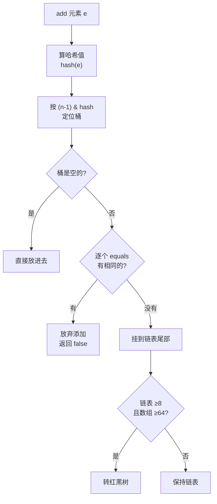

# W3 D4 · Set 三兄弟：HashSet / LinkedHashSet / TreeSet

> 2026-11-13（五）｜W3 第 4 天｜档位 A 基础｜配套课程：黑马「Set 集合」— 哈希值、哈希表、去重原理、比较器
>
> 今天要解决两个问题：**① 为什么自定义对象放进 `HashSet` 经常"去重失败"？② 想让 Set 有顺序，该用哪个？**
> 这两个问题背后是同一件事：**Set 靠什么判断"两个元素是不是同一个"**。

## 0. 今天会遇到的 7 个名词

| 名词 | 一句话人话 | 类比 |
| --- | --- | --- |
| `Set` | 不允许重复、没有索引的集合 | 抽奖箱，同一个号只能投一次 |
| 哈希值（`hashCode`） | 对象算出来的一个整数"身份证号" | 宿舍楼号 |
| 哈希表 | 用哈希值算位置来快速存取的数组 | 按楼号找房间，不用一间间敲门 |
| 哈希冲突 | 两个对象算出的位置撞了 | 两个人都分到 302 |
| 桶（bucket） | 哈希表数组的每一个格子 | 一个房间 |
| 去重 | "哈希值相同 **且** `equals` 为 true"才算重复 | 同楼号 + 同名才算同一个人 |
| 比较器（`Comparator`） | 告诉 `TreeSet` 按什么规则排序 | 裁判的打分标准 |

## 1. 今天 3 小时怎么分

| 时段 | 分钟 | 做什么 | 产出 |
| --- | --- | --- | --- |
| 看课 | 80 | Set 家族、哈希值、哈希表原理、去重、比较器，1.25 倍速边看边敲 | 跟敲代码 |
| 敲代码 | 60 | `Student` 去重实验（先不重写 `hashCode` 看效果）+ `TreeSet` 排序 + `LinkedHashSet` 保序 | `SetDemo` 一个类 |
| 算法 | 25 | 力扣 1 题（哈希类，如「存在重复元素」或「两个数组的交集」） | AC 记录 |
| 记录 | 15 | 笔记 3 条 + **术语 3 个**（写进 [术语表](../00-JavaSE总体路线与术语表.md)）+ commit + 日志 | 提交完成 |

## 2. 为什么需要 Set（先看需求）

需求：**统计一篇文章里出现了哪些不同的单词**（去掉重复）。

用 `List` 能做，但要自己写循环判断"这个单词是不是已经加过了"：

```java
List<String> words = new ArrayList<>();
// ... 往里加的时候每次都要手动判断，很啰嗦
if (!words.contains(w)) {
    words.add(w);
}
```

`Set` 天生就干这个：**加重复的，它自己不要。**

```java
Set<String> set = new HashSet<>();
set.add("java");
set.add("mysql");
set.add("java");      // 加不进去，返回 false
System.out.println(set);      // [java, mysql]  （顺序不保证）
System.out.println(set.size()); // 2
```

> 注意 `Set` 的两个特点：**① 不重复 ② 没有索引**（不能 `set.get(0)`）。想要索引就得用 `List`。

## 3. HashSet 底层其实就是 HashMap

这是今天最重要的一句话：

> **`HashSet` 的底层就是一个 `HashMap`，你 add 的每个元素，都是那个 `HashMap` 的 key，而 value 是一个固定的空对象。**

```java
// JDK 源码简化版
public class HashSet<E> {
    private transient HashMap<E, Object> map;      // 底层是 HashMap
    private static final Object PRESENT = new Object();   // 固定的占位 value

    public boolean add(E e) {
        return map.put(e, PRESENT) == null;   // put 返回 null 说明是新 key（没重复）
    }
}
```

所以：**`HashSet` 会的东西 = `HashMap` 的 key 会的东西**。搞懂 `hashCode` + `equals` 怎么决定 key 唯一，就同时搞懂了后面 D5 的 `HashMap`。

## 4. 一个元素是怎么放进 HashSet 的



四步读懂：

1. **算哈希值**：`hashCode()` 拿到 32 位 int，再和它右移 16 位异或（`h ^ (h >>> 16)`），让高位也参与运算，减少冲突。
2. **定位桶**：`(数组长度 - 1) & hash`，等价于"对长度取模"，但位运算快得多。
3. **桶空**：直接放，插入完成。
4. **桶不空**：和桶里每个元素挨个 `equals`——有相等的就放弃（这就是**去重**），全都不等就挂在链表尾部。

> 关键点：**先比哈希值，再比 `equals`**。因为比 int 快，能先筛掉绝大多数不同的对象。

## 5. 去重的真正条件：`hashCode` 相同 **且** `equals` 为 true

| 情况 | 结果 |
| --- | --- |
| `hashCode` 不同 | 直接算不同对象，`equals` 都不用调 → **不同** |
| `hashCode` 相同，`equals` 为 true | **判为重复，加不进去** |
| `hashCode` 相同，`equals` 为 false | 判为不同，挂在同一个桶的链表上（哈希冲突，正常现象） |

**只重写 `equals` 不重写 `hashCode` 会怎样？**

```java
public class Student {
    private String name;
    private int age;
    // 只重写了 equals，没重写 hashCode
    @Override
    public boolean equals(Object o) { /* 姓名年龄都相等就返回 true */ }
}
```

```java
Set<Student> set = new HashSet<>();
set.add(new Student("张三", 18));
set.add(new Student("张三", 18));   // 想让它去重，结果？
System.out.println(set.size());     // 2 ！去重失败
```

**为什么？** 两次 `new` 出来的对象，`Object` 默认的 `hashCode()` 是**根据内存地址算的**，两次地址不同 → 哈希值不同 → 落到**不同的桶** → 根本轮不到比 `equals`。

所以规矩是死板的：**自定义对象要放进 `HashSet`（或当 `HashMap` 的 key），`hashCode` 和 `equals` 必须一起重写。**

```java
public class Student implements Comparable<Student> {
    private String name;
    private int age;

    @Override
    public boolean equals(Object o) {
        if (this == o) return true;                              // 地址相同，直接算同一个
        if (o == null || getClass() != o.getClass()) return false; // 类型不同，不算
        Student s = (Student) o;
        return age == s.age && Objects.equals(name, s.name);
    }

    @Override
    public int hashCode() {
        return Objects.hash(name, age);   // 用所有参与比较的字段算，保证"equals 相等则 hashCode 必相等"
    }
}
```

> IDEA 快捷键 `Alt + Insert` → `equals() and hashCode()` 自动生成，别手写。但**必须知道它为什么长这样**。

## 6. 为什么重写了 `equals` 就必须重写 `hashCode`

这是 Java 的**硬性约定**：

> 如果 `a.equals(b)` 为 true，那么 `a.hashCode()` **必须**等于 `b.hashCode()`。

违反了会怎样？就是上面那个例子——对象散在不同桶，`HashSet` 认为它们是两个不同的东西。反过来（`hashCode` 相同但 `equals` 不同）是允许的，那只是哈希冲突，链表会处理。

**记忆口诀**：`equals` 决定"算不算同一个"，`hashCode` 决定"先去哪个桶找"。

## 7. LinkedHashSet：记得你加的顺序

`HashSet` 遍历顺序看着乱（其实是桶的顺序），业务里经常需要"**去重但保留我加进来的顺序**"。

```java
Set<String> hashSet = new HashSet<>();
hashSet.add("b"); hashSet.add("a"); hashSet.add("c");
System.out.println(hashSet);        // 可能是 [a, b, c]，也可能是 [b, a, c] —— 不保证

Set<String> linkedSet = new LinkedHashSet<>();
linkedSet.add("b"); linkedSet.add("a"); linkedSet.add("c");
System.out.println(linkedSet);      // 一定是 [b, a, c]
```

**底层**：在 `HashSet` 的基础上，每个节点额外加了 `before` / `after` 两个引用，串成一条**双向链表**，记录插入顺序。

| 对比 | HashSet | LinkedHashSet |
| --- | --- | --- |
| 顺序 | 不保证 | 保证插入顺序 |
| 底层 | `HashMap` | `LinkedHashMap`（多双向链表） |
| 性能 | 稍快 | 稍慢（要维护链表） |
| 用它的场景 | 只要去重 | 去重 + 想按加入顺序输出 |

## 8. TreeSet：自动排序的 Set

```java
Set<Integer> set = new TreeSet<>();
set.add(30); set.add(10); set.add(20);
System.out.println(set);     // [10, 20, 30] —— 自动升序

Set<String> names = new TreeSet<>();
names.add("banana"); names.add("apple");
System.out.println(names);   // [apple, banana] —— 按字典序
```

**底层**：红黑树（一种自平衡二叉搜索树）。**好处**：自动排序 + 查范围快；**代价**：比 `HashSet` 慢（每次插入要比较、可能要旋转树）。

**放自定义对象必须能比较**，两条路：

```java
// 路线 1：类自己实现 Comparable，重写 compareTo（"我天生就能比"）
public class Student implements Comparable<Student> {
    private String name;
    private int age;

    @Override
    public int compareTo(Student o) {
        // 返回 负数=我小, 0=一样大, 正数=我大
        return this.age - o.age;      // 按年龄升序
    }
}

// 路线 2：new 的时候传 Comparator（"临时请个裁判"），不改原类
Set<Student> set = new TreeSet<>(new Comparator<Student>() {
    @Override
    public int compare(Student a, Student b) {
        return a.getAge() - b.getAge();       // 按年龄升序
    }
});
// Lambda 写法（D6 会细讲，今天先见过）
Set<Student> set2 = new TreeSet<>((a, b) -> a.getAge() - b.getAge());
```

**TreeSet 也去重，但判断标准不一样**：它用 `compareTo` / `compare` 的结果，**返回 0 就认为重复**。

```java
// 陷阱：只按年龄比较，那么同年龄的两个学生会被当成"重复"而丢弃！
Set<Student> set = new TreeSet<>((a, b) -> a.getAge() - b.getAge());
set.add(new Student("张三", 18));
set.add(new Student("李四", 18));   // 年龄相同 → compare 返回 0 → 加不进去！
System.out.println(set.size());     // 1
```

> 这是 `TreeSet` 最容易被坑的地方：**排序规则决定了去重规则**。要保留同年龄的不同人，比较器必须继续比姓名：
> `(a, b) -> a.getAge() != b.getAge() ? a.getAge() - b.getAge() : a.getName().compareTo(b.getName())`

## 9. 三者对比与选型

| 维度 | HashSet | LinkedHashSet | TreeSet |
| --- | --- | --- | --- |
| 顺序 | 无序 | 插入顺序 | 排序（升序/自定义） |
| 底层 | 哈希表 | 哈希表 + 双向链表 | 红黑树 |
| 去重依据 | `hashCode` + `equals` | `hashCode` + `equals` | `compare` 返回 0 |
| 增删查性能 | 最快 O(1) 平均 | 略慢于 HashSet | O(log n) |
| 能放 null | 能（1 个） | 能（1 个） | **不能**（会 NPE） |
| 什么时候用 | 只要去重 | 去重 + 按加入顺序 | 去重 + 要排序 |

**选型口诀**：**默认 `HashSet`；要顺序用 `LinkedHashSet`；要排序用 `TreeSet`。**

## 10. 动手任务（60 分钟）

**任务 A：复现"去重失败"（15 分钟）**
写 `Student`（name, age），**先只重写 `equals`，不重写 `hashCode`**，往 `HashSet` 里加两个"张三,18"，打印 `size()` → 看到 **2**。然后补上 `hashCode`，重新跑 → 看到 **1**。
> 这个实验必须亲手做一遍，比看十遍视频都记得住。

**任务 B：LinkedHashSet 保序（10 分钟）**
把任务 A 的 5 个学生放进 `LinkedHashSet`，打印，确认输出顺序 = 添加顺序。

**任务 C：TreeSet 排序（20 分钟）**
让学生实现 `Comparable`，按年龄升序放进 `TreeSet`；再用 `Comparator` 改成按姓名长度降序。
**然后特意试一次**：只按年龄比较，加两个同年龄不同名的学生，看 `size()` 是不是 1。

**任务 D：去重统计（15 分钟）**
一段字符串 `"java mysql java redis mysql spring"`，用 `Set` 统计有多少个**不同的**单词；再用 `LinkedHashSet` 按出现顺序打印。

**验收标准**

- [ ] 能说出 `HashSet` 底层是什么，`add` 的返回值代表什么
- [ ] 能解释"只重写 `equals` 不重写 `hashCode` 为什么去重失败"
- [ ] 能说出 `TreeSet` 去重看的是 `equals` 还是 `compare` 返回值
- [ ] 三种 Set 的选型能一句话说出

## 11. 练习（先写，再看答案）

### A. 判断（5 题）

**A1.** `HashSet` 底层是一个数组 + 链表 + 红黑树。

> 答：

**A2.** 自定义类只重写 `equals` 不重写 `hashCode`，也能在 `HashSet` 里正常去重。

> 答：

**A3.** `TreeSet` 里的元素一定是有序的，且不能放 `null`。

> 答：

**A4.** `LinkedHashSet` 保证元素按添加顺序遍历，是因为它底层多了双向链表。

> 答：

**A5.** 两个对象的 `hashCode` 相同，它们一定 `equals` 相等。

> 答：

### B. 选择（5 题）

**B1.** `HashSet.add()` 返回 `false` 说明：
A. 添加失败抛出异常　B. 集合已满　C. 元素已存在，被去重　D. 元素为 null

> 答：

**B2.** 想让 `Set` 按添加顺序输出，应该用：
A. `HashSet`　B. `LinkedHashSet`　C. `TreeSet`　D. `ArrayList`

> 答：

**B3.** `TreeSet` 判断两个元素是否重复，依据是：
A. `hashCode` 相同　B. `equals` 为 true　C. `compare` 返回 0　D. 内存地址相同

> 答：

**B4.** 下列哪个不能放进 `TreeSet` 并正常排序：
A. `Integer`　B. `String`　C. 实现了 `Comparable` 的 `Student`　D. 没实现 `Comparable` 也没给 `Comparator` 的 `Student`

> 答：

**B5.** `HashSet` 中"先算哈希值再比 `equals`"的原因是：
A. 哈希值比较是 int 比较，更快，能先筛掉绝大多数不同对象　B. `equals` 方法有 bug　C. 哈希值相同才能比较对象　D. 为了记录元素个数

> 答：

### C. 简答（3 题）

**C1.** 用自己的话说清 `HashSet` 是怎么去重的（从 `add` 到"加不进去"的完整过程）。

> 答：

**C2.** 为什么重写 `equals` 必须同时重写 `hashCode`？举个会出问题的例子。

> 答：

**C3.** `HashSet`、`LinkedHashSet`、`TreeSet` 分别什么场景用？各说一句话。

> 答：

<details>
<summary>参考答案</summary>

**A 判断**：A1 对（JDK8 起：数组 + 链表 + 红黑树）｜A2 错（去重失败，散在不同桶）｜A3 对｜A4 对｜A5 错（哈希冲突时 `hashCode` 相同但 `equals` 可能为 false）

**B 选择**：B1 C｜B2 B｜B3 C｜B4 D（运行时 `ClassCastException`）｜B5 A

**C1**：`add(e)` 先调 `e.hashCode()` 得到哈希值（并做高低位异或扰动），再用 `(n-1) & hash` 计算出在数组中的桶下标。桶为空就直接放入；桶不为空则和桶里链表（或红黑树）上的每个元素依次 `equals`：有一个相等就返回 `false`（去重成功）；全都不等就挂到链表尾部（链表长度 ≥8 且数组长度 ≥64 时转红黑树）。所以去重的两个条件是**哈希值相同且 `equals` 为 true**。

**C2**：Java 约定"`equals` 相等则 `hashCode` 必须相等"。`HashSet` 是**先去桶里找**、再比 `equals` 的，而桶的位置是由 `hashCode` 算出来的。如果只重写 `equals`，两个"逻辑上相等"的对象用的是 `Object` 默认的 `hashCode`（按内存地址），哈希值不同 → 落到不同桶 → 永远不会被拿来比较 `equals` → 去重失败、`HashMap` 里同一个 key 会存成两份、`get` 也取不到。

**C3**：`HashSet` 只要去重、不在乎顺序（最快）；`LinkedHashSet` 要按添加顺序输出（去重 + 保序）；`TreeSet` 要自动排序或做范围查询（去重 + 排序，但元素必须能比较，且不能放 null）。

</details>

## 12. 高频坑

| 坑 | 说明 |
| --- | --- |
| 自定义对象只重写 `equals` | 必须两个一起重写，用 IDEA 自动生成 |
| `hashCode` 里用了不参与 `equals` 的字段 | 会让"相等"的对象算出不同哈希，去重失败 |
| 用可变字段参与 `hashCode` | 对象放进 Set 后改了字段，就再也找不到了（哈希变了） |
| `TreeSet` 只按一个字段比较 | 该字段相同的元素会被当重复丢弃 |
| `TreeSet` 放 `null` | 抛 `NullPointerException` |
| 以为 `Set` 能按索引取 | 没有 `get(i)`，要用 `List` 或 `stream().findFirst()` |
| `HashSet` 遍历顺序当"随机"理解 | 其实是桶的顺序，加元素多了确实会变 |

## 13. 30 秒卡

- **`HashSet` 底层**：`HashMap`，元素当 key，value 是 `PRESENT` 占位对象。
- **去重条件**：`hashCode` 相同 **且** `equals` 为 true。
- **`add` 返回 `false`**：元素已存在，被去重。
- **重写 `equals` 必须重写 `hashCode`**：否则散在不同桶，去重失效。
- **`LinkedHashSet`**：多一条双向链表，保插入顺序。
- **`TreeSet`**：红黑树，排序 + 去重（看 `compare` 返回 0），元素必须能比较，不能放 null。

## 14. 今天要记的 3 个术语（写进术语表）

- 哈希值（`hashCode`）
- 哈希冲突
- 去重（`equals` + `hashCode` 约定）
- 比较器（`Comparator`）
- 红黑树
- 插入顺序 / 排序

## 15. 面试一句话

> **`HashSet` 是怎么保证元素不重复的？**
> `HashSet` 底层是 `HashMap`，元素存在 key 上。`add` 时先算 `hashCode`（经高低位异或扰动），再用 `(n-1) & hash` 定位桶；桶空直接放，桶不空则和桶内元素逐个 `equals`，相等就放弃添加、返回 `false`，都不等就挂到链表尾部，链表长度到 8 且数组到 64 时转红黑树。所以去重的条件是 `hashCode` 相同且 `equals` 为 true，这也是为什么自定义对象必须同时重写这两个方法——只重写 `equals` 会散在不同桶，去重直接失效。
