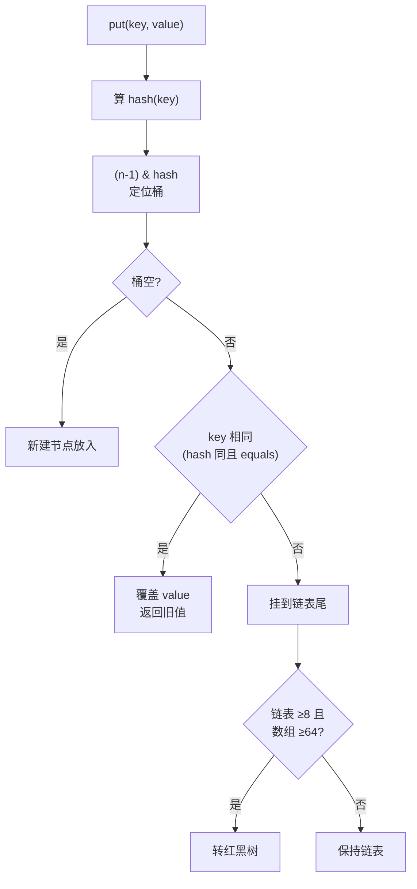

# W3 D5 · Map：HashMap / TreeMap + 词频统计

> 2026-11-15（日）｜W3 第 5 天｜档位 A 基础｜配套课程：黑马「Map 集合」— Map 接口、HashMap 底层、遍历、TreeMap
>
> 今天要拿下的能力：**看到"按 key 找 value"的需求，能立刻写出 `Map`，并且知道用哪种遍历最合适。**
> 昨天 `HashSet` 已经讲透了哈希那套东西，今天你会发现——`HashMap` 就是它的"带 value 版"，学起来会很快。

## 0. 今天会遇到的 7 个名词

| 名词 | 一句话人话 | 类比 |
| --- | --- | --- |
| `Map` | 存"键 → 值"的对应关系，键唯一 | 字典：字 → 解释 |
| 键（key）/ 值（value） | key 用来找，value 是被找的东西 | 学号 → 姓名 |
| `Entry` | Map 里的一个"键值对"对象 | 字典里的一行 |
| 负载因子（0.75） | 装到 75% 就扩容 | 杯子装 3/4 就换大杯 |
| 扩容 | 数组长度翻倍、元素重新分配 | 换大杯子，重新倒 |
| `TreeMap` | 按 key 自动排序的 Map | 按拼音排好的字典 |
| 词频统计 | 数每个词出现几次 | 点票 |

## 1. 今天 3 小时怎么分

| 时段 | 分钟 | 做什么 | 产出 |
| --- | --- | --- | --- |
| 看课 | 80 | Map 接口、HashMap 底层与遍历、TreeMap，1.25 倍速边看边敲 | 跟敲代码 |
| 敲代码 | 60 | 词频统计（三种写法：基础版 / `getOrDefault` / `merge`）+ 三种遍历 + `TreeMap` 排序 | `MapDemo` |
| 算法 | 25 | 力扣 1 题（「两数之和」或「有效的字母异位词」） | AC 记录 |
| 记录 | 15 | 笔记 3 条 + **术语 3 个**（写进 [术语表](../00-JavaSE总体路线与术语表.md)）+ commit + 日志 | 提交完成 |

## 2. 为什么需要 Map（先看需求）

需求：**给你一批"学号 → 姓名"，输入学号要立刻查到姓名。**

用 `List` 能做，但要遍历：

```java
List<Student> list = new ArrayList<>();
// 查学号 2023001 的姓名
for (Student s : list) {                 // 最坏要把整个 list 扫一遍 O(n)
    if (s.getId().equals("2023001")) { ... }
}
```

用 `Map`：

```java
Map<String, String> map = new HashMap<>();
map.put("2023001", "张三");
map.put("2023002", "李四");

String name = map.get("2023001");   // 直接拿到，平均 O(1)
```

一句话：**`Map` 是为"按 key 快速查找"而生的**——数组靠下标找，Map 靠 key 找。

> **`Map` 和 `Collection` 是两条线**：`List`/`Set` 属于 `Collection`（单个元素），`Map` 不属于 `Collection`（存的是键值对）。所以 `Map` 没有 `add`，只有 `put`。

## 3. Map 的常用 API（背这张表就够）

| 方法 | 作用 | 记忆点 |
| --- | --- | --- |
| `put(k, v)` | 放入/覆盖 | 返回**被覆盖的旧值**，没覆盖过返回 `null` |
| `get(k)` | 取值 | 不存在返回 `null` |
| `getOrDefault(k, 默认值)` | 取值，没有就返回默认值 | **统计计数必备** |
| `remove(k)` | 按键删除 | 返回被删的 value |
| `containsKey(k)` | 是否含这个键 | 别用 `containsValue`（要遍历，很慢） |
| `size()` | 键值对个数 | — |
| `keySet()` | 所有 key 的集合 | 遍历用 |
| `values()` | 所有 value 的集合 | 只要值的时候用 |
| `entrySet()` | 所有键值对的集合 | **遍历性能最好** |
| `computeIfAbsent(k, 函数)` | 没有就计算出来放进去 | 分组、建列表必备 |

```java
Map<String, Integer> map = new HashMap<>();
map.put("a", 1);
Integer old = map.put("a", 2);      // old = 1，返回被覆盖的旧值
System.out.println(map.get("a"));   // 2
System.out.println(map.get("b"));   // null（不存在，不是报错）
System.out.println(map.getOrDefault("b", 0));   // 0
```

## 4. HashMap 底层：和 HashSet 是同一套东西

昨天说过 `HashSet` 底层是 `HashMap`。今天反过来看：

> **`HashMap` = 数组（哈希表）+ 链表 + 红黑树**，数组的每个格子存一条链表（或一棵树），每个节点存的是 `key` + `value` + `hash` + `next`。



和 `HashSet` 的差别只有一处：**找到相同 key 时，`HashSet` 是放弃添加，`HashMap` 是覆盖 value 并返回旧值**。

**扩容**：当 `size > 数组长度 × 0.75`（负载因子）时，数组**翻倍**，所有元素**重新计算位置**（rehash）。默认初始容量 16，第一次 `put` 才创建数组。

> 为什么是 0.75？太低浪费空间，太高冲突变多。这是空间与时间的折中，**记住数字就行**。

## 5. 三种遍历，性能差在哪

```java
Map<String, Integer> map = new HashMap<>();
map.put("java", 3); map.put("mysql", 2); map.put("redis", 1);

// 写法 1：keySet 再 get（不推荐）
for (String k : map.keySet()) {
    System.out.println(k + "=" + map.get(k));   // 每个 key 又查了一次，多一层哈希计算
}

// 写法 2：entrySet（推荐）
for (Map.Entry<String, Integer> e : map.entrySet()) {
    System.out.println(e.getKey() + "=" + e.getValue());   // 一次拿到 key 和 value
}

// 写法 3：forEach + Lambda（D6 会细讲，今天先会用）
map.forEach((k, v) -> System.out.println(k + "=" + v));
```

| 写法 | 要不要再查一次 | 什么时候用 |
| --- | --- | --- |
| `keySet()` + `get()` | **要**，多一次哈希定位 | 只要 key 的时候 |
| `entrySet()` | 不要 | **同时要 key 和 value 时首选** |
| `forEach` | 不要 | 代码短，逻辑简单时 |

> 面试常问"HashMap 遍历为什么推荐 entrySet"——答：`keySet` 拿到 key 后还要 `get(key)` 再算一次哈希定位，`entrySet` 直接拿到节点，省掉这层。

## 6. 统计场景的三件套（今天的主力）

**需求**：统计字符串里每个单词出现的次数。三种写法，从笨到巧。

```java
String text = "java mysql java redis mysql spring java";
String[] words = text.split(" ");

// 写法 1：最基础 —— 手动判断 + 计数（一定要会写这个）
Map<String, Integer> count = new HashMap<>();
for (String w : words) {
    if (count.containsKey(w)) {
        count.put(w, count.get(w) + 1);   // 已存在：取旧值 +1
    } else {
        count.put(w, 1);                  // 第一次见：放 1
    }
}

// 写法 2：getOrDefault —— 一行搞定上面的 if-else
Map<String, Integer> count2 = new HashMap<>();
for (String w : words) {
    count2.put(w, count2.getOrDefault(w, 0) + 1);   // 没有就当 0，再加 1
}

// 写法 3：merge —— 更短
Map<String, Integer> count3 = new HashMap<>();
for (String w : words) {
    count3.merge(w, 1, Integer::sum);   // 存在就把旧值和 1 相加，不存在就放 1
}
```

**`computeIfAbsent` 的典型用法——分组**：

```java
// 需求：把学生按班级分组 → Map<String, List<Student>>
Map<String, List<Student>> groups = new HashMap<>();
for (Student s : students) {
    // 没有这个班级就先建一个空 List 放进去，然后往里 add
    groups.computeIfAbsent(s.getClassName(), k -> new ArrayList<>()).add(s);
}
```

如果不用它，就得写：

```java
if (!groups.containsKey(cls)) {
    groups.put(cls, new ArrayList<>());
}
groups.get(cls).add(s);
```

## 7. TreeMap：按 key 排序的 Map

```java
Map<Integer, String> map = new TreeMap<>();
map.put(30, "c"); map.put(10, "a"); map.put(20, "b");
System.out.println(map);   // {10=a, 20=b, 30=c}  —— 按 key 升序
```

**要点**：

1. 底层是**红黑树**，按 **key** 排序（不是按 value）。
2. key 必须能比较：要么实现 `Comparable`，要么 `new TreeMap<>(Comparator)`。
3. **key 不能是 null**（要比较，`null` 会 NPE；`HashMap` 的 key 可以是 null）。
4. 适合"要按 key 有序遍历"或"取一段 key 范围"（`subMap`/`firstKey`/`lastKey`）。

**`LinkedHashMap`** 一句话：在 `HashMap` 基础上多一条双向链表，**记住插入顺序**（和 `LinkedHashSet` 同理）。做 LRU 缓存时会用到它的访问顺序模式。

| 对比 | HashMap | LinkedHashMap | TreeMap |
| --- | --- | --- | --- |
| 顺序 | 无序 | 插入顺序 | 按 key 排序 |
| 底层 | 哈希表 | 哈希表 + 双向链表 | 红黑树 |
| 性能 | O(1) 平均 | 略慢 | O(log n) |
| key 能为 null | 能 | 能 | **不能** |
| 场景 | 默认选它 | 要顺序 | 要排序/范围 |

## 8. 动手任务（60 分钟）

**任务 A：三种写法写一遍（20 分钟）**
用上面那段 `"java mysql java redis mysql spring java"`，分别用"基础版 / `getOrDefault` / `merge`"各写一遍，打印结果（`{java=3, ...}`），确认三种结果一致。

**任务 B：按次数倒序输出（20 分钟）**
把词频结果按出现次数从多到少打印。提示：把 `entrySet()` 转成 `List`，用 `List.sort()` + `Comparator` 按 `getValue()` 降序（这是 D6 的前置练习，先照这行写：`list.sort((a, b) -> b.getValue() - a.getValue());`）。

**任务 C：分组（10 分钟）**
5 个学生，用 `computeIfAbsent` 按班级分组，打印每个班几个人。

**任务 D：TreeMap 对照（10 分钟）**
同一批数据分别放进 `HashMap` 和 `TreeMap`，打印对比输出的顺序差异；再试 `new TreeMap<>((a,b) -> b - a)` 看是不是降序。

**验收标准**

- [T] 能说出 `put` 的返回值代表什么
- [T] 能说出 `entrySet` 比 `keySet + get` 快在哪
- [T] 不查资料能写出 `getOrDefault` 版词频统计
- [T] 能说出 `TreeMap` 和 `HashMap` 的三个区别

## 9. 练习（先写，再看答案）

### A. 判断（5 题）

**A1.** `HashMap` 的 key 不允许重复，重复 `put` 会覆盖旧 value。

> 答：对

**A2.** `HashMap` 的 key 和 value 都可以放 `null`。

> 答：对

**A3.** `TreeMap` 是按 value 排序的。

> 答：错，先按key排序，要手动转换为value排序要转换为list并sort

**A4.** `HashMap` 的默认初始容量是 16，负载因子是 0.75。

> 答：对

**A5.** `Map` 接口继承自 `Collection` 接口。

> 答：错，Map和Collection是两条平行的线

### B. 选择（5 题）

**B1.** `map.put("a", 2)` 当 key "a" 已存在时，返回值是：
A. 新值 2　B. 旧值　C. `null`　D. 抛异常

> 答：A

**B2.** 同时遍历 key 和 value，最高效的方式是：
A. `keySet()` + `get()`　B. `values()`　C. `entrySet()`　D. `forEach` 里 `get()`

> 答：C

**B3.** 下列哪个 Map 的 key 不能是 `null`：
A. `HashMap`　B. `LinkedHashMap`　C. `TreeMap`　D. 都可以

> 答：C

**B4.** 统计词频时，`map.getOrDefault(w, 0) + 1` 的含义是：
A. 取 w 的值，取不到就当 0，再加 1　B. 取 w 的值加 1 后作为默认值　C. 删掉 w 再放 1　D. 返回 0

> 答：A

**B5.** `HashMap` 扩容的触发条件是：
A. `size` 达到数组长度　B. `size` 超过 `数组长度 × 0.75`　C. 链表长度到 8　D. 每次 `put` 都扩

> 答：B

### C. 简答（3 题）

**C1.** 用自己的话说清 `HashMap.put(key, value)` 的完整过程（从算哈希到覆盖或追加）。

> 答：先根据key值算哈希在桶查找，找不到则加入value，若桶已有元素，计算哈希冲突，equals则覆盖，反之追加链表尾

**C2.** 为什么遍历 HashMap 推荐 `entrySet()` 而不是 `keySet()` + `get()`？

> 答：entryset()一次查找，keyset()+get()要先查抄key值，再get出来

**C3.** `HashMap`、`LinkedHashMap`、`TreeMap` 分别什么场景用？各一句。

> 答：hashmap为默认，只根据key查值用。linkedhashmap为记录默认顺序并根据key查值。treemap为按key排序，无法插null

<details>
<summary>参考答案</summary>

**A 判断**：A1 对｜A2 对（`HashMap` 的 key 和 value 都能放 null）｜A3 错（按 **key** 排序，要按 value 排得自己转 `List` 再 `sort`）｜A4 对｜A5 错（`Map` 和 `Collection` 是平行的两条线，`Map` 不继承 `Collection`）

**B 选择**：B1 B（返回被覆盖的旧值，没覆盖过返回 null）｜B2 C｜B3 C（红黑树要比较，null 无法比较）｜B4 A｜B5 B

**C1**：先调用 `key.hashCode()` 得到哈希值并做高低位异或扰动，用 `(n-1) & hash` 定位到数组的桶。桶为空就直接新建节点放入；桶不空就遍历桶内的链表（或红黑树），用 `hash` 相同 **且** `equals` 为 true 判断 key 是否相同——相同则覆盖 value 并返回旧值；全都不相同就挂到链表尾部（链表长度 ≥8 且数组长度 ≥64 时转红黑树）。插入后若 `size > 容量 × 0.75` 则扩容一倍并 rehash。

**C2**：`keySet()` 只能拿到 key，要取 value 必须再 `get(key)`，而 `get` 内部又要重新算哈希、重新定位桶，相当于每个元素多走一遍查找；`entrySet()` 直接返回 `Entry` 对象（里面已经同时持有 key 和 value），遍历一次就能拿到两者，省掉重复定位。数据量大时差距明显。

**C3**：`HashMap` 是默认选择，只要"按 key 快速查找"、不关心顺序；`LinkedHashMap` 需要记住插入顺序（或做 LRU 缓存）；`TreeMap` 需要按 key 排序或取范围（key 必须能比较、不能为 null）。

</details>

## 10. 高频坑

| 坑 | 说明 |
| --- | --- |
| `get` 返回 `null` 就以为没这个 key | key 存在但 value 是 null 时也返回 null，要区分就用 `containsKey` |
| 用 `containsValue` 判存在 | 它要遍历全部 value，O(n)，很慢 |
| 自定义对象当 key 不重写 `hashCode`/`equals` | 和 `HashSet` 完全一样，`get` 永远取不到 |
| 把可变对象当 key | 放进去后改了字段，哈希变了，再也取不出来 |
| `TreeMap` 用不可比较的 key | 运行时 `ClassCastException` |
| 遍历时 `map.remove` | 抛 `ConcurrentModificationException`，用 `Iterator.remove()` 或 `removeIf`（JDK8 的 `map.entrySet().removeIf(...)`） |
| 以为 `HashMap` 线程安全 | 不是，多线程要用 `ConcurrentHashMap` |

## 11. 30 秒卡

- **Map 是两条线之一**：存键值对，不属于 `Collection`，没有 `add` 只有 `put`。
- **`put` 返回值**：被覆盖的旧值；没覆盖过是 `null`。
- **`HashMap` 底层**：数组 + 链表 + 红黑树；扩容条件 `size > 容量 × 0.75`。
- **遍历首选 `entrySet`**：省掉 `get` 的二次定位。
- **统计三件套**：`containsKey` 版 → `getOrDefault` 版 → `merge` 版。
- **`TreeMap`**：按 key 排序，key 必须能比较、不能为 null。

## 12. 今天要记的 3 个术语（写进术语表）

- 键值对（Entry）
- 负载因子 / 扩容
- rehash
- `computeIfAbsent`
- 词频统计

## 13. 面试一句话

> **HashMap 的 put 过程？和 HashSet 什么关系？**
> `put` 先算 key 的 `hashCode` 并做高位扰动，用 `(n-1) & hash` 定位桶；桶空直接放入，桶不空则遍历链表/红黑树，用 `hash` 相同且 `equals` 为 true 判断 key 重复，重复就覆盖 value 并返回旧值，不重复就尾插（链表 ≥8 且数组 ≥64 转红黑树）；插入后若 `size > 容量 × 0.75` 就扩容一倍并 rehash。`HashSet` 的底层就是一个 `HashMap`，元素当 key、value 是固定的 `PRESENT` 占位对象，所以两者的去重逻辑完全一致。

---

## 附：批改与点评（11/16 阅）

### 得分

| 题型 | 得分 | 说明 |
| --- | --- | --- |
| A 判断（5 题） | **5 / 5** | 全对 |
| B 选择（5 题） | **4 / 5** | B1 掉坑——`put` 的返回值 |
| C 简答（3 题） | **4.5 / 6** | 两处漏了"树化 + 扩容" |
| **合计** | **13.5 / 15（90%）** | 判断满分说明概念扎实，扣分集中在"细节没走完" |

### 逐题批注

**B1（这题必须记住，面试高频）**：你选 A（新值 2），正确答案是 **B（旧值）**。

`put` 的设计是**"返回被替换掉的东西"**，不是返回新放进去的：

```java
map.put("a", 1);
Integer old = map.put("a", 2);
// old = 1（旧值），map 里现在是 2
Integer first = map.put("b", 5);
// first = null（这个 key 之前不存在）
```

**为什么这么设计？** 因为调用方经常需要"旧值"——比如 `put` 前要判断是不是覆盖、要不要做清理。这也是 `HashMap` 里没有 `add` 的原因：`add` 意味着"新增"，而 `put` 的语义是"放进去（可能覆盖）"，返回值告诉你覆盖了什么。

口诀：**`put` 返回旧值，`null` 表示原来没有。** 和 `Set.add` 返回 `boolean`（有没有重复）是同一类设计思路。

**C1（扣 1）**：主链路对（算哈希 → 找桶 → 空则放 → 冲突比 `equals` → 覆盖或尾插）。但漏了两点，和 D4 的 C1 是同一个毛病：

1. **扩容**：`size > 容量 × 0.75` 时数组翻倍并 rehash——这是 `put` 流程的一部分，必须提。
2. **树化阈值**：链表 ≥8 且数组 ≥64 转红黑树。

你连着两天都漏这两条，说明脑子里 `put` 的流程"到链表就结束了"。**把它补成七步**：算 hash → 定位桶 → 桶空放入 → 桶不空比 `hash` 和 `equals` → 相同则覆盖并返回旧值 → 不同则尾插 → 判树化 → 判扩容。

**C2（扣 0.5）**：意思对（`keySet` 要二次查找），但表述要精确：

- "先查抄 key 值" → **"先遍历拿到 key"**
- "再 get 出来" → **"`get(key)` 内部要重新算哈希、重新定位桶"**——这句才是性能差的根因，只说"再 get 一次"听起来像"随手一拿"，其实是一次完整的查找。

**C3（扣 0.5）**：三句都对。两处措辞：

- "`LinkedHashMap` 为记录**默认顺序**" → 应是"**插入顺序**"（这个错你 D4 就犯过一次，`LinkedHashSet` 那次也是"原排序"）。
- 补上 `TreeMap` 的另一个前提：**key 必须能比较**（`Comparable`/`Comparator`），不补的话"无法插 null"只是半个答案。

### 你的规律（第三天出现同一个模式）

| 天 | 得分 | 丢分类型 |
| --- | --- | --- |
| D2 | 14.5 | 术语说混（fail-fast） |
| D3 | 14 | 术语含糊（"提前处理了"） |
| D4 | 14.5 | 流程不完整（漏桶空/树化） |
| D5 | 13.5 | **流程不完整（漏扩容/树化）+ 细节概念错（put 返回值）** |

三天的共同点：**主干全对，收尾不收**。哈希表这套东西的完整流程是"**放进去 → 冲突处理 → 树化 → 扩容**"四段，你总在第二段就停了。

**解法（明天起执行）**：凡是问"底层流程"的题，先在草稿上写一个字：**"放、突、树、扩"**（放入→冲突→树化→扩容），四个字都覆盖到再动笔。

### 错题回炉（☐ 完成后打勾）

| 题 | 一句话正确说法 | 回哪看 |
| --- | --- | --- |
| B1 | ☐ `put` 返回**被覆盖的旧值**，原来没有则返回 `null` | §3 |
| C1 | ☐ 七步：算 hash → 定位桶 → 空则放 → 比 hash+equals → 覆盖/尾插 → 树化 → 扩容 | §4 |
| C2 | ☐ `get` 要重新算哈希定位，`entrySet` 直接拿 `Entry`，省掉这次定位 | §5 |
| C3 | ☐ `LinkedHashMap` 保的是**插入顺序**；`TreeMap` 的 key 必须能比较 | §7 |

### 一句话总评

**13.5/15**。判断满分是真本事（说明概念没塌），但 "放突树扩" 这四个字你现在只做到一半——而这四个字恰好是 HashMap 面试 80% 的考点。明天写复盘小测时，凡是涉及 HashMap/HashSet 的题，就按这四个字检查一遍。
