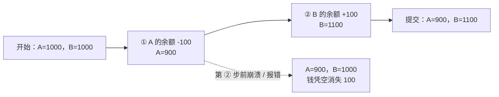
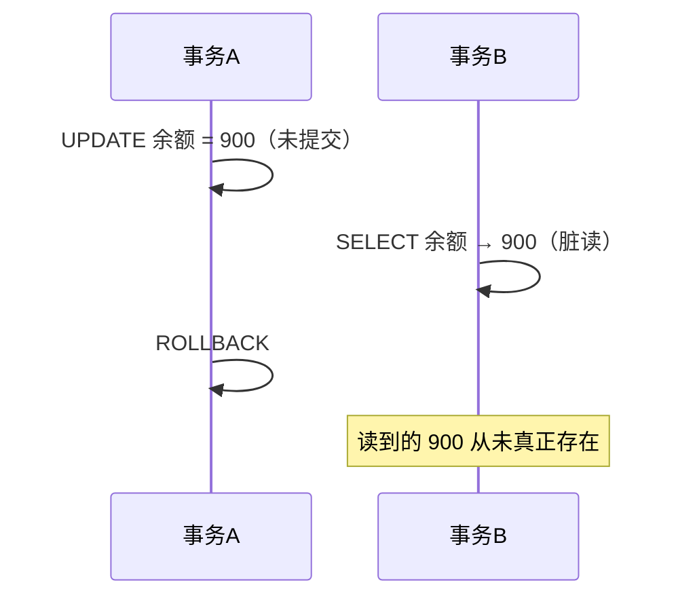
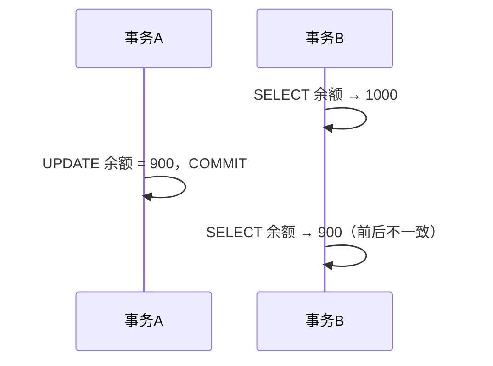
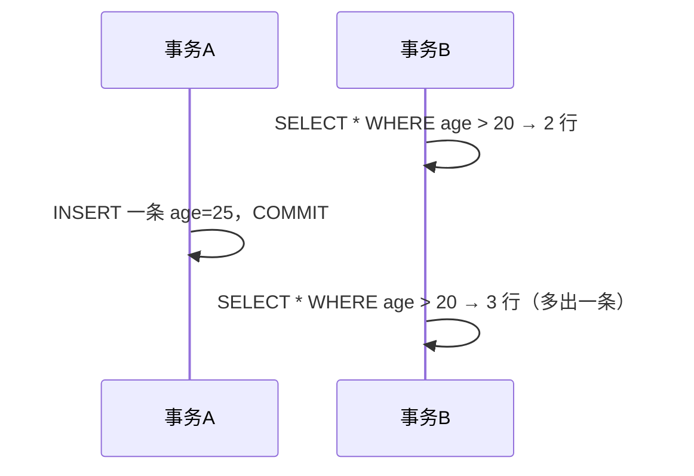

# MySQL 事务（基础篇）· 3 小时速通

> 一句话：**事务 = 把一组 SQL 打包，要么全部成功，要么全部失败。**
> 对应计划：W0 基础篇收尾 ｜ 学完能回答：ACID 是什么、三大并发问题、四种隔离级别、为什么 MySQL 默认 RR。

## 0. 今天 3 小时怎么用

| 时间 | 做什么 | 产出 |
| --- | --- | --- |
| 30 min | 读 §1–§4：转账例子、ACID、三条命令、并发三问题 | 能口述 ACID |
| 50 min | 跟着 §5 开两个窗口，亲手复现 3 个并发问题 | 3 张截图或记录 |
| 40 min | §6 四种隔离级别 + §7 转账 demo 自己敲一遍 | 一份可运行的 SQL |
| 30 min | §8 高频坑 + §9 自测 6 题 | 错题 1–3 条 |
| 30 min | 写笔记、`git commit`、在 PROGRESS 打卡 | 今天的产出 |

> 原则：**先跑通再记**。事务这节所有结论都能用两个窗口验证，别只背概念。

## 1. 为什么需要事务：转账

A 给 B 转 100 元，数据库要做两步：



| 情况 | A | B | 总额 | 结果 |
| --- | --- | --- | --- | --- |
| 正常 | 900 | 1100 | 2000 | ✅ 对 |
| 第 ② 步失败且不回滚 | 900 | 1000 | 1900 | ❌ 钱丢了 |
| 两步都回滚 | 1000 | 1000 | 2000 | ✅ 回到起点 |

**事务就是那个「要么两步都算，要么两步都不算」的开关。**

## 2. ACID：四个特性，一句话一个

| 字母 | 特性 | 一句话 | 谁在背后保证 | 破坏了会怎样 |
| --- | --- | --- | --- | --- |
| **A** | 原子性 Atomicity | 一组操作不可分割，要么全做要么全不做 | `undo log`（回滚日志） | 转了一半，钱丢 |
| **C** | 一致性 Consistency | 数据始终满足约束（总额不变、余额不为负） | 业务代码 + 约束（**这是目的，不是手段**） | 总额对不上 |
| **I** | 隔离性 Isolation | 并发事务互不干扰，像排队一样 | 锁 + MVCC | 脏读、幻读 |
| **D** | 持久性 Durability | 提交了就落盘，宕机也不丢 | `redo log`（重做日志） | 重启后数据没了 |

> 记忆：**A 靠 undo，D 靠 redo，I 靠锁和 MVCC，C 是最终目的。**

## 3. 三条命令 + 自动提交

```sql
SELECT @@autocommit;        -- 1 = 自动提交（MySQL 默认，每条 SQL 单独成事务）
SET autocommit = 0;         -- 0 = 手动提交（之后必须自己 COMMIT）

-- 手动控制事务的三种写法
START TRANSACTION;          -- 开启（同 BEGIN）
COMMIT;                     -- 提交：真正写进库，不可撤销
ROLLBACK;                   -- 回滚：撤销本事务所有未提交的修改

-- 存档点：只回滚一部分
SAVEPOINT p1;
ROLLBACK TO p1;
RELEASE SAVEPOINT p1;
```

| 命令 | 作用 | 注意 |
| --- | --- | --- |
| `START TRANSACTION` / `BEGIN` | 开启事务 | 开启后 SQL 不会自动生效 |
| `COMMIT` | 提交 | 提交后 `ROLLBACK` 也没用 |
| `ROLLBACK` | 回滚 | 只回滚**未提交**的部分 |
| `SAVEPOINT` | 存档点 | 可回滚到某个点，不用整个回滚 |

**两个容易踩的规则：**

1. **DDL 会隐式提交**：事务里执行 `CREATE / ALTER / DROP / TRUNCATE`，前面没提交的修改会被强制提交。
2. **连接断开 = 自动回滚**：客户端异常退出，未提交的事务全部撤销（这也是"忘了 COMMIT，数据没进库"的原因）。

## 4. 并发三大问题（两个事务同时跑会怎样）

### ① 脏读：读到了别人**没提交**的数据



### ② 不可重复读：同一事务内，**两次读同一行**结果不同



### ③ 幻读：同一事务内，**两次按条件查，行数变了**



| 问题 | 一句话 | 关键词 |
| --- | --- | --- |
| 脏读 | 读到别人没提交的 | 未提交 |
| 不可重复读 | 同一行，两次读不一样 | update / delete |
| 幻读 | 同一条件，两次查行数不一样 | insert |

> 区别记忆：**不可重复读是「同一行变了」，幻读是「多了一行」。**

## 5. 四种隔离级别（面试必考矩阵）

| 隔离级别 | 脏读 | 不可重复读 | 幻读 | 说明 |
| --- | --- | --- | --- | --- |
| READ UNCOMMITTED（读未提交） | 可能 | 可能 | 可能 | 几乎不用，性能最好 |
| READ COMMITTED（读已提交） | 不可能 | 可能 | 可能 | Oracle 默认 |
| REPEATABLE READ（可重复读） | 不可能 | 不可能 | 基本解决（InnoDB） | MySQL 默认 |
| SERIALIZABLE（串行化） | 不可能 | 不可能 | 不可能 | 全部加锁，最慢 |

> 隔离级别越高 → 一致性越强 → 并发性能越差。**默认 RR 是「够用且不慢」的平衡点。**

```sql
-- 查看 / 修改（MySQL 8；5.7 用 @@tx_isolation）
SELECT @@transaction_isolation;
SET SESSION TRANSACTION ISOLATION LEVEL READ COMMITTED;   -- 只影响当前连接
SET GLOBAL  TRANSACTION ISOLATION LEVEL REPEATABLE READ;  -- 影响新连接
```

**为什么 InnoDB 的 RR 能基本解决幻读？**
普通 `SELECT` 走 **MVCC 快照读**（读事务开始时的版本，看不到别人新插入的行）；
`UPDATE / DELETE / SELECT ... FOR UPDATE` 走 **当前读**，靠 **间隙锁（Gap Lock）** 锁住区间，让别人插不进来。
所以：**快照读不怕幻读，当前读靠间隙锁挡幻读。**

## 6. 双窗口实验（复制即用，50 分钟）

先准备数据（只做一次）：

```sql
CREATE DATABASE IF NOT EXISTS tx_lab DEFAULT CHARSET utf8mb4;
USE tx_lab;
CREATE TABLE account (
  id      INT PRIMARY KEY,
  name    VARCHAR(20),
  balance DECIMAL(10,2) CHECK (balance >= 0)
);
INSERT INTO account VALUES (1,'A',1000), (2,'B',1000);
```

### 实验 ① 脏读（需要 READ UNCOMMITTED）

| 步骤 | 窗口 A | 窗口 B |
| --- | --- | --- |
| 1 | `SET SESSION TRANSACTION ISOLATION LEVEL READ UNCOMMITTED;` | 同样设置 |
| 2 | `START TRANSACTION;`<br>`UPDATE account SET balance=900 WHERE id=1;` | — |
| 3 | 先别提交 | `SELECT balance FROM account WHERE id=1;` → **900（脏读）** |
| 4 | `ROLLBACK;` | `SELECT ...` → 又变回 1000 |

### 实验 ② 不可重复读（READ COMMITTED vs REPEATABLE READ）

| 步骤 | 窗口 A | 窗口 B |
| --- | --- | --- |
| 1 | `SET SESSION TRANSACTION ISOLATION LEVEL READ COMMITTED;` | 同样设置 |
| 2 | `START TRANSACTION;`<br>`SELECT balance ... id=1;` → 1000 | — |
| 3 | — | `UPDATE account SET balance=900 WHERE id=1; COMMIT;` |
| 4 | `SELECT ...` → **900（RC 下不可重复读）** | — |
| 5 | 改成 `REPEATABLE READ` 重做 → 第 4 步仍是 **1000** | — |

### 实验 ③ 幻读（REPEATABLE READ）

| 步骤 | 窗口 A | 窗口 B |
| --- | --- | --- |
| 1 | `SET SESSION TRANSACTION ISOLATION LEVEL REPEATABLE READ;` | 同样设置 |
| 2 | `START TRANSACTION;`<br>`SELECT COUNT(*) FROM account WHERE id > 10;` → 0 | — |
| 3 | — | `INSERT INTO account VALUES (11,'C',500); COMMIT;` |
| 4 | `SELECT COUNT(*) ... id > 10;` → **仍是 0**（快照读，MVCC 挡住了） | — |
| 5 | `UPDATE account SET balance=balance+0 WHERE id>10;` → 影响 **1 行**（当前读看到了新行） | — |

> 结论：InnoDB 的 RR 下，**普通查询看不到新插入的行**，但**更新语句能看到**（当前读）——这就是"基本解决"而不是"完全解决"。

## 7. 转账 demo（自己敲一遍，40 分钟）

```sql
-- 正常提交
START TRANSACTION;
UPDATE account SET balance = balance - 100 WHERE id = 1;
UPDATE account SET balance = balance + 100 WHERE id = 2;
COMMIT;

-- 校验：总额永远是 2000
SELECT SUM(balance) FROM account;
```

```sql
-- 模拟失败：第二步报错或主动回滚
START TRANSACTION;
UPDATE account SET balance = balance - 100 WHERE id = 1;
-- 假设这里发现对方账户异常
ROLLBACK;
-- 再查：A 仍是原值，钱没少
SELECT * FROM account;
```

再加一层保护（一致性不只靠事务）：

```sql
-- 余额不能为负：约束 + 检查
UPDATE account SET balance = balance - 99999 WHERE id = 1;  -- 报错，事务回滚
```

## 8. 高频坑（提前避开）

| 坑 | 后果 | 正确做法 |
| --- | --- | --- |
| 忘记 `COMMIT` | 数据没进库，断开连接就回滚 | 每个事务结束必须 commit / rollback |
| 事务里执行 DDL | 前面未提交的修改被隐式提交 | DDL 放事务外 |
| 长事务（开着事务去查资料） | 锁等待、undo 膨胀、主从延迟 | 事务尽量短，别在里面做网络/IO |
| `SET autocommit=0` 后忘了提交 | 后续所有语句都堆在一个事务里 | 用完改回 1，或显式 commit |
| 以为 RR 完全没幻读 | 当前读仍可能看到新行 | 快照读 vs 当前读要分清 |
| 只在 `GLOBAL` 改隔离级别 | 当前连接不生效 | 调试用 `SESSION` |

## 9. 自测 6 题（先自己答，再看答案）

<details><summary>1. ACID 分别由什么保证？</summary>

A 靠 undo log 回滚；D 靠 redo log 落盘；I 靠锁 + MVCC；C 是目的，靠业务约束和上面三者共同保证。
</details>

<details><summary>2. 脏读、不可重复读、幻读的区别？</summary>

脏读：读到未提交的数据；不可重复读：同一行两次读结果不同（别人 update/delete 并提交）；幻读：同一条件两次查行数不同（别人 insert）。
</details>

<details><summary>3. MySQL 默认隔离级别是什么？为什么？</summary>

REPEATABLE READ。它在「一致性够用」和「并发性能不差」之间平衡，且 InnoDB 用 MVCC + 间隙锁把幻读也基本解决了。
</details>

<details><summary>4. 事务里执行 CREATE TABLE 会怎样？</summary>

DDL 会隐式提交：执行前，当前事务未提交的修改被强制提交，事务边界被打断。
</details>

<details><summary>5. 为什么"忘了 COMMIT，数据没进库"？</summary>

未提交的修改只在当前连接的事务里；连接断开时 MySQL 自动回滚，所以数据消失。
</details>

<details><summary>6. 快照读和当前读的区别？</summary>

快照读（普通 SELECT）读事务开始时的 MVCC 版本，看不到别人新提交的行；当前读（UPDATE/DELETE/SELECT ... FOR UPDATE）读最新数据并加锁，能看到并锁住新行。
</details>

## 10. 30 秒复习卡

```text
事务 = 打包的 SQL，要么全成要么全败
ACID = 原子(undo) 一致(目的) 隔离(锁+MVCC) 持久(redo)
三问题 = 脏读(未提交) / 不可重复读(同一行变) / 幻读(多一行)
四级别 = RU < RC < RR(默认) < SERIALIZABLE
MySQL RR 抗幻读 = 快照读走 MVCC + 当前读走间隙锁
```

## 11. 面试一句话

> **事务是什么？** 一组要么全部成功、要么全部失败的操作，用来保证转账这类多步写操作的原子性和一致性。
>
> **MySQL 默认隔离级别？** REPEATABLE READ；普通查询靠 MVCC 快照读保证可重复读，当前读靠间隙锁防幻读，兼顾一致性和并发。
