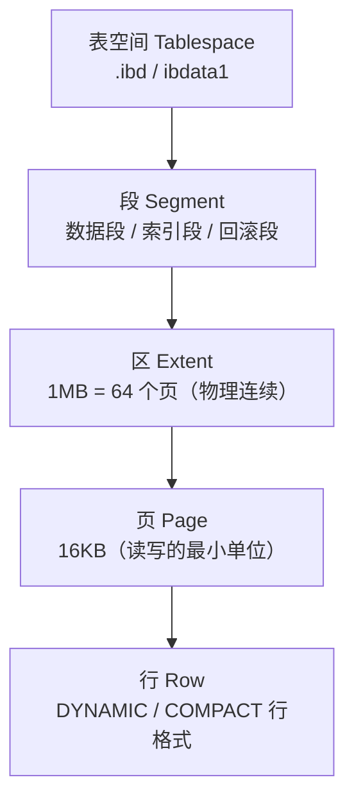

# 存储引擎与 InnoDB 逻辑结构（进阶篇 · W1 Day 1）

> 一句话：**存储引擎 = 表的「发动机」，决定数据怎么存、怎么锁、支不支持事务；InnoDB 的存储是「表空间 → 段 → 区 → 页 → 行」五层。**
> 对应计划：W1 D1（2026-10-26）｜学完能回答：为什么默认 InnoDB、一页多大、一区多大、页里装了什么。

## 0. 今天 3 小时怎么用

| 时间 | 做什么 | 产出 |
| --- | --- | --- |
| 30 min | 读 §1–§3：引擎是什么、三种引擎对比、怎么查改 | 能口述 InnoDB 的 4 个优势 |
| 50 min | 看黑马进阶篇「存储引擎」章节（1.25 倍速） | 跟完课程，记下没听懂的点 |
| 50 min | §7 动手实验：建三种引擎的表、对比文件、改引擎 | 实验记录 + 截图 |
| 25 min | §8 自测 6 题 + §9 高频坑 | 错题 1–3 条 |
| 25 min | 写笔记、`git commit`、更新 PROGRESS | 今天的产出 |

> 原则：**引擎这节不用背，靠「建表 → 看文件 → 改引擎」三件事记住**，40 分钟实验比看 2 小时视频有用。

## 1. 存储引擎是什么

同一张表，可以选不同的「底层实现」：

- 数据存在哪（几个文件、什么格式）
- 支不支持事务、外键
- 锁的粒度（表锁 / 行锁）
- 索引怎么组织（B+ 树 / 哈希）
- 崩溃后能不能恢复

**MySQL 是「插件式」的**：server 层负责 SQL 解析、优化，引擎层负责真正读写数据。所以 `CREATE TABLE ... ENGINE=xxx` 就是在选发动机。

## 2. 三种常见引擎对比（面试常问）

| 维度 | InnoDB（默认） | MyISAM（老） | MEMORY（内存表） |
| --- | --- | --- | --- |
| 事务 | ✅ 支持 | ❌ 不支持 | ❌ 不支持 |
| 锁粒度 | 行锁 + 间隙锁 | 表锁 | 表锁 |
| 外键 | ✅ 支持 | ❌ 不支持 | ❌ 不支持 |
| 崩溃恢复 | ✅ 靠 redo log | ❌ 不安全 | — |
| 索引结构 | 聚簇索引（B+ 树） | 非聚簇（索引与数据分离） | 默认哈希索引 |
| 存储文件 | `.ibd`（独立表空间） | `.MYD` 数据 + `.MYI` 索引 | 数据在内存，重启丢失 |
| 典型场景 | 绝大多数业务表 | 只读/历史归档（现在很少用） | 临时表、缓存小表 |

> **为什么 InnoDB 是默认引擎？**（MySQL 5.5.5 起）
> ① 支持事务，能保证转账这类操作的原子性；② 行锁并发高，不锁整张表；③ 支持外键，能保证引用完整性；④ 有 redo log，宕机可恢复；⑤ 聚簇索引，主键查询快。

## 3. 怎么查、怎么改（先会看，再会改）

```sql
-- 看当前 MySQL 支持哪些引擎（Support 列：DEFAULT 就是默认）
SHOW ENGINES;

-- 看默认引擎
SELECT @@default_storage_engine;

-- 看某张表用的什么引擎
SHOW TABLE STATUS LIKE 't_innodb';

-- 看建表语句（末尾能看到 ENGINE=InnoDB）
SHOW CREATE TABLE t_innodb\G

-- 建表时指定引擎
CREATE TABLE t_demo (id INT PRIMARY KEY) ENGINE = MyISAM;

-- 改引擎：会重建整张表（大表慎用，会锁表/耗时）
ALTER TABLE t_demo ENGINE = InnoDB;
```

**注意**：`ALTER TABLE ... ENGINE=` 在 MySQL 8 是「复制表重建」，大表会锁表很久，线上要评估。

## 4. InnoDB 的五层存储结构



| 层级 | 是什么 | 关键数字 / 一句话 |
| --- | --- | --- |
| 表空间 | 最大的逻辑容器 | 独立表空间每表一个 `.ibd`；系统表空间 `ibdata1` |
| 段 | 按用途分的一组区 | 一个索引 = 一个数据段 + 一个索引段；回滚段存 undo |
| 区 | 物理上连续的 64 个页 | **1MB**，连续是为了顺序 IO、减少随机读 |
| 页 | InnoDB 读写的最小单位 | **16KB**（`innodb_page_size`，初始化后不能改） |
| 行 | 真正的一条记录 | 行格式 DYNAMIC 默认；太大就「行溢出」 |

### 4.1 表空间：数据存在哪个文件

| 类型 | 文件 | 说明 |
| --- | --- | --- |
| 独立表空间 | `库名/表名.ibd` | `innodb_file_per_table=ON`（默认），每表一个文件，方便单表备份/迁移 |
| 系统表空间 | `ibdata1` | 共享，存 doublewrite buffer、change buffer、系统元数据（8.0 的数据字典在 `mysql.ibd`） |
| 通用表空间 | `xxx.ibd` | 多张表共用一个文件（少用） |
| undo 表空间 | `undo_001`… | MySQL 8 独立出来，存 undo log |

> 记忆：**开了 `innodb_file_per_table`，一张业务表 = 一个 `.ibd` 文件。**

### 4.2 区：为什么是 1MB 连续

- 机械硬盘最怕随机 IO，**连续读 1MB** 比读 64 个分散的 16KB 快得多。
- 区是「按区分配」的：新表先给 1 个区（1MB），数据多了再给下一个区，避免一页一页要空间。
- 所以：**区 = 空间分配单位，页 = IO 单位**。

### 4.3 页：16KB 里装了什么

一个数据页的内部布局（从上到下）：

```text
┌──────────────────────────── 16KB 数据页 ────────────────────────────┐
│ File Header        38B   页号、上一页/下一页、校验和                  │
│ Page Header        56B   记录数、空闲空间指针、页类型                  │
│ Infimum + Supremum       页内最小/最大记录的「哨兵」                  │
│ User Records             真正存的行记录（按主键有序）                 │
│ Free Space               还没用的空间                                │
│ Page Directory           页内目录（稀疏索引），加速页内查找            │
│ File Trailer        8B   校验和、LSN，防止页写坏                      │
└──────────────────────────────────────────────────────────────────────┘
```

> 记住两点就够：**页是 IO 最小单位**；**页内记录按主键有序 + 有页目录**，所以页内查找也很快。

### 4.4 行：一行太大怎么办

- 行格式：`DYNAMIC`（MySQL 5.7+ 默认）、`COMPACT`、`COMPRESSED`、`REDUNDANT`。
- 一个页至少要放 **2 行**，否则 B+ 树没法工作。
- 当一行太长（TEXT/BLOB），InnoDB 把超长字段存到**溢出页**，行里只留 **20 字节指针** → 这就是「行溢出」。

## 5. 这节和后面索引的关系（先埋个钩子）

| 今天的概念 | 后面会用到 |
| --- | --- |
| 页 16KB | B+ 树的每个节点就是一个页（明天 D2 讲） |
| 聚簇索引 | 叶子页存整行数据 → 主键查询直接命中（D3 回表） |
| 区 1MB 连续 | 范围查询/全表扫描为什么快 |
| 行溢出 | 大字段为什么影响性能、为什么建议拆表 |

## 6. 一句话理解 InnoDB 的「空间账」

> 1 张表 = 1 个表空间（`.ibd`）；
> 表空间里有很多段，段由区组成，**1 区 = 64 页 = 1MB**；
> 页是 **16KB** 的读写单位，页里按主键有序放行记录；
> 行太大就溢出到单独的页。

## 7. 动手实验（50 分钟，复制即用）

```sql
-- ① 看家底
SHOW ENGINES;
SELECT @@default_storage_engine;
SHOW VARIABLES LIKE 'innodb_page_size';      -- 16384
SHOW VARIABLES LIKE 'innodb_file_per_table'; -- ON
SHOW VARIABLES LIKE 'datadir';               -- 数据目录，后面去看文件

CREATE DATABASE IF NOT EXISTS engine_lab DEFAULT CHARSET utf8mb4;
USE engine_lab;

-- ② 三种引擎各建一张表
CREATE TABLE t_innodb (
  id   INT PRIMARY KEY,
  name VARCHAR(20)
) ENGINE = InnoDB;

CREATE TABLE t_myisam (
  id   INT PRIMARY KEY,
  name VARCHAR(20)
) ENGINE = MyISAM;

CREATE TABLE t_memory (
  id   INT PRIMARY KEY,
  name VARCHAR(20)
) ENGINE = MEMORY;

-- ③ 对比：Engine 列、行格式、创建时间
SHOW TABLE STATUS WHERE Name IN ('t_innodb','t_myisam','t_memory')\G
SHOW CREATE TABLE t_myisam\G

-- ④ 去看文件（在 datadir 下的 engine_lab 目录）
--    t_innodb.ibd        ← InnoDB 独立表空间
--    t_myisam.MYD/.MYI   ← MyISAM 数据 + 索引
--    t_memory 只有内存，没有数据文件

-- ⑤ 改引擎：MyISAM → InnoDB，再查一次
ALTER TABLE t_myisam ENGINE = InnoDB;
SHOW TABLE STATUS LIKE 't_myisam';

-- ⑥ 验证 MEMORY 的特性：重启 MySQL 后数据丢失（可选，别在重要库做）
-- INSERT INTO t_memory VALUES (1,'x');
-- 重启服务后再 SELECT：数据没了，表结构还在
```

**实验要记录的三件事**（写进笔记）：
1. 三种引擎的 `Engine` 列分别是什么；
2. `engine_lab` 目录下各表对应哪些文件；
3. 改引擎前后 `SHOW CREATE TABLE` 的差异。

## 8. 自测 6 题（先答再看）

<details><summary>1. 为什么 MySQL 默认引擎是 InnoDB？</summary>

支持事务（undo/redo）、行锁并发高、支持外键、崩溃可恢复、聚簇索引主键查询快，综合能力最强。
</details>

<details><summary>2. InnoDB 一页多大？一区多大？一区多少页？</summary>

页 16KB（默认 `innodb_page_size`）；区 1MB；1 区 = 64 页（16KB 页时）。
</details>

<details><summary>3. 独立表空间和系统表空间的区别？</summary>

独立表空间每张表一个 `.ibd`（`innodb_file_per_table=ON`），方便单表备份/迁移/回收空间；系统表空间 `ibdata1` 多表共享，存 doublewrite buffer、change buffer 和系统元数据（8.0 数据字典在 `mysql.ibd`）。
</details>

<details><summary>4. MyISAM 和 InnoDB 的索引结构差异？</summary>

InnoDB 是聚簇索引：叶子节点直接存整行数据，主键即数据；MyISAM 是非聚簇索引：索引文件 `.MYI` 的叶子存数据地址，还要回表读 `.MYD`。
</details>

<details><summary>5. 为什么区要设计成 1MB 连续空间？</summary>

按区分配空间、物理连续，能把随机 IO 变成顺序 IO，减少磁盘寻道；同时减少空间碎片。
</details>

<details><summary>6. 算一算：1 亿行、每行 1KB 的表，大约多少页、多少区、多少 GB？</summary>

数据量 ≈ 1 亿 × 1KB = 100GB；页数 ≈ 100GB ÷ 16KB ≈ 655 万页；区数 ≈ 655 万 ÷ 64 ≈ 10.2 万区（每区 1MB）。
</details>

## 9. 高频坑

| 坑 | 说明 | 正确做法 |
| --- | --- | --- |
| 以为「改引擎」很轻 | `ALTER TABLE ... ENGINE` 会重建表，大表锁表很久 | 线上用工具（gh-ost/pt-osc）或低峰期做 |
| 在 MEMORY 表存业务数据 | 重启/宕机数据全丢 | 只用来做临时表、缓存 |
| 以为 MyISAM 还常用 | 不支持事务/行锁，早已不是默认 | 新表一律 InnoDB |
| 改 `innodb_page_size` | 只能在初始化实例时设置 | 建库前定好，别中途改 |
| 分不清「区」和「页」的职责 | 区管空间分配，页管 IO | 记住：区 = 1MB 连续，页 = 16KB |

## 10. 30 秒复习卡

```text
引擎 = 表的发动机：InnoDB(事务/行锁/外键/聚簇) > MyISAM(表锁/无事务) > MEMORY(内存/重启丢)
InnoDB 五层 = 表空间 → 段 → 区(1MB=64页) → 页(16KB) → 行(DYNAMIC)
文件 = 独立表空间 .ibd；MyISAM .MYD + .MYI；系统表空间 ibdata1
页内 = File Header / Page Header / 记录 / Free Space / Page Directory / Trailer
```

## 11. 面试一句话

> **为什么 InnoDB 是默认存储引擎？**
> 因为它同时具备事务、行级锁、外键、崩溃恢复和聚簇索引，能覆盖绝大多数业务场景；MyISAM 只有表锁且不支持事务，MEMORY 数据不落盘，都不适合做主业务表。
>
> **InnoDB 的存储结构？**
> 逻辑上分五层：表空间 → 段 → 区 → 页 → 行；区固定 1MB（16KB 页时 64 页）用于连续分配减少随机 IO，页是 16KB 的读写单位，页内记录按主键有序并通过页目录加速查找。
