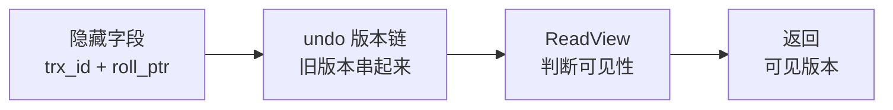
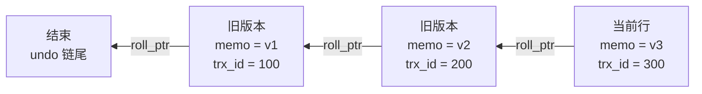

# MVCC 与隔离级别（进阶篇 · Day 10 / W2 D3）

> 一句话：**MVCC = 隐藏字段 + undo 版本链 + ReadView。RC 和 RR 的唯一区别，是 ReadView 什么时候生成 —— RC 每次 SELECT 新建一个，RR 只在第一次 SELECT 建一次然后一直用。**
> 排期：11/05｜前置：Day9 的 undo 两用途（回滚 + 版本链）。今天把"版本链"这半句彻底讲透。

## 0. 今天 3 小时怎么用

| 时间 | 做什么 | 产出 |
| --- | --- | --- |
| 15 min | 看 Day9 批改的 4 处措辞 + 读 §1 全景 | 能说出 MVCC 三件套 |
| 45 min | §2–§6 隐藏字段、版本链、ReadView 四条规则、RC/RR 差别 | 手写四条可见性规则 |
| 60 min | §7 实验 A–F（双窗口，**必须亲手做**） | 6 组对照结果 + 一张幻读截图 |
| 25 min | 算法 | 栈/队列 1 题 |
| 20 min | 记录表 + 30 秒卡 + 面试一句话口述 | 今天结束 |
| 15 min | 回填练习答案 | —— |

> 今天的重点不是背结论，而是**看懂"为什么两次读到的值不一样"**。所有实验都在两个窗口里做，一个窗口开事务不提交，另一个窗口改数据。

## 1. 全景：三个概念怎么咬合



三条线各自的职责：

| 组件 | 作用 | 一句话记忆 |
| --- | --- | --- |
| **隐藏字段** | 每行记录自带"谁改的、上一个版本在哪" | 相当于给每行贴了**修改记录单** |
| **undo 版本链** | 把一行的所有历史版本串成链表 | 相当于**修改历史**，从新到旧翻 |
| **ReadView** | 一份"哪些事务我该看见"的名单 | 相当于**当前时刻的一致性快照** |

> 关键认知：**MVCC 不复制数据、不建快照副本**。它只是"顺着版本链往回找，找到第一个我该看见的版本"。所以它很轻，但长事务会让链越拖越长。

## 2. 隐藏字段：每行记录都偷偷多存了 3 列

InnoDB 的每一行，除了你定义的列，还额外有：

| 字段 | 长度 | 含义 |
| --- | --- | --- |
| `DB_TRX_ID` | 6 字节 | **最后修改**这行的事务 ID（只记最后一次） |
| `DB_ROLL_PTR` | 7 字节 | 回滚指针，指向 undo log 里**上一个版本**的位置 |
| `DB_ROW_ID` | 6 字节 | 没有主键、也没有唯一非空索引时才生成的行 ID（有主键就不用它） |

```sql
-- 想直接看这三列？只能在"页"层面看，SQL 层看不到（被隐藏了）
-- 但可以验证它的存在：同一行被两个事务先后修改，DB_TRX_ID 会变
-- 用这个表通过行为验证，比看字节更实际
SELECT @@innodb_version;
```

两个常被问的点：

- **`DB_TRX_ID` 只记最后一次修改**，不是修改历史——历史在 undo 链里。
- **`DB_ROW_ID` 只在没有主键时存在**，所以"建表一定要有主键"还有个隐藏好处：省 6 字节/行，且聚簇索引更稳定。

## 3. undo 版本链：旧版本是怎么被串起来的

假设 `t_mvcc` 里 `id=1` 这行，`memo` 被三个事务先后改成 `v1 → v2 → v3`：



要点：

1. **每次 UPDATE 都把"改之前的值"写进 undo**，并让新版本的 `roll_ptr` 指向它 → 形成链表。
2. 链表**从新到旧**：先看当前版本，不可见就顺着 `roll_ptr` 往回翻。
3. undo 分两类，清理时机不同：

| 类型 | 由什么产生 | 什么时候能删 |
| --- | --- | --- |
| insert undo | `INSERT` | 事务提交后**立刻**可删（别人看不见这条，不需要历史） |
| update undo | `UPDATE` / `DELETE` | 要等**没有 ReadView 再需要它**时，由 **purge 线程**清理 |

> 这就解释了 Day9 那句话："undo 会被 purge 定期清理"——清的是 update undo，因为提交后它还要供 MVCC 读旧版本，不能马上删。

## 4. ReadView：四个字段决定"你能看见谁"

一个 ReadView 在生成的那一刻，相当于给数据库拍了张"事务花名册"：

| 字段 | 含义 |
| --- | --- |
| `m_ids` | 生成瞬间**所有活跃（未提交）事务**的 ID 列表 |
| `min_trx_id` | `m_ids` 里**最小**的 ID（没有活跃事务时= 下一个要分配的 ID） |
| `max_trx_id` | 生成瞬间**下一个将要分配**的事务 ID（注意不是 m_ids 的最大值） |
| `creator_trx_id` | 创建这个 ReadView 的事务自己的 ID |

## 5. 四条可见性规则（背这四条就够）

拿到一行数据的 `trx_id`，按顺序判断：

```text
① trx_id == creator_trx_id         → 可见（是我自己的修改）
② trx_id <  min_trx_id            → 可见（ReadView 之前就已提交，肯定看得到）
③ trx_id >= max_trx_id            → 不可见（是我拍快照之后才开的事务）
④ min_trx_id <= trx_id < max_trx_id：
     trx_id 在 m_ids 里            → 不可见（当时还活着，未提交）
     trx_id 不在 m_ids 里          → 可见（当时已提交）
```

一句话理解④：**"当时活着的不算，当时已经死了（已提交）的算"。**

不可见怎么办？**顺着 `roll_ptr` 往回翻一个版本，再判断一次**，直到找到可见的或链表结束（说明这行是后来才插入的，对你不可见）。

## 6. RC 与 RR 的唯一区别

| 隔离级别 | ReadView 生成时机 | 结果 |
| --- | --- | --- |
| **READ COMMITTED** | **每条 SELECT 都新建**一个 | 每次读都能看到别人最新的提交 → **不可重复读** |
| **REPEATABLE READ**（默认） | **第一条 SELECT 建一次**，整个事务复用 | 两次读同一个 ReadView → 值不变 → **可重复读** |

```text
RC：SELECT ① 建 RV → SELECT ② 重建 RV（看到了别人新提交的）
RR：SELECT ① 建 RV → SELECT ② 复用 RV（还是老名单，看不到）
```

> 这就是"可重复读"的全部秘密：**不是把数据锁住了，而是把"看谁的名单"锁住了。**
> 注意：ReadView 是**事务里第一条快照读（普通 SELECT）时**才建的，不是 `BEGIN` 时就建。所以 `BEGIN` 之后先做一次 `UPDATE` 再做 `SELECT`，快照是 UPDATE 之后才拍的。

### 6.1 快照读 vs 当前读（很容易混）

| 类型 | 语句 | 读什么 |
| --- | --- | --- |
| **快照读**（一致性读） | 普通 `SELECT` | 按 ReadView 读**历史版本**，不加锁 |
| **当前读**（锁定读） | `SELECT ... FOR UPDATE`、`SELECT ... LOCK IN SHARE MODE`、`UPDATE`、`DELETE`、`INSERT` | 读**最新版本**，并加锁（临键锁/记录锁） |

**记这条**：只有普通 SELECT 走 MVCC；**凡是写操作和加锁读，都读最新值**。这解释了为什么"我明明读到旧值，一 update 却影响了别人新插的行"。

## 7. 实验（60 分钟，双窗口，一题一记录）

```sql
-- 准备（只需一次）。注意：表要重新建，避免用旧数据干扰
USE lab;
DROP TABLE IF EXISTS t_mvcc;
CREATE TABLE t_mvcc (
  id   INT PRIMARY KEY AUTO_INCREMENT,
  memo VARCHAR(20) NOT NULL,
  age  INT NOT NULL,
  KEY idx_age (age)
) ENGINE = InnoDB;

INSERT INTO t_mvcc (memo, age) VALUES ('v0', 20), ('v0', 30);
SELECT * FROM t_mvcc;
```

```sql
-- ---------- 实验 A：先看清当前隔离级别 ----------
SELECT @@transaction_isolation;      -- 8.0 用这个变量（老版本叫 tx_isolation）
-- 预期：REPEATABLE-READ
SET SESSION TRANSACTION ISOLATION LEVEL READ COMMITTED;   -- 临时切 RC（只影响当前会话）
SELECT @@transaction_isolation;
SET SESSION TRANSACTION ISOLATION LEVEL REPEATABLE READ;  -- 记得切回来
```

```sql
-- ---------- 实验 B：RR 下的可重复读（版本链 + ReadView）----------
-- 【窗口 A】
SET SESSION TRANSACTION ISOLATION LEVEL REPEATABLE READ;
BEGIN;
SELECT id, memo FROM t_mvcc WHERE id = 1;     -- 记下：v0（这一步才生成 ReadView！）

-- 【窗口 B】别人改并提交
UPDATE t_mvcc SET memo = 'v1-b' WHERE id = 1;

-- 【窗口 A】再读：还是 v0
SELECT id, memo FROM t_mvcc WHERE id = 1;
-- 为什么：ReadView 里的 m_ids 包含窗口 B 的事务 → 不可见 → 顺 roll_ptr 翻到旧版本

-- 【窗口 A】
COMMIT;
SELECT id, memo FROM t_mvcc WHERE id = 1;     -- 事务结束，新 ReadView → v1-b
```

```sql
-- ---------- 实验 C：RC 下同一个操作，结果不同 ----------
-- 【窗口 A】
SET SESSION TRANSACTION ISOLATION LEVEL READ COMMITTED;
BEGIN;
SELECT id, memo FROM t_mvcc WHERE id = 1;     -- 当前值（假设现在是 v1-b）

-- 【窗口 B】
UPDATE t_mvcc SET memo = 'v2-b' WHERE id = 1;

-- 【窗口 A】再读：变成 v2-b（不可重复读！）
SELECT id, memo FROM t_mvcc WHERE id = 1;
COMMIT;

-- 对照结论：B 与 C 的 SQL 一模一样，只差隔离级别 → 差别就在 ReadView 重建与否
```

```sql
-- ---------- 实验 D：快照读之后做当前读，会看到最新值 ----------
-- 【窗口 A】RR
SET SESSION TRANSACTION ISOLATION LEVEL REPEATABLE READ;
BEGIN;
SELECT memo FROM t_mvcc WHERE id = 1;         -- 快照读：假设是 v2-b

-- 【窗口 B】
UPDATE t_mvcc SET memo = 'v3-b' WHERE id = 1;

-- 【窗口 A】update 是当前读 → 它看到的是最新值，并把最新值改掉
UPDATE t_mvcc SET memo = 'v3-a' WHERE id = 1;  -- 影响 1 行
SELECT memo FROM t_mvcc WHERE id = 1;          -- v3-a（自己改的，规则①可见）
COMMIT;
-- 结论：同一个事务里，快照读看历史，当前读看最新——两套机制并存
```

```sql
-- ---------- 实验 E：幻读到底怎么发生的（今天最重要）----------
-- 【窗口 A】RR
SET SESSION TRANSACTION ISOLATION LEVEL REPEATABLE READ;
BEGIN;
SELECT COUNT(*) FROM t_mvcc WHERE age > 20;    -- 记下 N（比如 1）

-- 【窗口 B】插入一条 age=25 并提交
INSERT INTO t_mvcc (memo, age) VALUES ('ghost', 25);

-- 【窗口 A】第一次验证：count 还是 N → 快照读**不幻读**
SELECT COUNT(*) FROM t_mvcc WHERE age > 20;

-- 【窗口 A】现在做一次「当前读」的 update：它会扫到窗口 B 新插的那行
UPDATE t_mvcc SET memo = 'touched' WHERE age > 20;   -- 影响 N+1 行！
SELECT COUNT(*) FROM t_mvcc WHERE age > 20;          -- 变成 N+1 → 幻读出现了
COMMIT;
-- 结论：RR 用 MVCC 挡住了「快照读的幻读」，但挡不住「当前读撞上新行后自己的快照被顶掉」
-- 真正靠间隙锁防幻读的是「当前读」那条路（Day8 的临键锁）
```

```sql
-- ---------- 实验 F：长事务 = 版本链越拖越长（顺手看一眼）----------
-- 【窗口 A】故意不提交，制造大量历史版本
BEGIN;
SELECT * FROM t_mvcc WHERE id = 1;

-- 【窗口 B】连续改 5 次
UPDATE t_mvcc SET memo = CONCAT('keep-', 1) WHERE id = 1;
-- 重复执行上一条 5 次，memo 依次变成 keep-1 … keep-5

SHOW ENGINE INNODB STATUS\G
-- 看 History list length：数值就是"还没被 purge 的旧版本数"，会 >= 5

-- 【窗口 B】改回实验前
-- 【窗口 A】COMMIT;   ← 提交后 purge 线程才能清理
```

**记录表（今天要填的 6 行）**

| 实验 | 隔离级别 | 第二次读到的值 | 结论 |
| --- | --- | --- | --- |
| B 可重复读 | RR | v0 | RR级别下根据版本链和readview可找回当前活事务，readview里max_trx_id大于m_ids不可见 |
| C 不可重复读 | RC | v2-b | RC级别下不可重复读，再读会读当前最新的readview，而窗口B的修改事务结束后生成了新的readview |
| D 快照 vs 当前读 | RR | v3-a | RR级别下同一个事务，快照读读历史版本，当前读读最新版本 |
| E1 快照读 count | RR | 1 | RR级别下快照读可被MCVV挡住幻读 |
| E2 update 影响行数 | RR | 2 | 但挡不住「当前读撞上新行后自己的快照被顶掉」 |
| F History list length | RR | | 长旧事务不提交旧版本会积累，提交后purge线程才清理旧版本 |

## 8. 练习

### A. 判断题（6）

**1.** MVCC 会把整行数据复制一份快照存在内存里供其他事务读取。
> 答：

**2.** RR 隔离级别下，ReadView 是在执行 `BEGIN` 时立即生成的。
> 答：

**3.** 普通 `SELECT` 是快照读，`SELECT ... FOR UPDATE` 是当前读。
> 答：

**4.** RC 与 RR 的差别在于 RC 不加锁、RR 加锁。
> 答：

**5.** ReadView 的 `max_trx_id` 是 `m_ids` 里最大的那个事务 ID。
> 答：

**6.** RR 隔离级别下幻读已经完全不可能发生。
> 答：

### B. 选择题（4）

**1. 一行数据的 `DB_TRX_ID` 记录的是？**
A. 创建这行的事务 ID　B. 最后修改这行的事务 ID　C. 最早读这行的事务 ID　D. 当前活跃事务数
> 答：

**2. 以下哪条语句走的是「当前读」？**
A. `SELECT * FROM t WHERE id = 1`
B. `SELECT * FROM t WHERE id = 1 FOR UPDATE`
C. `SELECT COUNT(*) FROM t`
D. `SELECT * FROM t WHERE id = 1 LIMIT 1`
> 答：

**3. RC 与 RR 最本质的区别是？**
A. 是否使用 undo log　B. ReadView 生成时机　C. 是否使用间隙锁　D. 是否支持事务
> 答：

**4. 判断一行是否可见时，`trx_id < min_trx_id` 说明？**
A. 该事务还活跃　B. 该事务在快照生成前已提交，可见　C. 该事务在快照之后才开，不可见　D. 该事务被回滚
> 答：

### C. 简答题（3）

**1. 简述 MVCC 的三件套，以及它们各自的作用。**
> 答：
>
>
>

**2. 同样是「事务 A 两次读同一行」，为什么 RC 会读到变化、RR 不会？**
> 答：
>
>
>

**3. RR 下快照读为什么不会幻读？那幻读又是怎么在 RR 下冒出来的？**
> 答：
>
>
>

### D. 分析题（2）

**1.** 事务 A（RR）先 `SELECT` 一次拿到 `memo='v0'`，随后事务 B 改为 `'v1'` 并提交。之后 A 执行 `UPDATE t_mvcc SET memo='v2' WHERE id=1`，请问 `UPDATE` 时它读到的是 `v0` 还是 `v1`？为什么最终值是 `v2`？
> 答：
>
>

**2.** 线上出现「同一事务里两次查询结果不一致」，同事怀疑是 RC 隔离级别。你怎么验证？给出至少 3 步。
> 答：
>
>

<details><summary><b>参考答案</b></summary>

**A. 判断题**

1. ❌ 错。MVCC **不复制数据**，它靠"隐藏字段 + undo 版本链 + ReadView"按需回溯旧版本。
2. ❌ 错。ReadView 在**事务里第一条快照读（普通 SELECT）**时生成，不是 `BEGIN` 时。先 UPDATE 再 SELECT 的话，快照是 UPDATE 之后拍的。
3. ✅ 对。
4. ❌ 错。差别在 **ReadView 的生成时机**；两者都用 MVCC，RC 只是每次 SELECT 重建 ReadView。
5. ❌ 错。`max_trx_id` 是"生成瞬间**下一个将要分配**的事务 ID"，比 `m_ids` 里最大的还大。
6. ❌ 错。RR 只挡住**快照读**的幻读；当前读（`UPDATE`/`FOR UPDATE`）仍可能撞上别人新插入的行，进而让后续快照读到新行。

**B. 选择题**

1. **B**。2. **B**。3. **B**。4. **B**。

**C. 简答题（要点）**

1. ①**隐藏字段**：`DB_TRX_ID` 记最后修改的事务 ID，`DB_ROLL_PTR` 指向 undo 里的上一版本——给回溯提供线索；②**undo 版本链**：把一行的历史版本从新到旧串成链表，提供"旧数据"；③**ReadView**：记录生成瞬间的活跃事务名单（`m_ids`/`min_trx_id`/`max_trx_id`/`creator_trx_id`），按四条规则判断哪个版本可见。
2. 因为 ReadView 的生成时机不同：RC **每条 SELECT 都新建** ReadView，B 提交后再读时 B 已不在活跃名单里（规则④判为可见）→ 看到新值；RR **只在第一条 SELECT 建一次**并复用，B 始终在 `m_ids` 里（规则④判为不可见）→ 顺着 `roll_ptr` 翻到旧版本。差别不在"锁没锁"，而在"看谁的名单"。
3. **快照读不幻读**：ReadView 固定了可见范围，事务 B 新插入的行 `trx_id >= max_trx_id`（规则③不可见），所以 count 不变。**幻读怎么冒出来**：一旦做了当前读（`UPDATE`/`FOR UPDATE`），它读最新版本并锁住扫到的记录，能"看见"并修改 B 新插的行；这行被本事务改过后 `trx_id` 变成自己（规则①可见），后续快照读就能看到它了 → 表现为幻读。

**D. 分析题**

1. `UPDATE` 读到的是 **`v1`**（当前读，读最新已提交版本），但**结果是 `v2`**：因为 `UPDATE` 不基于 A 的快照，而是直接在当前最新值上改，并把 `memo` 写成 `'v2'`。这说明同一事务内"快照读看历史、当前读看最新"两套机制并存——也提醒：**别用先读后写的逻辑假设数据没被别人改过**（要防这个就得用 `FOR UPDATE` 或乐观锁版本号）。
2. ①`SELECT @@transaction_isolation;` 确认**当前会话/全局**隔离级别（注意会话级可能被连接池或 `SET SESSION` 改过）；②复现：同一事务内两次 `SELECT` 同一行，中间让另一会话改并提交，看第二次是否变；③查 `information_schema.INNODB_TRX` 确认事务是否真的"同一个"（连接池可能复用连接导致误判）；④检查代码里是否有 `SET SESSION TRANSACTION ISOLATION LEVEL` 或连接串参数；⑤若确实是 RC，确认是否业务需要 RR（很多团队为减少间隙锁冲突主动用 RC，那就得在业务层接受不可重复读）。

</details>

## 9. 高频坑

| 坑 | 说明 |
| --- | --- |
| 以为 MVCC 是"复制一份数据" | 它只是按 ReadView 顺版本链回溯，不占额外数据副本 |
| 以为 ReadView 在 BEGIN 时建 | 在**第一条快照读**时建；先写后读会让快照"变新" |
| 以为 RR 完全无幻读 | 只挡住快照读；当前读仍可能撞上新行，混合场景会幻读 |
| 把当前读当快照读 | `FOR UPDATE`/`UPDATE` 读最新值并加锁；用它做过业务判断才安全 |
| 长事务不提交 | 旧版本无法 purge，`History list length` 暴涨 → undo 表空间膨胀、查询变慢 |
| 混淆 `max_trx_id` 与 `m_ids` 最大值 | `max_trx_id` 是"下一个待分配 ID"，比活跃列表最大值更大 |
| 用 `tx_isolation` | 8.0 已改为 `transaction_isolation` |

## 10. 30 秒复习卡

```text
MVCC = 隐藏字段(trx_id/roll_ptr) + undo 版本链 + ReadView
可见性四条：自己的→可见；< min→可见；>= max→不可见；
             在 m_ids 里→不可见，不在→可见
RC：每条 SELECT 新建 ReadView（不可重复读）
RR：第一条 SELECT 建一次复用（可重复读）
快照读=普通 SELECT；当前读=FOR UPDATE/UPDATE/DELETE/INSERT
RR 幻读：快照读挡得住，当前读撞上新行后会冒出来
长事务 → 版本链无法 purge → History list length 暴涨
```

## 11. 面试一句话

> **MVCC 是怎么实现的？**
> 每行有隐藏字段 `DB_TRX_ID`（最后修改的事务 ID）和 `DB_ROLL_PTR`（指向 undo 里的上一版本），UPDATE 时把旧值写进 undo 并用 `roll_ptr` 串成版本链；事务读的时候生成 ReadView（记录活跃事务列表 `m_ids`、`min_trx_id`、`max_trx_id`、`creator_trx_id`），按四条规则判断当前版本是否可见，不可见就顺链回溯。RC 每条 SELECT 重建 ReadView，RR 只在第一条 SELECT 建一次并复用，这就是"可重复读"的本质。
>
> **RR 能完全避免幻读吗？**
> 不能。快照读靠 MVCC 固定可见范围，看不到新插入的行；但当前读（`UPDATE`/`FOR UPDATE`）读最新版本并加临键锁，会看到并修改别人新插入的行，这行之后对本事务可见，就表现为幻读。要彻底避免要么用串行化，要么业务上避免"先快照读、再当前读"的混合用法。
