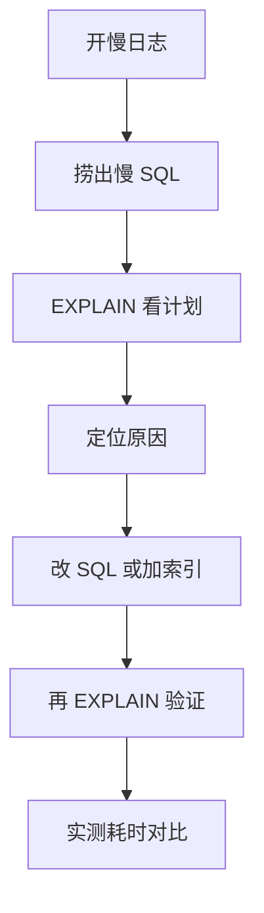

# 建表落地 + 慢 SQL 优化实战（进阶篇 · Day 12 / W2 D5）

> 一句话：**今天把 Day1–Day11 全部用一遍——建库建表、造 10 万行数据、让 5 条真实业务查询从"慢"变"快"，并用 EXPLAIN 证明它快了。**
> 排期：11/07｜产出物是 **M1 验收材料**：`shop` 库 6 张表 + 一张「优化前后对比表」。明天（11/08）做 M1 验收。

## 0. 今天 3 小时怎么用

| 时间 | 做什么 | 产出 |
| --- | --- | --- |
| 15 min | 范式白话版复盘（Day11 文末附录） | 能说出"一个事实只存一次" |
| 20 min | §2 建库建表（复用 Day11 的 DDL，加 1 张实验表） | `shop` 库 7 张表 |
| 25 min | §3 造数据（CTE 造 10 万订单、20 万点赞） | 数据量到位 |
| 60 min | §5 五个 Case：定位 → 改 → 再 EXPLAIN | 5 行对比数据 |
| 25 min | 算法 | 双指针 1 题 |
| 20 min | 填 §6 记录表 + 打勾 M1 自检清单 | 今天结束 |
| 15 min | 填练习 | —— |

> 今天**不学新知识**。所有概念你都学过（索引、失效、深分页、count、order by、慢日志、EXPLAIN），难点是**在同一条业务 SQL 上把它们串起来**。

## 1. 先说清楚：什么叫"优化成功"

不要凭感觉说"变快了"。每条 SQL 都要留下**三样证据**：

```text
① 优化前 EXPLAIN：type / key / rows / Extra
② 优化后 EXPLAIN：同上
③ 实测耗时：SHOW PROFILE 或 EXPLAIN ANALYZE 或 客户端计时（各 3 次取中位数）
```

判断"真的优化了"的最低标准：**type 从 ALL/index 变成 ref/range，且 rows 数量级下降**。只看耗时会被缓存和机器抖动骗。

## 2. 建库建表（20 分钟）

Day11 已给出 6 张表的完整 DDL（`t_user` / `t_shop` / `t_voucher` / `t_seckill_voucher` / `t_voucher_order` / `t_blog` + `t_blog_tag`），直接执行它们。

再补两张**实验专用表**——注意它们**故意留了索引坑**，别提前"修好"：

```sql
USE shop;

-- 订单实验表：故意只建单列索引 idx_user，用来演示"深分页 + filesort"
DROP TABLE IF EXISTS t_order_lab;
CREATE TABLE t_order_lab (
  id          BIGINT UNSIGNED NOT NULL AUTO_INCREMENT,
  user_id     BIGINT UNSIGNED NOT NULL COMMENT '下单用户',
  voucher_id  BIGINT UNSIGNED NOT NULL COMMENT '券ID',
  pay_value   DECIMAL(10,2)   NOT NULL DEFAULT 0,
  status      TINYINT         NOT NULL DEFAULT 0 COMMENT '0未支付 1已支付 2已核销',
  create_time DATETIME        NOT NULL COMMENT '下单时间',
  PRIMARY KEY (id),
  KEY idx_user (user_id)      -- ← 坑 1：只有单列索引，排序字段没进索引
) ENGINE = InnoDB COMMENT = '订单实验表';

-- 点赞实验表：用来演示 group by 排行榜
DROP TABLE IF EXISTS t_like;
CREATE TABLE t_like (
  id          BIGINT UNSIGNED NOT NULL AUTO_INCREMENT,
  blog_id     BIGINT UNSIGNED NOT NULL COMMENT '被赞评价',
  user_id     BIGINT UNSIGNED NOT NULL COMMENT '点赞人',
  create_time DATETIME        NOT NULL DEFAULT CURRENT_TIMESTAMP,
  PRIMARY KEY (id),
  UNIQUE KEY uk_blog_user (blog_id, user_id) COMMENT '防重复点赞',
  KEY idx_user (user_id)
) ENGINE = InnoDB COMMENT = '点赞记录';
```

```sql
-- 确认表都建好了
SHOW TABLES;
SHOW INDEX FROM t_order_lab;
```

## 3. 造数据（25 分钟，别手工插）

```sql
-- CTE 递归默认上限是 1000，造 10 万行前必须放开（只影响当前会话）
SET SESSION cte_max_recursion_depth = 300000;

-- ① 10 万订单：100 个用户 × 每人 1000 单，时间随机分布在最近 30 天
INSERT INTO t_order_lab (user_id, voucher_id, pay_value, status, create_time)
WITH RECURSIVE seq(n) AS (
  SELECT 1 UNION ALL SELECT n + 1 FROM seq WHERE n < 100000
)
SELECT
  1 + (n % 100)                                        AS user_id,     -- 100 个用户轮流
  1 + (n % 200)                                        AS voucher_id,
  50.00                                                AS pay_value,
  n % 3                                                AS status,
  NOW() - INTERVAL (n % 43200) MINUTE                  AS create_time  -- 最近 30 天
FROM seq;
```

```sql
-- ② 5000 用户
INSERT INTO t_user (phone, password, nickname)
WITH RECURSIVE seq(n) AS (SELECT 1 UNION ALL SELECT n + 1 FROM seq WHERE n < 5000)
SELECT CONCAT('138', LPAD(n, 8, '0')), REPEAT('a', 64), CONCAT('用户', n)
FROM seq
ON DUPLICATE KEY UPDATE nickname = VALUES(nickname);   -- 可重复执行不报错

-- ③ 200 张券
INSERT INTO t_voucher (shop_id, title, pay_value, actual_value, type, stock, begin_time, end_time, status)
WITH RECURSIVE seq(n) AS (SELECT 1 UNION ALL SELECT n + 1 FROM seq WHERE n < 200)
SELECT 1 + (n % 20), CONCAT('满100减', 10 + (n % 90)), 50.00, 10 + (n % 90), 0, 100,
       NOW() - INTERVAL 7 DAY, NOW() + INTERVAL 30 DAY, 1
FROM seq;

-- ④ 20 万点赞：1000 条评价 × 200 个用户（uk 保证不重复）
INSERT IGNORE INTO t_like (blog_id, user_id)
WITH RECURSIVE seq(n) AS (SELECT 1 UNION ALL SELECT n + 1 FROM seq WHERE n < 200000)
SELECT 1 + (n % 1000) AS blog_id, 1 + (n DIV 1000) AS user_id
FROM seq;
```

```sql
-- ⑤ 让优化器统计信息准确（很重要！不执行这条，rows 估算会离谱）
ANALYZE TABLE t_order_lab, t_like, t_user, t_voucher;

-- ⑥ 数据量确认
SELECT COUNT(*) FROM t_order_lab;   -- 100000
SELECT COUNT(*) FROM t_like;        -- 200000
```

## 4. 慢 SQL 定位：五步流程（今天照着走）



```sql
-- 第一、二步：先把慢日志打开（会话级，安全）
SET GLOBAL slow_query_log = ON;
SET GLOBAL long_query_time = 0.1;          -- 学习时设 0.1 秒，生产一般 1 秒
SET GLOBAL log_queries_not_using_indexes = ON;

-- 看完再关掉（生产环境别随手开，会写很多日志）
-- SET GLOBAL slow_query_log = OFF;
```

第三步往后的具体用法，在 Day6 §4 有完整命令（`mysqldumpslow`、`performance_schema.events_statements_summary_by_digest`、`EXPLAIN ANALYZE`）。

## 5. 五个 Case：每条 SQL 都要走完这五步

每个 Case 的格式统一为：**现象 → 原 EXPLAIN → 原因 → 改法 → 结果**。表格里留空，**你实测后填**。

### Case 1：店铺列表「按分类 + 评分排序」

```sql
-- 原 SQL：分类筛选 + 评分倒序 + 取前 10
SELECT id, name, score FROM t_shop WHERE type_id = 3 ORDER BY score DESC LIMIT 10;
```

先给 `t_shop` 造 2000 行（否则数据太少，优化器直接全表扫看不出问题）：

```sql
INSERT INTO t_shop (name, type_id, address, avg_price, score, status)
WITH RECURSIVE seq(n) AS (SELECT 1 UNION ALL SELECT n + 1 FROM seq WHERE n < 2000)
SELECT CONCAT('店', n), 1 + (n % 8), '某市某街', 30 + (n % 100), ROUND(3 + (n % 20) / 10, 1), 1
FROM seq;
ANALYZE TABLE t_shop;
```

```sql
EXPLAIN SELECT id, name, score FROM t_shop WHERE type_id = 3 ORDER BY score DESC LIMIT 10;
-- 预期问题：key=idx_type，但 Extra 里出现 Using filesort
-- 为什么：索引只帮它"筛"，没帮它"排" → 把过滤出来的行全捞出来再排序
```

```sql
-- 改法：把"过滤列 + 排序列"放进一个联合索引，顺序 = where 在前、order by 在后
ALTER TABLE t_shop ADD KEY idx_type_score (type_id, score);
```

```sql
EXPLAIN SELECT id, name, score FROM t_shop WHERE type_id = 3 ORDER BY score DESC LIMIT 10;
-- 预期：key=idx_type_score，Extra 里 filesort 消失（Using index condition 可能还在）
```

> 顺带验证 Day5 的知识：`ORDER BY score DESC` 用得上 **降序索引**，但 MySQL 8 已经支持 `(type_id, score DESC)`，本案例用默认升序索引也能反向扫，不必特意建 DESC。

### Case 2：券列表「上架 + 已开始 + 按开始时间倒序」

```sql
-- 原 SQL
SELECT id, title FROM t_voucher
WHERE shop_id = 5 AND status = 1 AND begin_time <= NOW()
ORDER BY begin_time DESC LIMIT 20;
```

```sql
-- 先加一个"看起来很合理"的索引（顺序故意的：范围列在前）
ALTER TABLE t_voucher ADD KEY idx_shop_begin (shop_id, begin_time, status);
EXPLAIN SELECT id, title FROM t_voucher
WHERE shop_id = 5 AND status = 1 AND begin_time <= NOW()
ORDER BY begin_time DESC LIMIT 20;
-- 预期：range 或 ref，但 begin_time 用了范围，后面的 status 就"用不上"了（Day4 的 S6）
```

```sql
-- 改法①：等值列在前、范围列在后 —— 让范围列成为索引的"最后一列"
ALTER TABLE t_voucher DROP KEY idx_shop_begin;
ALTER TABLE t_voucher ADD KEY idx_shop_status_begin (shop_id, status, begin_time);

EXPLAIN SELECT id, title FROM t_voucher
WHERE shop_id = 5 AND status = 1 AND begin_time <= NOW()
ORDER BY begin_time DESC LIMIT 20;
-- 预期：ref/range，key_len 覆盖三列，尽量没有 filesort

-- 改法②（可选，验证覆盖索引）：如果只查 id/title，把 title 也放进索引 → Using index
```

> 这个 Case 的考点：**联合索引里"范围列"要放最后**，否则它后面的列全部失效。这就是 Day4 S6 的真实业务版本。

### Case 3：订单列表「某用户的最新订单 + 深分页」

```sql
-- 原 SQL：用户 1 的第 990 页（每页 10 条）
SELECT * FROM t_order_lab WHERE user_id = 1 ORDER BY create_time DESC LIMIT 990, 10;
```

```sql
EXPLAIN SELECT * FROM t_order_lab WHERE user_id = 1 ORDER BY create_time DESC LIMIT 990, 10;
-- 预期：key=idx_user，但 Extra 有 Using filesort
-- 因为 idx_user 只有 user_id，排 create_time 还得现场排
```

```sql
-- 改法①：加联合索引 (user_id, create_time)，让"筛 + 排"一次完成
ALTER TABLE t_order_lab ADD KEY idx_user_time (user_id, create_time);
EXPLAIN SELECT * FROM t_order_lab WHERE user_id = 1 ORDER BY create_time DESC LIMIT 990, 10;
-- 预期：filesort 消失，但 rows 仍然很大 → 这就是"扫了再丢"
```

```sql
-- 改法②：延迟关联（先在索引里翻页拿到主键，再回表取整行）
SELECT o.* FROM t_order_lab o
JOIN (
  SELECT id FROM t_order_lab
  WHERE user_id = 1 ORDER BY create_time DESC
  LIMIT 990, 10
) t ON o.id = t.id;

-- 改法③：书签（推荐，翻页越深越省；但只能"下一页"，不能跳页）
SELECT * FROM t_order_lab
WHERE user_id = 1 AND create_time < '上一次的最后一行的 create_time'
ORDER BY create_time DESC LIMIT 10;
```

> 三个版本都 EXPLAIN 一遍，把 `rows` 和耗时填进表里——你会看到"索引解决排序"和"解决扫描量"是**两件不同的事**。

### Case 4：店铺详情「评价数」

```sql
-- 原 SQL：每次打开店铺详情都数一遍
SELECT COUNT(*) FROM t_blog WHERE shop_id = 5;
```

```sql
-- 先给 t_blog 造 5 万条
INSERT INTO t_blog (shop_id, user_id, title, content, liked, comments)
WITH RECURSIVE seq(n) AS (SELECT 1 UNION ALL SELECT n + 1 FROM seq WHERE n < 50000)
SELECT 1 + (n % 20), 1 + (n % 5000), CONCAT('评价', n), REPEAT('不错', 50), n % 100, n % 30
FROM seq;

EXPLAIN SELECT COUNT(*) FROM t_blog WHERE shop_id = 5;
-- 预期：如果 (shop_id, create_time) 索引存在 → type=ref，Extra=Using index（走覆盖索引）
-- 如果没索引 → 全表扫，5 万行每次都数一遍
```

```sql
-- 改法①：确保有 (shop_id, ...) 索引 → count 走覆盖索引，只读索引页
-- 改法②：冗余计数（Day11 的反范式）：在 t_shop 加一列，写入评价时 +1
ALTER TABLE t_shop ADD COLUMN blog_count INT NOT NULL DEFAULT 0 COMMENT '评价数（冗余计数）';

UPDATE t_shop s
SET blog_count = (SELECT COUNT(*) FROM t_blog b WHERE b.shop_id = s.id);
```

> 结论不是"一定要冗余"，而是：**count 有索引可走时够快就别冗余；列表页要展示 N 个店铺的评价数时，才需要冗余**（那是 N 次 count）。

### Case 5：点赞排行榜「按点赞数取 Top10」

```sql
-- 原 SQL
SELECT blog_id, COUNT(*) AS cnt
FROM t_like
GROUP BY blog_id
ORDER BY cnt DESC
LIMIT 10;
```

```sql
EXPLAIN SELECT blog_id, COUNT(*) AS cnt FROM t_like GROUP BY blog_id ORDER BY cnt DESC LIMIT 10;
-- 预期：type=index（扫整棵索引），Extra=Using index; Using temporary; Using filesort
-- 三件事同时发生：全索引扫 + 临时表 + 排序
```

```sql
-- 改法①：把 group by 的列做成索引前缀，让它"有序扫描" → 去掉临时表和 filesort
ALTER TABLE t_like ADD KEY idx_blog (blog_id);
EXPLAIN SELECT blog_id, COUNT(*) AS cnt FROM t_like GROUP BY blog_id ORDER BY cnt DESC LIMIT 10;
-- 预期：仍可能 Using temporary（因为 order by cnt 是聚合结果，必须排），但扫的是窄索引
```

```sql
-- 改法②（生产常用）：维护一张排行榜表，定时/异步更新，查询 O(1)
CREATE TABLE t_blog_rank (
  blog_id BIGINT UNSIGNED NOT NULL PRIMARY KEY,
  cnt     INT NOT NULL DEFAULT 0,
  KEY idx_cnt (cnt DESC)
) ENGINE = InnoDB COMMENT = '点赞排行（冗余聚合表）';
```

> 考点：`GROUP BY` 的代价来自"临时表 + 排序"，`ORDER BY 聚合值` **天然无法走索引**（值是算出来的）。所以要么接受，要么预聚合。

## 6. 记录表 + M1 前置自检

**① 优化前后对比表（今天必须填满，明天 M1 要用）**

| Case | 优化前 type / key / rows / Extra | 优化后 type / key / rows / Extra | 优化前耗时 | 优化后耗时 |
| --- | --- | --- | --- | --- |
| 1 店铺列表排序 | | | | |
| 2 券列表联合索引顺序 | | | | |
| 3 订单深分页 | | | | |
| 4 评价数 count | | | | |
| 5 点赞排行榜 | | | | |

**② M1 自检清单（明天验收就看这 10 条）**

```text
□ 能画出 shop 库 7 张表的 ER 关系（谁外键指向谁，不用真建外键）
□ 能解释每个字段的类型选择（为什么 CHAR(11) / DECIMAL(10,2) / DATETIME / TINYINT）
□ 每张表都有主键、字段注释、utf8mb4
□ 能说出 t_order_lab 上 idx_user 和 idx_user_time 的差别
□ 能背 key_len 公式，并现场算一个 (INT NOT NULL, VARCHAR(20) NOT NULL) 的值
□ 能背 8 个索引失效场景（S1–S8）并各举一例
□ 能写深分页的三种改法（延迟关联 / 书签 / IN）
□ 能解释 count(*) 为什么 InnoDB 慢，以及两个优化方向
□ 能说清 RR 与 RC 的差别（ReadView 生成时机）、快照读 vs 当前读
□ 能开慢日志并捞出一条慢 SQL，说出你的优化思路
```

## 7. 练习

### A. 判断题（6）

**1.** 只要 `WHERE` 用到了索引，`ORDER BY` 就一定不会 filesort。
> 答：

**2.** 联合索引 `(a, b, c)` 中，若 `b` 用了范围查询，`c` 仍能用于排序。
> 答：

**3.** 深分页慢的根因是"扫了 offset 行却只返回 10 行"。
> 答：

**4.** `GROUP BY` 一定产生临时表。
> 答：

**5.** `ALTER TABLE ... ADD KEY` 在大表上是瞬间完成的。
> 答：

**6.** 优化后 `rows` 变小但耗时没变，说明优化无效。
> 答：

### B. 选择题（4）

**1. `WHERE a=? AND b>? ORDER BY c`，最佳索引是？**
A. `(a, b, c)`　B. `(a, c, b)`　C. `(b, c)`　D. `(c, a, b)`
> 答：

**2. 深分页 `LIMIT 100000, 10` 最有效的改法是？**
A. 加大 `innodb_buffer_pool_size`　B. 延迟关联或书签翻页　C. 把 `SELECT *` 改成 `SELECT id`　D. 加 `FORCE INDEX`
> 答：

**3. `ORDER BY cnt DESC`（cnt 是 `COUNT(*)` 的结果）能走索引吗？**
A. 能，只要有索引　B. 不能，聚合值必须现场算再排　C. 能，需要覆盖索引　D. 能，需要降序索引
> 答：

**4. 加了 `(user_id, create_time)` 索引后，深分页仍慢，主要因为？**
A. 索引没生效　B. 仍要扫过前 offset 条索引记录再回表　C. 索引太大　D. 没有 ANALYZE
> 答：

### C. 简答题（3）

**1. 拿到一条慢 SQL，你的排查顺序是什么？（至少 5 步）**
> 答：
>
>
>

**2. 联合索引里"范围列"为什么要放最后？用一个具体例子说明。**
> 答：
>
>
>

**3. 什么情况下该用冗余计数，什么情况下不该？**
> 答：
>
>

### D. 优化题（2）

**1.** 下面 SQL 在 10 万行表上很慢，给出你的索引方案和改写方案，并说明预期 `type`：

```sql
SELECT id, title, create_time FROM t_article
WHERE category_id = 3 AND status = 1
ORDER BY create_time DESC
LIMIT 20;
```

> 答：
>
>

**2.** 下面这条统计 SQL 每次都扫全表，改成"预聚合"方案，写出表结构和更新方式：

```sql
SELECT shop_id, COUNT(*) FROM t_blog
WHERE create_time >= DATE_SUB(NOW(), INTERVAL 7 DAY)
GROUP BY shop_id;
```

> 答：
>
>

<details><summary><b>参考答案</b></summary>

**A. 判断题**

1. ❌ 错。`WHERE` 用索引只解决"筛"，`ORDER BY` 要能"排"才行——排序字段必须接在等值条件后面且方向一致（Day5 的 filesort 三条件）。
2. ❌ 错。范围查询会截断后续列，`c` **不能**用于排序（只能用于过滤的部分场景 / ICP）。这正是 Case 2 的坑。
3. ✅ 对。深分页是先读出 offset+limit 行、丢弃前 offset 行，代价与 offset 成正比。
4. ❌ 错。若 `GROUP BY` 的列能用索引有序扫描（且不需额外排序），可以没有临时表；但 `ORDER BY 聚合值` 通常仍要临时表 + filesort。
5. ❌ 错。大表 `ADD KEY` 要扫全表重建索引，可能锁表/耗时长；8.0 支持 `ALGORITHM=INPLACE`，但仍耗时。
6. ❌ 错。`rows` 是估算值，变小但耗时不变可能是：仍需回表、仍需 filesort、或缓存命中使前次本来就快。要看 `EXPLAIN ANALYZE` 的实际行数与耗时。

**B. 选择题**

1. **B**。等值 `a` 在前，排序 `c` 紧跟，范围 `b` 放最后（范围列放中间会让 `c` 失效）。
2. **B**。
3. **B**。
4. **B**。

**C. 简答题（要点）**

1. ①开慢日志/查 `events_statements_summary_by_digest` 找到具体 SQL 与耗时；②`EXPLAIN` 看 `type/key/rows/Extra`；③判断问题类型（没索引 / 索引失效 / 排序 / 深分页 / 回表多 / 统计不准）；④改 SQL 或加/改索引；⑤`ANALYZE TABLE` 后再次 `EXPLAIN ANALYZE` 验证；⑥实测对比并回归测试（确认没影响其他查询）。
2. 因为 B+ 树在联合索引里按 `(a, b, c)` 顺序排列，一旦 `b` 是范围（`b > 10`），`b` 之后的位置就无法再用"有序性"定位 `c`，只能逐行走 ICP 过滤。例：`WHERE a=1 AND b>10 ORDER BY c`，索引 `(a,b,c)` 中 `c` 无法用于排序 → filesort；改成 `(a,c,b)` 则可先按 `c` 有序取前 N 条再过滤 `b`。
3. **该用**：列表页要展示多个对象的计数（店铺列表显示评价数）、计数查询极频繁且允许短暂不一致、写入频率远低于读取。**不该用**：金额/库存等强一致数据、计数变化极频繁导致写放大、需要精确分页/对账的场景。

**D. 优化题**

1. 索引：`ALTER TABLE t_article ADD KEY idx_cat_status_time (category_id, status, create_time);`
   - 等值列 `category_id`、`status` 在前，排序列 `create_time` 在后 → `type=ref`，无 filesort。
   - 若只查 `id/title/create_time`，可再加 `title` 做覆盖索引 → `Using index`。
   - SQL 无需改写；若分页很深，再叠加"延迟关联/书签"。

2. 预聚合表：

```sql
CREATE TABLE t_shop_blog_daily (
  shop_id  BIGINT UNSIGNED NOT NULL,
  stat_day DATE            NOT NULL,
  cnt      INT             NOT NULL DEFAULT 0,
  PRIMARY KEY (shop_id, stat_day),
  KEY idx_day (stat_day)
) ENGINE = InnoDB COMMENT = '店铺每日评价数（预聚合）';

-- 更新方式：定时任务（每小时/每天）用 INSERT ... ON DUPLICATE KEY UPDATE 累加
INSERT INTO t_shop_blog_daily (shop_id, stat_day, cnt)
SELECT shop_id, DATE(create_time), COUNT(*)
FROM t_blog
WHERE create_time >= CURDATE()
GROUP BY shop_id, DATE(create_time)
ON DUPLICATE KEY UPDATE cnt = VALUES(cnt);

-- 查询近 7 天：只扫 7 天 × 店铺数的窄表
SELECT shop_id, SUM(cnt) FROM t_shop_blog_daily
WHERE stat_day >= DATE_SUB(CURDATE(), INTERVAL 7 DAY)
GROUP BY shop_id;
```

</details>

## 8. 高频坑

| 坑 | 说明 |
| --- | --- |
| 只看耗时判断优化 | 缓存、机器抖动都会骗人；看 `type/rows/Extra` + `EXPLAIN ANALYZE` |
| 加了索引就以为解决排序 | 排序字段要"接在等值条件后"，范围列会截断 |
| 深分页只加索引 | 索引解决"排序"，不解决"扫了再丢"；还要延迟关联/书签 |
| 忘记 `ANALYZE TABLE` | 统计信息过期 → `rows` 估算离谱 → 优化器选错索引 |
| 一次加一堆索引 | 每个索引都增加写放大与优化器选择成本；按查询建，定期清理无用索引 |
| 在业务低峰以外的时间 `ALTER` | 大表加索引会占用 IO，可能锁表（8.0 也有元数据锁排队） |
| `SELECT *` 妨碍覆盖索引 | 只取需要的列才能用 `Using index` |
| 用 `FORCE INDEX` 掩盖问题 | 数据分布一变就翻车；先查清为什么优化器不选它 |

## 9. 30 秒复习卡

```text
优化四件套：EXPLAIN(type/key/rows/Extra) + ANALYZE TABLE + EXPLAIN ANALYZE + 实测耗时
排序：等值列→排序列→范围列放最后
深分页：延迟关联（可跳页）/ 书签（更快但只能下一页）
count：走最小索引即可，别用 count(列)；列表页展示多对象计数才冗余
group by：优先让它有序扫描消掉临时表；order by 聚合值必须现场排
索引不是越多越好：写放大 + 优化器成本
```

## 10. 面试一句话

> **怎么优化一条慢 SQL？**
> 先用慢日志或 digest 表定位到具体 SQL，`EXPLAIN` 看 `type`、`key`、`rows`、`Extra` 判断是没走索引、索引失效、还是排序/回表/深分页的问题；然后针对性处理——补联合索引（等值在前、排序居中、范围最后）、改写 SQL（延迟关联、书签翻页、拆 count）、或做预聚合；最后 `ANALYZE TABLE` 后复测，并确认没有影响其他查询。判断标准不是"感觉快了"，而是执行计划与实测耗时同时改善。
>
> **深分页为什么慢，怎么解？**
> 因为 `LIMIT offset, n` 要读出 offset+n 行再丢掉前 offset 行，代价随 offset 增长。解法是延迟关联（先只查主键再回表）、书签翻页（用上一页最后的值做条件，代价恒定但不能跳页），或业务上限制最大页数。
