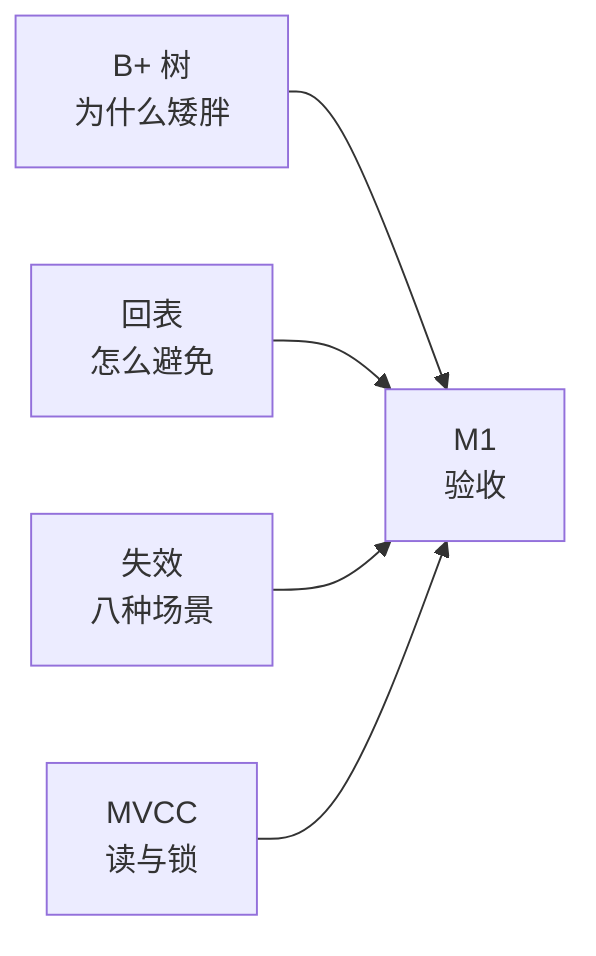

# Day13 · M1 验收 + W2 复盘（11/08 周日）

> 今天不学新东西。用 3 小时把 W2 的**锁、事务、MVCC、索引**闭卷捞一遍，跑出一个明确结论：**M1 通过 / 部分通过 / 不通过**。
> 结论要写进 `PROGRESS.md`，因为 W3 的 Java 自检要按这个结论分配精力——MySQL 没兜住的，W3 每天挤 20 分钟补，而不是整周回头重学。

## 0. 今天的 3 小时怎么分

| 时段 | 分钟 | 做什么 | 产出 |
| --- | --- | --- | --- |
| 口述 | 25 | 三问录音，不看笔记 | 3 段录音 + 自评表 |
| 闭卷 | 40 | 20 题，计时做完再对答案 | 卷面得分 |
| 批改 | 25 | 对答案、算分、定档 | M1 结论 |
| 回炉 | 30 | 只补错题，不重看整篇 | 错题回炉表 |
| 算法 | 30 | 哈希/链表各 1 题 | AC 记录 |
| 收尾 | 30 | 更新 PROGRESS + commit + 写 W3 待办 | 提交完成 |

> 计时建议：用手机计时器，40 分钟那一段**到点就停笔**。验收的意义是"现在能拿出多少"，不是"给我时间我能全对"。

## 1. M1 到底验什么

M1 的原话是：**"能讲 B+ 树、聚簇索引与回表、索引失效场景、MVCC"**。拆成四个可判定的问题：



| # | 问题 | 一分钟回答骨架 | 通过线 |
| --- | --- | --- | --- |
| 1 | B+ 树为什么适合做索引 | 非叶子只存键 → 扇出大 → 3 层存 2000 万；叶子链表 → 范围查询顺序扫 | 说出"扇出大/层数少/叶子有序"三点 |
| 2 | 聚簇索引与回表 | 聚簇叶子存整行；二级索引叶子存主键 → 查非索引列要回表；覆盖索引可免 | 能说"二级索引查到的是主键，不是行" |
| 3 | 索引失效场景 | 隐式转换、前导 %、列运算、列函数、跳最左、范围后、or 裸列、优化器放弃 | 至少说出 6 个并各举一例 |
| 4 | MVCC 怎么实现 | undo 版本链 + ReadView（m_ids/min/max/creator）+ 四条可见性规则；RC 每次新建、RR 首次固定 | 说清"RC 和 RR 只差 ReadView 生成时机" |

> 这四条就是面试官真正会追问的东西。其余（视图、存储过程、触发器、大表优化细节）M1 不验，忘了也不扣分——**减法清单里本来就允许它们模糊**。

## 2. 第一段：口述三问（25 分钟）

规则：**打开手机录音，每题 60–90 秒，不许看笔记**。录完回听，按下面三项各打 1–3 分。

### Q1. MVCC 是怎么实现的？

> （录音 60–90 秒，录完把 3 个关键词写在这里：_undo版本链____ / __readview___ / __四条可见性规则___）

### Q2. 间隙锁解决什么问题？什么隔离级别下才有？

> （录音，写完关键词在这里）解决幻读问题，当范围扫描时加上；RR级别才有。

### Q3. 拿到一条慢 SQL，你的排查顺序是什么？

> （录音，写完 5 个步骤的关键词在这里）先查看该条sql语句运行情况，再explain查看type/key/len/extra，再对问题进行加索引或重构sql语句，接着analyze table看统计信息，最后explain analyze复测看是否优化成功
### 自评表

| 维度 | Q1 | Q2 | Q3 | 说明 |
| --- | --- | --- | --- | --- |
| 内容完整（1–3） | 3 | 3 | 2 | 关键要素有没有漏 |
| 逻辑顺序（1–3） | 2 | 2 | 3 | 是不是"先…再…最后" |
| 术语准确（1–3） | 2 | 1 | 2 | 有没有说错词（如"行锁锁行"） |

> 9 分满分，**≥7 分算口述过关**。低于 7 分的那一题，把关键词抄到第 5 节的回炉表里。

**批改（11/08 阅）**：自评 20 / 27，**Q1 过关、Q2 基本过关、Q3 差一口气**。三条具体意见：

- **Q1（7 / 9）**三个关键词全对，骨架有了。口述时还该带出两句：①"InnoDB 每行有两个隐藏列 `trx_id` 和 `roll_pointer`，版本链就是靠 roll_pointer 串起来的"；②"**RC 和 RR 的唯一区别是 ReadView 的生成时机**——RR 只在第一次快照读时建一次"。第二句是面试官最爱追问的收尾。
- **Q2（7 / 9）**"解决幻读、RR 才有"完全正确。补一个精度：间隙锁**不只在范围扫描时加**——在 RR 下，即使 `WHERE b = 5` 是等值查询，只要 `b` 是**非唯一索引**，也会加间隙锁（lock_wait 时能看到临键锁）。"范围才加"是个常见但不准确的简化。
- **Q3（6 / 9）**自评 7 偏高了。两个问题：①漏了第 0 步"**先确认是不是偶发**"（锁等待/缓存穿透/机器抖动），这一步在真实排查里排第一；②`ANALYZE` 的位置错了——它是**优化之后**用来刷新统计信息的，不是"优化前先 analyze 看耗时"。同一处错误在简答 18 又出现了一次，说明是**流程记忆错位**，不是偶然，回炉时重点订正。

## 3. 第二段：闭卷 20 题（40 分钟）

> 闭卷 = 不翻文档、不查浏览器。计时 40 分钟，做完再往下对答案。
> 总分 40：判断 8×1 + 选择 6×1 + 简答 4×3 + 分析 2×7。

### A. 判断题（8，每题 1 分）

**1.** 聚簇索引的叶子节点存的是主键值。
> 答：错，存整行数据，非叶子节点存主键值，二级索引的叶子节点才存主键值

**2.** 一张 InnoDB 表可以建多个聚簇索引，只要主键不同。
> 答：错，聚簇索引只有一个，一般用主键

**3.** 联合索引 `(a, b, c)` 上，`WHERE b = 1 AND c = 2` 能用到这个索引。
> 答：错，最左前缀

**4.** 覆盖索引可以避免回表。
> 答：对

**5.** redo log 保证的是事务的原子性。
> 答：错，保证持久性，做过的不丢失，undo log才保证原子性，没做完的一件事回滚

**6.** 两阶段提交崩溃恢复时，以 binlog 是否完整来判断要不要提交。
> 答：对

**7.** 间隙锁只在 RR 隔离级别下存在。
> 答：对

**8.** 行锁是加在"行"上的。
> 答：错，锁加在索引项，如果没有索引则锁全表加前间隙

### B. 选择题（6，每题 1 分）

**9.** 单表 `SELECT * FROM t WHERE id = 5`（id 为主键），`type` 是：
A. `const`　B. `eq_ref`　C. `ref`　D. `ALL`
> 答：A 主键等值且唯一 → `const`；`eq_ref` 是 join 时被驱动表按唯一键匹配；`ref` 是非唯一索引等值。

**10.** 假设主键 BIGINT(8B)、指针 6B、页 16KB、一行数据 1KB，3 层 B+ 树大约能存多少行？
A. 1 万　B. 20 万　C. 200 万　D. 2000 万
> 答：D

**11.** `EXPLAIN` 的 `Extra` 出现 `Using index`，说明：
A. 用了主键　B. 用了覆盖索引，不需要回表　C. 用了索引下推　D. 索引失效
> 答：B

**12.** `UPDATE t SET a = 1 WHERE b = 2`，`b` 上没有索引，RR 下加锁范围是：
A. 只锁 id=2 那一行　B. 不锁　C. 全表所有记录 + 间隙　D. 只锁第一行
> 答：C

**13.** RC 隔离级别下，同一个事务里两次普通 `SELECT`，第二次读到了别人新提交的行，原因是：
A. 用了当前读　B. 每次 SELECT 都新建 ReadView　C. undo 被清了　D. 间隙锁没生效
> 答：B

**14.** `SELECT COUNT(*) FROM t`（t 上有主键和两个二级索引），InnoDB 通常选：
A. 主键（聚簇索引）　B. 最小的二级索引　C. 随便一个　D. 全部索引都扫
> 答：B

### C. 简答题（4，每题 3 分）

**15.** B+ 树相比 B 树、红黑树、哈希，为什么更适合做 MySQL 索引？
> 答：扇开大，层级少，分支少

**16.** 什么是回表？举一个会产生回表的 SQL，并说明两种避免方式。
> 答：二级索引按值查找到主键，依据主键二次回到聚簇索引查该主键包含行
>     selext id from lab where name = '杨戬';
>     **避免方式**走联合索引、优化业务逻辑
>                 

**17.** 写出 ReadView 的四个字段，并说明 RR 与 RC 的区别。
> 答：m_ids,min,max,creator  RR在事务开始时只生成一次readview，RC在每次查询都会生成新的readview

**18.** 一条 SQL 变慢，你的排查顺序是什么（至少 5 步）？
> 答：先查看sql情况，再explain查看语句的type、key、len、extra，根据对应问题优化sql语句或修改索引，然后analyze table刷新统计信息，最后explain analyze查看耗时情况和语句属性是否优化成功

### D. 分析题（2，每题 7 分）

**19.** 表 `t_order`：`PRIMARY KEY(id)`、`KEY idx_user_time(user_id, create_time)`，100 万行。
```sql
SELECT id, order_no, amount FROM t_order
WHERE user_id = 1001 AND create_time > '2026-01-01'
ORDER BY create_time DESC
LIMIT 20;
```
请写出 `type`、`key`、`rows` 量级、`Extra`，并说明是否有回表、是否需要 filesort。
> 答：type:range    key:idx_user_time    rows:十位数量级    extra：using index condition    联合索引无需回表，不需要filesort

**20.** RR 下有两个窗口：
- 窗口 A：`BEGIN; UPDATE t SET c = c + 1 WHERE b = 5;`（`b` 是普通索引，命中 3 行，不提交）
- 窗口 B：`INSERT INTO t (b, c) VALUES (6, 1);`

问：B 会阻塞吗？为什么？如果 B 插的是 `b = 5` 会怎样？
> 答：不会，窗口A的事务加的是临键锁，但锁只锁到b = 5和b = 6之间，窗口B插入b = 6 未上锁，不会堵塞。如果窗口B插入 b = 5则命中临键锁范围，会堵塞

<details><summary><b>参考答案</b></summary>

**A. 判断题**

1. ❌ 聚簇索引叶子存**整行数据**；存主键值的是**二级索引**的叶子。（这是最常被答反的一题）
2. ❌ 聚簇索引只能有一个，由主键决定；其余都是二级索引。
3. ❌ 跳过最左列 `a`，无法定位。想用上 `(b, c)` 得另建索引或把 `a` 补进条件。
4. ✅ 查询的列全在索引里，直接从索引返回，不回表。
5. ❌ redo 保证**持久性**；保证原子性（回滚）的是 **undo**。记法：redo 是"重做已提交的"，undo 是"撤销没提交的"。
6. ✅ binlog 完整说明事务可以对外生效，redo 里的 prepare 记录就提交；binlog 不完整则回滚。
7. ✅ RC 下没有间隙锁（除了外键检查和唯一性检查场景），所以 RC 幻读挡不住。
8. ❌ 锁加在**索引项**上。没有索引就退化成锁全表所有记录 + 间隙（见第 12 题）。

**B. 选择题**

9. **A**。主键等值且唯一 → `const`；`eq_ref` 是 join 时被驱动表按唯一键匹配；`ref` 是非唯一索引等值。
10. **D**。扇出 ≈ 16KB/(8+6)B ≈ 1170；叶子每页存 16 行；1170×1170×16 ≈ **2190 万**。
11. **B**。覆盖索引，从索引就能拿全所需列，`Extra: Using index`，没有回表。
12. **C**。无索引 → 扫全表 → 所有记录加临键锁（记录锁+间隙锁），再加 `supremum` 伪记录。这就是"update 没走索引锁全表"。
13. **B**。RC 每次 `SELECT` 都新建 ReadView，所以能看到别人新提交的；RR 只用第一次的，所以可重复读。
14. **B**。InnoDB 选**最小的二级索引**遍历，因为树更矮、页更少，扫的 IO 更少。

**C. 简答题**

15. 要点：①B+ 树非叶子只存键不存数据 → 单页能放更多键 → **扇出大、层数少**，3 层就 2000 万行，每次查询 2–3 次 IO；②叶子节点用链表相连 → **范围查询/排序**可以顺序扫，不用回上层；③B 树每个节点都存数据 → 扇出小、树更高；④红黑树是二叉 → 百万行要 20 层，每层一次 IO，且不支持范围顺序扫；⑤哈希只支持等值，不支持范围和排序，且哈希冲突要遍历。
16. 回表：在二级索引上查到主键，再拿主键去聚簇索引取整行，**两次 B+ 树查找**。例：`SELECT * FROM t WHERE name = 'x'`（只有 `idx_name`）。避免方式：①**覆盖索引**（把要查的列加进索引，`SELECT` 只取索引里的列）；②**索引条件下推**减少回表次数（`Using index condition`，但只是减少、不是消除）；③业务上改查询（只取需要的列）。根因记法：**二级索引叶子只有主键，没有整行**。
17. 四个字段：`m_ids`（活跃事务 ID 列表）、`min_trx_id`（最小活跃 ID）、`max_trx_id`（下一个待分配的 ID，不是最大活跃 ID）、`creator_trx_id`（创建者的 ID）。区别：**RC 每次快照读都新建 ReadView**，**RR 只在事务第一次快照读时建一次、之后复用**。这就是"RR 可重复读、RC 不可重复读"的全部原因。
18. ①先确认是否偶发（缓存穿透、锁等待、机器抖动）；②开慢日志 / 查 `events_statements_summary_by_digest` 定位具体 SQL 与耗时；③`EXPLAIN` 看 `type/key/rows/Extra`；④判断问题类型（没索引 / 失效 / 排序 / 深分页 / 回表多 / 统计过期）；⑤改 SQL 或加改索引；⑥`ANALYZE TABLE` 后 `EXPLAIN ANALYZE` 复测 + 实测耗时；⑦回归确认没影响其他查询。

**D. 分析题**

19. 
- `type = range`（`user_id` 等值 + `create_time` 范围）；
- `key = idx_user_time`，`key_len = 4 + 5 = 9`（BIGINT 4? 取决于定义：`user_id BIGINT` 则 8，`create_time DATETIME` 则 5，实际按建表算）；
- `rows`：命中该用户该时间段的订单量，量级 **10–1000**（不是 100 万）；
- `Extra = Using index condition` **且 `Using filesort` 不会出现**——因为 `ORDER BY create_time` 的列在索引里、且 `user_id` 是等值、方向一致，可以直接倒序读索引；
- **有回表**：`order_no`、`amount` 不在索引里 → 需要回表 20 次（只回 20 行，代价可接受）。
- 想消除回表：把索引改成 `(user_id, create_time, order_no, amount)` 做覆盖索引。

20. 
- **B 会阻塞**。窗口 A 的 `UPDATE ... WHERE b = 5` 在 `idx_b` 上命中 3 行，RR 下每条记录加**临键锁**（记录锁 + 前面的间隙锁），并额外锁住 `b=5` 前后的间隙。
- B 插 `b = 6`：如果 6 落在被锁的间隙里（即 5 与下一个值之间）→ **阻塞**；如果 6 落在已锁范围之外 → 不阻塞。判断依据是"**间隙是按索引值区间锁的**"，不是按行号。
- B 插 `b = 5`：落在被锁的间隙内 → **阻塞**，等 A 提交/回滚。
- 一句话结论：**间隙锁只挡 insert，不挡同值 update 之外的读**；它存在的唯一目的就是防止 RR 下的幻读。

</details>

## 4. 第三段：批改与定档（25 分钟）

先把每题得分填进来，只填错题：

| 题型 | 满分 | 得分 | 错题号 |
| --- | --- | --- | --- |
| 判断 | 8 | 7.5 | 2（结论对，理由只写"主键唯一性"） |
| 选择 | 6 | 6 | — |
| 简答 | 12 | 8 | 15、16、18 |
| 分析 | 14 | 5 | 19、20 |
| **合计** | **40** | **26.5** | |

### 本卷结论（11/08 阅）

> **26.5 / 40 → 26–33 区间：M1 部分通过。**

**你这张卷子的形态非常典型**：选择题 6/6 全对、判断题只错半个理由，说明**结论层面的记忆是扎实的**；但简答和分析掉在同一个地方——**"看不见的东西"说不清**：`Extra` 到底是 `Using index` 还是 `Using index condition`、`type` 该是 `ref` 还是 `range`、什么时候才真的 filesort。

这不是"没学会"，是"**只在看得到结果的时候会，一闭卷就退回模糊记忆**"。而这三样恰恰是面试追问的层次（"为什么是这个 type？""为什么没 filesort？"）。

**按判定线执行**：W3 前 3 天每天挤 20 分钟补下列错题对应的那一篇，W3 结束前复测一次（只重考第 19、20 两题 + 简答 4 题，20 分钟够）。

### 判定线

| 得分 | 结论 | 下一步 |
| --- | --- | --- |
| ≥34 | **M1 通过** | W3 正常推进 Java，MySQL 只保留每天 10 分钟八股 |
| 26–33 | **部分通过** | W3 前 3 天每天挤 20 分钟补错题对应的那一篇，W3 结束前复测一次 |
| <26 | **不通过** | W3 第 1–2 天各 40 分钟回炉 day9（事务）+ day10（MVCC），周末重考一次简答 4 题 |

> 判定要如实写。**故意放宽标准，害的是三周后的自己**——W8 苍穹外卖要写事务和索引，W15 点评要讲缓存与锁，地基虚了到时候是双倍返工。

### 逐题批注（只列扣分题，其余全对）

**判断 2（0.5 / 1）**　答"错，主键唯一性"——结论对，但理由没说在点上。准确说法：**一张表只有一个聚簇索引，因为数据只能按一种顺序物理存放**；"主键唯一"只能推出"主键不能重复"，推不出"不能有第二个聚簇索引"。这两个是不同的约束。

**简答 15（1.5 / 3）**　"扇开大，层级少，分支少"——三个词都对，但**只答了 B+ 树自己的优点，没答"为什么不是别的结构"**。题目问的是"为什么适合"（比较题），必须带上对手：B 树每个节点都存数据 → 扇出小、树更高；红黑树是二叉 → 百万行 20 层、每层一次 IO；哈希只能等值、不能范围。另外漏了最关键的一条：**叶子节点用双向链表连接，范围查询和排序可以顺序扫**——这条是 MySQL 选它而不是"更矮的树"的真正原因。

**简答 16（1.5 / 3）**　定义准确（"二级索引查到主键 → 拿主键回聚簇索引取整行"），但**题目要的三样只给了一样**：没举 SQL、没说两种避免方式。这两样才是得分点。避免方式：①覆盖索引（把要查的列加进索引）；②只取必要的列 / 让查询走索引下推减少回表次数。

**简答 18（2 / 3）**　步骤有，但**顺序错了一处**：你把 `ANALYZE` 放在了"优化之前"，实际应该是 `EXPLAIN` 判断问题 → 改 → **`ANALYZE TABLE` 更新统计信息** → `EXPLAIN ANALYZE` 复测。还漏了第①步"先确认是不是偶发"（锁等待 / 缓存穿透 / 机器抖动），真实工作里这一步能省掉一半无效优化。

**分析 19（2 / 7）**　这题是全场最该拿分的一题，只对了 `key` 和 `rows` 量级。三个错：

| 你的答案 | 正确 | 为什么 |
| --- | --- | --- |
| `type: ref` | **`range`** | `user_id` 等值 + `create_time` 范围，联合索引上范围条件把 type 提升为 `range`；`ref` 只在**全是等值**且非唯一索引时出现 |
| `Extra: using index` | **`Using index condition`** | 你只查 `id, order_no, amount`，而 `order_no`、`amount` **不在索引里** → 必须回表 → 不可能是覆盖索引。`Using index` 的前提是"要的列全在索引里" |
| "有聚合结果需要 filesort" | **无 filesort** | 这里没有聚合。`ORDER BY create_time` 的列在索引里、`user_id` 是等值、方向一致 → 直接倒序读索引，`Extra` 里不该出现 `Using filesort` |

> 顺带一个自相矛盾：你写 `using index` 又写"联合索引无需回表"，两句是一致的，但**前提错了**——回表是必须的（只是只回 20 行）。判断要不要回表，只问一句：**SELECT 的列和 WHERE/ORDER BY 的列，是否全在这一个索引里。**

**分析 20（3 / 7）**　第二问（插 `b=5` 会阻塞）完全正确；第一问结论"不阻塞"侥幸对了，但**理由是错的**：你说"锁只锁到 `b = 5` 之前"，实际临键锁锁的是 **`(5, 下一个索引值]` 这个区间**（记录锁锁 5 本身 + 间隙锁锁 5 到下一个值之间的空隙）。所以"插 6 会不会阻塞"取决于**6 在不在 5 和下一个值之间**，而不是"在 5 之前还是之后"。如果这张表里 5 后面紧邻的就是 6，那 B 会被阻塞。

正确表述一句话：**RR 下 UPDATE 命中 3 行，是在索引上给这 3 个索引项各加一把临键锁（记录+向右的间隙）；insert 只要落进任何一段被锁的间隙就阻塞。**


## 5. 第四段：错题回炉（30 分钟）

只补错题，**不要重看整篇**。填这张表，然后按"回哪篇"去翻对应小节的 30 秒卡：

| 题号 | 考点 | 回哪篇（`study/plans/MySQL/进阶篇/`） | 重做动作 |
| --- | --- | --- | --- |
| 1 / 2 | 聚簇 vs 二级 | `day3-索引分类与最左前缀.md` §1 | 画出两种索引叶子各存什么 |
| 3 | 最左前缀 | `day3` §4 | 把 `(a,b,c)` 8 种组合矩阵默写一遍 |
| 5 / 6 | redo/undo/2PC | `day9-事务原理redo-undo与两阶段提交.md` §2–§5 | 复述四种崩溃时刻的恢复动作 |
| 7 / 8 / 12 / 20 | 锁加在哪、间隙锁 | `day8-视图存储过程与锁机制.md` §2–§4 | 用"锁索引项"重讲一遍 |
| 13 / 17 | MVCC / ReadView | `day10-MVCC与隔离级别.md` §2–§4 | 双窗口再跑一次 RC vs RR |
| 10 | B+ 树容量 | `day2-索引结构B+树.md` §3 | 手算一次 1170×1170×16 |
| 11 / 14 / 19 | 覆盖/回表/count | `day12-建表落地与慢SQL实战.md` §5 | 跑一次 `EXPLAIN ANALYZE` 看回表次数 |

### 回炉记录

| 题号 | 原来的错误 | 正确说法（一句话） | 已订正 |
| --- | --- | --- | --- |
| 判2 | "错，主键唯一性" | 一张表只能有一个聚簇索引，因为数据只能按一种顺序物理存放 | ☐ |
| 简15 | 只说了"扇开大、层级少" | B+ 树叶存数据、扇出大层数少 + 叶子链表支持范围顺序扫；B 树更高、红黑树 20 层、哈希只能等值 | ☐ |
| 简16 | 只给了定义 | 回表 = 二级索引拿主键再回聚簇索引取整行；避免靠覆盖索引 + 只取必要列 | ☐ |
| 简18 | ANALYZE 放在优化前 | 先确认偶发 → 慢日志定位 → EXPLAIN → 改 → ANALYZE TABLE → EXPLAIN ANALYZE 复测 | ☐ |
| 析19 | `ref` / `Using index` / 有 filesort | 等值+范围 = `range`；列不在索引里 = `Using index condition` 且有回表；排序列在索引且等值前缀 → 无 filesort | ☐ |
| 析20 | "锁只锁到 b=5 之前" | 临键锁 = 记录锁 + 向右的间隙锁，锁的是 `(5, 下一个值]`；insert 落进任何被锁间隙就阻塞 | ☐ |

## 6. 预判五个最容易栽的坑

> 这五条是前两周你实际答偏过的，验收时重点自查：

1. **"redo 保证原子性"** → 原子性靠 undo 回滚；redo 管持久性。一句话：**redo 重做已提交，undo 撤销未提交**。
2. **"行锁锁的是行"** → 锁加在**索引项**上；没索引就锁全表所有记录 + 间隙。这句话是行锁部分的总开关。
3. **"RC 没有幻读"** → RC 的幻读比 RR **更严重**，因为 RC 没有间隙锁。说反了是硬伤。
4. **"ReadView 只有 m_ids"** → 四个字段；`max_trx_id` 是**下一个待分配 ID**，不是"最大活跃 ID"。
5. **"范围查询后的索引失效"** → 是**失去有序性**（不能排序/定位），不是失效；`Using index condition` 说明它还在做过滤。

## 7. 算法 30 分钟

验收日别停算法，30 分钟只做两题，做完就收：

| 题 | 主题 | 目标 | 状态 |
| --- | --- | --- | --- |
| 哈希 1 题（如 两数之和 / 字母异位词分组） | 哈希表 | 8 分钟内 AC | |
| 链表 1 题（如 反转链表 / 环形链表 II） | 双指针 | 10 分钟内 AC | |

> 卡住超过 15 分钟直接看题解，但**看完必须合上重写一遍**。今天的重点不是刷题量，是保持手感不断档。

## 8. W3 预告（下周一开始 Java 自检）

W3 主题是 **Java 自检 + 补强**，不是学新框架。先说清三件事，明天不慌：

1. **自检卷在 `study/plans/PROGRESS.md` 第三节**，8 个模块满分 60（基础语法/面向对象/集合/异常/泛型/IO/多线程/反射注解），先把表格里的 `/8` 填满。
2. **判定规则**：≥48 分只补漏点；36–48 补 2 个 P0 模块；<36 启动减法清单（先砍反射注解，再砍 IO 的 NIO 部分）。
3. **今天要准备的只有一件事**：确认 JDK、IDEA、Maven 都能跑（`java -version`、`mvn -v`）。明天开始就是写代码，环境不通会白白烧掉一小时。

> MySQL 从明天起**降为支线**：每天 10 分钟八股（就在碎片时间过一遍前面 13 篇的"30 秒卡"），主线全部让给 Java。想练 SQL 就等 W8 苍穹外卖，那时候是真业务。

## 9. 收尾（30 分钟）：记录 + 提交

### 9.1 更新 `study/plans/PROGRESS.md`

- 周打卡表：W2 行改为 `✅`，产出填 `MySQL/进阶篇/ day8–day13 + Day13 M1 验收 26.5/40（部分通过）`
- 当前周次改为 `W3`，最近更新改为 `2026-11-08`
- 里程碑：M1 打勾并注明"**部分通过 26.5/40，W3 内补测**"（补测只考第 19、20 两题 + 简答 4 题）
- 第三节 Java 自检表：明天开始填，今天先留着

### 9.2 三条日志

```text
2026-11-08 | M1 验收：闭卷 26.5/40（部分通过），口述 20/27 | 卡在 Extra 语义与 type 判定 | 明天：Java 笔试 60 题闭卷
```

### 9.3 提交

```bash
git add -A
git -c user.name=moropxin -c user.email=482477665@qq.com commit -m "docs: W2 收官，Day13 M1 验收（__/40）"
git pull --rebase && git push
```

## 10. 面试一句话（M1 总纲）

> **MySQL 这块你掌握到什么程度？**
> 索引上能讲清 B+ 树的扇出与三层容量、聚簇与二级索引的区别、回表的成因与覆盖索引的解法、八种失效场景和 `EXPLAIN` 五个关键列；事务上能讲 redo 管持久、undo 管原子与 MVCC、两阶段提交按 binlog 完整性决定提交还是回滚；锁上知道锁加在索引项而非行、RR 默认临键锁、间隙锁只为挡 insert，也踩过无索引 update 锁全表的坑；最后能把一条慢 SQL 从慢日志定位到索引改写再到 `EXPLAIN ANALYZE` 复测走完整条链路。
