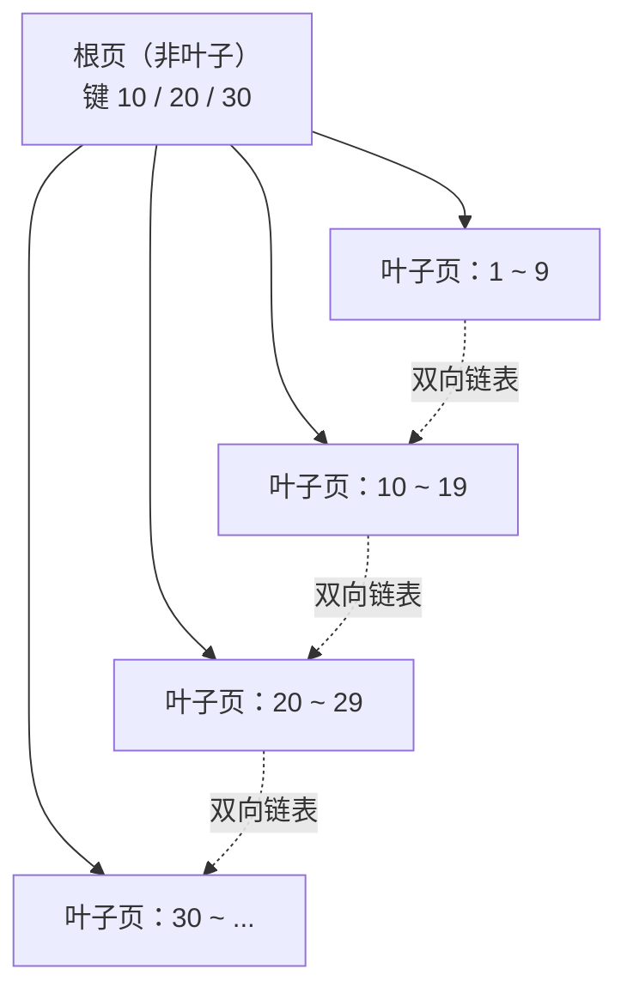

# 索引结构：B+ 树（进阶篇 · Day 2）

> 一句话：**索引就是一棵「矮胖」的 B+ 树——非叶子只存键和指针（扇出大），叶子存数据并用链表串起来（范围查询快），3 层就能装下约 2000 万行。**
> 对应计划：W1 D2（2026-10-27）｜前置：Day 1 的「页 16KB、区 1MB」｜学完能回答：为什么是 B+ 树、3 次 IO 怎么来的、哈希索引为什么不行。

## 0. 今天 3 小时怎么用

| 时间 | 做什么 | 产出 |
| --- | --- | --- |
| 30 min | 读 §1–§3：索引是什么、为什么要矮胖、四种结构淘汰赛 | 能口述 B+ 树 vs B 树 |
| 50 min | 看黑马进阶篇「索引-结构」章节（1.25 倍速） | 跟完课程 |
| 40 min | §7 动手：手画 3 层 B+ 树 + 跑 EXPLAIN 对比 | 一张手绘图 + 5 条 EXPLAIN |
| 45 min | §8 巩固练习：8 选择 + 5 判断 + 3 简答 + 2 计算 | 正确率 ≥ 80% |
| 15 min | 写笔记、`git commit` | 今天的产出 |

> 原则：**这一节不背概念，靠「画一棵树 + 算一次容量」记住**。画完 3 层树，B+ 树就再也不会忘。

## 1. 索引是什么

没有索引，查一条数据只能**一页一页翻**（全表扫描）：1000 万行 ≈ 几十万页，最坏要读几十万次磁盘。

索引 = **给数据建的目录**：

- 目录里放「键（key）」和「这一行在哪」；
- 键是排好序的，所以能**二分**快速定位；
- 目录本身也要存成页，所以目录也是树。

**索引 = 数据结构 + 排序 + 指向数据的指针。**

## 2. 磁盘视角：为什么要「矮胖」

| 事实 | 含义 |
| --- | --- |
| 磁盘一次 IO 读一页（16KB） | 读 1 字节和读 16KB 成本差不多 |
| 树每往下走一层 = 一次 IO | **树高 = 查询的磁盘 IO 次数** |
| 根节点常驻内存（buffer pool） | 实际 IO = 树高 − 1 |

所以设计目标只有一个：**在每次 IO 里塞进尽可能多的键，让树尽量矮**。

> 二叉树的树高 ≈ log₂N：1000 万行要 24 层 → 24 次 IO。
> B+ 树 3 层就能装 2000 万行 → 2–3 次 IO。
> 这就是「矮胖」的意义。

## 3. 四种候选结构，逐个淘汰

| 结构 | 等值查询 | 范围查询 | 排序 | 树高 | 淘汰原因 |
| --- | --- | --- | --- | --- | --- |
| 二叉搜索树 | 快 | 差 | 中 | 高 | 会退化成链表（有序插入时） |
| 红黑树 | 快 | 中 | 中 | 高（2 叉） | 1000 万行要 20+ 层，IO 太多 |
| B 树 | 快 | 中 | 中 | 较矮 | 节点里存了数据，扇出小；范围查询要中序遍历 |
| **B+ 树** | 快 | **快** | **快** | **最矮** | ✅ 非叶子只存键 + 指针，扇出最大；叶子有链表 |
| 哈希 | **最快** | ❌ 不支持 | ❌ 不支持 | — | 只能等值；范围、排序、最左前缀全废 |

**一句话记住淘汰顺序：**

```text
二叉树 → 太高
B 树   → 节点存数据，扇出小
哈希   → 只能等值，范围废
B+ 树  → 非叶子纯索引（扇出大）+ 叶子链表（范围快）= 赢
```

## 4. B+ 树长什么样



**三条规则（背下来）：**

1. **非叶子节点只存「键 + 子页指针」**，不存数据 → 一页能放更多键 → 扇出大。
2. **所有数据都在叶子节点**，且叶子之间用**双向链表**相连 → 范围查询顺着链表扫。
3. **任何查询都要走到叶子**（包括等值查询）→ 每次查询 IO 次数稳定，不会忽快忽慢。

### 4.1 算一算：3 层为什么能装 2000 万行

| 位置 | 一个槽位存什么 | 大小 | 一页（16KB）能放 |
| --- | --- | --- | --- |
| 非叶子 | 主键 `BIGINT` 8B + 子页指针 6B | ≈ 14B | ≈ **1170 个** |
| 叶子 | 一整行数据（假设 1KB） | 1KB | ≈ **16 行** |

```text
3 层容量 ≈ 1170 × 1170 × 16 ≈ 2190 万行
```

> 所以「3 层 B+ 树约 2000 万行」不是玄学，是 **扇出³ × 每页行数**。
> 行越小（比如 200B），能装 1 亿行；行越大，层数就得多。

### 4.2 一次查询到底几次 IO

| 情况 | IO 次数 |
| --- | --- |
| 3 层树，根不在内存 | 3 次（根 → 中间 → 叶子） |
| 3 层树，根常驻 buffer pool | 2 次（中间 → 叶子） |
| 覆盖索引（要的列都在索引里） | 只读索引页，回表那 1 次省掉（Day 3 讲） |

## 5. 哈希索引：快，但只快在一种场景

| 维度 | 哈希索引 | B+ 树 |
| --- | --- | --- |
| 等值 `=` | O(1)，最快 | O(log n) |
| 范围 `between / > <` | ❌ 不支持 | ✅ |
| 排序 `order by` | ❌ 不支持 | ✅（叶子有序） |
| 联合索引最左前缀 | ❌ 不支持 | ✅ |
| 哈希冲突 | 需要处理，冲突多会退化 | 无此问题 |

**两个关键事实：**

1. **InnoDB 不支持你手动建哈希索引**（`CREATE INDEX ... USING HASH` 无效）；只有 MEMORY 等引擎支持。
2. InnoDB 有**自适应哈希索引（AHI）**：它自己观察热点页，自动在内存里建哈希，加速等值查询——这是「自动的」，不用你管。

## 6. EXPLAIN 初体验：看优化器有没有用上索引

```sql
EXPLAIN SELECT * FROM t_user WHERE id = 500;
```

重点看 4 列：`type`（访问方式）、`key`（用了哪个索引）、`rows`（预估扫描行数）、`Extra`（额外信息）。

| type | 含义 | 好坏 |
| --- | --- | --- |
| `const` | 主键/唯一索引等值，最多一行 | 最好 |
| `eq_ref` | 联表时被驱动表走主键/唯一索引 | 很好 |
| `ref` | 普通索引等值 | 好 |
| `range` | 索引范围扫描 | 可以 |
| `index` | 扫整个索引树 | 一般 |
| `ALL` | 全表扫描 | 最差，要优化 |

> `Extra` 里出现 `Using index` = **覆盖索引**（不用回表）；出现 `Using filesort` / `Using temporary` 通常要警惕。

## 7. 动手任务（40 分钟）

### ① 手画一棵 3 层 B+ 树（10 分钟，纸上画）

要求：根 3 个键、4 个叶子页、叶子画双向链表、标出「一次查询走哪条路径」。

### ② 造数据 + 跑 EXPLAIN（25 分钟）

```sql
create database if not exists lab default charset utf8mb4;
use lab;

drop table if exists user;
create table user(
    id bigint primary key auto_increment,
    name varchar(50),
    age int,
    city varchar(20)
)engine = innodb;

-- MySQL 8：递归 CTE 造 1 万行（默认递归上限 1000，先放开）
set session cte_max_recursion_depth = 10000;
insert into user(name, age, city)
with recursive seq(n) as ( select 1 union all select n+1 from seq where n <10000)
SELECT CONCAT('user', n), 18 + n % 50, ELT(1 + n % 4, '北京','上海','广州','深圳')
FROM seq;

explain select * from user where id = 500; -- type: const key:primary rows:1 extra:null

explain select * from user where name = 'user500'; -- type: all key:null rows:9976 extra:using where

create index idx_name on user(name);
explain select * from user where name = 'user500'; -- type: ref key:idx_name rows:1 extra:null

create index idx_age on user(age);
explain select * from user where age between 20 and 25; -- type:range key:idx_age rows:1200 extra:using index condtion

explain select name from user where name = 'user500'; -- type:ref key:idx_name rows:1 Extra: using index

-- 重置index
drop index idx_name on user;
drop index idx_age on user;
```

**记录 5 条结果**：type、key、rows、Extra 各是什么，写进笔记。

### ③ 算一算（5 分钟）

如果你的表每行 200B，3 层 B+ 树大约能存多少行？写出计算过程。
答：innodb页16kb = 16384b；bigint主键8b+页指针6b = 14b；每行200b
    叶子页：16384b/200b = 81行/页
    非叶子页：16384b/14b = 1170个索引项/页
    3层B+tree：1170*1170*81 = 110880900行->约一亿行

## 8. 巩固练习（45 分钟，做完再看答案）

### A. 选择题（8 题）

**1. InnoDB 索引的默认数据结构是？** 
B
A. 哈希表　B. B+ 树　C. B 树　D. 红黑树

**2. 相比 B 树，下列不属于 B+ 树优势的是？** D
A. 非叶子不存数据，扇出更大
B. 叶子有链表，范围查询更方便
C. 所有查询都到叶子，IO 次数稳定
D. 支持哈希等值查询

**3. 主键 `BIGINT`、每行约 1KB 时，3 层 B+ 树大约能存多少行？** C
A. 1 万　B. 100 万　C. 2000 万　D. 10 亿

**4. 哈希索引不适合下列哪种查询？** B
A. `where id = 1`
B. `where age between 20 and 30`
C. `where name = 'a'`
D. `where id in (1,2,3)`

**5. InnoDB 的「自适应哈希索引」是？** B
A. 需要手动 `CREATE INDEX ... USING HASH`
B. InnoDB 自动为热点页建立的
C. MEMORY 引擎专有的
D. InnoDB 不支持

**6. B+ 树非叶子节点不存数据，最直接的好处是？** B
A. 节省磁盘
B. 一页能放更多键，扇出更大、树更矮
C. 方便删除
D. 减少锁冲突

**7. 3 层 B+ 树，根节点不在内存，查一条记录最多几次磁盘 IO？** C
A. 1　B. 2　C. 3　D. 4

**8. B+ 树的叶子节点之间用什么连接？** B
A. 单链表　B. 双向链表　C. 数组　D. 红黑树

### B. 判断题（5 题）

1. B+ 树的所有数据都存放在叶子节点。（T）
2. 哈希索引可以支持 `order by` 排序。（F）
3. InnoDB 可以用 `CREATE INDEX ... USING HASH` 显式创建哈希索引。（F）
4. 树高越低，查询需要的磁盘 IO 越少，查询越快。（T）
5. InnoDB 中，主键索引就是聚簇索引。（T）

### C. 简答题（3 题）

1. 为什么 MySQL 选 B+ 树，而不是 B 树？
答：只用双向链表链接数据，非数据节点做索引项，扇开更大，层数更少，优化IO。

2. 为什么不用红黑树做索引？
答：特殊情况会出现全扫描情况，IO大，不稳定。

3. 哈希索引适合什么场景？不适合什么场景？
答：适合仅做单次查询情况,IO仅为1，不适合范围查询和条件查询。

### D. 计算题（2 题）

1. 页大小 16KB，主键 8B，子页指针 6B，忽略页头开销，一个非叶子页大约能放多少个键？
答：页大小为16384b，键项总和14b
    非叶子页：16384b/14b = 1170键/页

3. 每行 200B，扇出按 1170 算，3 层 B+ 树大约能存多少行？
答：页大小为16384b
    叶子页：16384b/200b = 81页/行
    1170*1170*81=1亿

<details><summary><b>答案与解析（先做完再点开）</b></summary>

**A. 选择题**

1. **B**。InnoDB 默认 B+ 树；MEMORY 默认哈希。
2. **D**。哈希等值查询是哈希索引的优势，不是 B+ 树的；B+ 树本身不支持哈希语义。
3. **C**。1170 × 1170 × 16 ≈ 2190 万（1KB 行约 16 行/页）。
4. **B**。哈希只支持等值，`between` 必须全表扫或走 B+ 树。
5. **B**。AHI 是 InnoDB 自动维护的内存哈希，用户无需也无法手动建。
6. **B**。非叶子只存键 + 指针 → 单页塞更多键 → 扇出大 → 树矮 → IO 少。
7. **C**。根、中间、叶子各一次；根常驻内存时才是 2 次。
8. **B**。双向链表，方便正向/反向范围扫描。

**B. 判断题**

1. **对**。非叶子只有键和指针，数据全在叶子。
2. **错**。哈希无序，无法排序。
3. **错**。InnoDB 不支持显式哈希索引（只有 MEMORY 等支持）；即使写 `USING HASH` 也不会建出哈希索引，InnoDB 只有自动的 AHI。
4. **对**。IO 次数 ≈ 树高。
5. **对**。InnoDB 用主键建聚簇索引，叶子存整行。

**C. 简答题（要点）**

1. B 树节点存「键 + 数据」，一页能放的键少、扇出小、树更高；B+ 树非叶子只存键 + 指针，扇出大、树矮；B+ 树叶子有链表，范围查询顺序扫，B 树要中序遍历。
2. 红黑树是二叉，1000 万行要 20+ 层，每层一次 IO；B+ 树 3 层就够，IO 少一个数量级。
3. 适合：等值查询、内存表、缓存类场景（MEMORY）；不适合：范围查询、排序、联合索引最左前缀、模糊匹配。

**D. 计算题**

1. 16 × 1024 ÷ (8 + 6) ≈ **1170 个**。
2. 1170 × 1170 × (16 × 1024 ÷ 200 ≈ 81) ≈ **1.1 亿行**（约 1 亿）。

</details>

## 9. 高频坑

| 坑 | 说明 | 正确理解 |
| --- | --- | --- |
| 以为 B+ 树「数据在非叶子」 | 那是 B 树 | B+ 树非叶子只有键和指针 |
| 以为「树高 = 查询次数」绝对成立 | 根常驻内存 | 实际 IO = 树高 − 1（根命中缓存时） |
| 以为哈希索引万能 | 只适合等值 | 范围/排序/最左前缀都用不了 |
| 把「自适应哈希」当手动索引 | AHI 是自动的 | 你无法 `CREATE ... USING HASH` |
| 只背「3 层 2000 万」 | 换行大小就变了 | 记住公式：扇出³ × 每页行数 |

## 10. 30 秒复习卡

```text
索引 = 矮胖 B+ 树：非叶子存键+指针（扇出大），叶子存数据+双向链表（范围快）
3 层 ≈ 1170 × 1170 × 16 ≈ 2000 万行（1KB 行）
查询 IO = 树高（根在内存则 -1）
哈希 = 只快在等值；InnoDB 只有自动 AHI
EXPLAIN 看 type：const > eq_ref > ref > range > index > ALL
```

## 11. 面试一句话

> **为什么 MySQL 用 B+ 树而不是 B 树？**
> B+ 树非叶子只存键和子页指针，一页能放更多键、扇出更大，所以树更矮、IO 更少；叶子节点用双向链表相连，范围查询可以顺序扫描；而且所有查询都落到叶子，IO 次数稳定。
>
> **为什么不用哈希索引？**
> 哈希只支持等值查询，遇到范围、排序、联合索引最左前缀就失效；InnoDB 只提供自动的自适应哈希来加速热点等值查询。
