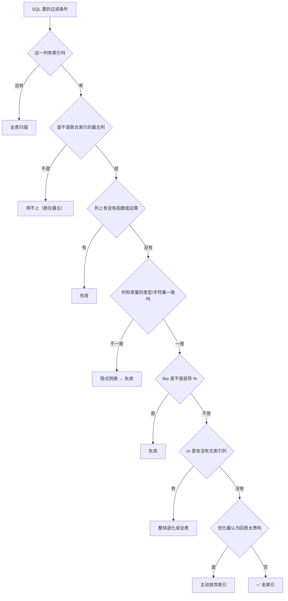

# 索引失效与 EXPLAIN 详解（进阶篇 · Day 4）

> 一句话：**EXPLAIN 是给 SQL 拍 X 光——看 `type / key / key_len / rows / Extra` 五列就知道走没走索引；索引失效基本逃不出「列上有运算、类型不一致、断了最左前缀、前导模糊、or 里有裸列、优化器嫌贵」这六类。**
> 对应计划：W1 D4｜前置：Day 2（B+ 树）、Day 3（聚簇/二级/回表/最左前缀）｜学完能回答：怎么 30 秒判断一条 SQL 有没有走索引、8 种失效怎么修。

## 0. 今天 3 小时怎么用

| 时间 | 做什么 | 产出 |
| --- | --- | --- |
| 25 min | 读 §1–§4：EXPLAIN 六列、type/Extra、key_len 算法、失效判定流程 | 能背出 5 个必看列 |
| 50 min | 看黑马进阶篇「索引-使用 / 索引-失效」章节 | 跟完课程 |
| 55 min | §5 实验：8 个失效场景逐条复现 + 填记录表 | 8 条 EXPLAIN 记录 |
| 35 min | §6 练习（判断题 8 / 选择 4 / 简答 3 / 改写 2） | 答题区填满 |
| 15 min | 写笔记、`git commit` | 今天的产出 |

> 原则：**今天不背结论，背「证据」**。每说一个"会失效"，EXPLAIN 里必须能指出 `key=NULL` 或 `type=ALL`。

## 1. EXPLAIN 全景：先会看，再会改

```sql
-- EXPLAIN：只生成执行计划，不会真正执行 SQL（安全，可随便跑）
EXPLAIN SELECT * FROM t_idx WHERE id = 1;

-- FORMAT=JSON：用 JSON 输出，带 cost（代价）、可能的子查询细节，适合深挖
EXPLAIN FORMAT=JSON SELECT * FROM t_idx WHERE id = 1;

-- ANALYZE（MySQL 8.0.18+）：真正执行 SQL，给出实际行数与耗时
-- ⚠️ 它会真跑一遍，所以只对 SELECT 用；DML 别这么玩
EXPLAIN ANALYZE SELECT * FROM t_idx WHERE id = 1;

-- 看表上建了哪些索引、各自区分度（Cardinality 越大越"独特"）
SHOW INDEX FROM t_idx;

-- 从数据字典看统计信息：Cardinality 低 = 区分度差 = 优化器可能放弃索引
SELECT index_name, column_name, cardinality
FROM information_schema.STATISTICS
WHERE table_schema = DATABASE() AND table_name = 't_idx';

-- 优化器开关：看 index_merge（or 自动合并索引）等能力是否开启
SELECT @@optimizer_switch;
```

### 必看的 5 列

| 列 | 含义 | 怎么看 |
| --- | --- | --- |
| `type` | 访问方式 | `const > eq_ref > ref > range > index > ALL`，**出现 ALL 就要怀疑** |
| `key` | 实际用了哪个索引 | `NULL` = 没用索引 |
| `key_len` | 用了索引的多少字节 | 变长 → 用了联合索引更多列 |
| `rows` | 预估扫描行数 | 越大越慢（是估算值，不是精确值） |
| `Extra` | 额外信息 | `Using index`（覆盖）/`filesort`/`temporary` 要关注 |

> 还有 `possible_keys`（候选索引）、`filtered`（过滤比例）、`ref`（和哪个值比较）作为辅助。

## 2. type 与 Extra 速查

| type | 含义 | 好坏 |
| --- | --- | --- |
| `const` | 主键/唯一索引等值，最多 1 行 | 最好 |
| `eq_ref` | 联表时被驱动表走主键/唯一索引 | 很好 |
| `ref` | 普通索引等值 | 好 |
| `range` | 索引范围扫描 | 可以 |
| `index` | 扫整个索引树 | 一般 |
| `ALL` | 全表扫描 | 最差 |

| Extra | 含义 | 说明 |
| --- | --- | --- |
| `Using index` | 覆盖索引 | 不回表，好 |
| `Using index condition` | 索引下推（ICP） | 索引层先过滤，减少回表 |
| `Using where` | 需要回表后/在服务层再过滤 | 常见，本身不坏 |
| `Using filesort` | 排序没走索引 | 数据量大时慢 |
| `Using temporary` | 用了临时表 | `group by`/`distinct` 常见，能避免就避免 |
| `Using join buffer (Block Nested Loop)` | 被驱动表没索引 | 联表缺索引的信号 |

## 3. key_len：判断联合索引用了几列

| 类型 | 字节数 |
| --- | --- |
| `TINYINT` / `SMALLINT` / `MEDIUMINT` / `INT` / `BIGINT` | 1 / 2 / 3 / 4 / 8 |
| `DATE` / `DATETIME(0)` / `DATETIME(3)` | 3 / 5 / 8 |
| `CHAR(n)`（utf8mb4） | `n × 4`（+1 可空） |
| `VARCHAR(n)`（utf8mb4） | `n × 4 + 2`（变长长度位；可空再 +1） |

**举例**：联合索引 `(age INT NOT NULL, city VARCHAR(20) NOT NULL)`，utf8mb4

| 条件 | key_len | 说明 |
| --- | --- | --- |
| `age = 20` | 4 | 只用到 age |
| `age = 20 AND city = '北京'` | 86 | 4 + (20×4+2) = 86，两列都用上 |
| `city` 列若可空 | +1 | 86 → 87 |

> 用途：**看到 key_len 变大，就说明联合索引用到了更多列**。这是判断"最左前缀断在哪"最快的办法。

## 4. 索引失效的判定流程（面试可直接背）



## 5. 八个失效场景（每个都要有 EXPLAIN 证据）

| # | 场景 | 失效写法 ❌ | 修复写法 ✅ | EXPLAIN 证据 |
| --- | --- | --- | --- | --- |
| S1 | 隐式类型转换 | `where phone = 13800138000`（phone 是 varchar） | `where phone = '13800138000'` | `type=ALL, key=NULL` |
| S2 | 前导模糊 | `like '%手机'` | `like '手机%'` 或全文索引 | `type=ALL` |
| S3 | 索引列参与运算 | `where id + 1 = 101` | `where id = 100` | `type=ALL` |
| S4 | 索引列套函数 | `where date(create_time) = '2026-10-30'` | `create_time >= '2026-10-30' and create_time < '2026-10-31'` | `type=ALL` |
| S5 | 联合索引跳过最左 | 索引 `(age, city)`，`where city = '北京'` | 补上 `age = ?` | `type=ALL` |
| S6 | 范围之后失效 | `(a,b,c)` 上 `a=1 and b>2 and c=3` | 调整顺序或接受 c 只做过滤（ICP） | `key_len` 只覆盖 a、b |
| S7 | or 里有无索引列 | `where name='x' or memo like '%y%'` | 拆 `union all`，或给 memo 建索引 | `type=ALL` |
| S8 | 优化器主动放弃 | 低区分度列 `where gender = 1`（男女各半） | 联合索引、`ANALYZE TABLE` 更新统计、覆盖索引 | `possible_keys` 有值但 `key=NULL` |

> **重要区分**：S1 里"`phone = 13800138000`"失效，是因为**列被转换**；而"`age = '20'`"（int 列 vs 字符串常量）通常**仍然走索引**，因为转换的是常量。判断口诀：**看谁被转换——列被转换就失效。**

## 6. 动手实验（55 分钟，代码带注释）

```sql
-- ===== 建实验库表 =====
CREATE DATABASE IF NOT EXISTS lab DEFAULT CHARSET utf8mb4;
USE lab;
DROP TABLE IF EXISTS t_idx;

CREATE TABLE t_idx (
  id          BIGINT PRIMARY KEY AUTO_INCREMENT,
  phone       VARCHAR(20)  NOT NULL,          -- 故意用字符串存手机号，方便演示隐式转换
  name        VARCHAR(50)  NOT NULL,
  age         INT          NOT NULL,
  city        VARCHAR(20)  NOT NULL,
  gender      TINYINT      NOT NULL,          -- 0/1，区分度极低，用来演示"优化器放弃索引"
  create_time DATETIME     NOT NULL,
  memo        VARCHAR(200),
  KEY idx_phone (phone),
  KEY idx_name  (name),
  KEY idx_age_city (age, city),               -- 联合索引：最左前缀/范围失效都靠它
  KEY idx_gender (gender)
) ENGINE = InnoDB;

-- 造 1 万行：WITH RECURSIVE 是 MySQL 8 的递归 CTE（相当于"用 SQL 写循环"）
-- cte_max_recursion_depth 限制递归深度，默认 1000，这里放大到 10000
SET SESSION cte_max_recursion_depth = 10000;
INSERT INTO t_idx (phone, name, age, city, gender, create_time, memo)
WITH RECURSIVE seq(n) AS (
  SELECT 1
  UNION ALL
  SELECT n + 1 FROM seq WHERE n < 10000
)
SELECT
  CONCAT('138', LPAD(n, 8, '0')),                          -- LPAD 左补零，凑够 8 位
  CONCAT('user', n),
  18 + n % 50,
  ELT(1 + n % 4, '北京', '上海', '广州', '深圳'),           -- ELT(序号, 值1..值N)：按序号取值
  n % 2,                                                   -- gender 只有 0/1
  NOW() - INTERVAL (n % 365) DAY                           -- INTERVAL 做日期加减
FROM seq;

-- 更新统计信息：优化器据此估算 rows，统计过期会导致"该走索引却走了全表"
ANALYZE TABLE t_idx;
```

```sql
-- ===== 逐条验证（每条都看 type / key / key_len / rows / Extra）=====

-- 【基线】主键等值：const
EXPLAIN SELECT * FROM t_idx WHERE id = 100;

-- 【基线】普通索引等值：ref + 回表（Extra 没有 Using index）
EXPLAIN SELECT * FROM t_idx WHERE phone = '13800000100';

-- S1 隐式转换：phone 是 varchar，这里却传数字 → 列被转成数字 → 索引失效
EXPLAIN SELECT * FROM t_idx WHERE phone = 13800000100;
-- 对照：int 列传字符串常量，转换的是常量，索引仍然有效
EXPLAIN SELECT * FROM t_idx WHERE age = '20';

-- S2 前导模糊：% 在开头，无法二分 → ALL
EXPLAIN SELECT * FROM t_idx WHERE name LIKE '%user500';
-- 对照：前缀模糊可以当范围查询 → range
EXPLAIN SELECT * FROM t_idx WHERE name LIKE 'user50%';

-- S3 列参与运算：id+1 破坏了有序性 → ALL
EXPLAIN SELECT * FROM t_idx WHERE id + 1 = 101;

-- S4 列上套函数：DATE(create_time) 相当于每行算一次 → ALL
EXPLAIN SELECT * FROM t_idx WHERE DATE(create_time) = CURDATE();
-- 改写为范围：range
EXPLAIN SELECT * FROM t_idx WHERE create_time >= CURDATE() AND create_time < CURDATE() + INTERVAL 1 DAY;

-- S5 跳过联合索引最左列：city 不是最左列 → ALL
EXPLAIN SELECT * FROM t_idx WHERE city = '北京';
-- 补上最左列 age：ref，key_len = 4+82 = 86（两列都用上）
EXPLAIN SELECT * FROM t_idx WHERE age = 20 AND city = '北京';
-- 只看 age：ref，key_len = 4
EXPLAIN SELECT * FROM t_idx WHERE age = 20;

-- S6 范围之后失效：a=1 and b>2 之后，c 不能定位（可能看到 Using index condition）
EXPLAIN SELECT * FROM t_idx WHERE age = 20 AND city > '北' AND memo = 'x';

-- S7 or 里有无索引列：memo 没索引 → 整体全表
EXPLAIN SELECT * FROM t_idx WHERE name = 'user500' OR memo = 'x';
-- 修复：拆成两段 union（两边各自走索引）
EXPLAIN SELECT * FROM t_idx WHERE name = 'user500'
UNION
SELECT * FROM t_idx WHERE memo = 'x';

-- S8 优化器放弃：gender 只有 0/1，约一半行要回表 → 不如全表扫
EXPLAIN SELECT * FROM t_idx WHERE gender = 1;

-- 覆盖索引对照：只取索引列 + 主键 → Using index
EXPLAIN SELECT age, city FROM t_idx WHERE age = 20;

-- 排序有没有走索引：order by 不在索引里 → Using filesort
EXPLAIN SELECT * FROM t_idx WHERE age = 20 ORDER BY name;
```

**记录表（把真实结果填进去，这就是今天的产出）**

| # | 场景 | type | key | key_len | rows | Extra |
| --- | --- | --- | --- | --- | --- | --- |
| 1 | S1 隐式转换 | | | | | |
| 2 | S2 前导模糊 | | | | | |
| 3 | S3 列运算 | | | | | |
| 4 | S4 列函数 | | | | | |
| 5 | S5 跳最左 | | | | | |
| 6 | S6 范围后 | | | | | |
| 7 | S7 or 裸列 | | | | | |
| 8 | S8 低区分度 | | | | | |

## 7. 练习（35 分钟，直接在答题区写）

### A. 判断题（8 题：会走索引 / 不走索引，并一句话说明原因）

> 表 `t_idx`：`phone varchar` 有索引、`age int` 有索引、`name varchar` 有索引、`create_time datetime` 无索引、`(age, city)` 联合索引。

**1.** `where phone = '13800000100'`
> 答：

**2.** `where phone = 13800000100`
> 答：

**3.** `where age = '20'`
> 答：

**4.** `where name like 'user50%'`
> 答：

**5.** `where name like '%user50'`
> 答：

**6.** `where city = '北京'`（单独查）
> 答：

**7.** `where age = 20 and city = '北京'`
> 答：

**8.** `where age = 20 and memo = 'x'`
> 答：

### B. 选择题（4 题）

**1. `key_len` 变大说明什么？**
A. 索引更多　B. 联合索引用到了更多列　C. 数据量变大　D. 回表次数变多
> 答：

**2. `Extra: Using filesort` 表示？**
A. 排序走了索引　B. 排序没走索引，要额外排序　C. 用了临时表　D. 覆盖索引
> 答：

**3. 下列**不是**索引失效原因的是？**
A. 对索引列使用函数　B. 字符串列不加引号　C. `is null` 查询　D. 前导模糊查询
> 答：

**4. `possible_keys` 有值、`key` 却是 NULL，最可能的原因？**
A. 索引坏了　B. 优化器认为全表扫描更便宜　C. 表太小没有索引　D. 字符集问题
> 答：

### C. 简答题（3 题）

**1. 拿到一条慢 SQL，你用哪几步判断它有没有走索引？**
> 答：
>
>

**2. 深分页 `limit 1000000, 10` 为什么慢？怎么优化？**
> 答：
>
>

**3. 一条 SQL 明明走了索引（type=ref），但还是慢，可能是什么原因？**
> 答：
>
>

### D. 改写题（2 题：把失效 SQL 改成能走索引的写法）

**1.** `select * from t_idx where date(create_time) = '2026-10-30' and age = 20;`
> 答：

**2.** `select * from t_idx where name = 'user500' or memo like '%x%';`
> 答：

<details><summary><b>参考答案（先写满答题区再点开）</b></summary>

**A. 判断题**

1. ✅ 走：`ref`，字符串对字符串，类型一致。
2. ❌ 不走：传数字让**列**被隐式转换成数字，索引失效（`ALL`）。改成 `'13800000100'` 即可。
3. ✅ 走：int 列对字符串常量，转换的是**常量**，不影响索引（`ref`）。
4. ✅ 走：前缀模糊等价于范围查询，`range`。
5. ❌ 不走：前导 `%` 无法二分定位，`ALL`。
6. ❌ 不走：`city` 不是联合索引 `(age, city)` 的最左列，`ALL`。
7. ✅ 走：两列都用上，`ref`，`key_len = 4 + 82 = 86`。
8. ✅ 走 `age`，但 `memo` 无索引只能回表后过滤：`ref` + `Using where`。

**B. 选择题**

1. **B**。`key_len` 是实际用到索引的字节数，变大 = 用了更多列。
2. **B**。排序没利用索引顺序，需要额外排序（内存或磁盘）。
3. **C**。`is null` 在 InnoDB 里其实**可以**走索引（索引里存了 NULL 标记），这是常见误区。
4. **B**。优化器基于统计信息估算，认为回表代价 > 全表扫，主动放弃；可 `ANALYZE TABLE` 更新统计或做覆盖索引。

**C. 简答题（要点）**

1. ①`EXPLAIN` 看 `type`：出现 `ALL` 基本就是没走索引；②看 `key` 是否为 NULL、`key_len` 到第几列；③看 `rows` 扫描行数与 `Extra`（回表/filesort/temporary）；④对可疑 SQL 用 `EXPLAIN ANALYZE` 看真实耗时。
2. 深分页要扫描并丢弃前 100 万行再取 10 行，扫描量巨大。优化：①**延迟关联**：先用覆盖索引查主键 `select id from t order by id limit 1000000,10`，再 `join` 回表；②记住上一页最大 id（`where id > last_id limit 10`）；③业务上限制可翻页深度。
3. 可能原因：①回表次数多（返回行多、随机 IO）；②`Using filesort`/`Using temporary`；③锁等待或并发高；④缓存未命中（buffer pool 小/冷数据）；⑤返回大量列或大字段（`select *`、TEXT）；⑥统计信息过期导致选错索引（`ANALYZE TABLE` + `FORCE INDEX` 只作最后手段）。

**D. 改写题**

1. `select * from t_idx where create_time >= '2026-10-30' and create_time < '2026-10-31' and age = 20;`（去函数、改范围；若 create_time 有索引则 `range`，否则仍靠 `age` 索引 + 过滤）
2. `select * from t_idx where name = 'user500' union all select id, phone, name, age, city, gender, create_time, memo from t_idx where memo like '%x%';`（拆开后，第一段走 `idx_name`；第二段的 `like '%x%'` 本身仍无法用普通索引，需要全文索引或改用可前缀匹配的设计）

</details>

## 8. 高频坑

| 坑 | 说明 | 正确结论 |
| --- | --- | --- |
| 背"`is null` 会失效" | InnoDB 索引里存 NULL，`is null` 可用索引 | 别把老 MySQL/MyISAM 的结论套过来 |
| 背"`!=` 一定失效" | 优化器按代价决定，多数情况选全表 | 说"通常不走索引定位，取决于数据分布"更稳 |
| 以为"字符串列传数字"和"数字列传字符串"一样 | 前者转换列（失效），后者转换常量（有效） | 看谁被转换 |
| 只看 `key` 不看 `rows` | 走了索引但扫了几十万行照样慢 | `type`+`rows`+`Extra` 一起看 |
| 字符集不一致的联表 | `utf8mb4_0900_ai_ci` vs `utf8mb4_general_ci` 会隐式转换 | 建表/联表统一字符集与排序规则 |
| 滥用 `FORCE INDEX` | 强行指定可能更慢，且数据分布一变就崩 | 先优化统计信息与索引设计 |

## 9. 30 秒复习卡

```text
EXPLAIN 五列：type（ALL=没走）、key（NULL=没用）、key_len（几列）、rows（扫多少）、Extra（filesort/temporary/Using index）
失效六因：列运算 / 列函数 / 隐式转换（列被转）/ 断最左 / 前导 % / or 含裸列（+ 优化器嫌贵）
修法：去函数改范围、常量补引号、补最左列、拆分 or、覆盖索引、ANALYZE TABLE
```

## 10. 面试一句话

> **你怎么判断一条 SQL 有没有走索引？**
> 用 `EXPLAIN` 看五列：`type` 是否退化到 `ALL`、`key` 是否为空、`key_len` 用到了联合索引第几列、`rows` 预估扫描量、`Extra` 有没有 `filesort`/`temporary`；再结合 `EXPLAIN ANALYZE` 看真实耗时。
>
> **索引失效的常见原因？**
> 在索引列上做函数或运算、隐式类型转换（字符串列传数字）、联合索引不满足最左前缀、`like '%x'` 前导模糊、`or` 连接了无索引列，以及数据区分度太低导致优化器主动放弃索引。