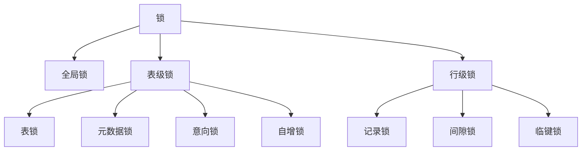

# 锁机制 + 视图/存储过程速通（进阶篇 · Day 8 / W2 D1）

> 一句话：**锁分三层——全局锁锁库、表级锁锁表（表锁/MDL/意向锁/自增锁）、行级锁锁索引（记录锁/间隙锁/临键锁）；而视图与存储过程只需 40 分钟知道「是什么、什么时候别用」。**
> 对应计划：W2 D1（11/03）｜为什么合并：W1 晚 1 天，把「视图/存储过程」压成 40 分钟并入本日，触发器直接跳过（减法清单第一位）。

## 0. 今天 3 小时怎么用

| 时间 | 做什么 | 产出 |
| --- | --- | --- |
| 15 min | §1 视图 / 存储过程 概念 | 知道语法与「为什么业务少用」 |
| 25 min | §1 动手：建 emp/dept + 1 视图 + 1 存储过程 | 能自己写出来 |
| 35 min | §2–§5 锁的分层与加锁规则 | 记住「什么条件加什么锁」 |
| 65 min | §6 实验 A–G（双窗口看锁、MDL、死锁） | 锁记录表填满 |
| 25 min | 算法 | 哈希 1 题 |
| 15 min | §8 记录 + commit | 今天结束 |

## 1. 视图 / 存储过程 / 触发器（40 分钟速通）

### 1.1 视图（View）：存起来的 SELECT

```sql
-- 视图 = 一条被命名的查询，本身不存数据（"虚表"）
CREATE OR REPLACE VIEW v_emp_dept AS
SELECT e.id, e.name, d.dept_name, e.salary
FROM emp e JOIN dept d ON e.dept_id = d.id;

SELECT * FROM v_emp_dept WHERE salary > 10000;   -- 当表用
```

| 用途 | 说明 |
| --- | --- |
| 简化复杂查询 | 多表 join 封装成一个名字 |
| 权限隔离 | 只把某几列暴露给只读账号 |
| 统一口径 | 报表口径改视图，不用改每处 SQL |

**为什么不建议在业务代码里用**：执行时**展开成原 SQL**，性能不会更好；视图上再套视图会让人查不到数据从哪来；`ORDER BY`/聚合视图基本不可更新。→ 一句话：**能当"查询封装"用，别当"表"用。**

### 1.2 存储过程（Procedure）：把一段 SQL 存进数据库

```sql
DELIMITER $$                       -- 临时把语句结束符改成 $$，否则 BEGIN...END 里的分号会提前结束
CREATE PROCEDURE p_count_dept(
    IN  p_dept INT,                -- IN：入参
    OUT p_cnt  INT                 -- OUT：出参，把结果带回去
)
BEGIN
    SELECT COUNT(*) INTO p_cnt FROM emp WHERE dept_id = p_dept;
END $$
DELIMITER ;                        -- 改回分号，别忘了

CALL p_count_dept(1, @cnt);        -- @cnt 是会话变量
SELECT @cnt;                       -- 读出结果
```

**业务代码里为什么少用**：难调试、难版本管理（存在数据库里，不在 Git 里）、迁移换库就废、逻辑分散在 Java 与 SQL 两处。它真正合适的场景是**批量数据处理、定时统计、DBA 运维脚本**。

### 1.3 触发器（Trigger）：一句话 + 今天跳过

`BEFORE/AFTER INSERT|UPDATE|DELETE` 自动执行的一段 SQL。**隐式执行、出问题极难排查**，黑马课程也只要求"知道有这回事"。→ 今天**不看**，考到就用这句话答：「由 DML 隐式触发，业务逻辑不该放这里，排查成本高」。

### 1.4 动手（25 分钟，跟着敲）

```sql
USE lab;
DROP TABLE IF EXISTS emp;  DROP TABLE IF EXISTS dept;

CREATE TABLE dept (id INT PRIMARY KEY, dept_name VARCHAR(20));
CREATE TABLE emp  (id INT PRIMARY KEY, name VARCHAR(20), dept_id INT, salary INT);

INSERT INTO dept VALUES (1,'研发'),(2,'销售'),(3,'财务');
INSERT INTO emp VALUES (1,'张三',1,12000),(2,'李四',1,15000),
                       (3,'王五',2,9000),(4,'赵六',3,11000);

-- 视图：员工 + 部门
CREATE OR REPLACE VIEW v_emp_dept AS
SELECT e.id, e.name, d.dept_name, e.salary
FROM emp e JOIN dept d ON e.dept_id = d.id;
SELECT * FROM v_emp_dept;

-- 存储过程：按部门统计人数
DELIMITER $$
CREATE PROCEDURE p_count_dept(IN p_dept INT, OUT p_cnt INT)
BEGIN
    SELECT COUNT(*) INTO p_cnt FROM emp WHERE dept_id = p_dept;
END $$
DELIMITER ;

CALL p_count_dept(1, @cnt);
SELECT @cnt AS 研发人数;

-- 收尾：确认删除（可选）
-- DROP PROCEDURE p_count_dept; DROP VIEW v_emp_dept;
```

## 2. 锁的全景（先记住这张图）



| 层 | 锁 | 加在哪 | 典型场景 |
| --- | --- | --- | --- |
| 库 | 全局锁 | 整个实例 | 全库逻辑备份 |
| 表 | 表锁 | 表 | 手工 `LOCK TABLES` |
| 表 | 元数据锁 MDL | 表 | 任何 CRUD / DDL 自动加 |
| 表 | 意向锁 IS/IX | 表 | 加行锁前自动加 |
| 表 | 自增锁 | 表（8.0 已弱化） | `AUTO_INCREMENT` 分配 |
| 行 | 记录锁 / 间隙锁 / 临键锁 | 索引项 | `update`/`delete`/`select ... for update` |

## 3. 全局锁与表级锁

**全局锁**：`FLUSH TABLES WITH READ LOCK;`（FTWRL）→ 全库只读，任何写都被阻塞，用于全库备份。8.0 的替代：`mysqldump --single-transaction`（靠 RR 一致性快照，不锁表）、`LOCK INSTANCE FOR BACKUP`（备份锁，不阻塞 DML）。

**表锁**：

```sql
LOCK TABLES t_lock READ;    -- 本会话和其他会话都能读，写被阻塞
LOCK TABLES t_lock WRITE;   -- 只有本会话能读写，其他会话全阻塞
UNLOCK TABLES;
```

> 坑：`LOCK TABLES` 会**隐式提交当前事务**；InnoDB 下这张表还会被"锁"住到 `UNLOCK TABLES`，别在业务里用。

**元数据锁 MDL**（不显式加，自动加）：CRUD 加 MDL 读锁，DDL 加 MDL 写锁，读写互斥。经典事故：一个长事务（`begin` 后没提交）持着 MDL 读锁 → `ALTER TABLE` 排队 → 后面所有查询又排在 ALTER 后面 → **整张表"锁死"**。所以：**长事务 + DDL 是线上头号组合**。

**意向锁 IS/IX**：表级、自动加。加行锁前先在表上加 IS/IX。作用只有一个：**让"加表锁"时不用逐行检查有没有行锁**——表上有 IX 就直接知道"里面有行被锁"，快速失败。

**自增锁**：8.0 默认 `innodb_autoinc_lock_mode = 2`（交错模式），批量插入不再用表级自增锁，代价是自增值可能不连续（回滚/批量分配会跳号），**ID 不连续是正常现象**。

## 4. 行级锁：加锁规则表（今天最重要的一张表）

| 条件 | 加的锁 | 说明 |
| --- | --- | --- |
| 唯一索引**等值**，记录存在 | 记录锁 `X,REC_NOT_GAP` | 只锁这一行 |
| 唯一索引**等值**，记录不存在 | 间隙锁 `X,GAP` | 锁住那个"空档"，防止别人插进来 |
| **非唯一索引**等值 | 临键锁（记录 + 前面的间隙） | 命中的行和前一个空档都锁 |
| **范围查询** | 多条临键锁 | 区间内所有记录与间隙 |
| **没有索引** | 全表所有记录 + `supremum` | 表现为锁全表 |
| RC 隔离级别 | 大多只剩记录锁 | 不加间隙锁 → 挡不住幻读 |

三个概念：

- **记录锁**：锁住索引上的一条记录；
- **间隙锁**：锁住两条记录之间的"空档"，**只防插入、不锁已有记录**；
- **临键锁**：记录 + 前面的间隙，**左开右闭**区间，RR 下的默认形态；
- （补充）**插入意向锁**：`insert` 前加，表示"我要在这个间隙插入"，与间隙锁冲突 → 这就是幻读被挡住的原因。

## 5. 死锁：两个事务互相等

```text
事务A: 锁 id=1 → 想锁 id=2   （等B）
事务B: 锁 id=2 → 想锁 id=1   （等A）
```

InnoDB 有**死锁检测**（`innodb_deadlock_detect=ON`，默认开），发现环就**回滚代价小的那个事务**，报 `ERROR 1213 (40001): Deadlock found when trying to get lock`。排查：`SHOW ENGINE INNODB STATUS\G` 看 `LATEST DETECTED DEADLOCK`；长期留档开 `innodb_print_all_deadlocks=ON`。预防：**固定顺序访问、事务尽量短、更新走索引、必要时改 RC**。

## 6. 实验（65 分钟，双窗口，全部带注释）

```sql
-- 建实验表：id 主键、name 唯一索引、age 普通索引、memo 无索引
USE lab;
DROP TABLE IF EXISTS t_lock;
CREATE TABLE t_lock (
  id   INT PRIMARY KEY AUTO_INCREMENT,
  name VARCHAR(20) NOT NULL,
  age  INT NOT NULL,
  memo VARCHAR(50),
  UNIQUE KEY uk_name (name),   -- 唯一索引
  KEY idx_age (age)            -- 普通索引
) ENGINE = InnoDB;

INSERT INTO t_lock(name, age, memo) VALUES
 ('a',10,'m1'),('b',20,'m2'),('c',30,'m3'),('d',40,'m4');
```

```sql
-- ========== 实验 A：唯一索引等值命中 → 只加记录锁 ==========
-- 【窗口 A】
BEGIN;
UPDATE t_lock SET memo = 'x' WHERE name = 'b';    -- name 是唯一索引，命中 1 行

-- 【窗口 B】看锁：data_locks 是 8.0 查行锁/表锁的权威表
SELECT ENGINE_TRANSACTION_ID, OBJECT_NAME, INDEX_NAME,
       LOCK_TYPE, LOCK_MODE, LOCK_STATUS, LOCK_DATA
FROM performance_schema.data_locks
WHERE OBJECT_NAME = 't_lock';
-- 预期：一行 TABLE / IX（意向锁，加行锁前自动加）
--       一行 RECORD / X,REC_NOT_GAP / 'b'（记录锁，REC_NOT_GAP = 不是间隙锁）

-- 【窗口 A】
ROLLBACK;
```

```sql
-- ========== 实验 B：非唯一索引等值 → 临键锁 ==========
-- 【窗口 A】
BEGIN;
UPDATE t_lock SET memo = 'y' WHERE age = 20;      -- age 是普通索引

-- 【窗口 B】
SELECT INDEX_NAME, LOCK_MODE, LOCK_DATA
FROM performance_schema.data_locks WHERE OBJECT_NAME = 't_lock';
-- 预期：约 2 条 RECORD 级 X 锁（LOCK_MODE 只是 'X'，没有 REC_NOT_GAP 就是临键锁）
--       LOCK_DATA 形如 '20, 2'、'30, 3' —— 记录 + 到下一个值的间隙

-- 验证间隙真的锁住了：在另一个会话插 age=25（落在间隙里）会阻塞
-- INSERT INTO t_lock(name, age) VALUES ('e', 25);

-- 【窗口 A】
ROLLBACK;
```

```sql
-- ========== 实验 C：范围查询 → 多条临键锁 ==========
-- 【窗口 A】
BEGIN;
UPDATE t_lock SET memo = 'r' WHERE age BETWEEN 10 AND 30;
-- 【窗口 B】观察 LOCK_DATA 列出区间内的多条记录（10,20,30 各一条临键锁）
SELECT INDEX_NAME, LOCK_MODE, LOCK_DATA
FROM performance_schema.data_locks WHERE OBJECT_NAME = 't_lock';
-- 【窗口 A】
ROLLBACK;
```

```sql
-- ========== 实验 D：条件列无索引 → 全表锁 ==========
-- 【窗口 A】
BEGIN;
UPDATE t_lock SET memo = 'z' WHERE memo = 'm1';   -- memo 无索引 → 全表扫描

-- 【窗口 B】会看到每条记录一条 X,REC_NOT_GAP，外加 supremum pseudo-record
SELECT COUNT(*) AS 锁条数 FROM performance_schema.data_locks WHERE OBJECT_NAME = 't_lock';
-- 【窗口 A】
ROLLBACK;
```

```sql
-- ========== 实验 E：RC vs RR（隔绝级别的差别就在这） ==========
-- 本会话切到 RC
SET SESSION TRANSACTION ISOLATION LEVEL READ COMMITTED;
BEGIN;
UPDATE t_lock SET memo = 'rc' WHERE age = 20;
-- 另一个窗口查 data_locks：只剩 X,REC_NOT_GAP（没有间隙锁）→ 所以 RC 挡不住幻读
ROLLBACK;

-- 改回默认 RR（MySQL 默认）
SET SESSION TRANSACTION ISOLATION LEVEL REPEATABLE READ;
```

```sql
-- ========== 实验 F：MDL 把整张表锁死（线上事故现场） ==========
-- 【窗口 A】开一个事务并查一下表，持住 MDL 读锁
BEGIN;
SELECT * FROM t_lock LIMIT 1;

-- 【窗口 B】改表结构：会等 MDL 写锁（先把等待时间调短，便于观察）
SET SESSION lock_wait_timeout = 5;
ALTER TABLE t_lock ADD COLUMN tmp INT;

-- 【窗口 C】此时普通查询也会被挡在 ALTER 后面 → 这就是"一条 DDL 锁死整表"
SELECT * FROM t_lock LIMIT 1;

-- 看等待关系（谁在等谁）
SELECT * FROM performance_schema.metadata_locks WHERE OBJECT_NAME = 't_lock';

-- 【窗口 A】提交/回滚后，B 的 DDL 与 C 的查询依次放行
ROLLBACK;
```

```sql
-- ========== 实验 G：制造一次死锁 ==========
-- 【窗口 A】
BEGIN;
UPDATE t_lock SET memo = 'a1' WHERE id = 1;
-- 【窗口 B】
BEGIN;
UPDATE t_lock SET memo = 'b1' WHERE id = 2;
-- 【窗口 A】再更新 id=2 → 阻塞（等 B）
UPDATE t_lock SET memo = 'a2' WHERE id = 2;
-- 【窗口 B】再更新 id=1 → 形成环，InnoDB 回滚其中一个，报 1213
UPDATE t_lock SET memo = 'b2' WHERE id = 1;
-- 【任一窗口】看死锁详情
SHOW ENGINE INNODB STATUS\G   -- 找 LATEST DETECTED DEADLOCK 那段
-- 【窗口 A】收尾
ROLLBACK;
```

**锁记录表（把实验 A–E 的观察填进来）**

| 实验 | 条件 | 索引 | TABLE 锁 | RECORD 锁条数 | LOCK_MODE | 结论 |
| --- | --- | --- | --- | --- | --- | --- |
| A | `name='b'` | 唯一 | record | 2 | REC_NOT_GAP | |
| B | `age=20` | 普通 | | 4 |GAP\REC_NOT_GAP | |
| C | `age between 10 and 30` | 普通 | | | | |
| D | `memo='m1'` | 无 | | | | |
| E | `age=20`（RC） | 普通 | | | | |

## 7. 练习（判断 6 / 选择 4 / 简答 3 / SQL 分析 2）

### A. 判断题

**1.** MDL 只在执行 DDL 时才会加。
> 答：

**2.** 意向锁是表级锁，会和行锁冲突。
> 答：

**3.** 唯一索引等值且记录存在时，只加记录锁，不加间隙锁。
> 答：

**4.** 间隙锁在 RC 隔离级别下也会大量加。
> 答：

**5.** `LOCK TABLES` 会隐式提交当前事务。
> 答：

**6.** 死锁发生后，InnoDB 会把参与死锁的所有事务都回滚。
> 答：

### B. 选择题

**1. 想查看当前实例的行锁，应该查哪张表？**
A. `information_schema.INNODB_TRX`　B. `performance_schema.data_locks`　C. `performance_schema.metadata_locks`　D. `SHOW INDEX`
> 答：

**2. MySQL 8.0 的 `innodb_autoinc_lock_mode` 默认值是？**
A. 0　B. 1　C. 2　D. 3
> 答：

**3. RR 下 `where age = 20`（age 是普通索引）加的是？**
A. 记录锁　B. 间隙锁　C. 临键锁　D. 表锁
> 答：

**4. 长事务导致 `ALTER TABLE` 卡住，根本原因是？**
A. 行锁　B. 元数据锁 MDL　C. 间隙锁　D. 自增锁
> 答：

### C. 简答题

**1. 意向锁的作用是什么？为什么需要它？**
> 答：
>
>

**2. 记录锁、间隙锁、临键锁分别锁什么？哪个隔离级别才有间隙锁？**
> 答：
>
>

**3. 线上报死锁，你的定位和预防手段是什么？**
> 答：
>
>

### D. SQL 分析

**1.** `UPDATE t_lock SET memo = 'x' WHERE age = 25;`（表里没有 age=25 的记录，age 是普通索引），会加什么锁？为什么？
> 答：
>
>

**2.** `UPDATE t_lock SET memo = 'x' WHERE memo = 'm1';`（memo 无索引）会加什么锁？怎么优化？
> 答：
>
>

<details><summary><b>参考答案</b></summary>

**A. 判断题**

1. ❌ 错。任何 CRUD 都会加 MDL **读锁**，DDL 加的是写锁，读写互斥才导致阻塞。
2. ❌ 错。意向锁是表级锁，与**表锁**（S/X）互斥，**与行锁不冲突**；它的存在就是让表锁能快速判断"表里有没有行锁"。
3. ✅ 对。唯一索引能精确定位到一行，加记录锁（`X,REC_NOT_GAP`）就够，不需要间隙锁。
4. ❌ 错。RC 下基本不加间隙锁（除唯一性冲突检查、外键），这也是 RC 并发好但会幻读的原因。
5. ✅ 对。`LOCK TABLES` 与 `UNLOCK TABLES` 都会隐式提交当前事务。
6. ❌ 错。只回滚**代价最小**的那个（一般改动行数少的），其余继续。

**B. 选择题**

1. **B**。`data_locks` 是行锁/表锁；`metadata_locks` 是 MDL；`INNODB_TRX` 看事务。
2. **C**。2 = 交错模式，并发最好，但自增值可能不连续。
3. **C**。非唯一索引无法唯一定位，会锁"记录 + 前面的间隙" = 临键锁。
4. **B**。长事务持 MDL 读锁不放，DDL 等写锁，后续查询又排在 DDL 后面。

**C. 简答题（要点）**

1. 意向锁 IS/IX 是**表级**锁，由 InnoDB 在加行锁前自动加。作用：让"给表加锁"时不必逐行扫描判断有没有行锁——看到表上有 IX 就知道"表里存在行锁"，直接等待或失败。它与行锁不冲突，只与表级 S/X 冲突。
2. **记录锁**锁索引上的一条记录；**间隙锁**锁两条记录之间的空档（防插入，不锁已有记录）；**临键锁** = 记录 + 前面的间隙（左开右闭），是 RR 下的默认形态。间隙锁在 **RR** 下生效，RC 下基本不加（因此 RC 挡不住幻读）。间隙锁的作用是防幻读，代价是并发下降和更容易死锁。
3. 定位：①看错误日志/`SHOW ENGINE INNODB STATUS` 的 `LATEST DETECTED DEADLOCK`（或开 `innodb_print_all_deadlocks`）；②看 `data_lock_waits` 谁等谁；③定位两条 SQL 与它们的索引情况。预防：①按固定顺序更新多行/多表；②事务尽量短，别在事务里做远程调用；③更新条件走索引（无索引会锁全表，概率指数上升）；④必要时降低隔离级别到 RC；⑤批量更新拆小批。

**D. SQL 分析**

1. 加**间隙锁**（`X,GAP`）。因为 age=25 没有命中任何记录，InnoDB 锁住它**本该存在的空档**（(20,30) 区间），阻止别的事务插入 25 —— 这正是 RR 防幻读的手段。注意：如果换成唯一索引等值且不存在，也是间隙锁，逻辑一致。
2. **全表所有记录 + supremum 伪记录**（近似"锁全表"）。因为 `memo` 没有索引，只能全表扫描，扫描到的每一行都加锁（RR 下是临键锁）。优化：①给 `memo` 建索引（长字符串用前缀索引，如 `KEY idx_memo (memo(20))`）；②或先用有索引的列缩小范围再更新；③批量更新拆小批、控制事务长度。

</details>

## 8. 记录 + 收尾（15 分钟）

1. 填完 §6 的锁记录表（5 行）；
2. 笔记里写三句话：①什么条件加什么锁（抄 §4 表头即可）；②MDL 事故是怎么发生的；③死锁怎么定位；
3. `git add study && git commit -m "week02-d1: 视图存储过程 + 锁机制双窗口实验" && git push`。

## 9. 高频坑

| 坑 | 说明 |
| --- | --- |
| 以为「有索引就只锁一行」 | 非唯一索引在 RR 下是临键锁，会多锁一段间隙 |
| 忘了 RC/RR 的差别 | 换隔离级别后锁表现完全不同，实验 E 就是证据 |
| 在事务里做远程调用 | 事务被拉长 → MDL/行锁持有时间变长 → 阻塞放大 |
| 用 `LOCK TABLES` 做业务并发控制 | 隐式提交 + 表级阻塞，InnoDB 下没必要 |
| 存储过程里写业务逻辑 | 难调试、难进 Git、迁移困难 |
| 用 `AUTO_INCREMENT` 连续值做业务假设 | 8.0 交错模式 + 回滚，ID 会有空洞 |

## 10. 30 秒复习卡

```text
锁三层：全局锁（FTWRL）/ 表级锁（表锁、MDL、IS/IX 意向锁、自增锁）/ 行级锁（记录、间隙、临键、插入意向）
加锁规则：唯一等值命中→记录锁；唯一等值未命中→间隙锁；非唯一等值→临键锁；范围→多条临键锁；无索引→锁全表
间隙锁只在 RR 起效（防幻读），RC 不加 → 所以 RC 并发好但幻读
MDL：CRUD 读锁 / DDL 写锁，长事务 + DDL = 表锁死
死锁：InnoDB 检测回滚代价小者，1213；固定顺序 + 短事务 + 走索引
```

## 11. 面试一句话

> **InnoDB 的行锁加在哪？**
> 加在**索引项**上，不是行上。唯一索引等值命中只加记录锁；非唯一索引等值在 RR 下加临键锁（记录 + 间隙）；条件列没索引就只能全表扫描，扫到的行全加锁，表现为锁全表。
>
> **间隙锁有什么用？**
> 防幻读：锁住记录之间的空档，让别人插不进来。它只在 RR 下生效，代价是并发下降、死锁概率上升。
