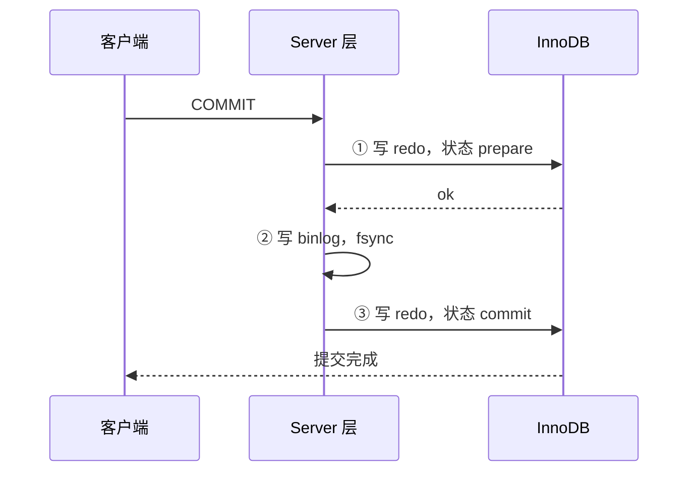

# 事务原理：redo log / undo log / 两阶段提交（进阶篇 · Day 9 / W2 D2）

> 一句话：**redo 保证「已提交的不丢」（崩溃恢复），undo 保证「没提交的能退」（回滚 + MVCC），两阶段提交保证「redo 和 binlog 不打架」。**
> 排期：11/04｜本日含 **40 分钟补 Day8 的锁**（你反馈"锁还是不清楚"，§1 用一套类比重讲，只做 3 个关键实验），其余 140 分钟学事务原理。

## 0. 今天 3 小时怎么用

| 时间 | 做什么 | 产出 |
| --- | --- | --- |
| 15 min | §1 锁：换一个说法重讲（占座类比 + 三条判断链） | 能不看笔记说出"什么条件加什么锁" |
| 25 min | §1.4 补做实验 A / B / D（跳过 C/E/F/G，只看结论） | 亲眼看到三种锁形态 |
| 45 min | §2–§5 三大日志与两阶段提交 | 记住分工表 + 崩溃恢复四种情况 |
| 55 min | §6 实验（日志参数、刷盘策略、undo 版本链、binlog 事件） | 参数表 + 版本链截图/记录 |
| 25 min | 算法 | 链表 1 题 |
| 15 min | 记录 + commit | 今天结束 |

> Day8 的 MDL / 死锁两个实验（F、G）今天**不做**，它们的结论写在 §1.5，会背结论即可；想动手就挪到 11/08（M1 验收日）补。

## 1. 锁：换一套说法重讲

### 1.1 先记住一个类比：图书馆占座

| 锁 | 类比 | 锁的是什么 |
| --- | --- | --- |
| **记录锁** | 在某个座位上贴条：「此座已占」 | 一条索引记录 |
| **间隙锁** | 在两个座位**之间的过道**拉警戒线：「不许加新座位」 | 两条记录之间的空档 |
| **临键锁** | 座位 + 它**左边的过道**一起占（默认就是这么大一块） | 记录 + 前面的间隙（左开右闭） |
| **意向锁** | 在**楼层门口**挂牌：「本层有人占了座位」 | 表级标记，只为让别人不用逐间数 |

三个关键认知（比背表格重要）：

1. **InnoDB 锁的是"索引项"，不是"行"**。所以「锁不锁得住」取决于「扫描到哪些索引项」——没有索引 → 全表扫 → 扫到的全都锁。
2. **默认单位是临键锁（一大块），不是记录锁**。只有当你能**唯一定位一行**（唯一索引/主键等值且记录存在）时，才缩小成记录锁。
3. **间隙锁只有一个目的：阻止 insert**。它不锁已有记录（已有记录由记录锁负责）。这也是它只在 RR 用的原因——RR 要防幻读（幻读 = 别人 insert 了新行）。

### 1.2 三条判断链（照这个顺序想，不会乱）

**问题一：加在表上还是索引上？**
→ 意向锁/表锁/MDL 在**表**；记录锁/间隙锁/临键锁在**索引项**。

**问题二：扫描到了哪些索引项？**
→ 有索引用索引扫（命中的那条 + 它前面的间隙）；**没索引就全表扫，所有记录都锁**（这就是"锁全表"的真相，不是有个"表锁"）。

**问题三：能唯一定位吗？**
→ 能（唯一索引等值命中）→ **记录锁**；不能（普通索引、范围、没命中）→ **临键锁或间隙锁**。

### 1.3 为什么"唯一索引等值"和"普通索引等值"差这么多

```text
name 是唯一索引，where name='b'  → 我知道只有 1 行 → 贴条就行（记录锁）
age  是普通索引，where age=20   → 可能有多行，且别人随时能插 age=20 → 必须把「20 这个值」和「20 到 30 之间的空档」都圈住（临键锁）
```

一句话：**唯一性能"点锁"，非唯一只能"区间锁"。**

### 1.4 补做实验（25 分钟，只做 A / B / D）

```sql
-- 前提：Day8 已建好 lab.t_lock（id 主键 / name 唯一 / age 普通索引 / memo 无索引）
USE lab;
SELECT * FROM t_lock;   -- 应有 a,b,c,d 四行
```

```sql
-- 实验 A：唯一索引等值命中 → 记录锁（LOCK_MODE 带 REC_NOT_GAP）
-- 【窗口 A】
BEGIN;
UPDATE t_lock SET memo = 'x' WHERE name = 'b';

-- 【窗口 B】
SELECT LOCK_TYPE, LOCK_MODE, LOCK_DATA
FROM performance_schema.data_locks WHERE OBJECT_NAME = 't_lock';
-- 预期：TABLE / IX 一枚；RECORD / X,REC_NOT_GAP / 'b' 一枚
-- 读法：REC_NOT_GAP = "不是间隙锁"，就是纯记录锁

-- 【窗口 A】ROLLBACK;
```

```sql
-- 实验 B：普通索引等值 → 临键锁（LOCK_MODE 只有 X）
-- 【窗口 A】
BEGIN;
UPDATE t_lock SET memo = 'y' WHERE age = 20;

-- 【窗口 B】
SELECT LOCK_MODE, LOCK_DATA FROM performance_schema.data_locks WHERE OBJECT_NAME = 't_lock';
-- 预期：2 枚左右 RECORD / X / '20, 2'、'30, 3'
-- 读法：X 后面没有 REC_NOT_GAP = 临键锁（记录 + 间隙）；LOCK_DATA 是"索引值, 主键"
-- 再验一次：另一个窗口 INSERT (name='e', age=25) 会被挡住 → 间隙真的锁住了

-- 【窗口 A】ROLLBACK;
```

```sql
-- 实验 D：条件列无索引 → 锁全表（本例最能解释"为什么 update 要加索引"）
-- 【窗口 A】
BEGIN;
UPDATE t_lock SET memo = 'z' WHERE memo = 'm1';    -- memo 无索引

-- 【窗口 B】条数会等于"记录数 + 1 个 supremum 伪记录"
SELECT COUNT(*) FROM performance_schema.data_locks WHERE OBJECT_NAME = 't_lock';
-- 【窗口 A】ROLLBACK;
```

### 1.5 只看结论的两个（今天不做实验）

- **MDL 事故**：长事务拿着 MDL 读锁不放 → `ALTER TABLE` 排队等写锁 → 后续所有查询又排在 ALTER 后面 → 整表"锁死"。记忆点：**长事务 + DDL = 线上事故**。
- **死锁**：两个事务交叉持有对方要的锁 → InnoDB 检测到环，回滚**代价小**的那个，报 `1213`；`SHOW ENGINE INNODB STATUS` 看 `LATEST DETECTED DEADLOCK`。预防：固定顺序、短事务、更新走索引。

### 1.6 一页速查（明天早读 60 秒）

| 条件 | 锁 |
| --- | --- |
| 唯一索引等值、记录存在 | 记录锁 `X,REC_NOT_GAP` |
| 唯一索引等值、记录不存在 | 间隙锁 `X,GAP` |
| 普通索引等值 | 临键锁 `X`（记录 + 间隙） |
| 范围查询 | 多条临键锁 |
| 无索引 | 全表所有记录 + `supremum` |
| RC 隔离级别 | 大多只剩记录锁（无间隙锁） |

## 2. 三大日志：先分清谁管什么

| 日志 | 属于 | 类型 | 写什么 | 解决什么 |
| --- | --- | --- | --- | --- |
| **redo log** | InnoDB 引擎 | **物理**日志 | "在哪个数据页上改了什么" | **持久性**：已提交的不丢（崩溃恢复） |
| **undo log** | InnoDB 引擎 | **逻辑**日志 | "反向操作"（insert 的反向是 delete） | **原子性**：回滚；**隔离性**：MVCC 版本链 |
| **binlog** | Server 层 | **逻辑**日志 | "执行了哪条 SQL / 行怎么变的" | **主从复制 + 归档**（不是崩溃恢复） |

一句话分工：**redo 给 InnoDB 自己用（崩溃恢复），undo 给回滚和 MVCC 用，binlog 给"别的机器"用（复制、备份、审计）。**

## 3. redo log：为什么"先写日志再写数据"

### 3.1 问题：直接改数据页太慢

数据页在磁盘上随机分布，`update` 一次要随机 IO 找页、改页、再刷回 → 随机写慢。于是 InnoDB 走 **WAL（Write-Ahead Logging）**：

```text
改内存里的 Buffer Pool 页（脏页）→ 顺序写一条 redo（快）→ 事务提交成功
→ 后台线程再慢慢把脏页刷回磁盘（checkpoint）
```

**顺序写 vs 随机写**：redo 是追加写（顺序），数据页是随机定位——这是 InnoDB 性能的根基。

### 3.2 redo 长什么样

```sql
-- 看 redo 相关参数
SHOW VARIABLES LIKE 'innodb_log_buffer_size';    -- 日志缓冲（内存）
SHOW VARIABLES LIKE 'innodb_redo_log_capacity';  -- 8.0.30+ 用这个控制总容量（默认 100MB）
SHOW VARIABLES LIKE 'innodb_flush_log_at_trx_commit';  -- 刷盘策略，默认 1
```

8.0 的 redo 存放在数据目录 `#innodb_redo/` 下的多个文件里，**循环写**：写满就覆盖最旧的部分（前提是对应的脏页已经刷盘）。所以 redo 不能当"永久日志"用——归档是 binlog 的事。

### 3.3 刷盘策略：`innodb_flush_log_at_trx_commit`

| 值 | 行为 | 掉电丢多少 | 适用 |
| --- | --- | --- | --- |
| **1**（默认） | 每次提交都 `fsync` 到磁盘 | 不丢 | 金融/订单，必须 |
| 2 | 每次提交写 OS cache，每秒 `fsync` | 最多 1 秒（OS 崩溃才丢） | 一般业务，性能好 |
| 0 | 每秒写 + 每秒 `fsync` | 最多 1 秒（MySQL 崩溃就丢） | 日志类、可丢数据 |

常说的「**双一配置**」= `innodb_flush_log_at_trx_commit=1` + `sync_binlog=1`，最安全也最慢。

## 4. undo log：回滚 + MVCC 的原料

`update` 之前，InnoDB 先把**旧值**写进 undo：

```text
行记录 (id=1, name='张三')  --update-->  '李四'
undo 里记：「把 name 改回 '张三'」（逻辑反向操作）
```

两个用途：

1. **回滚**：事务 `rollback` 或崩溃恢复时，按 undo 反向执行；
2. **MVCC**：每行的旧版本通过 `roll_pointer` 串成**版本链**，其他事务读旧版本时靠它（明天 Day10 展开 ReadView）。

```sql
-- 看事务与 undo 相关
SELECT trx_id, trx_state, trx_started, trx_rows_modified
FROM information_schema.INNODB_TRX;

SHOW VARIABLES LIKE 'innodb_undo%';   -- undo 表空间（undo_001、undo_002）
```

> undo 不是"备份"：它只保证**未提交事务**能退回去，且版本链会被 purge 线程定期清理（`innodb_purge_threads`）。

## 5. 两阶段提交：redo 与 binlog 怎么不打架

redo 在 InnoDB、binlog 在 Server 层，**两个日志必须同时成功或同时失败**，否则主从数据会不一致（主库有、从库没有）。所以提交分两步：



**崩溃恢复时怎么判断？**

| 崩溃时刻 | redo 状态 | binlog | 恢复动作 |
| --- | --- | --- | --- |
| ①之前 | 无 | 无 | 回滚（本来就没提交） |
| ①之后、②之前 | prepare | 不完整/没有 | **回滚** |
| ②之后、③之前 | prepare | **完整** | **提交**（把 redo 改成 commit） |
| ③之后 | commit | 完整 | 已提交，无需处理 |

一句话记忆：**以 binlog 是否完整为准——binlog 全了就提交，不全就回滚。**

> 别和"分布式事务的 2PC"混：这里的 2PC 是 MySQL **内部两个日志**的协调，不是跨库事务。

## 6. 实验（55 分钟，全部安全，不动数据）

```sql
-- ---------- 实验 A：把日志参数一次看清 ----------
SHOW VARIABLES WHERE Variable_name IN (
  'innodb_log_buffer_size',        -- redo 内存缓冲
  'innodb_redo_log_capacity',      -- redo 总容量（8.0.30+）
  'innodb_flush_log_at_trx_commit',-- redo 刷盘策略
  'sync_binlog',                   -- binlog 刷盘策略
  'binlog_format',                 -- 8.0 默认 ROW
  'log_bin'                        -- 是否开启 binlog
);
-- 记录到笔记：本机值 + 含义 + 属于"双一"配置吗
```

```sql
-- ---------- 实验 B：redo 文件真的在磁盘上（8.0 的新结构）----------
SHOW VARIABLES LIKE 'datadir';
-- 用资源管理器进 datadir 下的 #innodb_redo 目录，看有多少个 redo 文件、每个多大
-- 结论：8.0 把 ib_logfile0/1 换成了 #innodb_redo 目录下的多个文件
```

```sql
-- ---------- 实验 C：undo 在做什么（版本链的最小演示）----------
-- 【窗口 A】开事务，读一次（建立快照）
BEGIN;
SELECT * FROM t_lock WHERE id = 1;        -- 记下 memo 的值，比如 'm1'

-- 【窗口 B】改掉它并提交
UPDATE t_lock SET memo = 'changed-by-B' WHERE id = 1;

-- 【窗口 A】再读一次：还是 'm1'（RR 下读到的是 undo 版本链里的旧值）
SELECT * FROM t_lock WHERE id = 1;

-- 【窗口 A】
COMMIT;
-- 提交后再读：变成 'changed-by-B'
SELECT * FROM t_lock WHERE id = 1;
-- 这就是 undo + ReadView 的效果，明天 Day10 讲原理
```

```sql
-- ---------- 实验 D：观察一次真实提交在 binlog 里长什么样 ----------
SHOW MASTER STATUS;                        -- 记下当前 binlog 文件名与 Position
UPDATE t_lock SET memo = 'binlog-test' WHERE id = 2;

SHOW BINLOG EVENTS IN '<上一步的文件名>' LIMIT 20;
-- 能看到 GTID / Query(BEGIN) / Table_map / Update_rows / Xid 这些事件
-- Xid 就是"事务提交"的标记，两阶段提交里 redo 的 commit 与它对应

-- 有 mysqlbinlog 的话更直观（在 MySQL bin 目录下）
-- mysqlbinlog -v --base64-output=decode-rows <binlog路径> | more
```

```sql
-- ---------- 实验 E：把刷盘策略改一下，看影响（改完记得改回）----------
SHOW GLOBAL VARIABLES LIKE 'innodb_flush_log_at_trx_commit';   -- 默认 1
-- SET GLOBAL innodb_flush_log_at_trx_commit = 2;   -- 想体验性能差异时再开，测完改回 1
-- 结论：2 更快但最多丢 1 秒事务；生产订单类不允许
```

**记录表（今天要填的 5 行）**

| 项 | 本机值 | 含义 | 会不会丢数据 |
| --- | --- | --- | --- |
| `innodb_flush_log_at_trx_commit` | 1 | redo刷盘策略 | 不会 |
| `sync_binlog` | 1 | binlog刷盘策略 | 会 |
| `innodb_redo_log_capacity` | 104857600 | redo总容量 | 会 |
| `binlog_format` | ROW | binlogSEVER层 | 不会 |
| `log_bin` | ON | 是否开启binlog | 不会 |


## 7. 练习

### A. 判断题（6）

**1.** binlog 是 InnoDB 引擎层的日志，用于崩溃恢复。
> 答：错，不用于崩溃恢复，是sever层的日志

**2.** redo log 记录的是"哪个数据页改了什么"，属于物理日志。
> 答：对

**3.** undo log 就是数据库的备份，可以用来恢复误删的数据。
> 答：错，会被purge误删，binlog才是备份，只执行**逻辑反向操作**用于恢复未提交的事务和
> mcvv版本

**4.** 两阶段提交里，如果 redo 已经是 prepare 状态、binlog 也写完整了，崩溃恢复会提交该事务。
> 答：对

**5.** `innodb_flush_log_at_trx_commit=1` 时，事务提交成功就一定不会丢。
> 答：对

**6.** 间隙锁在 RR 下不仅阻止 insert，也会锁住已有的记录。
> 答：错，间隙锁只锁两行数据的间隙，不锁行

### B. 选择题（4）

**1. 保证"已提交事务不丢"的日志是？**
A. undo log　B. redo log　C. binlog　D. error log
> 答：B

**2. 支持主从复制的日志是？**
A. undo log　B. redo log　C. binlog　D. slow log
> 答：C

**3. 两阶段提交中，崩溃恢复的判定依据是？**
A. redo 是否 prepare　B. binlog 是否完整　C. 事务是否超过 60 秒　D. undo 是否清理
> 答：B

**4. 想要最高安全性，正确的组合是？**
A. `flush_log_at_trx_commit=2` + `sync_binlog=1000`
B. `=1` + `sync_binlog=1`
C. `=0` + `sync_binlog=0`
D. `=2` + `sync_binlog=1`
> 答：B

### C. 简答题（3）

**1. redo log 和 binlog 有什么区别？（至少说 3 点）**
> 答：**层级**redo log在innodb层，binlog在sever层
> **类别**redo log为物理级别（页+偏移+修改），binlog为逻辑级别（sql行列变换）
> **用途**redo log用于崩溃恢复事务，binlog用于复制sql操作+归档 
> **写法**redo lo重复写，可被覆盖，binlog追加写，可长期保存
>
**2. 为什么需要两阶段提交？如果先写 binlog 再写 redo 会怎样？**
> 答：因为两个日志分属两层，必须"同时成功或同时失败"，否则主从/备份会不一致：如果**先写
> binlog 再写 redo**，binlog 写成功但 redo 没写就崩溃 → 从库按 binlog 重放有了这条数>
> 据，主库崩溃恢复后却没有（redo 没落）→ 主从不一致。两阶段提交让 binlog 成为"提交裁决
> 者"：binlog 完整就补提交，不完整就回滚。
>
**3. undo log 的两个用途分别是什么？**
> 答：**回滚**当系统出现崩溃时撤销位提交的修改(原子性)
>**MVCC**：保存行的旧版本，通过 `roll_pointer` 组成版本链，让其他事务按 ReadView 读到历
> 史版本（隔离性/一致性读）。
>

### D. 分析题（2）

**1.** 某事务执行到「redo prepare 完成、binlog 写到一半」时机器断电。重启后这个事务是提交还是回滚？为什么？
> 答：**回滚**
> redo层修改好了数据，主库准备了，binlog层未prepare，从库读取不到redo层做出的修改，从库
> 与主库不一致，执行回滚操作
>

**2.** 一个 `update` 语句执行很慢且把其他会话全堵住了，你怀疑锁的问题，写出你的排查顺序（至少 3 步）。
> 答：'show processlist'找堵塞事务'waiting for……lock'
>`performance_schema.data_locks`找持有哪些锁'data_for_lock'看在等谁
>`information_schema.INNODB_TRX` 看长事务（`trx_started`）与 `trx_rows_modified`
> 'explain'该update，看事务是否走索引，还是全表锁
> 确认隔离级别是否为RR,有间隙锁
> 必要时kill掉长事务

<details><summary><b>参考答案</b></summary>

**A. 判断题**

1. ❌ 错。binlog 是 **Server 层**日志，用于**主从复制与归档**，不参与 InnoDB 的崩溃恢复（崩溃恢复靠 redo）。
2. ✅ 对。redo 记录"在某个页的某个偏移做了什么修改"，是物理日志。
3. ❌ 错。undo 是**逻辑反向操作**，只用于未提交事务回滚和 MVCC 旧版本，会被 purge 清理，**不能**用来恢复误删数据（那是备份/binlog 的事）。
4. ✅ 对。binlog 完整即视为"该提交"，恢复时把 prepare 的 redo 改成 commit。
5. ✅ 对（单机层面）。配置为 1 时每次提交都 fsync；但注意"提交成功"仍可能因磁盘/文件系统层故障丢失，这是硬件可靠性问题，不是 MySQL 配置问题。
6. ❌ 错。间隙锁**只锁空档、不锁已有记录**；锁已有记录的是记录锁/临键锁里的记录部分。

**B. 选择题**

1. **B**。2. **C**。3. **B**（binlog 完整就提交，否则回滚）。4. **B**。

**C. 简答题（要点）**

1. ①**层级**：redo 在 InnoDB 引擎层，binlog 在 Server 层；②**类型**：redo 物理（页 + 偏移 + 修改），binlog 逻辑（SQL 或行变更，`ROW` 格式）；③**用途**：redo 做崩溃恢复（持久性），binlog 做复制与归档；④**写法**：redo 循环写、会被覆盖，binlog 追加写、可长期保留；⑤**大小/管理**：redo 由 `innodb_redo_log_capacity` 控制，binlog 由 `max_binlog_size` 切分 + `expire_logs_days` 清理。
2. 因为两个日志分属两层，必须"同时成功或同时失败"，否则主从/备份会不一致：如果**先写 binlog 再写 redo**，binlog 写成功但 redo 没写就崩溃 → 从库按 binlog 重放有了这条数据，主库崩溃恢复后却没有（redo 没落）→ 主从不一致。两阶段提交让 binlog 成为"提交裁决者"：binlog 完整就补提交，不完整就回滚。
3. ①**回滚**：事务失败/崩溃时按反向操作撤销未提交的修改（原子性）；②**MVCC**：保存行的旧版本，通过 `roll_pointer` 组成版本链，让其他事务按 ReadView 读到历史版本（隔离性/一致性读）。

**D. 分析题**

1. **回滚**。因为 binlog 没写完，从库（或未来基于 binlog 的恢复）拿不到这条变更；若主库提交，就会与 binlog/从库不一致。规则是「binlog 完整才提交，否则回滚」，所以此时 redo prepare 会被撤销。
2. ①`SHOW PROCESSLIST` 找阻塞的会话与状态（`Waiting for ... lock`）；②`performance_schema.data_locks` 看持有了哪些锁、`data_lock_waits` 看谁在等谁；③`information_schema.INNODB_TRX` 看长事务（`trx_started`）与 `trx_rows_modified`；④`EXPLAIN` 该 update，确认是否走索引（没索引就是全表锁）；⑤确认隔离级别（RR 有间隙锁，易冲突）；⑥必要时 kill 掉长事务（谨慎，先确认能否回滚）。

</details>

## 8. 高频坑

| 坑 | 说明 |
| --- | --- |
| 把 redo 当 binlog | redo 管自己（崩溃恢复），binlog 管别人（复制/归档） |
| 以为 undo 能恢复误删 | undo 只回滚未提交事务，已提交的删除只能靠备份/binlog |
| 把 MySQL 内部 2PC 当分布式 2PC | 前者协调 redo 与 binlog，后者协调多个数据库 |
| 认为 `flush=1` 就绝对安全 | 还有磁盘缓存、文件系统、机房断电等硬件层问题 |
| 认为间隙锁锁记录 | 间隙锁只锁空档，防 insert |
| 生产随手把 `sync_binlog` 调大 | 崩溃时 binlog 丢一段 → 主从数据不一致，比丢 1 秒事务更严重 |

## 9. 30 秒复习卡

```text
redo：物理、循环写、崩溃恢复（持久性）→ WAL，先日志后脏页
undo：逻辑反向、回滚 + MVCC 版本链（原子性/隔离性）
binlog：Server 层、逻辑、复制与归档（不是崩溃恢复）
2PC：redo prepare → binlog fsync → redo commit；恢复以 binlog 是否完整为准
双一：innodb_flush_log_at_trx_commit=1 + sync_binlog=1
锁：唯一等值命中→记录锁；普通索引→临键锁；无索引→全表；间隙锁只锁空档
```

## 10. 面试一句话

> **redo log 和 binlog 的区别？**
> redo 是 InnoDB 的物理日志，循环写，用于崩溃恢复，保证已提交事务不丢；binlog 是 Server 层的逻辑日志，追加写，用于主从复制和归档。两者用两阶段提交协调，恢复时以 binlog 是否完整为准。
>
> **为什么要两阶段提交？**
> 因为 redo 和 binlog 必须同时成功或同时失败。先写 redo 并置为 prepare，再写 binlog 并 fsync，最后把 redo 置为 commit；崩溃恢复时若 binlog 完整就补提交，否则回滚——这样主库恢复后的数据与从库重放的结果一致。

---

## 附：批改与点评（11/04 阅）

**总体：判断题 6/6、选择题 4/4、简答题 5/6、分析题 3.5/4 —— 概念全部到位，扣分集中在「措辞精确度」和一处因果链倒置。**

### 需要改的 4 处

**① D1（结论对，理由要重写）**

你写的是：「redo 层修改好了数据，主库准备了，binlog 层未 prepare，从库读取不到 redo 层做出的修改」。

改写成：

> binlog 只写了一半 → 从库重放不到这条变更；若让主库提交，就会出现主库有、从库没有 → 主从不一致，所以必须回滚。

两个概念要分开：

- **binlog 没有 prepare 状态**。prepare 是 **redo** 的状态（日志已写、事务未最终提交），别把两套东西混成一句。
- **prepare 阶段数据页并没有"改好"**。此时只是 redo 日志落了盘，数据页还是 Buffer Pool 里的脏页，没刷到磁盘。这也是为什么崩溃后要靠 redo 重放，而不是"数据已经在了"。

**② A3（结论对，措辞要改）**

「会被 purge 误删」→ undo **记录会被 purge 线程定期清理（这是正常机制，不是误删）**，它只服务于未提交事务的回滚与 MVCC 旧版本；被清理的是它支撑的旧版本链，不是"备份被删了"。

**③ C1（4 点都写到了，一个词要改）**

「redo lo**重复写**」→ 「redo **循环写**」：环形空间，写满后覆盖最旧的部分（前提是对应脏页已刷盘）。"重复"会被理解成同一条日志写两遍，意思完全不同。

**④ C3（两个用途都对，触发时机要补）**

「当系统出现**崩溃**时撤销**位**提交的修改」→ 「事务 `rollback` 或崩溃恢复时撤销**未**提交的修改」。undo 不只服务崩溃，日常业务里主动 rollback 也走它；"位→未"是错别字。

### 两处小修正

- **D2**：`data_for_lock` 应为 **`data_lock_waits`**（查"谁在等谁"）；"看事务是否走索引"改为"看这条 update 是否走索引"。其余 6 步顺序（processlist → 锁等待 → INNODB_TRX → explain → 隔离级别 → kill）**完全正确**，可以直接背。
- **A5**：答"对"没问题，但要补半句——`flush=1` 只保证 MySQL 这一层做了 fsync，磁盘缓存/文件系统/机房断电仍可能丢，这是硬件层问题，不是配置能解决的。

### 一点肯定

- A6 你自己总结的「间隙锁只锁两行之间的间隙，不锁行」——比标准答案更好记，就是对的。
- C1 四点（层级/类型/用途/写法）已经从"背表格"升级成"能对比"，这是面试官想听到的结构。
- D2 六步排查顺序完整，说明你已经在用 Day8 的锁知识解决问题，而不是只记结论。
